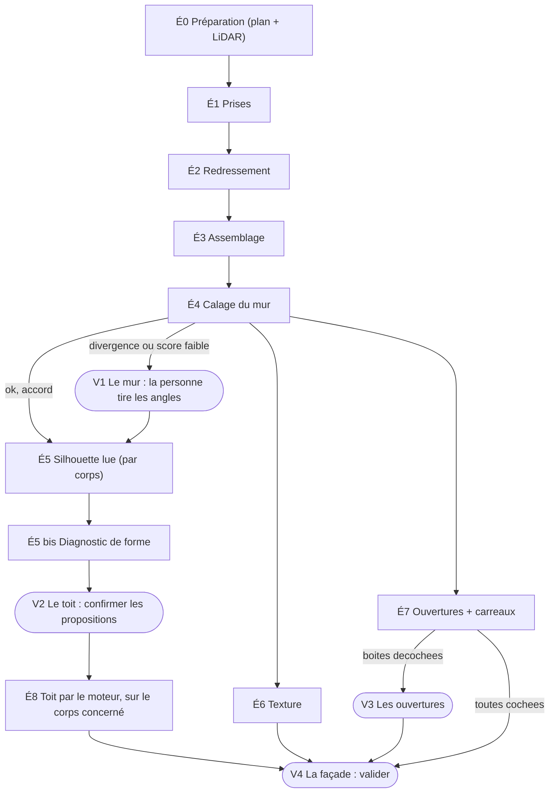

# Façade : calage, texture et fenêtres, de l'audit au modèle — spec

*Rédigée le 29 octobre 2026, sur `main` à la version 4.0.0 (commit `e9113ac2`), à la suite d'une discussion avec le propriétaire ; mise à jour le
même jour (la silhouette dérive du toit ; les corrections se font sur le corps concerné ; une façade peut en porter plusieurs ; un seul run
IA par façade, qui rend aussi les ouvertures et leurs carreaux ; le moteur de redressement et de fusion reste tel quel).
Aucun code n'accompagne ce document : il fixe l'intention, le modèle de données, le déroulé et les lots. Les noms de fonctions
cités existent ; le nom fait foi sur les numéros de ligne.*

Lire d'abord : `CLAUDE.md`, [`spec-facades-calage-detection.md`](spec-facades-calage-detection.md) (la chaîne de calage et de
détection, §5 à §14), [`spec-releve-facade.md`](spec-releve-facade.md), [`spec-audit.md`](spec-audit.md),
[`spec-flux-batiment.md`](spec-flux-batiment.md) (qui écrit quoi, `model/protections.ts`) et le skill `facades` (le banc).

---

## 1. Intention

À partir de ce que l'on sait déjà d'un bâtiment (le plan, l'IGN, le LiDAR), **une photo de façade doit servir à trois choses** :

1. **Vérifier les proportions** de la façade : sa largeur, son égout, la forme de son haut (pignon, croupe, appentis) ;
2. **Donner la texture** du mur, pour que la 3D soit jolie et vraie ;
3. **Poser les fenêtres telles qu'elles sont**, pas telles que la disposition automatique les devine.

La forme lue sur l'image sert aussi à **ajuster le toit** : un triangle est un pignon, un trapèze une croupe, une rampe un appentis. Tout ce
qui se lit sur la photo revient à l'audit, qui propose ; le moteur de règles tranche.

**Le fait qui structure toute la spec** : la silhouette d'une façade **n'est pas une donnée indépendante, elle est la projection du toit**
(`gabarit = gabaritDesCorps(silhouetteDeFace(corps))`, le même calcul que la silhouette du Mode Toit depuis le 29 octobre 2026). Un écart entre le gabarit calculé et ce que montre la photo est donc d'abord une information sur le
**toit** (un pignon manquant, un pan pris pour un pignon…), pas seulement une erreur de calage. L'IA apporte la forme de la façade, donc un
**ajustement du toit** ; elle découvre aussi d'autres éléments à placer (cheminées, lucarnes…).

### Décisions de la personne (à ne pas rediscuter)

1. **Les dimensions viennent du plan et du LiDAR, jamais de la photo.** L'IGN et le cadastre donnent la largeur des façades et la hauteur
   du faîtage ; le LiDAR donne la hauteur totale, la hauteur à l'égout, et de nouveau la largeur et le sol. La photo ne donne que des
   **proportions et des positions relatives** (c'est déjà la décision du dépôt : « les repères ne disent que les directions, la dimension
   vient du calage », `facade/gabaritMur.ts`).
2. **Deux chemins, en série, pas en concurrence.** Le **déterministe** (arêtes, teinte, points de fuite : ce que travaille la
   calibration) donne la géométrie fine. **L'IA** (la session de Claude de l'audit) donne le sens et des positions grossières : « ici
   un pignon », « la porte est à gauche de la fenêtre », « cette baie est cintrée ». Le LiDAR fixe les hauteurs.
3. **L'IA propose, le moteur tranche.** Une lecture de l'image n'écrit jamais un toit : elle devient une observation que le moteur de
   règles relit (`corpsSousContrainte`). La forme lue sur la photo l'emporte sur celle du LiDAR (décision du 19 octobre 2026), jamais
   les hauteurs.
4. **Les images de la calibration restent**, pour rejouer les scénarios.
5. **La calibration rejoue chaque scénario avec une illustration de chaque étape, déterministe et IA.** Elle devient l'écran où l'on
   voit pourquoi un calage a réussi ou échoué.
6. **Les photos se prennent et se rangent dans l'audit.** La calibration lit les façades de l'audit et en fait des cas ; elle ne prend
   plus de photos pour elle.
7. **La Façade stocke** : ses **dimensions**, sa **forme** (gabarit et silhouette lue) et sa **texture** (l'image **calée** sur le mur).
8. **Les fenêtres hors automatique sont dans la façade objet** : celles qui viennent de la photo, de Claude ou de la main. Les
   fenêtres automatiques ne sont pas stockées : la 3D les recalcule.
9. **La silhouette dérive du toit ; son écart avec la photo est un diagnostic de toit.** On cale le mur sur ce qui ne dépend pas du
   toit (angles, égout, sol), puis on compare la silhouette lue au gabarit : ce qui reste est une proposition de toit (§5 bis).
10. **Toute proposition de toit venue de la photo est confirmée par la personne**, tant que le corpus réel compte moins d'une vingtaine
    de cas validés. Rien ne s'applique seul, même quand les deux chemins s'accordent.
11. **Périmètre des éléments découverts, au départ** : pignon, appentis, cheminée, lucarne. Le reste du catalogue (fenêtre de toit,
    galerie, bow-window…) viendra quand ces quatre-là tiennent.
12. **Hauteurs : le LiDAR l'emporte, la photo signale.** Quand la photo contredit le LiDAR sur la hauteur d'une pointe, on garde le LiDAR
    et on le dit (alerte) ; la correction de hauteur reste un geste de la personne (poignée « hauteur à l'égout », « Rendre au calcul »).
13. **Les corrections de toit se font sur le corps concerné, et une façade peut en inclure plusieurs.** Un diagnostic est rattaché au
    corps dont le mur porte la partie de silhouette en cause ; une proposition s'écrit dans le repère de ce corps (§5 ter).
14. **Trois lectures votées par façade, et une escalade à la demande** (décision du propriétaire du 29 octobre 2026, sur la mesure de la
    vraie API ; d'abord « un seul run IA par façade »). Un schéma, une image : chaque lecture rend le calage (angles, pointes, corps),
    les éléments de toit vus, **les ouvertures et le type de leurs carreaux** ; trois lectures partent ensemble et le moteur les vote
    (`facades.ia.passes`, un réglage). Une quatrième, par le modèle de l'escalade, ne part **que si la personne la demande** (un bouton
    qui dit son coût, une requête). Ce modèle est **par défaut `claude-sonnet-5-5`** (décision du propriétaire du 29 octobre 2026) :
    avec Haiku par défaut, l'escalade n'était qu'une quatrième lecture du même modèle ; l'administrateur le change dans Réglages ›
    Modèles. Plus d'appels séparés (calage, puis renfort, puis détails). Voir §8.
15. **L'IA récupère aussi, pour la suite, les ouvertures et leurs carreaux** : le type de division du vitrage (petits bois, nombre de
    carreaux, imposte). On l'enregistre dans la façade objet **maintenant** ; son rendu en 3D est un lot ultérieur (§3.3, F8).
16. **Le moteur de redressement et de fusion reste tel quel.** Le redressement (`vuesDeFace`, `redresserParFuites`, `redresserParReperes`),
    l'assemblage (`mosaiqueDesVues`), la fusion des vues (`fondreLesVues`, vote des baies) et la version sans ombres ne sont **ni modifiés
    ni réglés** par cette spec : elle s'appuie dessus et agit **autour** (calage du mur, forme, diagnostic, ouvertures, rejeu). Voir §4 bis.
17. **Chaque étape est un contrat : entrant, action automatique avec son objectif, sortant, option manuelle quand l'objectif n'est pas
    atteint.** L'automatique est le chemin normal ; le manuel est une option de repli, jamais un passage obligé. Voir §4 ter.
18. **Certaines étapes sont des points de validation** (le mur, le toit, la façade), les autres tournent **en arrière-plan**. **L'audit
    est plus discret** : quand seul le résultat compte, l'étape reste cachée et ne se montre que si elle échoue ; **la calibration montre
    tout**. Voir §4 ter.
19. **Aucun code mort dans la migration.** Chaque morceau de code indépendant (audit, relevé, calibration) qui est absorbé par
    l'enchaînement est **supprimé dans la même PR** que son remplaçant : ni pont, ni doublon, ni « à nettoyer plus tard ». Voir §8 bis.
20. **L'audit et la calibration montrent la même barre de progression, en haut de l'écran.** Elle dit où en est l'enchaînement de la façade
    (étapes faites, étape en cours, étapes à confirmer ou en échec), lue sur les états de l'orchestrateur : un seul composant, deux écrans.
    Voir §4 ter.5.
21. Textes de l'interface en français avec accents et vouvoiement ; commentaires de code en français sans accents, qui disent pourquoi.

---

## 2. Ce qui existe déjà (relevé du 29 octobre 2026)

| Brique | Où | Ce qu'elle fait |
|---|---|---|
| Audit de la parcelle | `model/auditParcelle.ts` (`FacadeCapturee`, `BatimentCapture`), `app/audit/parcelle/` | Les photos par côté du contour (`facades[rang].photos`), les corrections de redressement, le bilan du redressement et de la fusion |
| Chaîne unique | `facade/releve/chaine.ts`, `facade/analyseMur.ts::analyserLeMur`, `fondreLesVues` | Une photo ou plusieurs : redressement, assemblage, mur, détection, texture. Le même code pour l'audit, le relevé et la calibration |
| Calage du mur | `facade/releve/coinsAuto.ts::murSurLAssemblage`, `vision/mosaiqueFuites.ts` (`rectangleSurLesAretes`, `rectangleDuMur`, `affinerEgoutEtSol`, `silhouetteDuMur`) | Les bouts, l'égout et le sol sur l'assemblage, par les arêtes puis par la teinte du mur |
| Gabarit | `facade/gabaritMur.ts` (`gabaritDesCorps`, `contourDuGabarit`, `gabaritSurLaVue`), tiré de `facade/regles/toits/silhouetteDesCorps.ts::silhouetteDeFace` | Le haut de toute la façade vue de dehors, tous corps compris, en parts de la largeur (`u`) et de l'égout (`v`) ; `u` peut sortir de 0..1 quand le mur d'un corps continue la façade au-delà de son côté (la détection ne lit que 0..1) |
| Silhouette → toit | `model/silhouetteFacade.ts`, `facade/regles/toits/silhouettes.ts`, `silhouetteDesCorps.ts` | `triangle`, `trapeze`, `rampe`, `ligne-droite`, `marches`, `plusieurs-sommets` ; lue sur la photo (par Claude ou par `classerProfil`), relue en observation par le moteur |
| Façade relevée | `model/typesReleve.ts::ReleveFacade`, `OuvertureFacade` | `largeur`, `hauteur`, `texture` (JPEG redressé), `photoLocale`, `hauteurTexture`, `ouvertures`, `calage`, `grille`, `depuisAudit` |
| Fenêtres automatiques | `facade/ouvertures.ts::ouverturesAutomatiques`, `three/detailsBatiment.ts::poserOuvertures` | Recalculées à chaque dessin ; un mur relevé n'en reçoit pas |
| IA | `model/analyseClaude.ts` (`FacadeAnalyse`, `FacadeVotee`), `deploy/schema-analyse.json` (**généré**), `facade/detection/renfort.ts` | Boîtes, coins, silhouette, bout ; trois passes votées, recalées sur l'image |
| Calibration | `zones/EditeurCasCalibration.tsx`, `zones/CalageSilhouette.tsx`, `zones/VueFacade3d.tsx`, `facade/releve/casCalibration.ts`, `facade/corpusReel.ts` | Un cas = une façade photographiée et annotée ; neuf images d'étapes ; calage de la silhouette (étapes 5 et 6) |
| Banc | `.claude/skills/facades/scripts/` (`banc.ts`, `egout-sol.ts`, `reel.ts`), `tests/fixtures/facades/` (23 scènes de synthèse), `tests/fixtures/facades-reel/` (**vide**) | Mesure la chaîne scène par scène |

**Mesures de départ** (banc de synthèse, `egout-sol.ts`, 29 octobre 2026) : égout trouvé 44/44, sol 43/44, bouts 86/88, gabarit posé à
2 % de la largeur 39/44. Ce banc ne contient aucune façade réelle.

### Le défaut qui motive cette spec (façade sud d'AE 101)

La façade sud d'AE 101 a deux pignons et un appentis (fixture `tests/fixtures/toits/vesinet-ae101.json`, corps `corpsAvecFaits`) : largeur
8,96 m, égout de l'appentis à 2,4 m, rapport hauteur/largeur 0,268, gabarit à deux pointes autour de `u` = 0,11 et 0,80, à environ 3,2 fois
l'égout. Sur la mosaïque réelle de cette façade, le calage automatique retient **un mur de 302 px (x de 451 à 752)** au lieu d'environ 610 px
(x de 140 à 750) : un seul bloc de pignon. Les bouts, l'égout et le sol sont faux ensemble, **et les drapeaux « trouvé » restent vrais**.
Causes : le haut de l'image ne se lit pas à la teinte (enduit, ciel et nuages presque neutres ; colombages verts, rives sombres, ardoise du
porche, arbre) ; le rectangle des arêtes s'arrête sur un bloc ; rien ne vérifie que la pose explique la silhouette de l'image. Un essai
d'ajustement du gabarit sur le haut lu à la teinte a échoué pour la première raison (il a remplacé une mauvaise pose par une autre) : il
a été abandonné, pas livré.

---

## 3. Modèle cible

### 3.1 Qui sait quoi, et qui l'emporte

| Donnée | Source qui fait foi | La photo peut… | Marque |
|---|---|---|---|
| Largeur du mur | cadastre / LiDAR (le contour) | jamais la changer ; vérifier | — |
| Hauteur à l'égout, hauteur totale, sol | LiDAR (`egoutChoisi` si la personne l'a fixée) | jamais les changer ; signaler un écart | `batiment.egoutChoisi` |
| Forme du haut (pignon, croupe, rampe) | le **toit** (corps, moteur de règles) ; la photo le **diagnostique** | proposer un ajustement, par corps ; la personne confirme, le moteur décide | observation du moteur |
| Texture | photo calée | la fournir | `texture`, `depuisAudit` |
| Ouvertures | photo (détection, Claude, main) | les fournir | `source` de chaque ouverture |
| Ouvertures automatiques | disposition automatique | — | rien (recalculées) |

La règle de priorité entre écrivains reste celle de `model/protections.ts` (« Qui l'emporte », `spec-flux-batiment.md`). Les nouveaux
champs s'y inscrivent comme **groupes** : `facade.dimensions`, `facade.forme`, `facade.texture`, `facade.ouvertures`, chacun avec ses
écrivains (`audit`, `releve`, `main`, `calibration`) et son niveau. Aucun écrivain ne lit les marques à la main.

### 3.2 La Façade (un enregistrement par côté du contour)

La Façade **est** `ReleveFacade` (`batiment.facades[]`, par `cote`), étendue : on n'ajoute pas un second objet. Tous les ajouts sont
**facultatifs** ; un projet d'aujourd'hui garde son sens (relecture à l'identique, test d'aller-retour de fichier ancien).

```ts
interface ReleveFacade {
  // inchange : cote, largeur, hauteur, texture, photoLocale, hauteurTexture, ouvertures, distance, sourceDistance,
  // releveLe, depuisAudit, partieBasse, calage, grille

  /** Les dimensions retenues, et d'ou elles viennent. La photo n'en change aucune : elle les verifie. */
  dimensions?: {
    largeurM: number;                 // le mur (cadastre, LiDAR)
    egoutM: number;                   // hauteur a l'egout de reference (LiDAR, ou choisie)
    faitageM?: number;                // le point haut de la facade (LiDAR / IGN)
    source: 'cadastre' | 'lidar' | 'ign' | 'saisie';
    /** L'ecart que la photo constate (en part), 0 quand elle confirme. Une alerte au-dela de 0,10, jamais une correction. */
    ecartPhoto?: { largeur?: number; egout?: number };
  };

  /** La forme de la facade : le gabarit du plan et du LiDAR, et ce que la photo en lit. */
  forme?: {
    gabarit: { u: number; v: number }[];          // facade/gabaritMur.ts : u en part de la largeur, v en part de l'egout
    silhouetteLue?: SilhouetteFacade;             // model/silhouetteFacade.ts, lue sur la photo
    bout?: BoutVu;                                // pignon, croupe, demi-croupe, brisis, sans-objet
    pointes?: { u: number; v: number; source: 'ia' | 'deterministe' | 'doigt' }[];   // les sommets lus (pignons)
    /** Les corps que la facade porte, de gauche a droite : chacun avec la part du mur (u0 a u1) qu'il couvre (§5 ter). */
    corps?: { mur: { gauche: PtBrut; droite: PtBrut }; u0: number; u1: number }[];
    source: 'plan' | 'photo' | 'ia' | 'doigt';
  };

  /**
   * Le parement du mur (decision du proprietaire du 29 octobre 2026, lot F2 : « donner le type de surface pour discriminer, par exemple
   * colombage ») : le principal, et les zones d'un autre, en part du mur. Vocabulaire ferme : enduit, pierre, brique, colombage
   * (pan de bois), bardage-bois, bardage-metal (metal ou composite), beton ; mixte pour le principal quand aucun ne domine. Lu par
   * le run de l'IA (§8) ; le calage s'en sert deja (une zone de colombage ecarte une pose, §5) ; il entre dans la Facade en F5.
   */
  surface?: {
    principale: 'enduit' | 'pierre' | 'brique' | 'colombage' | 'bardage-bois' | 'bardage-metal' | 'beton' | 'mixte';
    zones?: { type: 'enduit' | 'pierre' | 'brique' | 'colombage' | 'bardage-bois' | 'bardage-metal' | 'beton'; u0: number; u1: number; v0: number; v1: number; confiance: number }[];
    source: 'ia' | 'doigt' | 'audit';
  };

  /** La texture : l'image calee sur le mur. */
  textureCalee?: {
    pxParM: number;                   // la precision reelle de l'image
    cadre: { x0: number; y0: number; x1: number; y1: number };   // le mur sur l'assemblage, en pixels
    coinsPhotos: P2[][];              // les coins du mur sur chaque photo (calage, `sourceCoins` par point)
    sansOmbres?: boolean;
  };
}
```

Les **diagnostics et propositions de toit** (§5 bis) ne sont pas rangés dans la Façade : ce sont des propositions de l'audit
(`PropositionsAudit`, avant/après), qui n'écrivent le toit que par le moteur, après confirmation. La Façade ne garde que ce qui a été
validé (`forme`, `pointes`).

`texture` (le JPEG) et `photoLocale` ne changent pas de sens : la plateforme refuse les photos embarquées, le document n'en porte que la
clé et la texture redressée. `textureCalee` dit **comment** cette texture est posée sur le mur ; elle ne duplique pas l'image.

### 3.3 La façade objet (les fenêtres hors automatique)

**Une ouverture hors automatique est un objet de la façade** : elle a sa vie propre (retirer, déplacer, verrouiller), un identifiant
stable et une provenance. Les ouvertures automatiques n'y sont pas.

```ts
interface OuvertureFacade {
  // inchange : type, x, y, l, h (metres, x depuis la gauche du mur vu de dehors, y = appui)
  id: string;                               // stable : une correction retrouve son ouverture apres un rejeu
  source: 'detectee' | 'devinee' | 'claude' | 'ajoutee' | 'corrigee';   // jamais 'auto' : l'auto n'est pas stockee
  confiance?: number;
  niveau?: number; travee?: number;
  details?: {
    volets?: …; ferme?: boolean; allege?: …; forme?: 'rect' | 'cintre' | 'rond';
    /** La division du vitrage, lue par l'IA (decision 15). Enregistree maintenant ; dessinee en 3D plus tard (F8). */
    carreaux?: {
      vantaux?: 1 | 2 | 3;                                     // nombre de vantaux visibles
      grille?: { colonnes: number; rangees: number };           // carreaux par vantail (ex. 3 x 2) ; 1 x 1 : vitrage d'un seul tenant
      petitsBois?: 'aucun' | 'fins' | 'epais';
      imposte?: { hauteurM: number; grille?: { colonnes: number; rangees: number } };   // partie haute a petits carreaux (AE 101)
      vitrage?: 'clair' | 'depoli' | 'teinte' | 'vitrail';
      source: 'ia' | 'doigt';
    };
  };
  verifieeLe?: string;                      // posee par la personne : plus aucun rejeu ne la deplace
}
```

- `carreaux` est **facultatif** et sans effet sur ce que la 3D dessine aujourd'hui : un fichier sans lui garde son sens, et la façade garde
  ses fenêtres actuelles (`fenetres3d`). Il est rangé avec l'ouverture pour que le rendu des carreaux (F8) n'ait pas besoin de rappeler l'IA.
- Les valeurs sont un **vocabulaire fermé** (comme `silhouetteFacade.ts`) : l'IA choisit dans la liste, jamais d'un texte libre ; un mot
  inconnu relu devient `indetermine`, jamais une erreur. La liste se complète avec les premiers cas réels (l'imposte de la façade
  d'AE 101 en est le premier exemple).

- **Règle de la 3D** (déjà en place, à garder) : un mur qui a une façade objet n'a **pas** de fenêtres automatiques ; un mur sans façade
  objet garde la disposition automatique.
- **Un rejeu ne détruit pas le travail de la personne** : les ouvertures `corrigee`, `ajoutee` ou `verifieeLe` sont gardées et appariées
  aux nouvelles détections par recouvrement (> 50 %, comme le banc) ; les autres sont remplacées.
- **Où elles apparaissent** : l'inspecteur (liste de la façade, par niveau et travée), la 3D (`three/detailsBatiment.ts`), le plan
  (coupures du trait, `render/releve.ts`), la DP2 et les exports qui lisent déjà `ouvertures`.

### 3.4 Fichier, migration, version

- Champs facultatifs, validés à la lecture (`model/typesReleve` + validateurs voisins de `corpsToitEtendu.ts`), compactés à l'écriture
  (un champ absent reste absent), relus à l'identique pour un fichier ancien.
- Un **schéma** du fichier : les nouveaux champs s'écrivent au schéma suivant (`model/migrations.ts`, `CHAMPS_DEPUIS`) ; un projet qui
  n'en porte aucun reste au plus petit schéma qui le décrit.
- **Version** : une modification qui change ce que la 3D montre d'un bâtiment relevé est un événement de version majeure
  (`MD/RELEASE.md`). La seule empreinte golden qui voit les fenêtres est `glb-structure.json` (point 24 de la fumée) ; un lot qui la fait
  bouger le dit et le documente dans `EMPREINTES.md`.

---

## 4. Le déroulé, étape par étape

Chaque étape dit ce qui entre, ce que fait chaque chemin, qui arbitre, ce qui sort, et **l'illustration que la calibration en montre**.

### É0 · Préparation (plan + LiDAR)

- **Entrée** : le contour, les corps du toit, les hauteurs.
- **Sortie** : pour chaque côté, `dimensions`, `forme.gabarit` (`gabaritDesCorps`), le rapport hauteur/largeur, la liste des pointes attendues
  (leurs `u` et `v`).
- **Illustration** : le gabarit seul, en mètres, avec ses cotes et ses pointes numérotées.

### É1 · Prises (audit)

- Les photos se prennent et se rangent **dans l'audit**, par côté du contour (`BatimentCapture.facades[rang].photos`). Voir §6.
- **Sortie** : `PhotoCas` + prise (position, cap, attitude, focale), photos gardées sur l'appareil (`io/photosLocales.ts`).

### É2 · Redressement *(inchangé, §4 bis)*

- **Déterministe** : par les repères posés, sinon par les points de fuite (`vuesDeFace`, `redresserParFuites`).
- **IA** : néant (la géométrie n'est pas son travail).
- **Illustration** : chaque photo redressée, avec ses verticales et ses horizontales.

### É3 · Assemblage *(inchangé, §4 bis)*

- **Déterministe** : mosaïque ORB + RANSAC de similitude (`mosaiqueDesVues`), image prise pour tout le reste.
- **Illustration** : l'assemblage, le masque `vu`, les photos restées à part avec leur motif.

### É4 · Calage du mur (bouts, égout, sol) — l'étape à gagner

C'est le maillon faible : tout le reste en dépend. **On cale d'abord sur ce qui ne dépend pas du toit** : les deux angles du mur, la ligne
d'égout et le sol. Le gabarit vient du toit calculé, qui est peut-être faux ; s'en servir pour caler fausse le calage et masque l'écart que
l'on cherche à voir (§5 bis). Il ne sert qu'ensuite, à lire la silhouette.

- **Déterministe** (existant) : le rectangle des arêtes aux proportions du plan, affiné par la teinte du mur. Le gabarit ne **pose** plus
  le mur : il n'est posé qu'une fois le mur trouvé. Il produit une pose **et un score d'explication** (§5), calculé sur les ancres
  indépendantes du toit.
- **IA** (nouveau) : Claude lit l'assemblage et rend **quelques points, en parts du mur**, pas en pixels :
  - les deux **angles du mur** (gauche, droit), au niveau du sol et de l'égout si visibles ;
  - la **pointe de chaque pignon** (position horizontale, hauteur relative) ;
  - le **départ et la fin de l'appentis** ou du porche s'il y en a un ;
  - une **confiance** par point, et ce qui est caché (arbre, haie, voiture).
  Les **angles** donnent l'échelle et la place du mur ; les **pointes** servent ensuite de **mesure du toit** (§5 bis), pas d'ancre :
  quand le gabarit a des pointes à des `u` connus et que l'IA en voit aux mêmes places, c'est une confirmation indépendante de la pose ;
  quand elles divergent, c'est un diagnostic de toit.
- **Arbitre** : voir §5. Le déterministe **vérifie** la pose proposée par l'IA sur les arêtes (verticales aux angles, horizontale à
  l'égout, transition mur/sol) et la **corrige au pixel** ; si les deux s'accordent, on garde le meilleur score ; sinon la personne
  confirme un ou deux points d'un geste.
- **Sortie** : `x0`, `x1`, `égout`, `sol` sur l'assemblage, `forme.pointes`, la source de chaque point.
- **Illustration** : trois calques sur l'assemblage, activables : la pose déterministe (rouge), les points de l'IA (bleu), la pose retenue
  (vert), avec le score de chacune et l'écart entre elles en pourcentage de la largeur.

### É5 · Silhouette lue, par corps

- **Déterministe** : `silhouetteDuMur`, `classerProfil` : le haut du mur lu entre les bouts retenus (deux rampes, un triangle, des marches),
  **découpé selon les corps que la façade porte** (§5 ter) : chaque partie de la silhouette est rattachée au corps dont le mur la porte.
- **IA** : le mot (`silhouette`, `bout` du schéma d'analyse) par côté, et les `pointes` par corps quand elle les voit.
- **Sortie** : `forme.silhouetteLue`, `forme.bout`, `forme.corps` (la part du mur de chaque corps), `forme.pointes` ; **aucune
  observation n'est encore émise** : l'étape suivante compare à la silhouette du gabarit.
- **Illustration** : le haut lu sur l'image, le gabarit posé par-dessus, les corps en couleurs distinctes, le mot retenu par corps et sa
  provenance.

### É5 bis · Diagnostic de forme (nouveau)

- **Entrée** : la silhouette lue (É5) et le gabarit calculé (É0), posés sur le mur calé par les ancres seules (É4).
- **Traitement** : l'écart entre les deux, **corps par corps**, rangé dans la taxonomie du §5 bis. On teste un petit nombre de variantes de
  toit du corps (un pignon de plus, un de moins, un pan à la place, une croupe) et l'on garde celles qui expliquent mieux l'image que le
  toit calculé, avec le gain de chacune.
- **Sortie** : une liste de **propositions de toit**, chacune avec son corps, sa nature, sa place (en parts du mur du corps), son gain
  d'explication, sa provenance (déterministe, IA, les deux), et des **alertes** (hauteur de pointe qui contredit le LiDAR).
- **Illustration** : la silhouette de l'image, le gabarit calculé, et pour chaque proposition le gabarit **modifié**, avec le gain en
  pourcentage ; les alertes en marge.

### É6 · Texture *(le moteur de fusion est inchangé, §4 bis)*

- **Déterministe** : l'élévation calée sur le mur (`pxParM`), la fusion des vues (vote des baies, occultations, meilleure vue par pixel),
  la version sans ombres (`vision/sansOmbres.ts`).
- **Sortie** : `texture`, `textureCalee`, `hauteurTexture` (la bande au-dessus de l'égout, que la 3D plaque sur le pignon).
- **Illustration** : l'image calée sur la silhouette ; la même sans ombres ; la façade en 3D vue de face (`VueFacade3d`).

### É7 · Ouvertures

- **Déterministe** : candidats, classement, structure (grille niveaux × travées), détails (volets, allège, forme).
- **IA** : **le même run que le calage** (§8) rend les ouvertures vues, leur type, leurs `details` et leurs **carreaux** ; leurs boîtes sont
  recalées sur l'image par le recalage existant (`facade/detection/renfortRecalage.ts`). Le **vote à trois passes** du renfort
  (`facade/detection/renfort.ts`) n'est plus le mode par défaut : voir §8, « Un run, pas de vote ».
- **Arbitre** : l'accord avec la détection déterministe (une boîte de l'IA que la détection retrouve gagne en confiance ; une boîte
  seule reste décochée) et le vote entre vues de la fusion (existant, inchangé) ; une ouverture de la personne n'est jamais déplacée.
- **Sortie** : les ouvertures de la **façade objet** (§3.3), avec leur `source`, leur `confiance` et leurs `carreaux`.
- **Illustration** : l'image avec les boîtes (trait plein : détectées ; tirets : devinées ; couleur par source) ; au toucher d'une boîte, la
  division du vitrage lue (grille, petits bois, imposte) dessinée en surimpression.

### É8 · Toit (par le moteur, sur le corps concerné, après confirmation)

- **Entrée** : les propositions confirmées de l'É5 bis, chacune sur **un corps** ; les éléments de toit lus (cheminée, lucarne).
- **Confirmation** : **toujours demandée à la personne** (décision 10), dans l'avant/après de l'audit : chaque proposition est une ligne
  décochée par défaut, avec son image avant/après et son gain.
- **Sortie** : une **observation** du moteur par proposition, **adressée au corps** par son mur (`facade/regles/toits/murDuCorps.ts`, qui
  retrouve le corps dont un côté longe le mur donné : le rang d'un corps change à chaque relecture, son mur non). `corpsSousContrainte`
  la relit comme tout fait. Les pignons que posent aujourd'hui les faits ne vont que sur le **corps principal**
  (`facade/regles/toits/pignons.ts`) : **il faut les étendre à n'importe quel corps** (§5 ter).
- **Hauteurs** : celles du LiDAR (décision 12) ; une alerte les signale, la personne les règle à la main si besoin.
- **Illustration** : le toit avant et après l'observation (le rendu de l'avant/après de l'admin), le corps concerné en évidence.

### É9 · Validation

- La personne valide la façade (ou la corrige) dans l'audit ; la validation écrit `dimensions`, `forme`, `texture`, `textureCalee`, la
  façade objet, en **une étape d'historique** (comme la validation du Mode Toit). Annuler la défait d'un coup.

---

## 4 bis. Ce qui ne bouge pas : le redressement, l'assemblage, la fusion

Décision 16. Le moteur d'**image** reste tel quel, avec ses chiffres :

- **Redressement** (É2) : par les repères posés, sinon par les points de fuite ; une photo seule se redresse en une passe depuis la photo
  d'origine (`analyseMur.ts::photoCommeAssemblage`) ; plusieurs vues passent par l'assemblage.
- **Assemblage** (É3) : mosaïque ORB + RANSAC de similitude, avec ses critères (`CRITERES_MOSAIQUE`, `CRITERES_FUSION`).
- **Fusion** (É6) : `fondreLesVues`, le vote entre vues (`facade/detection/voteVues.ts`), les occultations par la parallaxe, la meilleure vue pixel
  par pixel ; la version sans ombres (`vision/sansOmbres.ts`).

Conséquences :

1. **Aucun seuil de ces étapes n'est touché** par les lots F0 à F8. Les tests `redressementFuites`, `mosaiqueFuites`, `fusion`, `voteVues`,
   `banc.test.ts` et le tableau du banc (sections « chaîne du relevé » et « fusion de plusieurs vues ») **ne doivent pas bouger**.
2. **La spec agit autour** : elle ajoute des étapes **après** l'assemblage (calage du mur par ses ancres, diagnostic, ouvertures) et un
   **rejeu** qui les illustre ; elle ne rééchantillonne rien, ne change ni l'échelle ni la résolution de l'assemblage.
3. **Si le calage du mur se corrige**, c'est dans `murSurLAssemblage` et ce qui le suit, jamais en retouchant l'image redressée ou la
   mosaïque pour que le mur « tombe juste ».
4. **Un défaut du redressement ou de la fusion** que la calibration révélerait est **noté** (cas, étape, image) et traité à part, dans sa
   propre PR, avec le banc avant/après (`SKILL.md` du skill `facades`) : jamais glissé dans un lot de cette spec.
5. **La calibration illustre ces étapes sans les modifier** : elle les rejoue telles quelles et montre leurs images (redressée, mosaïque,
   fusion).

---

## 4 ter. L'enchaînement global

Une façade traverse les étapes É0 à É9. Chacune est un **contrat** : ce qui entre, ce que l'automatique en fait **et l'objectif qu'il doit
atteindre**, ce qui sort, et ce que la personne peut faire à la main quand l'objectif n'est pas atteint.

### 4 ter.1 Le contrat d'une étape

- **Entrant** : les données dont l'étape a besoin, et d'où elles viennent (étape précédente, plan, LiDAR, photos).
- **Action automatique** : ce que la chaîne fait seule (déterministe, IA, ou les deux).
- **Objectif** : un critère **mesurable** qui dit que l'automatique a réussi (un score, un seuil, un taux). Il est écrit dans les réglages
  (`regles/facades/reglages.json`, un seuil par PR, §5.6), pas dans l'écran.
- **Sortant** : ce que l'étape rend, et que la suivante lit ; jamais plus que ce qui est validé.
- **Option manuelle** : le geste minimal de repli, **proposé seulement quand l'objectif n'est pas atteint** (ou à la demande de la personne).
  C'est un outil existant chaque fois que c'est possible (voir le tableau), jamais un formulaire.
- **État** : `ok` (objectif atteint), `a-confirmer` (atteint de justesse, ou deux chemins qui divergent), `echec` (non atteint),
  `saute` (inutile ici). L'état est **dérivé** (comme `BilanRedressement`) : jamais source de vérité, recalculé à chaque rejeu.
- **Mode d'audit** : `cache` (tourne en arrière-plan, ne se montre pas), `resume` (une ligne et une vignette, validée par exception) ou
  `valider` (un point d'arrêt : la personne confirme). Voir §4 ter.3.

### 4 ter.2 Le tableau de l'enchaînement

| Étape | Entrant | Action automatique | Objectif (réussi quand…) | Sortant | Option manuelle | Audit |
|---|---|---|---|---|---|---|
| **É0** Préparation | contour, corps du toit, LiDAR, cadastre | dimensions, gabarit, rapport, pointes attendues | un gabarit existe par côté (rectangle sinon) | `dimensions`, `forme.gabarit` | — (corriger le plan ailleurs) | `cache` |
| **É1** Prises | le côté choisi, le téléphone | prise, prise de vue située (position, cap, attitude, focale) | ≥ 1 photo du mur entier, prise lisible | `PhotoCas` + prise | ajouter, retirer, refaire une photo | `valider` (c'est le geste) |
| **É2** Redressement | photos, repères | points de fuite, sinon repères posés | chaque photo redressée, ou son motif dit | vues de face | poser 4 repères (un rectangle du mur) | `cache` ; `resume` si une photo échoue |
| **É3** Assemblage | vues de face | mosaïque ORB + RANSAC | toutes les vues assemblées, sinon motif | assemblage, masque `vu` | retirer une photo, la mettre à part | `cache` ; `resume` si des photos restent seules |
| **É4** Calage du mur | assemblage, rapport, **run IA** (angles) | arêtes + teinte, vérifiées par l'IA, arbitre (§5) | bouts, égout, sol à 3 % de la largeur ; score d'explication ≥ seuil | `x0`, `x1`, égout, sol ; `forme.pointes` | poser 2 angles, l'égout, le sol (poignées de `AjusterMur`, le seul composant du geste depuis F1) | `resume` ; **`valider`** si divergence ou score faible |
| **É5** Silhouette lue | assemblage calé, corps (§5 ter) | haut du mur, mot, découpage par corps | silhouette lue sur ≥ la moitié des colonnes, corps attribués | `forme.silhouetteLue`, `forme.corps` | désigner les pointes sur l'image | `cache` |
| **É5 bis** Diagnostic | silhouette lue, gabarit, **run IA** (pointes, corps) | variantes de toit par corps | une proposition n'existe que si elle explique mieux l'image (gain ≥ seuil) | propositions de toit, alertes de hauteur | cocher/décocher, ouvrir le Mode Toit | **`valider`** (toujours, décision 10) |
| **É6** Texture | assemblage calé | élévation calée, fusion, sans ombres | écart de teinte et liserés sous le seuil | `texture`, `textureCalee`, `hauteurTexture` | recadrer, activer/désactiver « sans ombres » | `cache` ; aperçu en `resume` |
| **É7** Ouvertures | assemblage calé, grille, **run IA** (boîtes, carreaux) | détection, accord avec l'IA, grille | rappel ≥ 85 %, précision ≥ 90 %, cotes ≤ 5 cm, < 3 corrections par façade | ouvertures de la **façade objet**, `carreaux` | ajouter, retirer, déplacer, redimensionner (éditeur du relevé) | `resume` : seules les boîtes **décochées** demandent un geste |
| **É8** Toit | propositions **confirmées**, faits, marques | observations du moteur, sur le corps concerné | observation acceptée par le moteur ; **hauteurs du LiDAR inchangées** | toit ajusté (par le moteur) | Mode Toit pour tout régler à la main | `valider` (avant/après) |
| **É9** Validation | tout ce qui précède | assemble le bilan de la façade | personne a validé ; une étape d'historique | `dimensions`, `forme`, `texture`, façade objet écrits | corriger n'importe quel sortant | **`valider`** (une validation, un Ctrl+Z) |

### 4 ter.3 Les points de validation, et l'audit discret

L'audit ne déroule pas dix écrans. Il se tient à **quatre points d'arrêt**, et ne montre le reste que s'il échoue.

| Point | Après l'étape | Ce que la personne voit | Ce qu'elle fait |
|---|---|---|---|
| **V1 · Le mur** | É4 | l'assemblage, le mur posé, les angles | confirme, ou tire un angle / l'égout / le sol ; **n'apparaît que si** les deux chemins divergent ou si le score est faible (sinon une ligne « Mur posé ✓ ») |
| **V2 · Le toit** | É5 bis | l'avant/après de chaque proposition, par corps | coche les propositions qu'elle accepte (toujours demandé) |
| **V3 · Les ouvertures** | É7 | la façade avec les boîtes **décochées** en évidence | accepte, retire ou corrige ; les cochées passent sans geste |
| **V4 · La façade** | É9 | le bilan : dimensions, forme, texture, ouvertures | valide d'un geste |

- **Étapes en arrière-plan** (`cache`) : É0, É2, É3, É5, É6. Seul leur **résultat** compte : elles rendent leur sortant sans se montrer. Une
  étape cachée **passe en `resume` dès qu'elle échoue** (une photo restée à part, un redressement impossible, une texture avec liserés)
  et propose son option manuelle.
- **Un échec arrête la suite** (pas de calage fondé sur un assemblage manquant) ; ou, quand la suite peut continuer sur une valeur
  **supposée** (le sol à la hauteur du plan), elle continue en le disant (`a-confirmer`, drapeau « supposé » visible).
- **La calibration montre tout** : toutes les étapes, quel que soit leur mode d'audit, avec leurs calques (§7.3). Le mode d'audit est un
  **réglage d'affichage**, pas une propriété de l'étape.
- **Le Mode Toit** est l'option manuelle de V2 : « tout régler à la main » ouvre la session du toit sur le corps concerné.



### 4 ter.4 Ce que ça demande au code

- **Un orchestrateur** (`facade/releve/enchainement.ts`, pur) qui déroule les étapes dans l'ordre du tableau, calcule l'état de chacune
  (objectif atteint ou non), dit laquelle bloque, et ce que la suivante peut faire sur une valeur supposée. Il **appelle** la chaîne
  existante (`analyserLeMur`, `murSurLAssemblage`…) sans la modifier (décision 16).
- **Un contrat par étape** : un type (`EtapeFacade` : entrant, sortant, objectif, option manuelle, mode d'audit) dans `model/`, les objectifs
  dans `regles/facades/reglages.json`, le mode d'audit dans un réglage d'interface (`affichage`), jamais dans la chaîne.
- **L'audit** lit les états et ne montre que V1 à V4 et les étapes en échec ; **la calibration** lit les mêmes états et montre tout. Un
  seul calcul, deux affichages, et **une seule barre de progression** (§4 ter.5) qui les rend l'un et l'autre.
- **Le rejeu** (§7.2) exécute le même orchestrateur sur un cas : mêmes entrants, mêmes réponses enregistrées, mêmes objectifs, mêmes états.

---

### 4 ter.5 La barre de progression (audit et calibration)

L'audit et la calibration montrent **une barre de progression en haut de l'écran**, la même. Elle se lit en un coup d'œil : où en est la
façade, ce qui est fait, ce qui attend la personne.

- **Un seul composant**, `BarreProgressionFacade` (`zones/composants/`), qui lit les **états de l'orchestrateur** (§4 ter.1) et rien d'autre.
  Aucun écran ne calcule sa propre progression des étapes de la façade (décision 19 : les indicateurs « étape n sur m » propres au relevé,
  à l'audit ou à la calibration pour cet enchaînement sont **supprimés** dans les lots qui les remplacent, §8 bis).
  *(La « progression » de la descente des réglages de la calibration (`avance` de `EcranCalibration.tsx`) et celle de la lecture des toits
  de la barre d'état sont d'autres traitements : elles ne changent pas.)*
- **Les segments** : une barre à **huit segments**, qui regroupent les étapes pour rester lisible :

  | Segment | Étapes | Point de validation sur le segment |
  |---|---|---|
  | 1 · Prise | É1 | — (c'est le geste) |
  | 2 · Image | É2 redressement, É3 assemblage | — (caché, passe en résumé s'il échoue) |
  | 3 · Mur | É4 calage | **V1** |
  | 4 · Forme | É5 silhouette lue, É5 bis diagnostic | **V2** |
  | 5 · Texture | É6 | — |
  | 6 · Ouvertures | É7 | **V3** |
  | 7 · Toit | É8 | — (suit V2) |
  | 8 · Façade | É9 | **V4** |

  (É0, la préparation, est instantanée et n'a pas de segment.) Les points de validation sont marqués d'un **repère** sur leur segment.
- **L'état de chaque segment** (le pire état de ses étapes) : *à venir* (neutre), *en cours* (animé, sans mouvement avec
  `prefers-reduced-motion`), *ok* (accent), *à confirmer* (attention), *échec* (danger), *sauté* (hachuré). Jamais la couleur seule : chaque état a
  aussi une **forme** (coche, point d'exclamation, croix, tiret) et un texte, pour le thème sombre et le daltonisme. Les couleurs sont des
  **jetons** (`styles/jetons.ts` d'abord, puis les modèles de palette), pas des valeurs en dur.
- **Sous la barre**, deux lignes : le **nom de l'étape en cours** (« Mur : calage ») et le **résultat de la dernière étape finie** en une
  phrase (« Mur posé, bouts à 1,2 % de la largeur »). Sur téléphone, la barre se réduit à un **fin ruban** et au libellé « 3 sur 8 · Mur ».
- **Pendant un calcul**, la barre avance au fil des événements de l'orchestrateur (étape, part faite) : le redressement, l'assemblage et le run
  IA durent plusieurs secondes sur téléphone ; ils tournent hors du fil de l'interface (le worker existant), et un bouton **« Arrêter »** apparaît
  à droite de la barre tant que quelque chose tourne.
- **Dans l'audit**, la barre montre toutes les étapes mais **n'ouvre que** les points de validation et les étapes en échec ou à confirmer ; une
  étape cachée qui a réussi n'est pas cliquable. C'est elle qui fait voir qu'une étape cachée a bien tourné.
- **Dans la calibration**, **tous** les segments sont ouvrables : toucher un segment ouvre l'étape avec ses calques (§7.3). « Rejouer » repart de
  la première étape ; **« Rejouer depuis cette étape »** repart de l'étape choisie, avec les sorties des précédentes.
- **Un échec** se lit sur le segment (croix, texte) ; le toucher dit pourquoi (une ligne sous la barre, pas une infobulle seule : le doigt n'a pas
  de survol) et propose l'**option manuelle** de l'étape.
- **Accessibilité** : une liste ordonnée (`ol`) de huit éléments, `aria-current="step"` sur l'étape en cours, un texte lu à voix haute
  (« Étape 3 sur 8, Mur, à confirmer ») ; les segments ouvrables sont des **boutons de 44 px au moins** (le segment est mince, sa zone de
  toucher ne l'est pas).
- **Commandes** : un segment ouvrable est un bouton lié à une commande du registre (`facade.etape`, paramètre `data-etape`), inscrite dans
  `app/exposition.ts` pour les trois classes d'écran, décrite au glossaire (`app/descriptions.ts`) et classée dans `app/controlesInterface.ts` ;
  il lit `commandes.etat(id)` (grisé avec la raison, jamais `obtenir(id).actif` seul).
- **Place** : en haut du contenu de l'écran (sous la barre d'application Z1), **collée** quand on défile. Ce n'est pas une zone de plus : c'est un
  bandeau de l'écran qui le porte (le parcours de l'audit, l'éditeur de cas de la calibration).

---

## 5. Arbitrer le déterministe et l'IA

Principe : **l'IA propose le sens, le déterministe prouve la géométrie, la personne tranche en dernier recours.**

1. **Chaque chemin rend sa pose et un score d'explication, calculé sans le toit.** Pour le calage du mur : la couverture des deux angles
   par des verticales, de l'égout par une horizontale, la transition mur/sol, et la plausibilité des proportions (rapport du plan à 30 %
   près). Le gabarit n'entre pas dans ce score : il vient du toit, qui est ce que l'on met en question (§5 bis).
   **Le haut de l'image** (par le ciel quand il est bleu, par la matière du mur sinon) sert ensuite à comparer des **variantes de toit** :
   un gabarit à pointes doit expliquer ce haut au moins deux fois mieux qu'une ligne droite, sinon rien ne dit qu'il y a des pointes.
2. **Les deux s'accordent** (écart des bouts et de l'égout sous 3 % de la largeur) : on garde la pose au meilleur score, corrigée au pixel
   par les arêtes.
3. **Elles divergent** : on garde celle qui **explique le mieux** si son score passe le seuil, et on **demande un geste** sinon : la
   silhouette posée, deux ou trois poignées claires (les angles, les pointes), un seul bouton « Valider ». Jamais de formulaire.
4. **Aucune des deux ne passe le seuil** : la pose reste celle du plan seul (largeur du contour, hauteur du LiDAR, centrée), dite
   **supposée** ; la façade n'est pas validée tant que la personne n'a pas posé au moins les deux angles.
5. **Les drapeaux disent la vérité** : `egout`, `pied`, `cotes` ne valent « trouvé » que si la pose a passé le test d'explication. (Sur
   AE 101 aujourd'hui, ils étaient vrais pour une pose fausse.)
6. **Les seuils sont des réglages**, pas du code (`regles/facades/reglages.json`), un seuil par PR, justifié par des cas (`cas`), jamais
   par une seule image. On ne règle rien sur moins d'une vingtaine de cas validés.

**L'IA alimente le moteur de règles** (décision du propriétaire du 29 octobre 2026, lot F2). Rien de ce que Claude rend n'est lu
directement par la chaîne des façades : sa réponse devient des **observations** typées (`src/regles/facades/observations.ts`, le
contrat d'entrée du moteur, comme les faits pour les toits), et des **règles** (`facade/regles/facades/ia.ts`, une par sujet, leurs
seuils dans `regles/facades/ia.json`, des réglages édités dans Admin › Règles) en tirent des **décisions**, que l'arbitre de l'É4,
l'É7 de l'enchaînement et l'aide du relevé appliquent :

| Règle | Observation | Décision | Réglages |
|---|---|---|---|
| Le vote des passes (trois en production) | les passes d'un run | une observation : médianes, majorité | `passes`, `voteMemeU`, `voteMemeBaie`, `voteMemeEtendue` |
| L'escalade, à la demande | le vote et la lecture du modèle de l'escalade | une observation : l'escalade l'emporte sur le calage, la forme, le parement où elle s'écarte ; ses boîtes en plus, à accorder | `escaladeEcartPart`, `voteMemeBaie` |
| Les angles sont une pose candidate | `calage.angles` | une pose de plus pour `calerParLesAncres`, jugée par le même score | — (l'écart d'accord : `calageEcartMaxPart`) |
| Le colombage écarte les poses qui tiennent dedans | `surface.zones` de type `colombage`, partielles | les poses dont les deux bouts tombent dans la zone ne sont pas jugées ; la teinte du mur se lit hors d'elle | `colombagePartMax`, `colombageTolerancePart` |
| Les pointes : diagnostic ou alerte, jamais correction | `calage.pointes` | accord, en plus, manquante (diagnostic, F4), hauteur (alerte : le LiDAR est gardé) | `pointeEcartU`, `pointeEcartHauteur` |
| Une boîte n'est cochée que si la détection la retrouve | `ouvertures` | cochée (retrouvée, ou baie devinée confirmée), seule (décochée), écartée (hors du mur) | `baieRetrouvee`, `devineeConfirmee`, `baieMinM`, `confianceSeule` |

Les observations de toit (silhouette, bout, pointes, appentis, corps, éléments) sont **enregistrées** avec la réponse ; depuis F4,
les pointes entrent dans le diagnostic de forme (§5 bis, `facade/regles/facades/diagnosticForme.ts`) et ne vont au toit que par
`corpsSousContrainte`, une fois la proposition cochée par la personne (§9 bis, F4).

**Coordonnées de l'IA** : toujours en **parts du mur** (`u` le long de la largeur, `v` en part de l'égout), jamais en pixels de la
photo : elles ne dépendent ni de la résolution ni du redressement, et se comparent directement au gabarit. Le calage les ramène en pixels.

---

## 5 bis. La silhouette dérive du toit : le diagnostic de forme

Le gabarit d'une façade est calculé à partir des corps (`gabaritDesCorps`) ; la silhouette lue sur la photo est ce que le toit **réel** y
dessine. Quand le mur est calé par ses ancres (angles, égout, sol), leur écart est un **diagnostic du toit calculé**. Chaque écart se range
dans une taxonomie ; chaque case est une proposition, **sur le corps concerné** (§5 ter), jamais une écriture.

| La photo montre… | …là où le gabarit a… | Proposition sur le corps | Éléments (périmètre initial) |
|---|---|---|---|
| un triangle | une ligne plate | **ajouter un pignon** (place, largeur, hauteur relative) | pignon |
| une ligne plate ou une rampe | un triangle | **retirer le pignon**, ou le remplacer par un pan | pignon |
| un triangle | un trapèze (croupe) | croupe → pignon | pignon |
| un trapèze | un triangle | pignon → croupe | pignon |
| une rampe | un deux-pans | un **appentis** (un seul pan) | appentis |
| une marche | un seul niveau | un **second corps** (aile, appentis) | appentis |
| un pignon plus étroit, plus large, décalé | un pignon ailleurs | **déplacer ou redimensionner** le pignon | pignon |
| une bosse étroite sur la ligne du haut | rien | une **cheminée** ou une **lucarne** | cheminée, lucarne |
| une pointe plus haute ou plus basse | la même pointe, une autre hauteur | **aucune** : on garde le LiDAR et on **signale** | — |

Règles :

1. **Une proposition n'existe que si elle explique mieux l'image que le toit calculé** (gain d'explication au-dessus d'un seuil, §5.6), et
   si le déterministe ne dit pas « non » (une arête qu'il voit contredit la variante).
2. **Pan ou pignon** : à un bout du faîtage, un triangle de la couleur du mur est un pignon ; un trapèze (croupe) ou une rampe n'en est pas
   un. Le moteur sait déjà lire ces mots (`silhouettes.ts` : sens du faîtage, bouts) ; la proposition réutilise **ses observations**, elle
   n'invente pas de vocabulaire.
3. **Une proposition modifie un toit calculé, pas un toit fait à la main** : si le bâtiment est `toitFige` ou retouché à la main, la
   proposition est **décochée** et dit ce qu'elle remplacerait (le comportement de l'audit, `spec-flux-batiment.md`).
4. **La boucle ne tourne qu'une fois par validation** : une fois le toit modifié, le gabarit est recalculé et le diagnostic se rejoue sur
   la même pose ; une proposition acceptée ne peut pas en rappeler une autre en cascade sans nouvelle confirmation.
5. **L'IA peut inventer un pignon** que le toit n'a pas (un colombage en triangle, un arbre) : sa proposition vaut ce que le
   déterministe confirme sur l'image ; seule, elle reste proposée, décochée.

## 5 ter. Une façade, plusieurs corps

**Deux silhouettes, deux mots** (décision de la personne, 29 octobre 2026). On ne les confond plus :

| | **Silhouette du corps** | **Silhouette de la façade complète** |
|---|---|---|
| Ce que c'est | le haut d'**un** mur d'**un** corps : son pignon, sa croupe, la rampe d'un appentis | ce que montre **la photo** : toutes les silhouettes de corps visibles depuis la façade, projetées sur son plan, la plus haute l'emportant |
| Calcul | `silhouetteDuCorps(corps, mur)` | `silhouetteDeFace(façade, corps)`, faite des silhouettes de corps |
| Où elle se voit | le Mode Toit 3D, sur le corps choisi | le gabarit de l'audit, du relevé et de la calibration, calé sur l'assemblage |
| À quoi elle sert | au diagnostic **par corps** et aux corrections, dans le repère du corps (`murDuCorps`) | au **calage** du mur (bouts, égout, sol) et à la comparaison avec la **silhouette lue** |
| Bornes | les bouts du mur de ce corps | les bouts de ce qui se voit : le côté du contour, ou plus loin quand le mur d'un corps continue la façade |

La silhouette lue sur la photo se compare à la **silhouette de la façade complète** ; l'écart se découpe en tronçons (`forme.corps`), et chaque
tronçon renvoie à la **silhouette du corps** qui le porte : c'est là que s'écrit la proposition de toit. Une correction ne s'écrit jamais sur
la silhouette de la façade complète : elle n'est qu'une projection, recalculée à partir des corps.

Une façade du contour (un côté de `pts`) n'est pas un corps : elle peut longer le mur du **corps principal**, celui d'une **aile**, d'un
**appentis**, d'un **bow-window** ou d'une **galerie**, à des profondeurs différentes. Le gabarit, lui, est le haut de **tous** les corps,
le plus haut l'emportant (`silhouetteDeFace`). Pour corriger un toit, il faut savoir **à quel corps appartient chaque partie de la
silhouette**.

- **Découpage de la façade en tronçons de corps.** Pour chaque abscisse `u` du mur, on garde le corps qui porte le haut visible : celui dont
  le mur est le plus proche, ou le plus haut s'il est derrière un plus bas (un pignon d'un corps en retrait se voit au-dessus d'un appentis
  devant). Le résultat est la liste `forme.corps` (§3.2) : pour chaque corps, son mur sur la façade (`gauche`, `droite`) et la part
  `u0` à `u1` qu'il couvre.
- **Repère de la correction.** Une proposition porte le corps, par le **mur de ce corps sur la façade** (`murDuCorps(corps, gauche, droite)`
  le retrouve, quelle que soit la renumérotation des corps) ; sa place est ramenée dans le repère du corps : `s` le long de son faîtage
  depuis `pts[0]`, pan 0 ou 1 (le côté du mur regardé). C'est le repère de `PignonToit` (`pan`, `debut`, `fin`, `faitage`), de `Lucarne`
  et de `Cheminee`, que le Mode Toit sait déjà poser.
- **Silhouette d'un seul corps** : `facade/regles/toits/silhouetteDesCorps.ts` lit déjà le haut du mur **d'un seul corps**, celui qui le
  porte ; il sert au diagnostic par corps (`silhouetteDesCorps`, `motDuHaut` : le verdict de forme lu sur le LiDAR). Le gabarit de
  toute la façade, qui sert à caler et à illustrer, est depuis le 29 octobre 2026 (bertrandra/plan#483) **la même projection que la
  silhouette du Mode Toit** : `silhouetteDuCorps(c, mur)` pour chaque mur de corps qui fait face à la façade (à 60° près), projeté sur
  son plan, le plus haut l'emportant ; un corps plus haut en retrait se voit au-dessus d'un plus bas devant ; un mur à plus d'un mètre
  devant la façade n'en est pas (`DEVANT_FACE_M`) ; un mur dans le plan de la façade qui la dépasse se voit entier
  (`MUR_CORPS_DISTANCE_M`). Le verdict de forme et le gabarit restent deux lectures (fondre le verdict changerait ses réponses :
  `silhouetteDesCorps.ts` le dit), mais ils partent des mêmes corps. **Le découpage `forme.corps` part de là** : `silhouetteDeFace`
  sait, à chaque abscisse, quel mur de corps porte le haut visible ; il reste à le rendre (aujourd'hui elle ne rend que `x0`, `x1` et
  `haut`).
- **Ce qui est à étendre** : les pignons que posent les faits ne vont aujourd'hui que sur le corps principal
  (`facade/regles/toits/pignons.ts`, `pignonsAuxBouts`) ; il faut les adresser à n'importe quel corps, par son mur. Même chose pour les
  lucarnes et les cheminées lues.
- **Un diagnostic ne traverse pas deux corps** : une pointe n'est jamais « à cheval » ; si une marche tombe à la frontière de deux corps,
  la proposition est un second corps, pas un déplacement de pignon.
- **Illustration** : chaque corps en couleur sur la silhouette et sur la 3D ; la proposition se montre sur le corps concerné seulement.

## 5 quater. Les éléments que l'IA découvre

L'IA ne se limite pas à la forme du haut : elle voit des choses à placer. Chacune a **un seul endroit où atterrir**.

| Ce qu'elle voit | Atterrit dans | Par où | Périmètre |
|---|---|---|---|
| un pignon, un appentis | le **toit** du corps concerné | observation du moteur, après confirmation (§5 bis) | **initial** |
| une cheminée | le toit du corps (`Cheminee`) | observation / élément posé | **initial** |
| une lucarne, un chien-assis | le toit du corps (`Lucarne`) | observation / élément posé | **initial** |
| une fenêtre de toit, un panneau solaire | le toit du corps (`ElementDeToit`) | idem | plus tard |
| une galerie, un bow-window | le toit (une `saillie` du corps) | idem | plus tard |
| baies, portes, portes-fenêtres, garage | la **façade objet** (§3.3) | ouvertures `source: 'claude'` | existant |
| volets, allège, balcon, garde-corps, forme (cintre, rond) | `details` d'une ouverture de la façade objet | existant | existant |
| soubassement, bandeaux, colombages, parement | la **texture** (et le profil de la façade) | pas d'objet : c'est de l'image | existant |

Règles : **un seul endroit** (une cheminée n'est jamais à la fois dans la façade objet et dans le toit) ; **la personne confirme** tout ce
qui va dans le toit ; **les éléments posés à la main** (Mode Toit, `toitFige`) **ne sont jamais déplacés** par un rejeu.

---

## 6. L'audit : où vont les photos

- **Ce qui bouge** : la prise des photos de façade, leur redressement, leur assemblage et leur rangement vivent **dans l'audit**
  (`app/audit/parcelle/`, écrans de la parcelle). Le relevé de façade (`zones/Releve.tsx`) devient un **éditeur** de la façade déjà
  auditée (corriger le mur, les ouvertures), plus un second chemin de capture.
- **Ce qui ne bouge pas** : la chaîne (`analyserLeMur`) est la même ; l'écran de calibration ne prend plus de photos.
- **Stockage** : les photos restent sur l'appareil (`photoLocale`) ; le document porte la clé, la texture redressée, `textureCalee`. Une
  photo est une donnée personnelle : on ne copie dans le dépôt (corpus de calibration) que celles que l'on peut y conserver.
- **Migration** : `FacadeCapturee` (photos, corrections, `inaccessible`) ne change pas ; `ReleveFacade.depuisAudit` garde son sens. Un
  projet qui a des façades relevées sans audit les garde telles quelles ; elles se rejouent depuis leur photo locale quand elle est là.
- **La barre de progression** (décision 20, §4 ter.5) se tient en haut de l'écran de la façade : l'audit n'y ouvre que les points de validation et les étapes
  qui échouent.
- **Mode discret** (décision 18) : l'audit ne montre que les points de validation V1 à V4 (§4 ter.3) et les étapes qui échouent ; le redressement,
  l'assemblage, la silhouette lue et la texture tournent en arrière-plan. La personne ne voit que le résultat.
- **Parcours** : l'audit propose les côtés du contour, la personne choisit un côté (la vue de prise existante, élévation devant la
  façade), prend une à huit photos du mur entier, l'assemblage et la pose s'affichent, la personne valide (§4 É9).
- **Aucun écran n'est supprimé d'un coup** : le relevé garde son entrée tant que l'audit ne l'a pas remplacé (lot F6).

---

## 7. La calibration : rejouer chaque scénario, étape par étape

**Rôle** : un outil de développeur (Admin › Calibrer la détection), qui rejoue des cas et montre **chaque étape, pour le déterministe et
pour l'IA**, avec la mesure contre la vérité. On y règle les seuils sur des cas validés.

### 7.1 Les cas

- Un **cas** = une façade photographiée et annotée (`facade/corpusReel.ts::CasStocke`) : photos, dimensions réelles, gabarit, calage vrai
  (les quatre coins), ouvertures vraies, statut (`brouillon`, `valide`), `difficultes`.
- **Naissance d'un cas** : depuis une **façade de l'audit** (« Créer un cas depuis cette façade »), qui reprend les photos, les
  dimensions et le gabarit, comme le fait déjà « depuis un bâtiment d'un projet ». Les images sont **gardées** : c'est ce qui permet de
  rejouer.
- **Le premier cas à poser** : la façade sud d'AE 101 (deux pignons et l'appentis), avec ses photos, sa largeur 8,96 m, son égout 2,4 m,
  son gabarit et les quatre coins vrais posés à la main. Elle sert d'étalon pour l'É4.
- **Le cas porte aussi la vraie forme du toit, corps par corps** (pignons : pan, début, fin, hauteur ; appentis ; cheminées ; lucarnes),
  relue sur la photo par la personne : c'est la vérité du diagnostic (É5 bis) et de l'É8. Sans elle, on mesure le calage mais pas ce que le
  toit gagne ou perd. La façade sud d'AE 101 la donne : deux pignons (3,7 m au faîtage, `faits.json`) et l'appentis.

### 7.2 Rejouer

- Un bouton **« Rejouer »** exécute É2 à É8 dans **deux modes** :
  - **déterministe** : la chaîne seule ;
  - **IA** : avec les réponses de Claude **enregistrées** pour ce cas (comme `tests/fixtures/facades/claude/` pour le banc), donc sans
    appel réseau ni coût ; un second bouton **« Rappeler Claude »** refait l'appel, en disant son coût, et enregistre la nouvelle réponse
    à côté de l'ancienne (jamais en l'écrasant).
- Un rejeu est **reproductible** : mêmes photos, mêmes réponses enregistrées, mêmes seuils, même résultat. La version de la chaîne et
  celle des réglages sont inscrites dans le résultat.

### 7.3 Ce que l'écran montre

En haut, **la barre de progression** (§4 ter.5), dont tous les segments s'ouvrent. Dessous, une **frise d'étapes** (É2 à É8), chacune avec sa vignette ; toucher une étape l'ouvre en grand avec ses **calques** :

| Étape | Vignette | Calques (déterministe / IA / retenu) | Mesure contre la vérité |
|---|---|---|---|
| É2 Redressement | la photo redressée | verticales, horizontales | écart des coins (cm sur le mur) |
| É3 Assemblage | la mosaïque | photos assemblées, à part (motif) | recouvrement, échelle, rotation |
| É4 Calage | le mur posé | pose des arêtes, points de l'IA, pose retenue | écart de chaque bout/égout/sol en % de la largeur ; score d'explication |
| É5 Silhouette | le haut lu, par corps | silhouette lue, gabarit, corps en couleurs, mot | mot juste / faux, corps bien attribués |
| É5 bis Diagnostic | l'écart gabarit / image | propositions de toit (gabarit modifié), gain, alertes de hauteur | propositions justes / fausses / manquées, contre la vraie forme du toit |
| É6 Texture | l'image calée | avec et sans ombres, 3D de face | écart de teinte, liserés |
| É7 Ouvertures | les boîtes | détectées, devinées, IA, retirées | VP, FP, FN, cotes médianes |
| É8 Toit | avant / après, sur le corps concerné | observation, forme obtenue | forme du toit juste / fausse par corps ; hauteurs inchangées |

Les mesures du cas alimentent un **tableau** (cas × étape × chemin) que l'on colle dans une PR, comme le banc de synthèse.

### 7.4 Le corpus réel

- `tests/fixtures/facades-reel/` reçoit les cas validés (aujourd'hui vide). Un cas non validé n'y compte pas.
- Objectif de variété : brique, enduit, pierre, colombages, pignons, appentis et porche, haie ou voiture devant, ton sur ton, grand-angle.
- **Aucun seuil ne se règle sur moins d'une vingtaine de cas validés** ; d'ici là, les chiffres du banc de synthèse restent le garde-fou
  (ils ne doivent pas baisser).

---

## 8. Contrat avec l'IA : trois lectures votées par façade, une escalade à la demande

- **Où** : le sujet « façades » de l'audit (`app/regles/sujets/facades.ts`) et le schéma d'analyse. Le prompt et le schéma sont
  **générés** : `npm run regles:generer`, jamais à la main ; un texte changé monte la version dans `versions.ts`.
- **Un run, une réponse.** Pour chaque façade, **une** requête à Claude sur l'image prise pour la suite (l'assemblage) rend **tout** :
  1. **le calage** (champ `calage`) : `angles` (gauche et droite, en `u` de 0 à 1 sur l'image assemblée), `pointes` (pour chaque pignon vu,
     `u` et `v`, hauteur relative à l'égout à 10 % près, ou `absent`), `appentis` (début et fin en `u`), `corps` (les parties de la
     silhouette qui lui paraissent d'un autre volume, début et fin en `u` : une **aide** au découpage par corps du §5 ter, tenue pour une
     hypothèse), `cache` (arbre, haie, voiture, et où) ;
  2. **la forme** : `silhouette` et `bout` par côté (existant) ;
  3. **les éléments de toit** vus sur la ligne du haut (`elements` : cheminée, lucarne, avec leur `u`, périmètre initial §5 quater) ;
  4. **les ouvertures** : type (fenêtre, porte-fenêtre, porte, garage…), boîte, niveau et travée si elle les voit, `confiance` ;
  5. **leurs détails** : volets, allège, forme, et **les carreaux** (§3.3) : vantaux, grille, petits bois, imposte, vitrage ;
  6. **une confiance** par élément, et ce qu'elle ne voit pas ;
  7. **le parement du mur** (`surface`, lot F2, décision du propriétaire) : le principal (`enduit`, `pierre`, `brique`, `colombage`,
     `bardage-bois`, `bardage-metal`, `beton`, ou `mixte`) et les zones d'un autre parement, en `u` et `v`, avec leur confiance (un étage
     en colombage sur un rez-de-chaussée enduit, un pignon en pan de bois). En **entrée**, le texte donne le parement déjà connu (vu
     sur place à l'audit, sinon la BD TOPO) : Claude lit la photo avec lui. Les bois d'un colombage dessinent des rectangles nets que
     les arêtes prennent pour le mur (AE 101) : la règle du colombage (§5) écarte ces poses.
  Les coordonnées sont celles de l'image prise pour la suite, **normalisées** (`u` le long du mur, `v` en part de l'égout) : l'IA ne voit
  ni les pixels ni les dimensions réelles.
- **Trois lectures votées** (décision du 29 octobre 2026, qui remplace « un run, pas de vote »). La même requête part trois fois, au
  même contenu, dans le même appel ou le même batch ; le moteur vote les observations (`voterObservations` : la médiane de ce que plus
  de la moitié des passes voient, le mot de la majorité). Le nombre est un **réglage** (`facades.ia.passes` dans
  `regles/facades/ia.json`, 3), jamais une constante ; « Une passe (pour mesurer) » reste dans la calibration. Le vote ne coche rien :
  une boîte n'est cochée que si la détection la retrouve, ou si elle confirme une baie devinée par la grille ; une boîte seule reste
  **décochée**. Mesure de la vraie API qui l'a décidé (run 40903934070, branche `claude/facade-f2-json`, 22 scènes du banc, toutes
  lisibles) :

  | Mode | Rappel | Précision | Carreaux | Coût par façade |
  |---|--:|--:|--:|--:|
  | ×1 | 92,9 % | 98,3 % | 0 / 16 | 0,00153 $ |
  | ×3 | 99,2 % | 100 % | 10 / 21 | 0,00464 $ |

- **Une escalade, à la demande seulement.** Sous la barre d'une façade, dans l'audit et dans le rejeu de la calibration, un bouton (la
  commande `facade.escalader`, exposée dans les trois classes) envoie **une** requête de plus : la même image, le même texte, le même
  prompt et le même schéma (sortie structurée, exemple en repli, `refusFormat`), au **modèle de l'usage `escalade`** que le serveur
  connaît (Réglages › Modèles ; par défaut `claude-sonnet-5-5` depuis le 29 octobre 2026, décision 14 : avec `claude-haiku-5-5`, celui
  des passes, l'escalade n'était qu'une quatrième lecture du même modèle). La demande porte l'usage `escalade`, la requête garde l'usage `facade` : le serveur prend le prompt de la requête
  et le modèle de la demande, et la compte en escalade (journal, tableau de bord). Le bouton dit le modèle et le coût annoncé (une passe
  du run aux prix du jour du modèle, que l'état du serveur donne) ; il n'y en a qu'**une par lecture**, jamais automatique. Sa réponse est
  enregistrée **avec le run** (`escalade` : sortie, modèle, versions, coût), dans la capture de l'audit et dans le cas de la calibration,
  et se rejoue sans réseau. **Le moteur la pèse** (`escaladerObservations`, `facade/regles/facades/ia.ts`) : sur le calage (chaque
  angle, les pointes, les appentis, les corps, ce qui cache), la forme, les éléments du toit et le parement, elle **l'emporte** là où
  elle s'écarte du vote de plus de `facades.ia.escaladeEcartPart` (3 %) ou dit un autre mot ; un `indetermine` ne contredit rien. Ses
  ouvertures que le vote n'a pas **s'ajoutent**, marquées `escalade`, et ne sont cochées que si la détection les retrouve, comme les
  autres. Ce qu'elle a tranché se dit en mots (É4 : « Escalade (modèle) : elle l'emporte sur le parement. »).
- **Ce que Claude ne fait pas** : il n'écrit ni hauteur, ni largeur, ni forme de toit ; il ne corrige pas le plan. Quand il voit une
  pointe plus haute ou plus basse que prévu, il le dit (`v`), et la spec le traite en **alerte**, jamais en correction (décision 12).
- **Par le moteur de règles** (§5, « L'IA alimente le moteur de règles ») : la réponse devient des observations, les règles en
  décident ; la chaîne ne lit jamais le JSON de Claude.
- **Où va chaque champ** : le calage et le parement → É4 ; la forme et les `elements` → É5 bis et É8 (propositions confirmées) ; les ouvertures et
  leurs détails → É7, **façade objet** ; les carreaux → `details.carreaux` (sans rendu avant F8).
- **Reproductibilité** : la réponse du run (ses trois passes, et son escalade s'il y en a une) est **enregistrée** avec la version du prompt
  et du schéma ; la calibration la rejoue (§7.2) sans appel réseau.
- **Coût** : trois requêtes par façade, environ 0,0046 $ au tarif de `claude-haiku-5-5` (mesure ci-dessus), plafonnées par le serveur
  comme les autres ; l'escalade coûte une requête de plus, au tarif de son modèle, et seulement quand la personne la demande. L'audit
  dit le coût de chaque façade sous sa barre.

---

## 8 bis. La migration : un seul enchaînement, rien qui traîne

Aujourd'hui, **trois morceaux de code indépendants** enchaînent chacun à sa façon les mêmes étapes : l'audit (`app/audit/parcelle/mesures.ts`),
le relevé (`zones/Releve.tsx`, ~350 lignes de glue dans l'écran) et la calibration (`facade/releve/casCalibration.ts`, `EditeurCasCalibration.tsx`).
Ils partagent déjà le moteur (`analyserLeMur`, `redresserEtFusionner`, `murSurLAssemblage`), pas l'enchaînement. La migration les fait tous
passer par **l'orchestrateur** du §4 ter.4 et **supprime** ce qui devient inutile.

### 8 bis.1 Les règles (décision 19)

1. **Un seul chemin.** Une fonction d'enchaînement a une seule maison : l'orchestrateur. Les trois entrées (audit, relevé, calibration)
   l'appellent ; aucune ne réordonne les étapes elle-même.
2. **Un lot supprime ce qu'il remplace, dans la même PR.** Pas de « à supprimer dans un prochain lot », pas de `TODO` de nettoyage, pas de
   code commenté. La PR dit ce qu'elle supprime (« bilan de suppression » : fichiers, fonctions, lignes) et la CI le vérifie (règle 5).
3. **Pas de couche de compatibilité.** Aucun `export … from` de remplacement, aucun adaptateur gardé « pour l'ancien appelant », aucun
   `@deprecated` : un déplacement est un `git mv` avec tous les appelants corrigés dans la PR.
4. **Pas de drapeau de bascule permanent.** Un interrupteur ancien/nouveau n'existe qu'**à l'intérieur d'un lot** et disparaît avant la
   fusion ; une PR ne fusionne jamais avec les deux chemins vivants. Quand deux consommateurs ne peuvent pas migrer ensemble, c'est
   **l'ordre des lots** qui les sépare (§8 bis.3), pas un pont.
5. **Un cliquet des orphelins.** Un test d'architecture (`tests/unit/architecture/orphelins.test.ts`) parcourt les exports des dossiers
   concernés (`facade/releve`, `facade/detection`, `facade/calage`, `app/releve`, `app/audit/parcelle`, `zones/releve`, et les zones de la
   calibration) et échoue pour **tout export ou fichier qu'aucun autre fichier de `src/` n'importe** (hors points d'entrée déclarés).
   Les orphelins déjà présents sont dans une liste (`tests/fixtures/architecture/orphelins-autorises.json`) qui **ne peut que raccourcir** :
   un orphelin qui disparaît doit sortir de la liste (le test échoue sinon), un nouveau fait échouer la CI. À la fin de la migration, la liste
   est vide pour ces dossiers. *(Limites : un import dynamique et un type utilisé dans son seul fichier se déclarent à la main.)*
6. **Les données anciennes se lisent, ne s'écrivent plus.** Un champ qui n'est plus écrit n'est lu que par `model/migrations.ts`, avec son
   test d'aller-retour de fichier ancien : jamais par un écran.
7. **Ce qui entoure le code part avec lui** : les commandes (`app/exposition.ts`, `app/descriptions.ts`), les contrôles
   (`app/controlesInterface.ts`), les points de la fumée (`scripts/fumee.mjs`, `tests/CHECKLIST-FUMEE.md`), les règles CSS, les textes
   d'aide, les tests. Un test d'un code supprimé est **supprimé ou déplacé**, jamais `skip`. Le CHANGELOG a une ligne « Supprimé ».
8. **Contrôle de fin de lot, « rien ne traîne »** : (a) un `grep` des noms supprimés ne renvoie plus rien dans `src/`, `tests/`, `scripts/`,
   `MD/` ; (b) le cliquet des orphelins passe ; (c) le tableau du banc (redressement, fusion) est identique ; (d) la PR liste les lignes
   supprimées et les lignes ajoutées.

### 8 bis.2 Le relevé de l'existant : où va chaque morceau

*Relevé par imports et tailles de fichiers, 29 octobre 2026 : à reconfirmer par `grep` en tête de chaque lot (c'est sa première tâche).*

| Morceau | Taille | Rôle aujourd'hui | Destin | Lot |
|---|---|---|---|---|
| `facade/analyseMur.ts` (`analyserLeMur`, `fondreLesVues`) | 162 | une photo, des morceaux, des vues | **reste**, moteur gelé (décision 16) ; appelé par l'orchestrateur | — |
| `facade/releve/chaine.ts` (`redresserEtFusionner`, `morceauRedresse`, `champDesFuites`, `verticaliteDeg`, `VERSION_CHAINE_FACADES`…) | 397 | redressement, replis, report, fusion | la **partie moteur reste** telle quelle ; ce qui est de l'**ordre des étapes** passe à l'orchestrateur | F0 |
| `facade/vision/*` (redressement, mosaïque, fusion, vote, sans ombres) | — | le moteur d'image | **reste**, intact | — |
| `facade/releve/coinsAuto.ts` (`murSurLAssemblage`, `coinsAutoDeSerie`, `reporterCoins`) | 150 | le mur sur l'assemblage | reste ; `murSurLAssemblage` reçoit le calage par ancres | F1 |
| `facade/releve/serie.ts`, `app/releve/rechercheCoins.ts`, `calageFin.worker.ts`, `facade/calage/*` | 297+90+23 | les coins par la prise de vue (calage grossier, fin) | restent, **chemin déterministe de l'É4** pour une photo avec capteurs ; appelés par l'orchestrateur seul | F1 |
| `facade/releve/analyseSerie.ts` (`analyserSerie`, `calageDeSerie`, `etirerEnHauteur`, `releveDuMur`, `avisFusion`) | 158 | colle l'analyse, le calage et le relevé | **fonctions d'étape** appelées par l'orchestrateur seul ; les appels de `zones/Releve.tsx` et de `mesures.ts` disparaissent | F3, F6 |
| `facade/releve/casCalibration.ts` (`preparerSurLAssemblage`, `coinsDeSerie`, `etapesDe`, `assemblageDeLaSerie`, `facadeSurLAssemblage`) | 181 | l'enchaînement propre à la calibration | **supprimé** : les états et les images d'étapes viennent de l'orchestrateur | F0 |
| `facade/corpusReel.ts` (`preparerCas`, `calibrer`, la mesure) | 365 | cas, descente des réglages | `preparerCas` → orchestrateur ; la descente (`calibrer`) et la mesure **restent** | F0 |
| `zones/EditeurCasCalibration.tsx`, `EcranCalibration.tsx` | 403+292 | éditeur de cas, étapes | deviennent l'écran de rejeu (frise d'étapes) ; l'enchaînement inline **disparaît** | F0, F2 |
| `zones/CalageSilhouette.tsx` et `zones/releve/AjusterMur.tsx` | 102+135 | **deux composants du même geste** (poser bouts, égout, sol) | **un seul** : l'option manuelle de l'É4 ; l'autre est supprimé | F1 |
| `zones/releve/Coins.tsx`, `EtapeCoins.tsx` | 142+225 | poser 4 repères | **une seule version**, option manuelle de l'É2, pour l'audit, le relevé et la calibration | F3 |
| `zones/Releve.tsx` + `zones/releve/*` (`Visee`, `ChoixMethode`, `PhotosRue`, `ChoixMur`, `Elevation`, `EtapeResultat`, aides, `capteurs`, `commun`, `ouvertures`) | ~1 900 | le relevé : capture + chaîne + éditeur | la capture → l'audit ; la chaîne → l'orchestrateur ; **ce qui reste est l'éditeur** du mur et des ouvertures ; le reste est supprimé (écrans, commandes, aides, CSS, fumée) | F6 |
| `app/releve/releve.ts`, `casDeReleve.ts`, `renfortReleve.ts` | 156+57+150 | écrire le relevé, créer un cas, renfort du relevé | l'écriture → la validation V4 ; `casDeReleve` → « Créer un cas depuis cette façade » ; `renfortReleve` **supprimé** (run unique) | F2, F5, F6 |
| `app/audit/parcelle/mesures.ts`, `redressement.ts`, `rejeu.ts` | 233+… | l'audit calcule sa façade | appellent l'orchestrateur ; leur glue **disparaît** ; « Rejouer » = rejeu de l'orchestrateur | F3 |
| `app/audit/parcelle/entreesRenfort.ts`, `escalade.ts`, `facade/detection/renfort.ts`, `renfortRecalage.ts` | — | les trois passes votées du renfort | remplacées par le run unique ; le **vote ×3 ne reste que comme option du rejeu** (son seul appelant) ; s'il est jugé inutile après mesure (§11), supprimé en bloc | F2, F3 |
| Indicateurs d'étape propres à chaque écran (`zones/releve/AideEtapes.tsx`, les textes « étape n sur m » de l'audit et de la calibration, **pour cet enchaînement**) | — | dire où l'on en est | remplacés par **la barre de progression** unique ; supprimés (à confirmer au `grep`) | F0, F3, F6 |
| `deploy/schema-analyse.json`, `deploy/prompt-analyse.md` (générés) | — | ce que Claude lit et rend | **régénérés** (`npm run regles:generer`) ; un champ qu'aucun lecteur n'utilise est retiré du schéma | F2 |

### 8 bis.3 L'ordre : un consommateur à la fois, du plus sûr au plus exposé

1. **La calibration d'abord** (F0 à F2) : c'est un outil de développeur, sans utilisateur final, qui montre chaque étape. Elle devient
   le **premier consommateur** de l'orchestrateur ; son enchaînement propre est supprimé dans la même PR. Elle sert de banc de non-régression
   pour les deux suivants.
2. **L'audit ensuite** (F3, F4, F5) : il appelle l'orchestrateur, prend le mode discret et le run IA unique ; sa glue (`mesures.ts`) et le
   renfort à trois passes disparaissent.
3. **Le relevé en dernier** (F6) : il ne perd rien tant que l'audit n'a pas l'équivalent. Quand l'audit sait prendre, assembler et valider
   une façade, le relevé devient un éditeur et ses écrans de capture sont supprimés.

Chaque lot a donc **un premier consommateur dans sa propre PR** : aucun morceau n'arrive avant d'être appelé (pas de code « en attente »).
C'est pourquoi un champ du modèle (`dimensions`, `forme`, `textureCalee`) n'est ajouté que **dans le lot qui l'écrit et le lit** (F5), et
l'orchestrateur n'est livré qu'avec la calibration qui l'appelle (F0).

### 8 bis.4 Le bilan de suppression de chaque lot

Chaque PR de lot porte, dans sa description, le tableau suivant, rempli avec les vraies lignes :

| Supprimé | Fichiers | Fonctions / composants | Lignes | Remplacé par |
|---|---|---|---|---|
| … | … | … | … | … |

Et la mention « cliquet des orphelins : liste raccourcie de N entrées », « grep des noms supprimés : vide ».

---

## 9. Étapes de livraison

Chaque lot est livrable seul : CI verte, CHANGELOG (`## [Non publié]`, avec une ligne « Supprimé »), fumée sur les points touchés, PR, merge par
commit de merge. **Chaque lot a un premier consommateur et supprime ce qu'il remplace** (§8 bis). `AE 101` ne bouge pas (`identite.ts`) sauf décision
écrite ; les empreintes golden non plus ; le tableau du banc (redressement, fusion) est identique avant et après.

| Lot | Livre | Supprime, dans la même PR | Critère d'acceptation |
|---|---|---|---|
| **F0 — Orchestrateur + calibration** *(livré le 29 octobre 2026, §9 bis)* | L'orchestrateur pur et le type `EtapeFacade` (§4 ter.4), les états d'étape, les objectifs en réglages ; **la calibration devient son premier consommateur** (déterministe) : **barre de progression**, frise d'étapes, images de chaque étape ; le cas d'étalon AE 101 posé au corpus réel (avec sa vraie forme de toit par corps) | `casCalibration.ts` (enchaînement propre), le glue d'`EditeurCasCalibration.tsx`, `preparerCas` de `corpusReel.ts`, les indicateurs d'étape propres à la calibration pour la chaîne | Le rejeu d'un cas du banc donne les mêmes sorties qu'avant ; l'état de chaque étape est calculé ; AE 101 montre la pose actuelle fausse (302 px au lieu de ~610), étape par étape, reproductible |
| **F1 — Calage par ancres** *(livré le 29 octobre 2026, §9 bis)* | L'É4 : score d'explication **sans le toit** (angles, égout, sol), règle d'accord/divergence/repli, drapeaux honnêtes ; **un seul composant** de calage manuel (poignées bouts, égout, sol) | `CalageSilhouette.tsx` **ou** `AjusterMur.tsx` (l'un des deux), la silhouette posée avant le calage dans `murSurLAssemblage` | Banc de synthèse : égout 44/44, sol 43/44, silhouette à 2 % ≥ 39/44 (**ne baisse pas**) ; AE 101 : bouts à 3 % près ; aucun drapeau « trouvé » sur une pose qui échoue au test |
| **F2 — Un run IA par façade** *(livré le 29 octobre 2026, §9 bis)* | Un schéma unique (calage, forme, `elements`, ouvertures, détails, `carreaux`), une requête par façade, réponse enregistrée ; mode « IA » du rejeu, « Rappeler Claude » (×1, ×3) | `renfortReleve.ts` ; les champs du schéma qu'aucun lecteur n'utilise ; le vote ×3 n'est gardé que comme option du rejeu | Les points de l'IA s'affichent à l'É4, les boîtes et leurs carreaux à l'É7 ; coût et version affichés ; **mesure ×1 contre ×3** (§11) : si le vote n'apporte rien, `renfort.ts` est supprimé dans ce lot |
| **F3 — L'audit sur l'orchestrateur** *(livré le 29 octobre 2026, §9 bis)* | L'audit appelle l'orchestrateur ; **mode discret** (V1 à V4, étapes cachées) avec **la même barre de progression** ; « Rejouer » = rejeu de l'orchestrateur ; **une seule version** du geste « 4 repères » | les indicateurs d'étape propres à l'audit, la glue de `mesures.ts`, `entreesRenfort.ts`, `escalade.ts` (si le vote est parti), les appels directs à `analyserSerie`/`calageDeSerie`/`releveDuMur` | Une façade se calcule dans l'audit par l'orchestrateur, à résultat identique ; une étape cachée apparaît dès qu'elle échoue ; trois classes d'écran |
| **F4 — Diagnostic de forme et toit par corps** *(livré le 29 octobre 2026, §9 bis)* | Découpage de la façade en tronçons de corps ; diagnostic (taxonomie du §5 bis, variantes) ; propositions confirmées dans l'avant/après ; observations **adressées au corps** par son mur ; `pignons.ts` étendu à tout corps ; alertes de hauteur | l'unique corps principal codé en dur dans `pignons.ts` | Sur AE 101 sud : la proposition juste est faite sur le **bon corps**, décochée ; accepter change le toit **par le moteur seulement** ; hauteurs du LiDAR inchangées ; AE 101 identique sans proposition acceptée |
| **F5 — La Façade et la façade objet** *(livré le 29 octobre 2026, §9 bis)* | `dimensions`, `forme`, `textureCalee`, et les ouvertures en objets (`id`, `verifieeLe`, `carreaux` rangés), **écrits à la validation V4**, lus par la 3D, l'inspecteur, le plan, le Mode Toit ; groupes de `protections.ts` ; migration du fichier | les champs du relevé qu'ils remplacent, leurs validateurs et leurs écrivains locaux | Un fichier ancien se relit à l'identique ; aller-retour testé ; un rejeu ne déplace pas une ouverture vérifiée ; empreinte `glb-structure.json` : dite si elle bouge |
| **F6 — Photos dans l'audit** | Prise, redressement, assemblage et rangement des photos de façade dans l'audit ; « Créer un cas depuis cette façade » ; le relevé devient **éditeur** | `zones/Releve.tsx` (la capture et la glue), `Visee`, `ChoixMethode`, `PhotosRue`, `EtapeCoins` (si doublon), leurs aides, commandes, CSS, points de fumée ; `casDeReleve.ts`, la part « capture » de `releve.ts` | Parcours complet sur téléphone, trois classes d'écran ; migration d'un projet existant sans perte ; **plus aucun écran de capture hors de l'audit** |
| **F7 — Éléments découverts** | Cheminées et lucarnes lues sur la ligne du haut, posées par le moteur sur le corps concerné après confirmation | — (ajout) | Un élément n'est jamais à la fois dans la façade objet et dans le toit ; les éléments posés à la main ne bougent pas au rejeu |
| **F8 — Carreaux en 3D** | Les carreaux (`details.carreaux`) dessinés dans les fenêtres de la 3D (`three/detailsBatiment.ts`) | le dessin de fenêtre sans carreaux si le nouveau le remplace | Un fichier sans carreaux se dessine comme avant ; empreinte `glb-structure.json` dite si elle bouge (version majeure) ; vérifié sur la façade d'AE 101 |

Ordre : F0 à F8 dans cet ordre, parce que **chaque lot suppose le précédent** (§8 bis.3). F8 attend que des cas réels aient confirmé le vocabulaire des
carreaux.

### 9 bis. F0, livré le 29 octobre 2026

**Ce qui est livré.**

- Le contrat des étapes, comme une donnée : `model/etapeFacade.ts` (`EtapeFacade` : entrant, action, objectif, sortant, option manuelle,
  mode d'audit, point de validation, lot ; `ETAPES_FACADE` dans l'ordre du tableau §4 ter.2 ; les huit `SEGMENTS_FACADE` du §4 ter.5 ;
  `etatDuSegment`, le pire état de ses étapes).
- Les objectifs en réglages : `regles/facades/enchainement.json` (`facade/regles/facades/enchainement.ts`, empreinte inscrite dans chaque
  rejeu) : photos minimum, part redressée, part assemblée, écart du calage contre la vérité (3 % de la largeur), rappel, précision et cotes
  des ouvertures contre la vérité.
- L'orchestrateur pur `facade/releve/enchainement.ts::derouler` : É0 à É9 dans l'ordre, un état par étape (`ok`, `a-confirmer`, `echec`,
  `saute` ; `a-venir` pour ce qui n'a pas tourné), une phrase par étape, la mesure contre la vérité (É4 : chaque bord en part de la largeur
  vraie ; É7 : rappel, précision, cotes), les versions (`VERSION_CHAINE_FACADES`, empreinte des objectifs), la reprise depuis une étape
  avec les sorties des précédentes, l'arrêt à la demande, un événement par étape (la barre avance). Il appelle la chaîne telle quelle :
  `vuesDeFace`, `mosaiqueDesVues` et `murSurLAssemblage` (par `coinsAuto.ts::mosaiqueDeLaSerie` et `murDeLaSerie`, le corps de
  `coinsAutoDeSerie` découpé sans rien changer), `redresserEtFusionner` pour chercher les coins, `fondreLesVues`, `analyserLAssemblage`,
  `analyserLeMur`. Les images de chaque étape : `facade/releve/imagesEtapes.ts`.
- La calibration, premier consommateur : en haut de l'éditeur d'un cas, **la barre de progression** (`zones/composants/BarreProgressionFacade.tsx`,
  une liste ordonnée de huit segments, un état en mot et en forme, `aria-current="step"`, des boutons de 44 px liés à la commande
  `facade.etape`, « Arrêter » pendant un calcul, deux lignes dessous, un ruban « 3 sur 8 · Mur » au téléphone) ; dessous, **la frise des
  étapes** (`zones/FriseEtapesCalibration.tsx`, É0 à É8 avec leur vignette), qui ouvre une étape en grand : ses calques, sa phrase, sa mesure
  contre la vérité, son contrat, « Rejouer depuis cette étape ». Le calage de la silhouette (`CalageSilhouette.tsx`) y est l'option manuelle
  de l'É4. La mesure des cas validés et le corpus réel préparent leurs cas par `preparerPourLaMesure`.
- Le cas d'étalon d'AE 101 sud : `tests/fixtures/facades-reel/etalons/ae101-sud.json` (dimensions et gabarit du plan, mur vrai sur
  l'assemblage, pose constatée, vraie forme du toit corps par corps : le corps principal à deux pignons de 3,7 m au faîtage 7,6 m, l'appentis
  à l'égout 2,4 m, chacun désigné par son mur), tenu aux données du dépôt par `tests/unit/facade/etalonAe101.test.ts` ;
  `reel.ts etalon <cas.json>` rejoue un cas étape par étape avec cette vérité.
- Le cliquet des orphelins (§8 bis.1, règle 5) : `tests/unit/architecture/orphelins.test.ts` et
  `tests/fixtures/architecture/orphelins-autorises.json` (257 orphelins le jour où il est posé).
- Fumée : point 100 (la barre, la frise, l'étape ouverte, le rejeu depuis une étape).

**Acceptation.**

- *Le rejeu d'un cas du banc donne les mêmes sorties qu'avant* : six scènes (`02`, `08`, `16`, `18`, `22`, `23`), quatre chemins (l'éditeur
  qui cherche les coins, l'éditeur aux coins gardés, la mesure, la mesure sur la première photo), comparés à l'ancien code (`coinsDeSerie`,
  `preparerSurLAssemblage`, `preparerCas`) : coins, origines, mur cherché, pose, élévation, texture (empreintes des pixels), ouvertures,
  fusion, toit estimé **identiques au bit près**. Banc des façades : toutes les sections identiques hors colonne des temps ; `egout-sol.ts`
  identique ; AE 101 « corps identiques » ; empreintes golden inchangées.
- *L'état de chaque étape est calculé* : `tests/unit/facade/releve/enchainement.test.ts`.
- *AE 101 montre la pose fausse, étape par étape, reproductible* : voir l'interprétation 2.

**Interprétations** (le code l'emporte sur la spec quand ils diffèrent ; les plus petites lectures fidèles) :

1. **Les objectifs ne sont pas dans `reglages.json`** mais dans `regles/facades/enchainement.json`, à côté : l'empreinte de `reglages.json`
   entre dans `VERSION_LECTURE_FACADES` et fait rechoisir les profils des bâtiments de tous les projets ouverts ; un objectif d'étape ne
   change aucun bâtiment. L'objectif de l'É5 (« la moitié des colonnes ») reste le seuil de `silhouetteDuMur` (moteur, décision 16).
2. **Les photos d'AE 101 ne sont pas dans le dépôt** (donnée personnelle, §6, §11.4 ; aucune copie n'en existe hors de l'audit du serveur).
   L'étalon porte donc la vérité du cas sans ses photos ; la pose constatée (302 px, x de 451 à 752, chaîne version 9) y est écrite comme
   un constat. La reproduction : tirer le cas de l'audit dans la calibration (l'É4 dit alors « Mur cherché sur l'assemblage : x de … à … »),
   ou `reel.ts etalon <cas.json>`, qui ajoute la mesure contre le mur vrai (sur la pose constatée, le bout gauche est à 51 % de la largeur vraie : faux). Le premier cas *validé* du corpus
   réel reste à poser avec les photos que le propriétaire accepte d'y mettre.
3. **Deux images prises pour la suite**, que l'orchestrateur garde toutes deux pour ne rien changer : l'assemblage montré par l'éditeur
   (`image: 'assemblage'`, É2 et É3 calculées par l'orchestrateur) et celle d'`analyserLeMur` (`image: 'chaine'`, la mesure et le banc, où
   la chaîne redresse et assemble en un appel ; É2 à É4 s'y lisent sur ce qu'elle rend). Les unifier changerait les nombres d'une photo
   seule (un rééchantillonnage de plus) : c'est une décision à prendre à part, avec le banc.
4. **Les états de F0 sont ceux que la chaîne sait dire** : l'É4 suit les drapeaux trouvé / supposé de `murSurLAssemblage` (ils mentent sur
   AE 101 jusqu'à F1 ; la mesure contre la vérité, elle, le dit) ; l'É7 est « à confirmer » quand la structure a deviné des baies ; É5 bis
   et É8 (F4), É9 (F5) sont « sautées » avec leur lot. La lecture du haut de l'image (É5) passe par `mosaiqueFuites.ts::silhouetteLue`, la
   même lecture que celle qui affine l'égout, exposée sans rien poser.
5. **« Rejouer » rejoue le cas tel qu'il est enregistré** (ses coins) : un rejeu reproductible. « Retrouver le mur sur toutes les photos »,
   l'ajout d'une photo et l'ouverture d'un cas tiré d'un audit cherchent de nouveau les coins (un mur posé à la main reste).
6. **La commande `facade.etape`** vit dans un registre propre à l'écran de la calibration (Plan ne démarre pas sous un écran d'admin) ;
   son emplacement est `barreFacade` (`app/exposition.ts`, trois classes), rangé en Z8 avec les parcours.
7. **Le mode d'audit** est porté par le contrat (`EtapeFacade.modeAudit`) et seulement dit par la calibration (« Dans l'audit : … ») ;
   le réglage d'affichage qui le lit viendra avec l'audit (F3).

**Bilan de suppression** (§8 bis.4) :

| Supprimé | Fichiers | Fonctions / composants | Lignes | Remplacé par |
|---|---|---|---|---|
| L'enchaînement propre à la calibration | `facade/releve/casCalibration.ts`, `tests/unit/facade/releve/casCalibration.test.ts` | `coinsDeSerie`, `preparerSurLAssemblage`, `assemblageDeLaSerie`, `facadeSurLAssemblage`, `etapesDe`, `versLesPhotos`, `casCale`, `avisDuCas`, `Etapes`, `OrigineCoins`, `originesDuCas`, `reperesDe`, `OutilsPhotos` | 181 + 22 | `facade/releve/enchainement.ts` (`derouler`, `casApresRejeu`, `casCaleALaMain`, `originesDuCas`, `reperesDe`), `imagesEtapes.ts` ; `OutilsPhotos` dans l'éditeur |
| La glue de l'éditeur | `zones/EditeurCasCalibration.tsx` | `coinsDeLaSerie`, `redresser`, `recalculerCoins`, `EtapesDuCas`, `SurLAssemblage`, `SurLaSilhouette`, `TraitSilhouette` | 184 retirées, 117 ajoutées | `useRejeu`, la barre, la frise (`FriseEtapesCalibration.tsx`) |
| La préparation des cas | `facade/corpusReel.ts` | `preparerCas`, `contourDe`, `resumeFusion` | 31 | `preparerPourLaMesure` |
| Les indicateurs d'étape de la calibration | `EditeurCasCalibration.tsx`, `CalageSilhouette.tsx`, `controlesInterface.ts`, `app.css` | les titres « 1. » à « 9. », « 5. » et « 6. », l'avis de la fusion à part (`calibration.avisFusion`), `calibration.redresser`, `calibration.etapes`, `.calEtapes` | — | la barre de progression et la frise |

Cliquet des orphelins : posé avec 257 entrées, soit **3 de moins** que l'état d'avant F0 (260 : `assemblageDeLaSerie`, `facadeSurLAssemblage`,
`versLesPhotos`). Grep des noms supprimés dans `src/`, `tests/`, `scripts/`, `MD/` (hors cette spec et le CHANGELOG, qui les citent comme
historique) : vide.


### 9 bis. F1, livré le 29 octobre 2026

**Ce qui est livré.**

- **Le score d'explication, sans le toit** : `facade/releve/calageAncres.ts::expliquer`. Pour une pose (bouts, égout, sol sur
  l'assemblage), chaque ancre de 0 à 1 : chacun des **deux angles** (la matière du mur, lue le long de ses bouts, qui s'arrête là, sous
  l'égout et au-dessus d'une haie ; et, pour 30 %, une verticale qui le longe), l'**égout** (une horizontale, ou la matière qui commence
  sous lui aux deux angles : un pignon monte dès l'angle, un toit ou le ciel est au-dessus), le **sol** (la matière qui finit, ou une
  horizontale), les **proportions** du plan (à 30 % près). Pondéré 0,35 par angle, 0,15 l'égout, 0,1 le sol, 0,05 les proportions, et
  ramené à la part du mur entre ses angles qui a sa matière (sous la moitié, la « matière » lue aux bouts n'est pas celle du mur : deux
  fenêtres prises pour ses bouts). Le gabarit n'y entre pas (§11.8).
- **Le test** (`expliqueLaPhoto`) : le score au moins à `facades.enchainement.explicationMin` (0,75) **et** chaque angle au moins à
  `facades.enchainement.angleMin` (0,6), deux réglages de `regles/facades/enchainement.json`.
- **L'arbitre** (`calerParLesAncres`, appelé par `murSurLAssemblage`) : la pose des arêtes est gardée si elle passe le test ; sinon,
  parmi les autres murs que les arêtes dessinent (`mosaiqueFuites.ts::rectanglesSurLesAretes`, les six suivants, un par paire de
  bouts, et le mur lu sur les lignes de la largeur vue), le mieux expliqué qui passe le test : l'É4 est **à confirmer** ; sinon la pose
  du **plan seul** (aux proportions du plan, centrée sur ce que l'assemblage montre), dite supposée : l'É4 est **en échec** et demande
  les deux angles, l'égout et le sol. Chaque pose est affinée par la teinte (`affinerEgoutEtSol`) avant d'être jugée.
- **Des drapeaux honnêtes** : `egout`, `pied`, `cotes` ne disent « trouvé » que d'une pose qui passe le test ; la série le reporte
  (`lu` faux : les coins restent prédits dans la chaîne de l'audit, `chaine.ts`). `VERSION_CHAINE_FACADES` passe à 10.
- **L'É4 de l'orchestrateur** lit l'arbitre : « Mur cherché … expliqué sans le toit (score …) », « La pose des arêtes … n'explique pas
  la photo … ; retenue : celle qui l'explique … : à confirmer », « Aucune pose n'explique la photo … Le mur est supposé … Posez les deux
  angles, l'égout et le sol. » ; la pose retenue (les coins du cas) a son propre score, et une pose qui échoue au test rend l'étape à
  confirmer (sauf un mur posé à la main). La calibration montre la pose des arêtes écartée en tirets, avec son score.
- **Un seul composant du calage à la main** : `zones/releve/AjusterMur.tsx` (égout, sol, deux bouts), sur une photo redressée par ses
  repères (l'audit, l'éditeur d'un cas) ou sur l'assemblage déjà de face (`reperes: null` : l'option manuelle de l'É4 de la
  calibration, « Revenir au mur retenu », « Appliquer le calage et rejouer »).
- **La silhouette n'est plus posée avant le calage** : le paramètre `gabarit` de `murSurLAssemblage`, `affinerEgoutEtSol`,
  `coinsAutoDeSerie` et `murDeLaSerie` est retiré ; `MurLu.silhouette` est celle lue sur l'image ; qui veut le gabarit le pose sur le
  mur calé (`gabaritSurLaVue`, comme `egout-sol.ts`).
- **AE 101 en synthèse** : `tests/banc/facades/ae101.ts::sceneAe101` refait l'assemblage de la façade sud à partir de son étalon (le
  mur vrai de x 140 à 750, l'égout de l'appentis, l'étage et ses deux pignons au gabarit de l'étalon, un pan de bois qui dessine, dans
  le pignon de droite, un rectangle net aux proportions du plan là où le calage s'arrêtait, x de 451 à 752 ; le ciel presque de la
  teinte de l'enduit ; un buisson, ou un arbre entier, devant l'angle gauche, une haie contre l'angle droit).

**Acceptation.**

- *Banc de synthèse* (`egout-sol.ts`, avant et après) : égout **44/44**, sol **43/44**, bouts 86/88, silhouette à 2 % **39/44** ;
  toutes les colonnes de position et les drapeaux identiques scène par scène ; colonne nouvelle « Explication » : **44/44** poses
  expliquées (scores de 0,83 à 1). Sur les mêmes scènes, 88 poses de travers (une moitié du mur, le mur décalé ou rentré de 15 %)
  sont toutes refusées (la meilleure fait 0,76, avec un angle à 0,57).
- *Le moteur d'image ne bouge pas* : banc des façades (`banc.ts`) identique avant et après hors colonnes des temps (« chaîne du
  relevé », « fusion de plusieurs vues » et toutes les autres sections) ; tests `redressementFuites`, `mosaiqueFuites`, `fusion`,
  `voteVues`, `banc.test.ts` inchangés et verts.
- *AE 101, bouts à 3 % près* : voir l'interprétation 1. Sur l'assemblage refait en synthèse, les arêtes seules retiennent le bloc du
  pignon (x de 448 à 756 : le bout gauche à 51 % de la largeur vraie, comme le constat) ; le calage par les ancres l'écarte (score 0,50)
  et retient le mur vrai : **bout gauche à 0,7 %, bout droit à 1,0 %, égout et sol à 0 %**. Par l'orchestrateur (redressement et
  assemblage compris) : x de 136 à 755 (0,7 % et 0,8 %), l'É4 à confirmer.
- *Aucun « trouvé » sur une pose qui échoue au test* : l'angle gauche caché par un arbre, aucune pose ne passe ; la pose du plan seul
  est retenue, égout, sol et bouts **supposés**, l'É4 **en échec** (`calageAncres.test.ts`, `enchainement.test.ts`).
- AE 101 « corps identiques » ; empreintes golden inchangées.

**Interprétations** :

1. **Les photos d'AE 101 ne sont toujours pas dans le dépôt** (F0, interprétation 2) : l'acceptation « bouts à 3 % près » est prouvée
   sur l'assemblage refait en synthèse à partir des nombres de l'étalon (mur vrai, rapport du plan, gabarit, pose constatée), qui
   reproduit le défaut (les arêtes retiennent le même bloc, à 51 %), et sur les scènes du banc ; elle reste à constater sur la vraie
   mosaïque, par `reel.ts etalon <cas.json>` (l'É4 y dit le score de chaque pose), le jour où le cas est tiré de l'audit. Sur la vraie
   photo, si le mur vrai n'est pas parmi les murs que dessinent les arêtes, l'arbitre ne l'inventera pas : il dira la pose supposée
   (échec, geste demandé), ce qui tient déjà le critère « aucun trouvé faux ».
2. **F1 n'a pas encore d'IA** (F2) : les « deux chemins » du §5 sont, ici, la pose des arêtes et les autres murs qu'elles dessinent,
   jugés par le même score. L'arbitre (`calerParLesAncres`) reçoit des poses : F2 lui donnera celle de l'IA, sans changer la règle.
3. **Les seuils du calage sont dans `regles/facades/enchainement.json`**, à côté des objectifs d'F0 : ils sont l'objectif de l'É4
   (§4 ter.2, « score d'explication ≥ seuil »). À la différence des autres, ils changent ce que la chaîne retient (une pose qui échoue
   n'est plus prise pour trouvée) : la chaîne monte en version 10. Ils sont posés sur le banc de synthèse faute de vingt cas réels
   validés (§5.6) ; deux réglages et non un, parce qu'un angle juste et l'autre faux font un score moyen qui passe (la moitié gauche de
   la scène 05 fait 0,76).
4. **Un angle au bord de l'image ne s'explique pas** : la bande au-delà n'est pas vue, rien ne dit que la matière s'y arrête (le cadre
   d'un assemblage dessine aussi des arêtes : sur AE 101 en synthèse, redressée et assemblée, les arêtes prenaient le cadre entier). Une
   photo serrée sur le mur, sans rien autour, échoue donc au test : le test de l'écran de la calibration montre désormais son mur avec
   un peu de ciel et de gazon. L'égout et le sol, eux, ne sont pas contredits par une bande hors de l'image.
5. **La teinte du score se lit sur le haut du mur** (de 10 à 60 % de sa hauteur sous l'égout, là où se lisent les angles) et non sur le
   bas comme l'affinage (30 à 90 %) : un buisson contre un angle prenait la teinte. `teinteDuMur` reçoit les rangées à lire, celles de
   l'affinage par défaut : l'affinage, la silhouette lue et le banc n'en changent pas.
6. **Le composant gardé est `AjusterMur`** : il a les trois poignées que demande le §9 (bouts, égout, sol) et sert déjà l'audit
   (`CoinsPhotoAudit.tsx`). `CalageSilhouette` liait l'égout au sol par le rapport du plan et ajoutait un étirement de la photo pour
   compenser ; l'égout tiré librement fait les deux. L'éditeur d'un cas garde « Ajuster l'égout et le sol » sur une photo (le même
   composant), utile pour une photo restée hors de l'assemblage.
7. **« Rejouer » garde les coins du cas** (F0, interprétation 5) : l'option manuelle part du mur retenu, et l'É4 dit si ce mur
   explique la photo. « Retrouver le mur sur toutes les photos » cherche de nouveau, par l'arbitre.

**Bilan de suppression** (§8 bis.4) :

| Supprimé | Fichiers | Fonctions / composants | Lignes | Remplacé par |
|---|---|---|---|---|
| Le second composant du calage à la main | `zones/CalageSilhouette.tsx`, `facade/calage/calageSilhouette.ts`, `tests/unit/zones/calageSilhouette.test.ts`, `tests/unit/facade/calage/calageSilhouette.test.ts` | `CalageSilhouette`, `calageDe`, `egoutDuCalage`, `bouger`, `coinsDuCalage`, `Calage`, `Prise`, `PAS_CLAVIER`, `ECART_MIN`, `ETIREMENT` ; règles `.calCalage.prise` | 103 + 45 + 68 + 27 | `zones/releve/AjusterMur.tsx` (`reperes: null`), `CalageALaMain` de `FriseEtapesCalibration.tsx` |
| La silhouette posée avant le calage | `facade/vision/mosaiqueFuites.ts`, `facade/releve/coinsAuto.ts`, `facade/releve/chaine.ts`, `facade/releve/enchainement.ts` | le paramètre `gabarit` de `affinerEgoutEtSol`, `murSurLAssemblage`, `coinsAutoDeSerie`, `murDeLaSerie`, et la branche qui le posait | — | le gabarit posé après le calage (`gabaritSurLaVue`) ; le calage par les ancres |
| Le rectangle des arêtes unique | `facade/vision/mosaiqueFuites.ts` | `rectangleSurLesAretes` | — | `rectanglesSurLesAretes` (les n meilleurs ; le premier est le même) |

Cliquet des orphelins : 257 entrées, inchangé (les fichiers supprimés étaient importés ; les nouveaux exports ont tous un importeur
dans `src/`). Grep des noms supprimés dans `src/`, `tests/`, `scripts/`, `MD/` (hors cette spec, `spec-releve-facade.md` qui les
cite comme historique, et le CHANGELOG) : vide.


### 9 bis. F2, livré le 29 octobre 2026

**Ce qui est livré.**

- **Un run, un schéma** : `src/regles/sujets/descriptions/facadesRun.ts` (le prompt et le schéma, des données), généré par
  `npm run regles:generer` en `deploy/prompt-facade.md` et `deploy/schema-facade.json` (version 1, `VERSIONS_PROMPT_FACADE` et
  `VERSIONS_SCHEMA_FACADE` dans `versions.ts`). Il rend le calage (`angles` en part de l'image ; `pointes`, `appentis`, `corps`,
  `cache` en part du mur), la `forme`, les `elements`, la **`surface`** (le parement principal et ses zones, décision du propriétaire),
  les `ouvertures` (type, boîte, niveau, travée, confiance), leurs `details` et leurs **`carreaux`**. Le texte donne ce que le plan
  attend du haut et le parement déjà connu. Le serveur PHP le sert sous l'usage `facade` (`FICHIERS_PAR_USAGE`, `MODELE_PAR_USAGE`,
  `comptesFacade` pour le journal, versions dans `etat`) ; une requête par façade (×1), trois au plus (×3).
- **L'IA alimente le moteur de règles** (décision du propriétaire) : les observations (`src/regles/facades/observations.ts`), les
  règles (`facade/regles/facades/ia.ts`), leurs seuils (`regles/facades/ia.json`, lus et vérifiés par `src/regles/facades/ia.ts`,
  édités dans Admin › Règles, « Réglages et faits », et montrés avec le prompt et le schéma du run dans l'onglet « Run d'une façade »).
  Le tableau des règles est au §5. La chaîne ne lit que les décisions.
- **La réponse enregistrée** (`RunEnregistre` : date, modèle, versions, passes, sorties, tokens, coût, image, chaîne), rangée avec le
  cas (`CasReel.ia`, jamais écrasée) ; le cas porte aussi le parement vu à l'audit (`CasReel.parement`).
- **La calibration** : « Déterministe » / « IA (réponse enregistrée) », le choix de la réponse rejouée (son en-tête dit la date, les
  passes, le modèle, les versions et le coût), « Rappeler Claude » et « Rappeler Claude ×3 » (`app/releve/runFacade.ts`, par la route
  immédiate, sous la session de l'administrateur). L'É4 montre la pose des deux angles de Claude (trait sombre), ses pointes, ses
  appentis et caches, les zones de colombage et les poses qu'elles écartent ; sa phrase dit l'accord ou la divergence (à confirmer),
  les pointes contre le gabarit (diagnostic ou alerte de hauteur), le parement. L'É5 dit le mot de Claude. L'É7 montre ses boîtes
  (pleines : cochées, retrouvées ; tirets : seules, décochées) ; toucher une boîte dessine la division de son vitrage. La mesure
  contre la vérité de l'É7 compte aussi les boîtes de Claude. La note de version dit l'IA et l'empreinte de ses règles.
- **Le relevé** passe par le run (une requête) : à l'étape des coins, les angles de Claude sur la photo deviennent des graines
  recalées sur ses arêtes ; à la vérification, ses boîtes sur l'élévation (ce qu'aucune photo ne montre en gris) s'accordent avec la
  détection.
- **La mesure ×1 contre ×3** : `.claude/skills/facades/scripts/ia-x1-x3.ts` (préparer, simuler, évaluer), `scripts/verifier-api-claude.mjs
  --facades`, et le workflow « Vérifier l'API Claude » (case « mesure des façades »). Le vérificateur envoie aussi, à chaque passage,
  une requête `facade` sur `tests/fixtures/facades-ia/facade-test.jpg` (l'assemblage de la scène 22 du banc, aucune photo personnelle)
  et dit si sa sortie a la forme du schéma.
- Fumée : point 101 (le mode IA de la calibration) ; points 71 et 82 (l'aide du relevé) passés au run unique.

**Acceptation.**

- *Les points de l'IA s'affichent à l'É4, les boîtes et leurs carreaux à l'É7, coût et version affichés* :
  `tests/unit/zones/ecranCalibration.test.ts` (« rappelle Claude… ») et `tests/unit/facade/releve/enchainement.test.ts` (« le mode IA
  du rejeu »), fumée 101 ; captures `f2-e4.png`, `f2-e7.png`.
- *La zone de colombage écarte la pose du pan de bois d'AE 101* : sur l'assemblage refait en synthèse, une réponse enregistrée
  (synthétique, `tests/fixtures/facades-ia/ae101-sud-synthetique.json`) qui voit le pan de bois du pignon de droite en colombage fait
  écarter la pose x de 448 à 756 (les bois) ; le mur retenu est le vrai, à 3 % (`calageAncres.test.ts`). Capture `f2-ae101-colombage.png`.
- *Mesure ×1 contre ×3* : faite hors réseau sur des réponses **synthétiques** (22 scènes du banc à prise par caméra), pour prouver
  la chaîne de mesure ; chiffres sans valeur sur Claude : ×1 rappel 92,1 %, précision 95,1 %, pose à 1,6 % (médiane) ; ×3 rappel 96 %,
  précision 100 %, pose à 1,2 % ; coût **estimé** (tokens × tarif Haiku du serveur, appel immédiat) 0,0012 $ par façade en ×1, 0,0021 $
  en ×3. **La vraie mesure reste à jouer avec la clé** (ci-dessous).
- Banc des façades identique à la décimale hors colonnes des temps ; `egout-sol.ts` identique (égout 44/44, sol 43/44, silhouette à
  2 % 39/44, 44/44 expliquées) ; AE 101 « corps identiques » ; empreintes golden inchangées.

**Interprétations.**

1. **Les angles sont en part de l'image, le reste en part du mur** : le §8 dit « angles en `u` sur l'image assemblée » et « le reste
   normalisé (`u` le long du mur, `v` en part de l'égout) » ; les angles portent aussi le `y` de l'égout et du sol (sinon pas de pose).
2. **Le run a ses propres fichiers générés**, à côté de ceux de l'analyse d'une maison, depuis une description du sujet « façades »
   (`descriptions/facadesRun.ts`) : une requête par façade n'a ni la même image ni la même question que l'analyse d'une maison, dont le
   schéma ne change pas (tous ses champs ont un lecteur).
3. **La version 1 du run contient déjà la surface** : le run est né dans ce lot, aucune version n'était publiée ; la demande du parement
   y entre donc sans monter de version (le texte et le schéma ont leurs empreintes dans `versions.ts`).
4. **Le vote ×3** vote les observations de ce schéma (`voterObservations`), pas celles du renfort. **`renfort.ts` reste** : le renfort à
   trois passes de l'audit (`entreesRenfort.ts`) l'appelle encore, jusqu'à F3 ; la mesure ×1 contre ×3 n'est pas faite sur Claude. Si
   elle montre que le vote n'apporte rien, F3 retire l'option ×3 (`voterObservations`, « Rappeler Claude ×3 ») avec le renfort.
5. **« Les champs du schéma qu'aucun lecteur n'utilise »** : le schéma du run n'en a pas (chaque champ est lu par une règle ou par
   l'écran : les observations de toit sont dites à l'É5 et enregistrées pour F4) ; celui de l'analyse d'une maison non plus. Le schéma
   du renfort garde `raison` et `confiance`, sans lecteur, parce qu'il disparaît avec le renfort en F3 : le changer demanderait une
   version de son prompt écrit à la main pour un fichier qui s'en va.
6. **Une boîte seule n'est pas retirée** si rien ne la soutient sur l'image (le renfort la rejetait) : la spec dit qu'elle reste
   décochée ; seule une boîte hors du mur est écartée. Claude ne retire plus une baie détectée.
7. **Le colombage n'écarte qu'une pose qui tient dans une zone partielle** (les deux bouts dedans) : un mur tout en colombage garde ses
   angles. La teinte du mur se lit hors des zones (la vue passée à `matiereDuMur`), pas la matière des angles, qui doit voir le bord.
8. **La réponse ne se rejoue que sur l'assemblage de l'éditeur** (`image: 'assemblage'`), celui qu'elle a vu ; la mesure des cas
   (`image: 'chaine'`) reste déterministe.

**Bilan de suppression** (§8 bis.4) :

| Supprimé | Fichiers | Fonctions / composants | Lignes | Remplacé par |
|---|---|---|---|---|
| Le renfort du relevé | `app/releve/renfortReleve.ts`, `tests/unit/app/releve/renfortReleve.test.ts` | `creerAideReleve` (trois passes), `fabriqueImagesRenfortNavigateur`, `reponsesRenfort`, `DemandeAide`, `ReponseAide`, `FabriqueImagesRenfort`, `ContexteAide`, `ImageRenfort` | 150 + 89 | `app/releve/runFacade.ts` (le run, une requête) ; `contenuRenfort`, `requetesRenfort` déplacés dans `app/audit/parcelle/entreesRenfort.ts`, leur seul appelant |
| Ce que seul le relevé lisait | `facade/detection/renfortRecalage.ts`, `facade/detection/renfort.ts` | `grainesDeCoins`, `depuisGrille` (le banc du renfort les garde), l'export de `ResultatRenfort` | 9 | `coinsDeLIa`, `accorderOuvertures` (`facade/regles/facades/ia.ts`) |
| Les avis de Claude sur les baies au relevé | `zones/releve/aide.ts`, `AideEtapes.tsx` | `ouverturesAvecAide` par `appliquerRenfort`, les props `hauteurMesuree` et `grille` de l'aide | — | l'accord des boîtes (une boîte seule décochée) |

Cliquet des orphelins : 257 → 248 entrées (9 de moins : les sept de `renfortReleve.ts`, `CartesAretes` et `recalerBoite`, que les règles
lisent maintenant). Grep des noms supprimés dans `src/`, `tests/`, `scripts/` : vide (hors le banc du renfort, qui garde `depuisGrille`
et `grainesDeCoins` pour lui).

**Ce qui reste à jouer avec la clé.** Le workflow « Vérifier l'API Claude » (Actions › Vérifier l'API Claude › Run workflow, sur
`main` après la fusion) avec **`mesure_facades` coché** et **`plafond` à `0.25`** (modèle vide) : il vérifie la requête `facade` sur
l'image de test (acceptée, conforme, tokens, coût), puis joue ×1 et ×3 sur les 22 scènes du banc (88 requêtes, environ 0,07 $ au tarif
estimé), colle le tableau ×1 contre ×3 au résumé du job et garde les réponses en artefact (`mesure-facades-x1-x3`). En local, avec une
clé : `npx tsx .claude/skills/facades/scripts/ia-x1-x3.ts --preparer /tmp/m && ANTHROPIC_API_KEY=… node scripts/verifier-api-claude.mjs
--facades /tmp/m --plafond 0.25 && npx tsx .claude/skills/facades/scripts/ia-x1-x3.ts --evaluer /tmp/m`. La décision sur le vote (garder
l'option ×3 ou la retirer en F3 avec `renfort.ts`) se prend sur ce tableau.

**Après la fusion : la requête `facade` refusée par la vraie API, puis corrigée** (29 octobre 2026). Le premier passage du workflow
sur `main` (run 40887362801) a accepté l'analyse et le renfort, et refusé le run d'une façade : réponse rendue (`end_turn`), « Sortie
non JSON » ; la mesure ×1 contre ×3 n'est pas partie (le vérificateur s'arrête au premier refus, et le garde : ses 88 requêtes partent
du même prompt et du même schéma). La cause : comme tous les usages depuis le 15 octobre, la requête partait **sans sortie structurée**
(le schéma en consigne à la suite du prompt), et le faux Anthropic des tests rendait toujours un JSON propre. Le texte réel n'ayant pas
été gardé, sa forme exacte reste inconnue ; ce qui est sûr, c'est que rien ne la contraignait. Correction : le run d'une façade demande
la sortie structurée (`SORTIE_STRUCTUREE`, `output_config.format` avec son schéma, à l'appel immédiat seulement), que son schéma
permet (ni récursion ni contrainte numérique ; `additionalProperties: false` partout), et repart une fois sans elle si l'API refusait
de le compiler (`formatRefuse`). La lecture d'une réponse libre ne prend plus « de la première accolade à la dernière » mais le dernier
bloc de code, le dernier objet équilibré, puis sans virgule finale. Une sortie illisible rend le début de son texte (`erreur.apercu`),
que le vérificateur imprime avec l'arrêt et les tokens. Le faux Anthropic rend maintenant, sans format, un texte de cette forme
(`TEXTE_FACADE_SANS_FORMAT`, synthétique) : l'ancien serveur y échoue en « Sortie non JSON », le nouveau le lit. Prompt et schéma
inchangés (version 1).

**Puis la mesure sur la vraie API** (run 40896695970, 0,145 $) : acceptée, mais **pas valide**. Toutes les requêtes, celle de la
vérification comprise, sont reparties sans sortie structurée : l'API refusait le schéma, et le message de son refus n'était pas gardé.
Le repli montrait le schéma en texte, et Haiku le recopiait en logeant ses valeurs dedans (une fois `egout: 258`, des pixels). La
plupart des lignes « 0 / 6 / 0 » du tableau (×1 : rappel 19,8 % ; ×3 : 64,3 %) sont donc des passes illisibles, pas des baies
manquées. Corrigé, prompt et schéma en **version 2** :
- **sortie structurée** : le schéma part seul en `output_config.format`, plus dans le prompt ; refusée, la requête repart une fois sans
  elle, et le message du refus est gardé (`refusFormat`, au résultat et au journal) et imprimé par le vérificateur ;
- **sans elle**, le prompt montre un exemple de réponse (une façade inventée, `exemple` du fichier de schéma, généré et vérifié contre
  le schéma), jamais le schéma ; un schéma recopié n'est plus lu comme une réponse vide (« Sortie hors du schéma ») ;
- **bornes** : le prompt dit que tous les nombres sont des parts, et les observations (`src/regles/facades/observations.ts`) écartent
  un nombre hors de son repère, au-delà d'un débord d'arrondi de 0,05 ramené au bord. La sortie structurée ne peut pas porter ces
  bornes (ni `minimum` ni `maximum`) ;
- **la mesure** passe par la même requête que la production (la route de l'appel immédiat). Elle garde, par mode, les passes
  envoyées, les illisibles, celles en sortie structurée et le début de texte des échecs. Le tableau compte les passes illisibles à
  part, hors de la qualité, et compare ×1 et ×3 sur les façades lues dans les deux modes.

### 9 bis. F3, livré le 29 octobre 2026

**Ce qui est livré.**

- **L'audit sur l'orchestrateur** : `facade/releve/enchainement.ts` gagne le mode `audit` (`image: 'audit'`, `PrisesAudit`) : les photos
  de l'audit avec leur prise de vue (GPS, boussole, EXIF), le côté du contour, les corrections de la personne et les photos illisibles.
  L'É2 y appelle la chaîne de l'audit telle quelle (`redresserEtFusionner`, avec le calage fin et le gabarit) ; le relevé du mur sort
  de l'orchestrateur (`sorties.audit` : le relevé, la photo qui le porte, le bilan du redressement, les photos redressées entières),
  écrit par une fonction d'étape que lui seul appelle (`analyseSerie.ts::releveDeLaSerie`, le corps de l'ancien `releveDeLAnalyse`). Les
  étapes se lisent sur ce qu'elle rend : É2 le statut de chaque photo, É3 la fusion (complète, partielle, indépendante, une photo
  seule : sautée), É4 d'où viennent les coins (posés à la main, trouvés, prédits) et, sur un assemblage, le score d'explication du lot
  F1, É5 la ligne du haut lue sur la photo, É6 et É7 comme ailleurs. `app/audit/parcelle/mesures.ts` ne garde que ce qui n'est pas
  l'enchaînement : la prise de chaque photo, la couleur du mur, et la lecture des sorties ; `MesureFacade.etapes` porte l'état de chaque
  étape (dérivé, jamais écrit dans le fichier de l'audit).
- **Le mode discret** : `app/audit/parcelle/discret.ts` lit le mode d'audit du contrat de chaque étape (`EtapeFacade.modeAudit`) : une
  étape qui doute (en échec, ou à confirmer) se montre, en une ligne, avec son option manuelle ; une étape en résumé qui a réussi (le
  mur, les ouvertures) tient en une ligne ; une étape cachée qui a réussi ne se montre pas. Seuls les points de validation et ce qui
  doute s'ouvrent depuis la barre.
- **La même barre de progression** (`zones/composants/BarreProgressionFacade.tsx`, inchangée) : sur la façade dépliée de la liste
  (`zones/parcours/FacadeAudit.tsx`), et en tête de l'écran de prise dès la première photo, en ruban (la carte est étroite). Elle avance
  étape par étape pendant le calcul (`surEtape` de l'orchestrateur, relayé par la validation : `etapeEnCours`), « Arrêter » l'interrompt
  (`arreterMesure` : la mesure arrêtée ne se garde pas, elle se refera). Ses segments sont liés à la commande `facade.etape`, déclarée
  pour Plan dans `app/audit/parcelle/commande.ts` (la façade vient de `data-facade` de la barre) ; l'étape ouverte vit dans la session
  (`etapeOuverte`, `ouvrirEtape`).
- **« Rejouer » = le rejeu de l'orchestrateur** : « Rejouer la façade » (une façade) et « Rejouer les façades » (tout l'audit) ;
  `Validation.rejouerFacade`. Un rejeu ne se dit pas par un toast : la barre le montre. L'audit rejoue une façade dès sa première photo
  (et non plus à la deuxième, pour vérifier la fusion) : un échec se voit pendant qu'on peut encore reprendre la façade.
- **Une seule version du geste « quatre repères »** : `zones/releve/PoserReperes.tsx` (la consigne, les quatre repères, « Ajuster
  l'égout et le sol » avec `AjusterMur`), porté par l'audit (`ReperesAudit` : l'échelle, « Appliquer », « Revenir à l'automatique »,
  « Annuler ») et par la calibration (`PlacerReperes` : « Retirer les repères »).
- **Le run d'une façade dans l'audit** (§8) : une requête par façade mesurée, dans le batch de l'analyse, sur l'élévation du mur
  (`app/audit/parcelle/runsFacades.ts`, le contenu de `app/releve/runFacade.ts`, l'image de `render/imageFacade.ts`, le texte de
  `texteRunFacade` avec les pointes du gabarit et le parement vu sur place) ; sa réponse est enregistrée comme celle de la calibration
  (`RunEnregistre` : ses propres versions — le serveur les rend désormais pour une requête d'un autre usage que son batch —, modèle,
  tokens, coût ; `analyse.resultats.runs`) ; le moteur l'accorde avec la détection de la façade mesurée (`accorderOuvertures`, les
  arêtes de l'élévation décodée de la texture) ; le résultat (`AccordFacadeCapture`, `analyse.resultats.accords`) se propose en deux
  lignes décochées, se constate et s'observe comme le renfort le faisait.
- Fumée : point 102 (la barre à la prise et sur la façade de la liste, le mode discret, le segment « Mur », le rejeu).
  Points touchés rejoués dans les trois classes (54, 58, 59, 62, 63, 65, 67, 85, 86, 88, 71, 82, 100, 101, 102) : 43 sur 45 ;
  101 échouait en compact et en moyen, à l'identique sur la base F2 (`db1b573a`, F2 ne l'avait joué qu'en large) : le choix de la réponse
  rejouée prenait la largeur de son option la plus longue, la page s'élargissait (910 px sur 390) et le navigateur la dézoomait, le
  toucher de « Rejouer » tombait sur le titre du cas. Corrigé dans l'interface (`.calChamp select` tient dans sa colonne) : 100, 101 et
  102 rejoués, 9 passés sur 9 dans les trois classes.

**Acceptation.**

- *Une façade se calcule dans l'audit par l'orchestrateur, à résultat identique* : `mesurerFacade` avant F3 (l'arbre de
  `origin/claude/facade-f2-ia`) et après, sur **68 cas** : les 22 scènes du banc à prise par caméra, chacune trois fois (sans correction,
  la prise de vue située par la caméra de synthèse ; quatre repères aux coins de la première ouverture ; le mur posé à la main par ses
  vrais coins), et les cas des tests de l'audit (une photo à 8 m, boussole ; une photo illisible). Sorties comparées en JSON canonique,
  les images remplacées par l'empreinte SHA-256 de leurs pixels (texture du relevé, chaque photo redressée), la date du relevé retirée :
  **68 identiques sur 68** (12 fusionnées, 56 photo seule ou sans fusion ; 67 relevés, 45 aux coins trouvés, 376 ouvertures).
- *Une étape cachée apparaît dès qu'elle échoue* : `tests/unit/zones/facadeAudit.test.ts` (l'assemblage en échec apparaît avec son geste
  sur chaque photo, son segment devient ouvrable ; réussi, il ne se montre pas), `tests/unit/app/audit/parcelle/redressement.test.ts`
  (des photos qui ne s'assemblent pas : « Reprenez la façade avec des chevauchements »), fumée 102.
- *Trois classes d'écran* : fumée 102 en compact, moyen et large ; captures `f3-compact-prise.png`, `f3-moyen-prise.png`,
  `f3-large-prise.png` et leurs pendants `-liste`.
- Le moteur de redressement, d'assemblage et de fusion ne bouge pas : banc des façades identique hors colonnes des temps (la section
  du renfort de Claude est retirée avec lui) ; `egout-sol.ts` identique (égout **44/44**, sol **43/44**, bouts 86/88, silhouette à 2 %
  **39/44**, 44/44 expliquées) ; AE 101 « corps identiques » ; empreintes golden inchangées. L'IA n'alimente toujours que le moteur de
  règles : l'audit ne lit du run que les décisions d'`accorderOuvertures`.

**Interprétations.**

1. **Le vote ×3 est parti du chemin de l'audit, `renfort.ts` aussi** : décidé par les importeurs. L'option « Rappeler Claude ×3 » de la
   calibration vote les observations du schéma du run (`voterObservations`, `facade/regles/facades/ia.ts`) et n'a jamais lu
   `renfort.ts` ; après F3, plus rien dans `src/` n'appelait son vote, son schéma ni sa grille. Ce qui servait encore part sous un nom
   juste : les signaux de l'aide du relevé (`facade/detection/signaux.ts`, `signauxDeLaFacade`, F6 les reprendra avec le relevé), le
   recalage des graines (`facade/detection/recalageIa.ts`, lu par l'accord et par l'aide du relevé), l'image du run
   (`render/imageFacade.ts`). L'usage `renfort` du serveur et ses fichiers partent avec lui ; une ligne `renfort` du journal se lit
   toujours, un réglage des modèles qui la nomme est ignoré. *Revu le même jour* : la mesure ×1 contre ×3 sur Claude a été jouée
   (§8) et le propriétaire a décidé trois lectures votées partout, et une escalade à la demande (ci-dessous, « Trois lectures et
   l'escalade »).
2. **`escalade.ts` reste** : il départage les trois passes de **l'analyse d'une maison** (forme, bouts, couverture), qui n'ont pas changé ;
   ce vote-là n'est pas celui du renfort. « Si le vote est parti » ne le concerne pas.
3. **Le run de l'audit lit l'élévation du mur**, pas l'assemblage : l'audit ne garde pas l'assemblage de ses vues, et ce que le run y
   sert ici, ce sont les boîtes des ouvertures en part du mur (l'image « élévation » du prompt : ses angles sont les bords de l'image).
   La pose de ses angles, qui sert l'É4 de la calibration, n'est pas lue par l'audit : son mur est calé avant la réponse (elle arrive
   avec le batch). Une requête par façade mesurée, sans signal (décision D11, comme le renfort pendant les premiers audits).
4. **Les étapes de l'audit sont celles que sa chaîne sait dire** (comme F0, interprétation 4) : l'É4 suit d'où viennent les coins et,
   sur un assemblage, le score du lot F1 ; É5 bis, É8 et É9 restent sautées avec leur lot (F4, F5). Le mode d'audit est lu sur le contrat
   de l'étape par `discret.ts`, la seule fonction d'affichage qui le lit ; la calibration l'ignore et montre tout.
5. **La calibration et le relevé ne bougent pas** : la calibration garde ses modes (`assemblage`, `chaine`) ; le relevé appelle encore
   `analyserSerie`, `calageDeSerie`, `releveDuMur` depuis son écran (F6). Le geste « quatre repères » du relevé (`EtapeCoins`, les
   quatre **coins du mur**, pas des repères) est un autre geste : il part avec la capture du relevé en F6.
6. **« Arrêter » ne garde pas une mesure arrêtée** : elle se refait au rejeu ou à l'analyse ; une mesure lue dans un fichier d'audit n'a
   pas d'étapes (le fichier ne les porte pas, elles sont dérivées) : la façade le dit et « Rejouer la façade » les recalcule.
7. **Le prompt du run d'une façade ne se sert plus en clair** : `deploy/htaccess.template` gardait le prompt du renfort, pas celui du run
   (oubli du lot F2) ; corrigé avec la suppression.

**Bilan de suppression** (§8 bis.4) :

| Supprimé | Fichiers | Fonctions / composants | Lignes | Remplacé par |
|---|---|---|---|---|
| La glue de l'audit | `app/audit/parcelle/mesures.ts` | `releveDeLAnalyse`, `photosRedressees`, l'appel direct à `redresserEtFusionner` et à `analyserSerie`/`calageDeSerie`/`releveDuMur`, la re-exportation de `SEUIL_VERTICALES_DEG` et `verticaliteDeg` | 65 retirées, 36 ajoutées | l'orchestrateur, mode `audit` (`enchainement.ts`), `analyseSerie.ts::releveDeLaSerie` |
| Les indicateurs d'étape de l'audit | `app/audit/parcelle/redressement.ts`, `zones/parcours/AuditParcelle.tsx`, `etapesSession.ts`, `controleur.ts`, `typesSession.ts`, `controlesInterface.ts` | `LIBELLE_REJOUER`, `textePhoto`, `texteFusion`, `avertissementPrise`, `texteRejeu`, `Redressement`, `fusionAPriseDe`, `session.avertissementPrise`, les contrôles `auditParcelle.statutFusion`, `.avertissementFusion`, `.rejouerRedressement` | 50 + 57 | la barre de progression et le mode discret (`FacadeAudit.tsx`, `discret.ts`) ; « Rejouer la façade » |
| Le second geste des quatre repères | `zones/parcours/CoinsPhotoAudit.tsx`, `EditeurCasCalibration.tsx` (le corps de `PlacerReperes`) | `CoinsPhotoAudit`, les contrôles `auditParcelle.ajusterMur`, `calibration.ajusterMur` | 84 + 17 | `zones/releve/PoserReperes.tsx` (contrôle `reperes.ajusterMur`), `ReperesAudit` |
| Le renfort à trois passes de l'audit | `app/audit/parcelle/entreesRenfort.ts`, `analyseClaude.ts`, `entreesAnalyse.ts`, `model/auditParcelle.ts` | `contenuRenfort`, `requetesRenfort`, `requetesRenfortDuBatiment`, `renfortUtile`, `prefixeRenfort`, `rangerRenfort`, `renforcerFacades`, `renfortDiffere`, `renfortBrutDe`, `photoRenfortNavigateur`, `elevationRenfortNavigateur`, `RenfortFacadeCapture`, `resultats.renfort`, `.renfortBrut` | 125 + 79 | `runsFacades.ts`, `accordsDifferes`, `AccordFacadeCapture`, `resultats.runs`, `.accords` |
| Le vote, le schéma et la grille du renfort | `facade/detection/renfort.ts` (devenu `signaux.ts`), `renfortRecalage.ts` (devenu `recalageIa.ts`), `render/imagesRenfort.ts` (devenu `imageFacade.ts`) | `voterRenfort`, `estReponseRenfort`, `texteRenfort`, `versGrille`, `graduations`, `PASSES_RENFORT`, `RENFORT_A_CHAQUE_FACADE`, `appliquerRenfort`, `texteBilan`, `bilanVide`, `dessinerPhotoRenfort`, `dessinerElevationRenfort`, `cadragePhotoRenfort`… | 333 + 386 + 204 retirées ; 84 + 222 + 48 gardées (en-têtes compris) | `facade/regles/facades/ia.ts` (`accorderOuvertures`, `texteAccord`), le run d'une façade |
| L'usage `renfort` du serveur | `deploy/analyse-fonctions.php`, `deploy/analyse.php`, `deploy/prompt-renfort.md`, `deploy/schema-renfort.json`, `scripts/livraison.mjs`, `scripts/verifier-api-claude.mjs` | `USAGES`, `MODELE_PAR_USAGE`, `FICHIERS_PAR_USAGE`, les comptes du renfort, ses versions dans l'état, l'usage par défaut de l'appel immédiat | 33 + 99 | l'usage `facade` |
| Le banc du renfort | `tests/banc/facades/renfort.ts`, `tests/fixtures/facades/claude/` (24 fichiers), `.claude/skills/facades/scripts/simuler-claude.ts`, `--sans-renfort` | `rejouerRenfort`, `tableauRenfort`, `simulerReponses`, `DetailReleve` | 275 + 30 | — (la mesure ×1 contre ×3, `ia-x1-x3.ts`) |
| Leurs tests | `renfortAudit.test.ts`, `renfortRecalage.test.ts`, `bancRenfort.test.ts`, `imagesRenfort.test.ts`, `analysePhpRenfort.test.ts` (devenu `analysePhpFacade.test.ts`), `renfort.test.ts` (devenu `signaux.test.ts`), `coinsPhotoAudit.test.ts` (devenu `reperesAudit.test.ts`) | — | — | `runsFacades.test.ts`, `facadeAudit.test.ts`, et les tests déplacés |

En tout : `src/` +1 110 −1 404 lignes, `tests/` +448 −2 151, `deploy/`, `scripts/` et le skill +91 −254. Cliquet des orphelins : 248 → 217
entrées (**31 de moins** : les 29 de `renfort.ts`, `renfortRecalage.ts` et `entreesRenfort.ts`, et `SEUIL_VERTICALES_DEG`, `verticaliteDeg`
de `mesures.ts` ; les exports qui ont changé de fichier sans importeur ont été rendus locaux). Grep des noms supprimés dans `src/`,
`tests/`, `scripts/` : vide, hors l'historique (le CHANGELOG, cette spec, `spec-facades-calage-detection.md`, la note du skill
`facades`), le journal de consommation (une ligne `renfort` se lit toujours), `livraison/` (construit depuis `main`) et `textePhoto`,
déplacé tel quel dans l'orchestrateur (la phrase de l'É2 de l'audit).

#### Trois lectures et l'escalade à la demande (29 octobre 2026, sur la branche F3)

**Décision du propriétaire**, après la mesure de la vraie API (run 40903934070, §8) : « go for 3 read and 1 escalation process on
request ». Livré sur la branche de F3, après la fusion de #498 (la sortie structurée du run et le prompt v2), dont l'escalade reprend la
requête telle quelle.

- **Trois lectures partout** : l'audit (trois passes par façade mesurée dans le batch de l'analyse, `requetesRunsDuBatiment` ; une
  façade dont les trois ne tiennent plus dans le batch n'en part pas), l'aide du relevé et « Rappeler Claude » de la calibration
  (« Une passe (pour mesurer) » y reste). Le nombre est le réglage `facades.ia.passes` (1 à 3, entier), le vote `voterObservations`.
  `rangerRuns` regroupe les passes d'une façade, leur nombre celui des requêtes envoyées, leur coût toutes passes comprises.
- **L'escalade** : la commande `facade.escalader` (`app/audit/parcelle/commande.ts` pour l'audit, le registre de l'écran pour la
  calibration ; exposée sous la barre dans les trois classes), `app/audit/parcelle/escaladeFacade.ts` et `envoyerEscalade`
  (`app/releve/runFacade.ts`) ; la règle `escaladerObservations` et le réglage `facades.ia.escaladeEcartPart` ; le run la garde
  (`RunEnregistre.escalade`, relue par `lireRunEnregistre`). L'état du serveur dit le modèle de l'escalade et ses prix
  (`escaladeFacade`). Dans l'audit, la ligne « Lue par Claude, … trois passes votées, …, 0,0046 $ » dit le coût de chaque façade.
- **Serveur** (`deploy/analyse-fonctions.php`) : dans une demande `escalade`, une requête garde le prompt et le schéma de son usage
  et prend le modèle de l'escalade ; elle se compte `escalade` au journal et au résultat. Une conséquence voulue : l'escalade D20 des
  maisons prenait jusqu'ici le modèle de l'analyse (ses requêtes portent l'usage `analyse` depuis le serveur PHP seul) ; elle prend
  maintenant celui de l'escalade, comme D20 le dit.

**Acceptation.** Règles : trois passes entrent, le vote sort ; l'escalade d'accord ne change rien, en désaccord l'emporte sur le
calage et le parement, ajoute ses boîtes sans les cocher, est toute la lecture sans vote lisible (`tests/unit/facade/regles/facades/ia.test.ts`).
Audit : trois passes par façade, l'escalade d'une façade (une requête, son contenu exact, l'accord refait, jamais deux)
(`runsFacades.test.ts`), la ligne et le bouton (`facadeAudit.test.ts`). Calibration : « Rappeler Claude » en trois passes, l'escalade
par la commande, son coût annoncé, gardée dans le cas (`ecranCalibration.test.ts`). Serveur : `analyseFonctions.test.ts`,
`analysePhpFacade.test.ts`. Fumée : point 103 (l'escalade dans la calibration) et 71, 82 (le relevé envoie trois passes au même
contenu), 100, 101, 102 : 15 passés sur 15, dans les trois classes ; captures `f3-escalade-{compact,moyen,large}.png`. Banc identique
hors temps, égout et sol 44/44, 43/44, 86/88, 39/44, 44/44 expliquées ; AE 101 « corps identiques » ; empreintes golden inchangées.

### 9 bis. F4, livré le 29 octobre 2026

**Ce qui est livré.**

- **Le découpage de la façade en tronçons de corps** : `silhouetteDesCorps.ts::silhouetteDeFace` dit, à chaque point de son haut, quel
  mur de corps le porte (`porteur`, `murs`) ; `tronconsDeFace` en tire les tronçons (le mur du corps, sa part `x0` à `x1`) ; un joint
  plus court que le pas de lecture n'en fait pas un. Le gabarit (`gabaritDesCorps`) ne change pas.
- **Le moteur des toits pose des pignons sur n'importe quel corps** (`facade/regles/toits/pignons.ts`) : `PignonsFait.mur` désigne le
  corps par son mur (`murDuCorps`) ; `position: 'places'` dit exactement les pignons que ce mur montre (`pignonsAuxPlaces` : un de
  plus, un de moins, déplacé, élargi ; chacun monte au faîtage du corps ; le pan n'est pas relu, les hauteurs restent celles du
  LiDAR) ; `ObservationFait.boutsDesMurs` dit le bout que montre un mur de bout (`boutAuMur` : une croupe à la pente des pans,
  profondeur de la moitié de la largeur, ou un pignon). `corpsSousContrainte` les applique comme tout fait (`avecPignons`, puis
  `avecBoutsDesMurs`). Le vocabulaire de `regles/toits/faits.json` ne change pas (une observation de l'audit ne s'y écrit jamais).
- **Le diagnostic de forme** (É5 bis, `facade/regles/facades/diagnosticForme.ts::diagnostiquerForme`, pur) : le haut lu sur la photo,
  en parts du mur (l'É5 de la calibration, `etapesForme.ts::hautEnPartsDuMur` ; l'analyse le rend aussi, `ResultatAnalyse.hautLu`,
  lu à la matière du mur avant que le ciel ne soit repeint : l'audit en a un) contre le gabarit, **tronçon par tronçon**, sur 120
  colonnes, l'écart plafonné à une hauteur d'égout par colonne. Sur un long pan à faîtage, une recherche en trois tours au plus
  essaie un pignon de moins, chaque pignon déplacé ou élargi (bords au quart de mètre, à ±1 m) et un pignon ajouté sur chaque bosse
  du haut lu (centre à ±0,5 m, largeurs de `LARGEUR_PIGNON_MIN_M` à `LARGEUR_PIGNON_MAX_M`), **chaque variante faite par le moteur**
  (`pignonsAuxPlaces`) et redessinée par la même projection (`gabaritDesCorps`) ; sur un mur de bout, la croupe ou le pignon
  (`boutAuMur`). Une variante n'est proposée que si le tronçon s'écarte du haut lu d'au moins `diagnosticEcartMin` (0,08 hauteur
  d'égout) et qu'elle réduit cet écart d'au moins `diagnosticGainMin` (25 %) ; un pignon à peine bougé (moins d'un pas et demi)
  reste celui du calcul. Chaque proposition dit son corps, son mur, sa nature (`ajouter-pignon`, `retirer-pignon`,
  `deplacer-pignon`, `pignon-vers-croupe`, `croupe-vers-pignon`), sa place, ses pignons dans le repère du corps, l'écart avant et
  après, son gain, sa provenance, le gabarit modifié et **l'observation** que le moteur relira.
- **Claude dans le diagnostic** (par la règle des pointes, `avisDesPointes`) : une proposition dont ses pointes confirment la place
  vient « des deux » ; sans haut lu, ses pointes en plus (un pignon de la largeur d'un pignon voisin du même corps, centré sur sa
  pointe) ou manquantes font des propositions « de Claude seul », sans gain ; avec un haut lu, une pointe qu'il est seul à voir ne
  se propose pas, elle est dite en constat (§5 bis, règles 1 et 5).
- **Les alertes de hauteur** : une pointe du gabarit que le haut lu (ou Claude) voit plus haute ou plus basse de plus de
  `facades.ia.pointeEcartHauteur` est une alerte, rattachée à son corps ; jamais une proposition (décision 12).
- **Ce qui ne se propose pas** est dit en constat : une bosse plus étroite qu'un pignon (cheminée ou lucarne, F7), les éléments et les
  autres volumes que Claude voit, et un haut lu qui passe sous l'égout (il ne lit pas le haut du mur : il ne sert pas).
- **L'orchestrateur** : `EntreesFacade.toit` (le mur de la façade et les corps du toit), `SortiesFacade.forme` (le haut lu, le
  diagnostic) ; l'É5 bis (`etapesForme.ts::etapeDiagnostic`) dit les tronçons, l'écart, chaque proposition, chaque alerte et les
  constats, à confirmer s'il y en a (le point V2, toujours demandé), et sa mesure contre la vraie forme du toit d'un cas ; l'É8
  (`etapeToit`) dit les propositions à confirmer dans l'avant/après. Seule l'É9 reste « sautée » avec son lot (F5) ; un
  cas sans corps du toit saute l'É5 bis et l'É8, en le disant. Un segment de la barre s'ouvre sur l'étape qui doute, sinon son point
  de validation (« Forme » ouvre le diagnostic).
- **L'audit** : `mesurerFacade` donne les corps du toit à l'orchestrateur ; la mesure garde le haut lu et le diagnostic (dérivés,
  jamais écrits dans le fichier de l'audit) ; `app/audit/parcelle/formeFacades.ts::propositionsDeForme` fait relire chaque
  proposition par le moteur des toits (`corpsSousContrainte`, sur la mesure LiDAR du bâtiment, le corps que désigne le mur), la passe
  à la porte du fait du bâtiment (`corpsProposesSousFait`), et propose le corps rendu (`effet: corpsDuToit`), **décochée** (« Une
  forme de toit lue sur la photo se confirme toujours … ») ; un toit figé ou saisi le dit (`remplaceChoix`). L'avant/après la montre,
  le corps concerné en surbrillance.
- **La calibration** : un cas tiré d'un audit garde les corps qui font son gabarit (`CasReel.toit`, relu et vérifié) ; l'É5 bis de
  la frise montre sur l'image le gabarit du plan, le haut lu, le gabarit de chaque proposition (tirets) et les tronçons de corps,
  avec la vraie forme du toit du cas.
- Fumée : point 104. Points touchés rejoués dans les trois classes (62, 63, 85, 86, 88, 97, 98, 100, 101, 102, 104) : **33 sur 33**.

**Acceptation.**

- *Sur AE 101 sud, la proposition juste est faite sur le bon corps, décochée* (`tests/unit/facade/ae101Forme.test.ts`,
  `tests/unit/facade/releve/enchainement.test.ts` « E5 bis et E8 ») : le toit est celui du LiDAR du 14 octobre au soir
  (`vesinet-ae101-lidar-soir.json`), où le calcul seul a perdu le pignon est de la façade sud ; la façade se découpe en un tronçon,
  le long pan du corps principal (celui que désigne le mur du toit vrai de l'étalon) ; l'assemblage refait en synthèse et la réponse
  synthétique de Claude du lot F2 font proposer **un pignon de plus, sur le corps principal et lui seul**, à sa place (« Corps
  principal (corps 1) : proposition juste (2 pignons vrais, …) » contre la vraie forme du toit) ; l'É5 bis et l'É8 sont à confirmer ;
  dans l'audit, la ligne arrive décochée (`tests/unit/app/audit/parcelle/formeFacades.test.ts`).
- *Accepter change le toit par le moteur seulement ; hauteurs du LiDAR inchangées* : l'observation relue par `corpsSousContrainte`
  pose le pignon est sur le corps principal ; ses murs, son faîtage, ses égouts et le pignon ouest lu par le LiDAR ne bougent pas ;
  les autres corps sont identiques ; `ecartsAuFait` de l'observation est vide. L'accepter dans l'audit (`appliquerPropositions`) ne
  change que ce corps ; ensuite, plus rien n'est proposé.
- *AE 101 identique sans proposition acceptée* : sur les corps d'AE 101 d'aujourd'hui (sous leurs faits), le diagnostic ne propose
  rien et ne lève aucune alerte ; `identite.ts` : « AE 101 : corps identiques » (le fait de ses pignons se pose maintenant sur le
  côté de corps en façade qui regarde au sud, parmi les corps à faîtage, et c'est toujours le corps principal) ; empreintes golden
  inchangées.
- *Le moteur d'image ne bouge pas* : banc des façades identique hors colonnes des temps (toutes les sections) ; `egout-sol.ts`
  identique (égout **44/44**, sol **43/44**, bouts 86/88, silhouette à 2 % **39/44**, 44/44 expliquées). `hautLu` est une lecture de
  plus sur l'élévation, avant que le ciel ne soit repeint : aucune image ni aucun nombre de la chaîne ne change.

**Interprétations** (le code l'emporte sur la spec quand ils diffèrent ; les plus petites lectures fidèles) :

1. **Les photos d'AE 101 ne sont toujours pas dans le dépôt** (F0, interprétation 2) : l'acceptation est prouvée sur l'assemblage
   refait en synthèse (`tests/banc/facades/ae101.ts`), avec la réponse **synthétique** de Claude du lot F2. Sur cet assemblage, le
   haut lu à la teinte passe sous l'égout (la galerie à l'ombre, l'enduit presque de la teinte du ciel : le défaut que la scène
   reproduit) : il est écarté et c'est Claude seul qui propose ; la même proposition, faite par le déterministe avec un haut juste
   (le gabarit de l'étalon), vient « des deux » (gain 0,79). Elle reste à constater sur la vraie mosaïque, le cas tiré de l'audit.
2. **« Le bon toit » d'AE 101 sud** est celui du LiDAR du 14 octobre au soir, sans ses faits : avec ses faits, le toit d'aujourd'hui
   tient déjà les deux pignons et rien n'est à proposer (c'est l'acceptation « AE 101 identique »). La largeur d'un pignon que Claude
   seul propose est celle du pignon voisin du même corps (2,41 m, le pignon ouest du soir), centrée sur sa pointe : la place est juste,
   la largeur une estimation (la vérité donne 3,7 m) ; la mesure contre la vérité juge la place (recouvrement à moitié au moins) et
   dit l'écart des bords.
3. **Les hauteurs ne bougent jamais** : un pignon proposé monte au faîtage du corps, et le pan n'est pas relu sur la mesure (à la
   différence d'un pignon que pose un fait du dépôt, `pignonsAuxBouts`, ou que disent les silhouettes de l'arbitrage,
   `pignonTraversant`) : relire le pan changerait le faîtage et les égouts lus sur le LiDAR, ce que la décision 12 interdit à une
   lecture de photo.
4. **Le périmètre posé par le moteur** : les pignons d'un long pan (un de plus, de moins, déplacé, élargi) et le bout d'un mur de
   bout (pignon ou croupe). Les autres lignes de la taxonomie (§5 bis) sont des constats sans proposition : une marche (un second
   corps) et une rampe (un appentis) ne se fabriquent pas par le moteur, le Mode Toit le fait à la main ; une bosse étroite
   (cheminée, lucarne) attend F7.
5. **Le run de l'audit lit l'élévation du mur, sans la bande au-dessus de l'égout** (F3, interprétation 3) : ses pointes ne voient
   pas le haut, l'audit ne les donne pas au diagnostic. Le diagnostic de l'audit est celui du haut lu ; celui de la calibration y
   ajoute Claude (le run lit l'assemblage).
6. **Une mesure relue d'un fichier d'audit n'a pas de haut lu** (il ne s'écrit pas, comme les étapes) : « Rejouer la façade » le
   recalcule.
7. **Le fait d'un bâtiment l'emporte sur une proposition de l'audit** (`corpsProposesSousFait`), comme pour les autres propositions
   de toit : un fait en remplacement fixe le toit, un fait en contrainte refuse ce qui ne le tient plus (« vu sur place » est le
   niveau de l'audit, sous celui du fait, `spec-flux-batiment.md`).
8. **Les pignons d'un fait du dépôt** se posent maintenant sur le côté de corps en façade du contour qui regarde vers l'azimut, le
   plus long, **parmi les corps qui ont un faîtage** (l'appentis de la galerie d'AE 101 a un côté aussi long que le grand pan) : c'est
   la règle des appentis, sans corps principal supposé. Sur le dépôt, seul AE 101 en porte, identique.
9. **Un segment de la barre ouvre l'étape qui doute** (sinon son point de validation, sinon la première) : « Forme » ouvrait la
   silhouette lue, qui a réussi ; il ouvre maintenant le diagnostic qui attend la personne. Le segment « Image » ouvre l'assemblage
   quand c'est lui qui échoue.
10. **Les objectifs de l'É5 bis sont dans `regles/facades/enchainement.json`**, à côté de ceux d'F0 et F1 (F0, interprétation 1), posés
    sans cas réel validé (§5.6) ; toute proposition arrive décochée, le seuil ne décide que de ce qui est montré.

**Bilan de suppression** (§8 bis.4) :

| Supprimé | Fichiers | Fonctions / composants | Lignes | Remplacé par |
|---|---|---|---|---|
| L'unique corps principal codé en dur | `facade/regles/toits/pignons.ts`, `facade/regles/toits/faits.ts` | la désignation du plus grand corps dans `avecPignons` (et son `aire`), `pignonsManquants(…, principal)` | 7 retirées | `porteurDesPignons` (le mur désigné, sinon le côté en façade qui regarde vers l'azimut, parmi les corps à faîtage), `pignonsManquants(…, corps)` |
| Les étapes « sautées » pour F4 | `facade/releve/enchainement.ts`, `model/etapeFacade.ts` | les pas « Le diagnostic de forme vient avec le lot F4 », « Le toit par le moteur vient avec le lot F4 », `lot: 'F4'` | 4 | `etapesForme.ts::etapeDiagnostic`, `etapeToit` |
| L'ouverture d'un segment sur sa première étape | `zones/composants/BarreProgressionFacade.tsx` | `data-etape={s.etapes[0]}` | 1 | `etapeAOuvrir` |

Cliquet des orphelins : 217 entrées, inchangé (les exports nouveaux ont tous un importeur dans `src/` ; ceux que seuls les tests
lisaient ont été rendus locaux). Grep des noms supprimés : sans objet (aucun nom public n'est parti ; la désignation interne a changé).

### 9 bis. F5, livré le 29 octobre 2026

**Ce qui est livré.**

- **La Façade** (`model/typesReleve.ts::ReleveFacade`, §3.2), tous champs facultatifs : `dimensions` (largeur, égout, faîtage, source,
  l'écart que la photo constate en part, une alerte au-delà de 0,10, jamais une correction), `forme` (le gabarit du toit calculé, la
  silhouette lue, les pointes lues avec leur source, les corps que la façade porte par leur mur, la source), `surface` (le parement
  lu par Claude, lot F2), `textureCalee` (la précision de l'image et le mur sur elle). **La façade objet** (§3.3) : chaque ouverture a
  un `id` stable (`o1`, `o2`…), une date de vérification (`verifieeLe`) et ses carreaux rangés dans `details.carreaux` (vantaux,
  grille, petits bois, imposte en mètres, vitrage, source), dans le vocabulaire fermé de la spec.
- **Le bilan de l'É9** (`facade/releve/bilanFacade.ts::bilanDeLaFacade`) : l'orchestrateur ne la saute plus. Dans l'audit, l'É9 dit le
  bilan (« Mur de 8 × 6 m ; haut … ; texture calée à 98 px/m ; 6 ouvertures. Validez la façade … (V4). »), **à confirmer** jusqu'à
  la validation ; la calibration le montre sans rien écrire (sautée : la façade se valide dans l'audit). La pose de la texture de
  l'audit est celle de son élévation (`analyseSerie.ts::poseDeLaTexture`) ; celle de la calibration, le mur retenu sur l'assemblage.
- **La validation V4** (`app/audit/parcelle/facadeValidee.ts::facadeAEcrire`, `validation.ts::validerFacade`, commande `facade.valider`,
  exposée sous la barre dans les trois classes, décrite au glossaire) : « Valider la façade » écrit la Façade d'un geste, **en un pas
  d'historique**, par l'effet `releve` (le même chemin que les propositions) ; les dimensions prennent la source de la hauteur du
  bâtiment (`model/protections.ts` : LiDAR, IGN, saisie, cadastre) ; les ouvertures (celles du relevé posé d'office, sinon de la
  mesure) reçoivent leur identifiant, les carreaux que l'accord du run y a lus, et `verifieeLe` ; `depuisAudit` tombe. Validée, l'É9
  de la barre est faite et le bouton part (`etapesApresValidation`). Ctrl+Z la défait d'un coup.
- **Un rejeu ne déplace pas une ouverture vérifiée** (`model/facadeObjet.ts`) : une Façade validée arrête l'écriture d'office de
  l'audit (groupe `facadeTexture`) ; un relevé neuf écrit quand même (la ligne cochée) garde, telles quelles et à leur place, les
  ouvertures vérifiées, corrigées ou ajoutées, et n'ajoute pas la détection qui en recouvre une de plus de moitié
  (`fusionnerOuvertures`) ; les identifiants suivent par recouvrement (`numeroterOuvertures`) ; les dimensions et la forme validées
  restent, la pose de la texture et le parement partent avec l'ancienne texture (`releveReecrit`).
- **Les groupes de `model/protections.ts`** : `facadeDimensions`, `facadeForme`, `facadeTexture`, `facadeOuvertures`, par mur ; une
  origine nouvelle, `facadeValidee` (niveau 1) ; `ouvertureGardee`, la règle d'une ouverture. Matrice épinglée par
  `protections.test.ts` (trois bâtiments de plus, quatre colonnes de plus).
- **La lecture et l'écriture du fichier** : validateurs (`facadeLue`, à la normalisation) ; rien à compacter (un champ absent reste
  absent) ; **schéma 7** (ci-dessous).
- **Les lecteurs** : la 3D (chaque ouverture de la façade objet dans un groupe `ouverture:<id>`, `three/releve3d.ts`), l'inspecteur
  (la ligne d'un mur : « Façade » et « Ouvertures » par niveau, `ui/champs/facade.ts`), le plan (sur une Façade validée, une ouverture
  pas encore vérifiée a ses tableaux en tirets ; chaque coupure porte `data-ouverture`), le Mode Toit (`facadeValideeDuMur` : le mur
  d'un corps qui porte une Façade validée est en tirets dans le navigateur des façades, et la barre du mode dit « vue sur la photo
  (triangle, 2 pointes) »).
- **Les carreaux rangés** : la règle `ouvertureDeLIa` (`facade/regles/facades/ia.ts`) range les carreaux que lit Claude dans les
  détails de la boîte ; l'accord les porte sur l'ouverture retrouvée (un « détail ajouté »). Sans effet sur la 3D avant F8.
- Fumée : point 105 (le bilan à confirmer, « Valider la façade », la Façade écrite, l'É9 faite, les groupes de la 3D, l'inspecteur,
  Ctrl+Z).

**Acceptation.**

- *Un fichier ancien se relit à l'identique ; aller-retour testé* (`tests/unit/model/migrations.test.ts`, « la migration 6 -> 7 ») :
  le témoin `tests/fixtures/golden/projet.json`, lu puis réécrit, revient **octet pour octet** ; la démonstration et les témoins des
  schémas 5 et 6 (`tests/fixtures/migrations/schema-6.json` : un relevé posé par l'audit, ses ouvertures, son calage avec
  `contourDecaleM`) sont des points fixes, au schéma qui les décrit (5, 6, 6), le relevé du témoin 6 revient tel quel ; un relevé
  d'avant est rendu par `facadeLue` comme le même objet. Comparé à la base F4 : les quatre allers-retours donnent les mêmes octets
  (empreinte SHA-256 du JSON réécrit, identique avant et après).
- *Un rejeu ne déplace pas une ouverture vérifiée* : `tests/unit/app/audit/parcelle/facadeValidee.test.ts` (une ouverture placée par
  la personne, une ajoutée : le rejeu ne s'écrit pas d'office, et écrit, il les garde à leur place, sans doublon, avec les dimensions
  et la forme validées) et `tests/unit/model/facadeObjet.test.ts`.
- *Empreinte `glb-structure.json`* : **inchangée**. La démonstration ne porte aucun relevé : aucune ouverture n'a d'identifiant, la
  3D pose les mêmes mailles au même endroit (un groupe n'apparaît que pour une ouverture de Façade validée). Point 24 rejoué. Les
  autres empreintes golden : inchangées ; les exports de la démonstration aussi (elle reste au schéma 5).
- *Le moteur d'image ne bouge pas* : banc des façades identique hors colonnes des temps (202 lignes, 50 différentes, toutes par le
  temps) ; `egout-sol.ts` identique (égout **44/44**, sol **43/44**, bouts 86/88, silhouette à 2 % **39/44**, 44/44 expliquées).
  AE 101 : « corps identiques ». L'IA n'alimente toujours que le moteur de règles (les carreaux et le parement passent par les règles
  `ouvertureDeLIa` et `surfaceDeLIa`).

**Le schéma : 7.** Un lecteur 6 (Plan 5.0.0) garderait ces champs à la lecture (un relevé est recopié en JSON), mais les perdrait dès
que la façade se réécrit : le relevé refait à la main reconstruit le relevé, la mesure de l'audit posée d'office le remplace, et une
ouverture vérifiée redeviendrait déplaçable, sans un mot (`RELEASE.md` §3.1 : la règle « un lecteur plus ancien perdrait le champ à
l'enregistrement » ; même raisonnement que la calibration d'un relevé au schéma 5). D'où `SCHEMA_VERSION = 7`, la migration 6 → 7
**identité** (`model/migrations.ts`, avec ce qu'elle apporte), `schemaMinimal` à 7 dès qu'un relevé porte sa Façade ou qu'une
ouverture porte `id`, `verifieeLe` ou `details.carreaux` (`porteLaFacade`) — un projet qui n'en porte pas reste au plus petit schéma
qui le décrit (la démonstration au 5) — et `contrat/plan-produit.json` annonce `[1 … 7]`. **La plateforme (`bertrandra/backprod`)
doit accepter 7 (`project_schema_versions` du produit Plan) avant le dépôt** : sans elle, l'enregistrement d'un projet dont une
façade a été validée répond `422 UNSUPPORTED_SCHEMA_VERSION`.

**Interprétations** (le code l'emporte sur la spec quand ils diffèrent ; les plus petites lectures fidèles) :

1. **`textureCalee` ne porte pas `coinsPhotos`** : les coins du mur sur chaque photo, avec leur source par point, sont déjà dans
   `calage.photos[].coins` (`sourceCoins`) ; les recopier ferait deux sources pour un fait. `textureCalee` garde la précision et le
   cadre ; `sansOmbres` est lu par le validateur mais rien ne l'écrit encore (l'audit ne fait pas de texture sans ombres).
2. **La pose de l'audit est sur son élévation**, pas sur un assemblage : l'audit ne garde pas l'assemblage de ses vues (F3,
   interprétation 3) ; le cadre dit où est le mur sur la texture (du sol à l'égout, la bande du pignon au-dessus). Celle de la
   calibration est le mur retenu sur l'assemblage, en pixels.
3. **Les pointes lues** sont celles du gabarit que le haut lu confirme (le plus haut du haut lu à 5 % de la largeur d'une pointe,
   au-dessus de l'égout ; source `deterministe`) et, dans la calibration en mode IA, celles de Claude qui ne sont pas déjà là
   (`ia`). Une pointe lue n'est jamais une hauteur : le LiDAR garde les hauteurs (décision 12). L'audit ne donne pas les pointes de
   Claude (son run lit l'élévation sans la bande au-dessus de l'égout, F4, interprétation 5) ; ni `bout`, que seul le run dit.
4. **Une ouverture « vérifiée » l'est par la validation V4** : la personne valide le bilan, ouvertures comprises, d'un geste ;
   chaque ouverture écrite reçoit `verifieeLe` (une ouverture déjà vérifiée garde sa date). Le geste par ouverture (retirer,
   déplacer, verrouiller) reste celui de l'éditeur du relevé (F6).
5. **Le niveau d'une Façade validée est 1** (la personne), comme un relevé fait à la main : valider retire `depuisAudit`. L'origine
   `facadeValidee` distingue, part par part, ce que la validation a écrit ; elle a le même niveau que `releveMain`.
6. **La granularité de la façade objet (§11, question 5)** : une ouverture est un objet par son identifiant et ses marques, dans la
   liste `ouvertures` de son relevé ; pas d'objet du plan à part. Le fichier garde sa forme ; un rejeu et l'inspecteur la lisent
   ouverture par ouverture.
7. **La source des dimensions** est celle de la hauteur du bâtiment (`origineActuelle(o, 'hauteur')`) : LiDAR (`lidar`), BD TOPO
   (`ign`), le défaut (`cadastre`), tout choix de la personne ou validation sur place (`saisie`). La largeur est toujours celle du
   contour.
8. **Ce qui ne s'écrit qu'à V4** : un relevé posé d'office par l'audit (`depuisAudit`) ou coché dans l'avant/après ne porte pas la
   Façade ; elle n'existe qu'une fois validée (« jamais plus que ce qui est validé », §4 ter.1).
9. **Le Mode Toit lit la Façade, il ne l'écrit pas** : il dit qu'un mur a été vu sur la photo, et ce qu'elle en lit ; corriger le
   toit reste son geste (et le diagnostic de F4, par le moteur). Le profil de façade à l'échelle (§11, question 7) n'est pas repris
   ici.
10. **Les carreaux comptent comme un détail** de l'accord : une boîte retrouvée qui apporte ses carreaux fait « 1 détail ajouté »
    et la ligne « avec l'aide de Claude » se propose, décochée comme avant (deux tests de `runsFacades.test.ts` le disent).

**Bilan de suppression** (§8 bis.4) :

| Supprimé | Fichiers | Fonctions / composants | Lignes | Remplacé par |
|---|---|---|---|---|
| L'écart du contour dans le calage du relevé | `model/typesReleve.ts`, `facade/releve/analyseSerie.ts` (`calageDeSerie`), `tests/unit/zones/releve.test.ts` | `CalageReleve.contourDecaleM`, son écrivain | 4 | `dimensions.ecartPhoto.largeur` (en part), écrit à V4 ; `ReleveDeLaSerie.ecartLargeur` (`ecartDeLargeur`) ; un fichier d'avant garde la clé, lue par la seule migration |
| Le lot des étapes à venir | `model/etapeFacade.ts`, `zones/FriseEtapesCalibration.tsx` | `EtapeFacade.lot` (onze `lot: null`, un `lot: 'F5'`), `disabled={… \|\| !!def.lot}` | 14 | — (plus aucune étape n'attend son lot) |
| L'É9 sautée | `facade/releve/enchainement.ts` | « La validation de la façade vient avec le lot F5 … » | 1 | `validation` (le bilan, `bilanDeLaFacade`) |
| La marque lue à la main par l'écriture d'office | `app/audit/parcelle/validation.ts` | `!releveChoisiALaMain(o, cote)` dans `alimenterLesFacades` | 1 | `ecrivainPeut(o, 'audit', 'facadeTexture', { cote })` |

En tout : `src/` +949 −59 lignes, `tests/` +548 −45. Cliquet des orphelins : 217 entrées, inchangé (les exports nouveaux ont tous un
importeur dans `src/` ; ceux que seuls les tests liraient ont été rendus locaux : `EntreesBilan`, `ecartDeLargeur`, `carreauxDeLIa`).
Grep des noms supprimés : `contourDecaleM` ne reste que dans la migration, son témoin et leurs tests ; « vient avec le lot F5 » et
`def.lot` : vides.

---

## 10. Vérifier

```bash
npm run typecheck && npm run lint && npm run cliquet && npm run gate:client && npm test      # la CI
npx tsx .claude/skills/toits/scripts/identite.ts                                              # AE 101 : corps identiques
npx tsx .claude/skills/facades/scripts/banc.ts                                                # le banc : avant / apres dans la PR
npx tsx .claude/skills/facades/scripts/egout-sol.ts                                           # bouts, egout, sol, gabarit pose
NODE_PATH=$(npm root -g) npx tsx .claude/skills/facades/scripts/reel.ts mesurer               # le corpus reel (quand il existe)
```

- Toute PR qui touche au calage ou à la détection colle le **tableau avant et après** du banc (au moins les lignes « Ensemble »).
- **Le cliquet des orphelins** (§8 bis.1, règle 5) : `npm test` échoue sur tout export ou fichier sans importeur dans les dossiers de la migration, et sur une liste d'orphelins autorisés qui ne raccourcit pas quand elle le doit.
- **Le bilan de suppression** est dans chaque PR de lot (§8 bis.4) ; `grep` des noms supprimés : vide.
- **Le moteur de redressement et de fusion ne doit pas bouger** (§4 bis) : les sections « chaîne du relevé » et « fusion de plusieurs vues » du
  banc, `redressementFuites.test.ts`, `mosaiqueFuites`, `fusion`, `voteVues.test.ts` sont identiques avant et après, à la décimale.
- **Pièges de CI** : `max-lines-per-function` 150 ; couches (`tests/unit/architecture.test.ts`) ; exposition des commandes
  (`app/exposition.ts`, trois classes d'écran) ; contrôles classés (`controlesInterface.ts`) ; `exactOptionalPropertyTypes`.
- **Fumée** : un point nouveau pour la barre de progression et la frise de calibration, un pour la prise dans l'audit (la barre y est aussi) ; points existants touchés : 54, 58, 59, 62,
  63, 65, 67 (chaîne des façades) et 24 (GLB, fenêtres).
- **Garde-fou de zones** : tout calque qui suit la caméra ou l'image se tient hors du rendu de React (nœud stable, contenu écrit à la main)
  pour ne pas faire échouer la comparaison des clés de version (`zones/composants/abonnement.ts`).

---

## 11. Risques et questions ouvertes

1. **Le haut de l'image est la donnée la plus fragile** : colombages, ardoise, arbre, ciel couvert. Le score d'explication peut échouer
   sur des façades réelles que le banc de synthèse ne montre pas ; d'où le repli (§5.4) et le geste de confirmation. *À mesurer sur les
   premiers cas réels.*
2. **Un seul run, plus de vote** : une boîte ou un carreau inventé n'est plus filtré par trois passes. *Répondu le 29 octobre 2026* : la
   mesure de la vraie API (§8, run 40903934070) donne au vote de trois passes 6 points de rappel, 1,7 de précision et dix fois plus de
   carreaux lus, pour trois fois le coût ; le propriétaire a décidé « trois lectures, et une escalade à la demande » (décision 14). Le
   vote ne coche toujours rien seul : l'accord avec le déterministe et la grille décide des boîtes. Et l'IA peut se tromper de manière
   corrélée (les trois passes verraient la même erreur) : le déterministe doit pouvoir dire « non » (verticale absente à l'angle
   annoncé), et l'escalade, un autre modèle, est le recours que la personne demande.
2 bis. **Carreaux** : le vocabulaire (vantaux, grille, petits bois, imposte) est posé avant le moindre cas réel ; il se complétera. Enregistrer
   sans dessiner (F8) évite de figer un rendu avant de savoir ce que l'IA lit juste.
3. **Le coût** d'une passe de plus par façade : plafond serveur et mesure (§8).
4. **Les photos** sont des données personnelles : ce qui entre dans le dépôt (corpus) et ce qui part vers le serveur d'analyse doit être
   décidé cas par cas. *Question ouverte : y a-t-il un format réduit (recadrage de la façade seule) accepté pour le corpus ?*
5. **Façade objet : granularité.** Un objet par ouverture (proposé) ou un objet par façade qui porte sa liste ? Le premier simplifie les
   rejeux et l'inspecteur ; le second reste plus proche du fichier actuel. *À trancher avant F5.*
6. **Fenêtres automatiques sur un mur relevé** : aujourd'hui aucune. Faut-il en poser sur les parties **non vues** d'un mur relevé (un
   mur à moitié caché par une haie) ? Hors périmètre de cette spec.
7. **Le Mode Toit** (`spec-mode-toit-3d.md`) montre déjà un profil de façade à l'échelle (essai, branche `claude/profil-facade-essai`,
   non fusionné). Faut-il le fusionner avec la forme de la Façade (§3.2) ou l'abandonner ? *Proposition : le reprendre une fois F5 posé,
   en lisant `forme.gabarit`.*
8. **Circularité** : la silhouette dérive du toit, qui est ce qu'on veut corriger. Si le calage s'appuie sur le gabarit, une erreur de toit
   déforme le calage et cache l'écart (§4 É4, §5). Garde-fou : le score d'explication du calage ne contient jamais le gabarit.
9. **Un faux pignon** (colombage en triangle, arbre) proposé par l'IA ou le déterministe : toute proposition est décochée et vérifiée par
   l'autre chemin (§5 bis, règle 5).
10. **Plusieurs corps** : l'attribution d'une partie de silhouette au bon corps peut se tromper (un corps en retrait plus haut, un
    appentis devant un pignon). Une proposition qui touche une frontière de corps devient un second corps, pas un déplacement (§5 ter) ;
    et le rejeu doit montrer **quel corps** est visé avant toute confirmation.
11. **`pignons.ts` ne connaît que le corps principal** : l'étendre aux autres corps change ce que le moteur peut poser ; AE 101 doit rester
    identique tant qu'aucune proposition n'est acceptée (`identite.ts`).
12. **Migration en trois consommateurs** : l'ordre calibration, audit, relevé (§8 bis.3) évite les ponts, mais le relevé garde son code tant que l'audit n'a pas
    l'équivalent : il ne doit rien perdre en route (parcours, cas particuliers). *Chaque lot commence par un `grep` qui relève ce que l'ancien chemin fait et que le
    nouveau doit refaire.*
13. **Le cliquet des orphelins est un test d'imports, pas un analyseur** : un import dynamique ou un export utilisé dans son seul fichier lui échappe ; ceux-là se
    déclarent à la main, et le bilan de suppression de la PR reste le filet.
14. **Deux chemins de capture** : le relevé garde son entrée tant que F6 n'est pas livré ; la chaîne est commune et l'enchaînement unique (F3), donc seule
    l'**interface** de capture coexiste, jusqu'à la suppression de F6.

---

## 12. Glossaire et plan du code

- **Mur** : un côté du contour, de `pts[cote]` à `pts[cote+1]`. **Façade** : l'enregistrement qui le décrit (§3.2).
- **Assemblage** : l'image redressée et fusionnée des photos d'un mur ; l'image prise pour la suite.
- **Silhouette du corps** : le haut d'un mur d'un seul corps (`silhouetteDuCorps`), celle du Mode Toit ; le repère des corrections (§5 ter).
- **Silhouette de la façade complète** : ce que la photo montre, toutes les silhouettes de corps visibles projetées, la plus haute l'emportant
  (`silhouetteDeFace`) ; le gabarit en est la forme normalisée (§5 ter).
- **Gabarit** : la silhouette de la façade complète en parts de la largeur (`u`) et de l'égout (`v`), du plan et du LiDAR (`gabaritDesCorps`).
- **Silhouette lue** : le haut du mur lu sur l'image, comparé à la silhouette de la façade complète (`triangle`, `trapeze`, `rampe`, `ligne-droite`, `marches`, `plusieurs-sommets`).
- **Façade objet** : les ouvertures hors automatique d'une façade (§3.3).
- **État d'étape** : `ok`, `a-confirmer`, `echec`, `saute` ; dérivé de l'objectif de l'étape, jamais enregistré comme vérité (§4 ter.1).
- **Mode d'audit** : `cache`, `resume` ou `valider` ; un réglage d'affichage de l'audit, la calibration montre tout (§4 ter.3).
- **Point de validation** : V1 le mur, V2 le toit, V3 les ouvertures, V4 la façade (§4 ter.3).
- **Run IA** : l'unique requête par façade qui rend le calage, la forme, les éléments de toit, les ouvertures et leurs carreaux (§8).
- **Carreaux** : la division du vitrage d'une ouverture (vantaux, grille, petits bois, imposte), lue par l'IA et rangée dans `details.carreaux`.
- **Calage du mur** : bouts, égout et sol du mur sur l'assemblage.
- **Diagnostic de forme** : l'écart entre la silhouette lue et le gabarit calculé, rangé par corps ; il donne des propositions de toit (§5 bis).
- **Corps concerné** : le corps dont le mur porte la partie de silhouette en cause ; il se retrouve par son mur (`murDuCorps`), pas par son rang.
- **Score d'explication** : la part du haut de l'image que la pose explique, comparée à un gabarit plat (§5).

| Sujet | Code |
|---|---|
| Chaîne et assemblage | `facade/analyseMur.ts`, `facade/releve/chaine.ts`, `facade/releve/coinsAuto.ts`, `facade/vision/mosaiqueFuites.ts` |
| Gabarit et silhouette | `facade/gabaritMur.ts`, `facade/regles/toits/silhouettes.ts`, `silhouetteDesCorps.ts`, `model/silhouetteFacade.ts` |
| Modèle | `model/typesReleve.ts`, `model/auditParcelle.ts`, `model/protections.ts`, `model/migrations.ts` |
| IA | `model/analyseClaude.ts`, `app/regles/sujets/facades.ts`, `deploy/schema-analyse.json` (généré), `facade/detection/renfort.ts` |
| Calage du mur (É4) | `facade/releve/calageAncres.ts` (score d'explication, arbitre), `facade/releve/coinsAuto.ts::murSurLAssemblage`, `zones/releve/AjusterMur.tsx` (à la main) |
| Calibration | `zones/EditeurCasCalibration.tsx`, `zones/FriseEtapesCalibration.tsx`, `zones/VueFacade3d.tsx`, `facade/releve/enchainement.ts`, `facade/corpusReel.ts` |
| Audit | `app/audit/parcelle/`, `zones/parcours/` |
| 3D et plan | `three/detailsBatiment.ts`, `facade/ouvertures.ts`, `render/releve.ts` |
| Banc | `.claude/skills/facades/scripts/`, `tests/banc/facades/`, `tests/fixtures/facades/`, `tests/fixtures/facades-reel/` |
