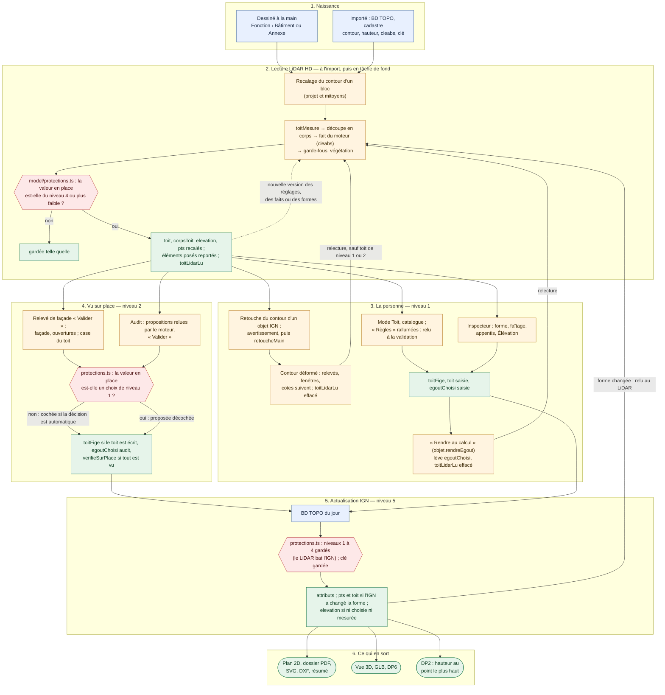
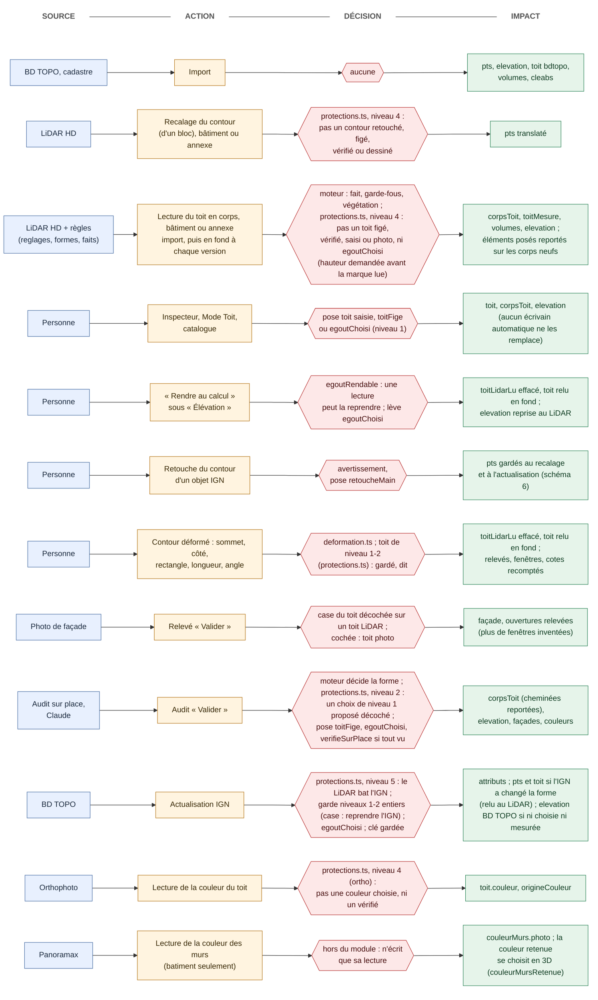
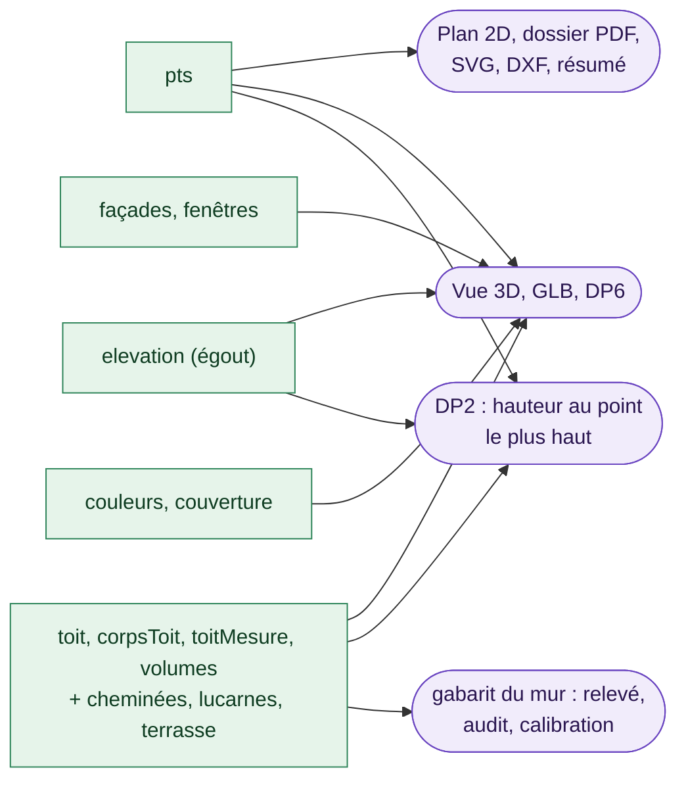
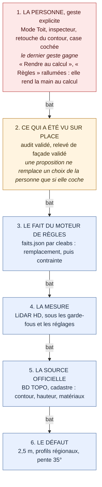

# Le flux de construction d'un bâtiment — qui écrit quoi, qui l'emporte

*Mis à jour le 28 octobre 2026, sur `main` à la version 4.0.0 (commit `a53e0239`). Ce document était jusque-là une section de
[`MD/spec-ouvrages.md`](spec-ouvrages.md) ; il en est sorti le même jour, sans rien perdre de son texte ni de son historique.*

Un bâtiment (ou une annexe) est l'ouvrage du plan qui a le plus d'auteurs : la personne, l'import et l'actualisation IGN, la
lecture LiDAR HD, le moteur de règles, le relevé de façade et l'audit de la parcelle écrivent chacun quelques-uns de ses champs, à
des moments différents. Ce document suit un bâtiment de sa naissance à ce qui en sort (plan, Vue 3D, DP2, dossiers), dit qui écrit
chaque champ, et la règle unique qui les départage (`model/protections.ts`, « Qui l'emporte »). Il donne aussi la définition du
**corps**, la brique du toit, et sa règle de découpe. La place du bâtiment parmi les autres ouvrages (registre, références par
côté, indépendance) reste dans [`MD/spec-ouvrages.md`](spec-ouvrages.md) ; ce que l'audit de la parcelle fait d'un toit, dans sa
section [« Les toits dans l'audit de la parcelle »](spec-ouvrages.md#les-toits-dans-laudit-de-la-parcelle). Les règles et les
seuils des toits sont dans [`MD/spec-toit-ign.md`](spec-toit-ign.md) et le skill `toits`.

Les numéros de ligne cités viennent du relevé du 28 octobre 2026 (commit `445e5899`) et des PR qui ont suivi ; le code a bougé
depuis : le nom de la fonction fait foi.

## Le relevé

*Relevé dans le code le 28 octobre 2026 (worktree `w68`, commit `445e5899`), en lecture seule : rien n'a été exécuté.* Un
bâtiment n'a pas d'auteur unique. Neuf sources écrivent dans le même objet, chacune quelques champs, à des moments différents :
la création, l'import IGN, la lecture LiDAR (à l'import, puis en tâche de fond), le moteur de règles, le Mode Toit,
l'inspecteur, le relevé de façade, l'audit de la parcelle et l'actualisation IGN. Ce qui arbitre entre elles n'est pas un
composant : ce sont quatre marques posées sur l'objet (`toitFige`, `verifieSurPlace`, `retoucheMain`, `toit.source`) et une
version (`toitLidarLu`), lues chacune par une partie des écrivains seulement.

**Depuis le relevé** (PR #468 et #469, fusionnées le 28 octobre 2026) : une décision de toit validée par l'audit pose `toitFige` ;
l'audit propose décoché ce qui remplacerait un toit fait à la main ; valider une forme reporte cheminées, lucarnes, terrasse et
appentis sur les nouveaux corps ; un contour retouché n'est plus recalé par le LiDAR ; les façades de l'audit retrouvent leur mur
par la géométrie ; la DP2 donne le point le plus haut ; le relevé ne coupe plus la lecture LiDAR sans le dire ; les fenêtres
automatiques quittent les murs relevés ; la couverture survit à l'actualisation ; le faîtage et l'appentis ouvert sont protégés ;
un mur en L garde les corps. Les tableaux ci-dessous le disent, point par point, dans « Ce qu'il faut ranger ». **La règle qui
arbitre est décidée** (« Qui l'emporte », 28 octobre 2026) ; ~~son module unique est en cours (étape 6.3)~~ — écrit le même jour :
`model/protections.ts` est le seul juge, et plus aucun écrivain ne lit les marques à la main.

**À la 4.0.0** (CHANGELOG, `## [4.0.0] — 2026-10-28`, vérifié dans le code) :

- **les annexes sont lues au LiDAR**, comme les bâtiments (version majeure, décision du propriétaire) : l'ouvrage le déclare
  (`Ouvrage.toitLuAuLidar`, `model/ouvrages/bati.ts`), et la lecture, les mitoyens et la question du toit à cheval le demandent
  (`model/fonctions.ts::toitLuAuLidar`) ;
- **la hauteur à l'égout choisie** porte sa marque (`batiment.egoutChoisi`, `'saisie'` ou `'audit'`) et se rend au calcul par
  « Rendre au calcul » (commande `objet.rendreEgout`) ;
- **le schéma 6** du fichier : `retoucheMain`, `batiment.egoutChoisi` et le soleil du projet (`parcelle.soleil`) s'écrivent au 6
  (`model/migrations.ts`, `CHAMPS_DEPUIS`) ; un projet qui n'en porte aucun reste au plus petit schéma qui le décrit ;
- **ce qui est rangé par côté suit un contour déformé**, pour tous les ouvrages (`Ouvrage.suivreDeformation`,
  `model/referencesContour.ts`), et **supprimer un objet nettoie** ce qui le tenait par sa clé (`Ouvrage.oublier`) — le toit à
  cheval compris ;
- **la couleur du toit lue sur l'orthophoto** passe par `model/protections.ts` (groupe `couleurToit`, écrivain `ortho`) ; la couleur
  des murs lue sur Panoramax reste hors du module (« Qui l'emporte ») ;
- **la lecture à l'import et à l'actualisation** demande le droit d'écrire la hauteur **avant** de marquer le bâtiment lu
  (`app/toits/toitsLidar.ts::toitsDepuisLidar`) : la marque faisait passer une hauteur posée pour une mesure ;
- **« Règles » rallumées** en Mode Toit relit le toit à la validation de la session, tout de suite ; le bilan de l'actualisation
  compte à part les bâtiments au toit réglé à la main.

## Le schéma du flux

La vie d'un bâtiment, de sa naissance à ce qui en sort. Les couleurs sont celles du schéma « couche par couche » : en bleu ce qui
apporte une donnée, en orange le geste qui l'écrit, en rouge ce qui décide si elle passe, en vert ce qu'elle change. Chaque fois
qu'un écrivain automatique rencontre une marque, il demande à `model/protections.ts` si la valeur en place est de son niveau ou
d'un niveau plus faible (`peutEcrire`, « Qui l'emporte ») ; les boucles sont la relecture LiDAR et l'actualisation.



## Les repères

- **Un bâtiment** est un polygone de fonction `batiment` (ou `annexe`) : `model/ouvrages/bati.ts::BATIMENT`, particularité
  `releve`, élévation par défaut 2,5 m. `estBatiment` (`model/fonctions.ts:55`) vaut pour les deux ; la lecture LiDAR aussi,
  depuis la 4.0.0 — elle ne prenait que `batiment` avant (`model/fonctions.ts::toitLuAuLidar`, déclaré par l'ouvrage :
  `Ouvrage.toitLuAuLidar`, posé sur `BATIMENT` et `ANNEXE`) : toit, hauteur à l'égout, recalage du contour, mitoyens
  (`model/mitoyennete.ts`), toit à cheval (`app/toits/toitsACheval.ts`). Seule la couleur des murs lue sur Panoramax ne prend
  encore que la fonction `batiment` (`estOuvrage(o, BATIMENT)`, `render/couleurMurPhoto.ts`, `app/toits/mursFond.ts`).
- **Ce qu'il porte** : à plat sur l'objet, `pts`, `elevation` (la hauteur à l'égout, celle du prisme), `bdtopo`, `retoucheMain`,
  `fill` ; dans le sous-objet `batiment` (`model/typesFonctions.ts:13-79`), `toit` (la forme simple), `volumesToit`, `toitMesure`,
  `corpsToit` (cheminées, lucarnes, terrasse, appentis, bow-windows sont **dans** les corps), `toitLidarLu`, `toitACheval`,
  `modeToit`, `toitFige`, `verifieSurPlace`, `egoutChoisi` (la hauteur à l'égout choisie : `'saisie'` ou `'audit'`), `facades`
  (relevés), `fenetres3d`, `couleurMurs`, `profilFacades`. Au fichier, tout est à plat (`model/champsFonction.ts`) ;
  `retoucheMain` et `egoutChoisi` s'écrivent au **schéma 6** (`model/migrations.ts`, `CHAMPS_DEPUIS`, avec le `soleil` de la
  parcelle), le reste des champs du toit au 5 au plus.
- **Trois identités** : la clé du plan (`bati-<id>`, `geo/cadastreObjets.ts:335`), `bdtopo.id` (la clé gardée à l'actualisation)
  et `bdtopo.cleabs` (les faits du moteur, `regles/toits/faits.ts:339`).
- **Un mur** se désigne par le rang de son côté dans `pts` (`cote`) : relevés, fenêtres réglées une par une, façades de l'audit,
  cotes. Un corps a ses propres murs, numérotés dans `corps.pts`.
- **Les hauteurs** : `elevation` est l'égout (sol → égout, la `hauteur` de la BD TOPO) ; `toit.hauteur` est la montée du faîtage
  au-dessus de l'égout ; un corps porte ses hauteurs en absolu (`egouts`, `faitage`, depuis le sol).

## Le corps : définition et règle de découpe

**Définition.** Un corps est **un rectangle du bâtiment qui porte un toit à lui** : une maison, une aile, une annexe, un
appentis, une tourelle. Un bâtiment en L, en T ou en U n'a pas un toit mais plusieurs ; chacun a son faîtage, ses égouts, parfois
sa hauteur. Le corps est la brique du toit : tout ce qui se pose sur un toit appartient à un corps.

| Ce qu'un corps porte (`CorpsToit`, `model/typesToit.ts:71`) | Sens |
|---|---|
| `pts` | le rectangle, quatre sommets : `pts[0]→pts[1]` suit le faîtage (la longueur), `pts[0]→pts[3]` la largeur |
| `posFaitage` | la place du faîtage dans la largeur, depuis le côté `pts[0]-pts[1]` ; 0 ou la largeur : un appentis |
| `faitage`, `egouts: [e0, e1]` | hauteurs **absolues**, depuis le sol : le faîtage, l'égout de chaque pan ; faîtage = égouts : plat |
| `croupes`, `bouts` | ce qui ferme chaque bout : pignon (deux pans) ou croupe (quatre pans) |
| `pignons` | les pignons qui partent du faîtage, le long d'un mur |
| `cheminees`, `lucarnes`, `elementsToit`, `terrasse` | ce qui est posé sur lui : souches, lucarnes, fenêtres de toit et panneaux, toiture-terrasse |
| `profil`, `bords`, `speciale`, `ouvert`, `saillie`, `baie` | profil des pans, débords, toit de révolution, appentis ouvert, élément posé sur un mur d'un autre corps, bay window |
| `ecart` | l'écart quadratique moyen à la mesure LiDAR : ce que la lecture a su expliquer |

Les corps **se chevauchent** par construction : une aile qui pénètre la maison a son toit entier, le plus haut l'emporte en 3D, et
les noues naissent de leur rencontre. Le **corps principal** est le plus grand : il porte la porte d'entrée, donne la forme du
bâtiment (`model/formeToit.ts`) et c'est lui que remplace une forme du catalogue (Mansart, gambrel, berceau…).

Un corps n'est **pas** un volume (`volumesToit`, l'ancienne lecture : un rectangle et un toit simple, `estime`), ni la forme simple
`toit` du bâtiment (un seul toit sur tout le contour). Ce que la 3D montre se décide une fois (`model/toitMesure.ts::modeToitActif`) :
le mode choisi, sinon les corps, sinon les volumes, sinon le toit simple.

**Qui découpe.** Seule la lecture LiDAR découpe un bâtiment en corps, et seulement sur la parcelle du projet et ses mitoyens (le
voisinage garde un toit par bâtiment, sauf « Toits en corps et pignons », coché par défaut) :
`app/toits/toitsLidar.ts::corpsLus` → `facade/toits/toitCorps.ts::reconstruireCorps`. À la main, le Mode Toit ajoute, retire,
tourne ou duplique un corps ; un fait du moteur de règles impose le corps principal (`corpsSousContrainte`). Un bâtiment dessiné
sans LiDAR n'a pas de corps.

**La règle de découpe**, dans l'ordre (seuils de `regles/toits/reglages.json`, lus par le code, entrés dans
`VERSION_LECTURE_TOITS` : en changer un relit les toits déjà lus) :

1. **Mise à l'équerre** (`model/volumesToit.ts::decomposerEnRectangles`) : le contour est tourné dans l'axe de son plus long côté ;
   chaque côté à moins de **15°** (`TOLERANCE_DEG`) de l'équerre y est ramené. Les **décrochés de moins de 1,2 m**
   (`SEUIL_DECROCHE_M`) sont lissés : un ressaut, un conduit, un perron ne font pas un corps.
2. **Rectangles maximaux** (`couvertureRectangles`) : sur la grille des abscisses et ordonnées du contour, chaque rectangle tout
   entier dedans qu'aucun autre ne contient, du plus grand au plus petit, autant qu'il en faut pour tout couvrir. On renonce si le
   contour n'est pas rectiligne, si l'équerre change l'aire de plus de 15 %, ou si un rectangle fait moins de **1,5 m** de large
   (`LARGEUR_MIN_M`). Une maison rectangulaire donne un rectangle (`rectanglesDuContour`).
3. **Coupe aux marches** (`model/toitMesure.ts::decouperParHauteurs`) : un rectangle est recoupé là où la couverture mesurée
   saute d'au moins **0,8 m** (`SEUIL_MARCHE_M`) **d'un coup** — 1,6 fois plus que sur le mètre voisin : un pan raide monte
   partout, une marche d'un seul coup. Deux coupes au plus par rectangle ; un bloc fait au moins **1,5 m** (`LARGEUR_BLOC_MIN_M`).
   Une aile dont plus de **la moitié** est sous un rectangle plus grand (`PART_SOUS_PLUS_GRAND`) n'est pas coupée si son toit
   entier tient la mesure : ses « marches » sont les pentes du toit qui la couvre.
4. **Refonte** (`refondre`) : deux morceaux redeviennent un seul corps si le toit lu sur le rectangle entier fait presque aussi
   bien — un écart au plus **1,15 fois** celui des morceaux (`TOLERANCE_REFONTE`), **1,6 fois** si un morceau fait moins de 3 m
   (`TOLERANCE_BANDE`, `LARGEUR_BANDE_M`) — et toujours s'il n'y a **aucune marche** à la coupe (saut médian sous **0,6 m**,
   `CONTINUITE_M`). Un corps ne se coupe pas sans raison.
5. **Coupe par le modèle** (`meilleureCoupe`, deux fois au plus) : à l'inverse, un rectangle sans marche devient deux corps si
   deux toits simples expliquent la mesure nettement mieux qu'un — l'écart tombe aux **deux tiers** (`GAIN_COUPE`), il valait au
   moins 25 cm, et les deux toits diffèrent d'au moins 60 cm. Un pignon n'est pas un corps : ses mesures n'y comptent pas.
6. **Le toit de chaque corps** (`ajusterCorps`) : chaque sens et chaque place du faîtage, tous les 25 cm, murs compris (un
   appentis) ; ce qui dépasse le pan de plus de **40 cm** est écarté (pignon, arbre, lucarne). Pente au plus 60°, égouts au moins
   1,5 m ; moins de **30 cm** de montée ou moins de **3°** : plat (`HAUTEUR_PLAT_M`, `PENTE_PLAT_DEG`) ; un faîtage à moins de
   **1 m** d'un mur (`PAN_MIN_M`) : un appentis. Puis les **pignons** (la mesure dépasse le pan de 80 cm le long d'une façade, sur
   1,5 à 6 m) et les **croupes** (gardées si l'écart tombe à 0,8 fois celui des pignons de bout).
7. **Bandes recouvertes** (`sansBandesRecouvertes`) : un corps de moins de **3 m** de large dont plus de **90 %** est sous les
   autres est retiré — c'était un morceau du toit voisin. Un corps plus large reste, même recouvert.
8. **Contour de biais** (`corpsDeReprise`) : quand l'équerre échoue, le contour est ramené en marches dans l'axe qui aligne le plus
   de côtés, découpé en tranches, puis chaque corps avance ses côtés libres pour couvrir le contour (complétion, avec trois
   garde-fous : au moins 10 % du contour sans toit devant lui, pas d'égout sous 2 m, la mesure à sa hauteur). En dernier recours,
   un seul corps sur la boîte orientée.
9. **Après la découpe** : la forme du catalogue remplace le corps principal si elle explique mieux la mesure
   (`facade/regles/toits/catalogue.ts::corpsCalcules`), le fait du bâtiment s'impose (`corpsSelonFait`), et un corps dont l'égout
   dépasse la BD TOPO de plus de 3 m est écarté comme végétation (`corpsVraisemblables`).

La découpe de référence est **AE 101** (2 allée des Limites, Le Vésinet) : quatre corps sous ses faits ;
`npx tsx .claude/skills/toits/scripts/identite.ts` vérifie qu'elle ne bouge pas. Le détail des seuils, avec leurs cas, est dans
`MD/spec-toit-ign.md` §11 et §13 et dans le skill `toits` (§3).

**Ce que la découpe ne dit pas** (à relier au « Qui l'emporte ») : un corps n'a pas d'identité propre — il est rendu par sa place
dans `corpsToit`, et une lecture rend une liste neuve. Ce qui était posé sur un ancien corps (cheminées, lucarnes, terrasse) n'a
donc pas d'adresse stable : c'est le point 3 des [« toits dans l'audit de la parcelle »](spec-ouvrages.md#les-toits-dans-laudit-de-la-parcelle)
(corrigé à part) ; ~~pour la relecture LiDAR, la même question reste à vérifier~~ — réglé le 28 octobre 2026 : la relecture
reporte sur les corps neufs ce que portaient les anciens, là où il tient encore, par la géométrie et non par le rang
(`facade/regles/toits/elementsVus.ts::corpsAvecCeQuIlsPortaient`, point 16 de « Ce qu'il faut ranger »).

## 1. La naissance

| | Dessiné à la main | Importé (BD TOPO) |
|---|---|---|
| Geste | un polygone (`model/creation.ts::nouvelObjet`, fonction `autre`, rectangle si les quatre sommets sont gelés), puis « Fonction › Bâtiment » | « Nouveau plan depuis une adresse » → `geo/cadastreObjets.ts::objetBatiment` (:321) |
| `pts` | ceux du dessin, contraints à la parcelle (`constrained: true`) | l'anneau BD TOPO projeté, en sens horaire, simplifié si demandé (`geo/apiIgn.ts::anneauVersPts`, :141) ; jamais contraint |
| `elevation` | absente : 2,5 m par défaut (`engine/hauteurs.ts:101`) | `hauteurBatiment` (`geo/bdtopo.ts:30`) : la hauteur BD TOPO, sinon étages × 2,7 m, sinon 2,5 m |
| `toit` | absent (un bloc plat) ; créé `source: 'saisie'` au premier réglage de l'inspecteur ou du Mode Toit (`ui/champs/facade.ts:33`, `three/gestesToits.ts:250`) | `toitBdTopo` (`model/toitBdTopo.ts:50`) : deux pans dans l'axe d'un rectangle allongé, croupes sinon ; hauteur = altitude max − min du toit ; plat sous 0,5 m ou 10° ; `source: 'bdtopo'`, `estime` sans altitudes |
| `volumesToit` | — | sur la propriété : `volumesParDefaut` (`model/volumesToit.ts:290`) |
| `bdtopo` | — | `id`, `cleabs`, hauteurs, altitudes, étages, matériaux des murs et du toit, `surParcellePrincipale`, `recupereLe` (:339-354) |
| Verrou | non | `locked` hors de la propriété (:337) |

À l'import, dans l'ordre (`app/cadastre/importCadastre.ts:735-746`) : couleur des toits sur l'orthophoto, forme des toits au
LiDAR (les 30 plus proches), couleur des murs sur Panoramax, relief. Le reste des toits se lit à l'ouverture, en tâche de fond.

## 2. Le contour

| Geste | Bâtiment de l'IGN | Bâtiment dessiné | Ce que le toit fait |
|---|---|---|---|
| Glisser, aligner (tourner) | refusé, `MESSAGE_TERRAIN_REEL` (`interaction/pointeur.ts:210`, `interaction/outilAlignement.ts`) | permis | suit : `suivreLeContour` → `Ouvrage.suivreContour` (`model/ouvrages/index.ts:42`, `model/ouvrages/bati.ts:11-32`) translate et tourne corps, cheminées, édicules, volumes, `angleFaitage` ; `toitMesure` translaté, **effacé** s'il tourne |
| « Réinitialiser la position » | permis (`app/ecouteurs/objets.ts:117-133`) | permis | suit |
| Tirer un sommet ou un côté, en ajouter, saisir un angle ou une longueur | après la question de retouche (`interaction/retoucheTerrain.ts:26-28`, `app/inspecteur.ts:118`) : pose `retoucheMain` (`model/retouche.ts:27`) | permis sans question | se relit : à la fin du geste, un toit lu au LiDAR redevient à lire (`toitLidarLu` effacé) et la tâche de fond le refait sur le nouveau contour en reportant ce qui était posé dessus ; un toit protégé reste, et un message le dit (`core/deformation.ts`, `model/contourDeforme.ts`) |
| Rectangle (quatre sommets gelés) | — | coin ou côté tiré redimensionne (`interaction/drag.ts:117-131`) | se relit, comme ci-dessus |
| Recalage LiDAR | translation d'un bloc si plus de 12 % de vide sous le contour (projet et mitoyens, `toitsLidar.ts:73-88`) ; écrit `pts` (`toitsFond.ts:130`, `CHAMPS_LUS`) ; demandé à `model/protections.ts` (écrivain `recalage`, niveau 4) : pas un contour retouché, figé ou vérifié ; une annexe aussi depuis la 4.0.0 | ~~id., s'il est lu (voir 4)~~ — jamais depuis le 28 octobre 2026 : le contour d'un bâtiment dessiné est un geste de la personne (niveau 1) | les corps sont relus ensuite sur le contour recalé |
| Actualisation IGN | `pts` remplacés par la BD TOPO du jour (`app/cadastre/actualisationIgn.ts:298`) | supprimé et recréé par « Actualiser le projet » s'il est sur la parcelle (`:164-169`, `:194`) | voir 9 |

Les relevés et les fenêtres, rangés par rang de côté, suivent un déplacement d'eux-mêmes ; depuis le 28 octobre 2026, un sommet
ajouté ou retiré recompte leurs rangs, et ceux des cotes du plan (une cote dont le point visé est retiré part avec lui) ;
l'actualisation IGN les range par la géométrie sur le contour du jour (`model/contourDeforme.ts`, qui reprend
`model/cotesAudit.ts::correspondanceDesCotes`). Le relevé posé sur un mur qui a changé de longueur s'étire, ses ouvertures gardent leur
cote depuis la gauche et celles qui sortent sont omises (`three/releve3d.ts:306-322`).

## 3. Les hauteurs

| Hauteur | Écrite par | Où |
|---|---|---|
| `elevation` (égout du prisme) | import : hauteur BD TOPO | `geo/cadastreObjets.ts:334` |
| | LiDAR : l'égout mesuré (10e centile) ou celui de la forme ajustée, s'il s'écarte d'au moins 0,3 m et reste entre 2 et 40 m ; seulement si `model/protections.ts` le permet au niveau 4 (ni `egoutChoisi`, ni toit figé, saisi, vérifié ou photo, ni hauteur posée sur un bâtiment dessiné), demandé **avant** de poser `toitLidarLu` depuis la 4.0.0 | `facade/regles/toits/vraisemblance.ts:66-69`, `toitsLidar.ts:367-370`, :423-425 |
| | fait en remplacement : son égout, au niveau 3 (pas une hauteur choisie) | `toitsLidar.ts:137`, :141 |
| | inspecteur « Élévation » : pose `egoutChoisi: 'saisie'` ; « Rendre au calcul » la lève et remet le toit à lire (`objet.rendreEgout`, visible si `egoutRendable`) | `ui/champs/objet.ts:115-123`, `app/ecouteurs/objets.ts:72-81`, `model/protections.ts::egoutRendable` |
| | Mode Toit : poignée « Hauteur à l'égout » du corps principal (son égout le plus bas, le corps entier déplacé, pente gardée) ; pose `egoutChoisi: 'saisie'` et `toitFige` (28 octobre 2026) | `facade/modeToit/poignees.ts::glisser` (`egout`), `sessionToit.ts::ecrireLeGeste` |
| | audit : « Hauteur à l'égout » (photos, Claude, LiDAR arbitrés) ; pose `egoutChoisi: 'audit'` | `regles/decisions.ts:270`, `app/audit/parcelle/arbitrages.ts:92` |
| | actualisation IGN : hauteur BD TOPO, ~~à chaque fois~~ — depuis le 28 octobre 2026, seulement si elle n'est ni choisie ni mesurée (niveau 5 : le LiDAR bat l'IGN) | `actualisationIgn.ts:302` |
| `toit.hauteur` (faîtage au-dessus de l'égout) | BD TOPO, LiDAR (forme ajustée), inspecteur (`source: 'saisie'`, `ui/champs/facade.ts:335-340`), audit « Hauteur totale » (`decisions.ts:271`) | |
| égouts et faîtage d'un corps | LiDAR (`reconstruireCorps`), fait, Mode Toit (poignées), audit (corps relus) | `corpsToit` |
| murs d'un volume, d'un corps | dérivés : `hauteurMurMesuree`, `hauteursMursCorps` | lus, jamais saisis |
| hauteur mesurée sur une photo de façade | **dite, pas appliquée** : « le bâtiment garde x m » | `app/releve/releve.ts:121-128` |

En mode corps, la 3D monte chaque prisme à l'égout de son corps (`three/sceneObjets.ts:316-320`) : `elevation` ne s'y voit plus,
mais reste celle que lisent l'inspecteur, les relevés, la DP2 et l'audit. Pour corriger la hauteur d'un corps, c'est la poignée
« Hauteur à l'égout » du Mode Toit (28 octobre 2026) : elle déplace le corps et, sur le corps principal, réécrit `elevation`.

## 4. Le toit automatique

**La chaîne** (`app/toits/toitsLidar.ts::toitsDepuisLidar`, :380 ; le détail des règles est dans le skill `toits` §2-§3) :

1. **Qui est lu** : `toitAAjuster` (`app/toits/ecritureToits.ts`) — fonction `batiment` ou `annexe` (`toitLuAuLidar`), pas `toitFige`, et un toit absent, `bdtopo` ou `lidar` ;
   puis `admis` (:389) demande `ecrivainPeut(o, 'lidar', 'toit')` (`model/protections.ts`), qui écarte aussi `verifieSurPlace` (sauf `verifies: 'relire'`). Rien ne demande `bdtopo` : **un bâtiment dessiné
   dans un projet géolocalisé est lu aussi**, en tâche de fond, comme un voisin. Une `annexe` l'est de même depuis la 4.0.0.
2. **Un fait en remplacement** pose le toit sans rien lire, LiDAR ou pas (`toitDuFait`, :132-142) : corps et forme du fait,
   `toitMesure`, `volumesToit`, `toitACheval` effacés, `elevation` = son égout.
3. **Lecture** de la grille MNH sous le contour (`lireSous`, :306) ; `toitLidarLu` posé dès que le service a répondu, même sans
   mesure (:425). Depuis la 4.0.0, le droit d'écrire la hauteur est demandé **avant** cette marque (:423) : posée après, elle
   faisait passer pour une mesure la hauteur d'une annexe ou d'un bâtiment dessiné, que l'actualisation IGN réécrivait ensuite.
4. **Recalage** d'un bloc, pour le projet et les mitoyens (:435), si `ecrivainPeut(o, 'recalage', 'contour')`.
5. **Sous les seuils du profil** du bâtiment (`avecSeuilsToit`, `facade/regles/toits/profils.ts`), `poserLeToit` (:339-372) :
   la forme simple ajustée (`facade/toits/toitLidar.ts::ajusterToit`, sous le fait en contrainte : `ajusteSelonFait`), écartée
   si c'est un houppier ; sur la propriété, `toitMesure` (`model/toitMesure.ts::toitMesureDepuisGrille`), `volumesToit`
   (`volumesDepuisLidar`) et `corpsToit` (`corpsLus`, :118-121) ; chez un voisin, les corps seuls (calcul allégé hors
   mitoyens), `toitMesure` gardé chez le mitoyen ; la question « à cheval » (`toitAChevalApresCalcul`, :102).
6. **`corpsLus`** = `corpsCalcules` (pentes droites `facade/toits/toitCorps.ts::reconstruireCorps`, puis formes du catalogue
   `facade/regles/toits/catalogue.ts:46`) → `corpsSelonFait` (fait en contrainte : `corpsSousContrainte`, pignons, appentis,
   bay windows ; `facade/regles/toits/faits.ts:170`, :309) → `corpsVraisemblables` (végétation).
7. **Écriture** : `toit` remplacé par la forme ajustée en gardant `couleur`, `origineCouleur` et `couverture` (`avecCouleurDe`,
   :124-127) ; `elevation` (point 3) ; `toucher(o)`.

**Le moteur de règles** ne s'appelle pas à part : il est dans cette chaîne. Réglages (`regles/toits/reglages.json`, lus à chaque
appel par `S.NOM`), formes (`regles/toits/formes.json`), profils (aucun livré), faits par `cleabs` (`regles/toits/faits.json` : un
seul, AE 101, en contrainte). Rien de l'application n'écrit ces fichiers.

**Ce qui déclenche une relecture** :

| Déclencheur | Effet | Où |
|---|---|---|
| Une ligne de `LECTURES_TOITS`, ou des empreintes de réglages, faits ou formes qu'aucune ligne ne connaît | `VERSION_LECTURE_TOITS` monte : tout bâtiment marqué plus bas redevient à lire | `toitsLidar.ts:209-249` |
| L'ouverture du plan, un import, une actualisation, « Reprendre » | `toitsFond.relancer()` : les bâtiments éligibles non lus, du plus proche au plus loin | `app/boot.ts:85`, `app/boot/chargements.ts:88`, `:108`, `app/ecouteurs/toitsFond.ts:18` |
| Une actualisation IGN qui relit un bâtiment | `toitLidarLu: null` | `actualisationIgn.ts:307` |
| « Règles » rallumées (Mode Toit) | `toitLidarLu`, corps, volumes, mesure, mode effacés ; `saisie` redevient `bdtopo` ; depuis le 28 octobre 2026, la validation de la session relance tout de suite la lecture en fond (une session abandonnée rend le toit d'avant) | `three/gestesToits.ts:374-382`, `app/toits/modeToit.ts::validerLaSession` (:272) |
| Un contour déformé (sommet, côté, rectangle, longueur, angle) | `toitLidarLu` effacé, sauf un toit de niveau 1 ou 2 ; relecture demandée | `core/deformation.ts:33`, `lectureToits.demanderRelecture` |
| « Rendre au calcul » (inspecteur, sous « Élévation ») | `egoutChoisi` levé, `toitLidarLu` effacé ; relecture demandée ; un pas d'annulation | `app/ecouteurs/objets.ts:73-81` |
| Une annexe d'un projet enregistré avant la 4.0.0 | sans `toitLidarLu` : lue une fois par la tâche de fond à la prochaine ouverture | `tests/unit/app/toits/annexesLidar.test.ts` |
| Faits d'essai (`?regles=local`) | relecture, marque `MARQUE_ESSAI_FAITS` | `toitsLidar.ts:255-259`, `app/boot/branchementToits.ts:25` |

La tâche de fond lit une **copie** et ne la reporte que si `pts` et `toit` n'ont pas bougé (`toitsFond.ts:137`, :148 ; depuis le
28 octobre 2026, l'empreinte compte aussi les corps, la hauteur et les marques) ; elle écrit
`pts`, `elevation` et `toit`, `toitMesure`, `volumesToit`, `corpsToit`, `toitACheval`, `toitLidarLu` (:130-132), ou la seule marque
pour un bâtiment vérifié (:133, :150-156). Hors historique : Ctrl+Z ne la défait pas.

## 5. Le toit à la main

| Chemin | Ce qu'il écrit | Marque posée |
|---|---|---|
| Inspecteur, mode « Un seul toit » : forme, hauteur du faîtage | `toit.forme`, `toit.hauteur` | `toit.source = 'saisie'` (`ui/champs/facade.ts:316`, :339) |
| Inspecteur : direction du faîtage | `toit.angleFaitage` | ~~**aucune** (:358-360)~~ — `toit.source = 'saisie'` depuis le 28 octobre 2026 (:363-364) |
| Inspecteur : couverture (couleur), matériau | `toit.couleur` (retire `origineCouleur`), `toit.couverture` | l'absence d'`origineCouleur` (:371-376) ; rien pour le matériau (:139-142) |
| Inspecteur : « Toit en 3D » | `modeToit` | — (:261) |
| Inspecteur : appentis ouvert ou fermé | `corps.ouvert` | ~~**aucune** (:164-171)~~ — `toitFige` depuis le 28 octobre 2026 (:173) |
| Inspecteur : « Élévation » ; « Rendre au calcul » | `elevation` ; lève la marque | `egoutChoisi: 'saisie'` ; levée par `objet.rendreEgout` (section 3) |
| Inspecteur : éléments de façade (bow-window, galerie) | `corpsToit` (saillie) | `toitFige` (:186-189, :225, :230) |
| Mode Toit (Vue 3D, `app/toits/modeToit.ts`) : poignées (dont « Hauteur à l'égout », depuis le 28 octobre 2026 : le corps entier monte ou descend, pente gardée ; sur le corps principal, `elevation` = son égout le plus bas et `egoutChoisi: 'saisie'`, gardés dans les instantanés de la session), catalogue (`three/gestesToits.ts::appliquerPiece`), cheminées, lucarnes, édicules, corps neufs, tourner, dupliquer | `corpsToit`, `toit`, `modeToit`, `volumesToit`, et `elevation` par la poignée de l'égout du corps principal, dans une session à part ; « Valider » : une étape d'historique | ~~`toitFige` à la validation (`modeToit.ts:265`)~~ — depuis le 28 octobre 2026, à chaque geste du mode (`modeToit.ts:471`, `app/ecouteurs/toitCatalogue.ts`), la validation ne pose plus rien (`validerLaSession`) ; une forme du catalogue pose aussi `toit.source = 'saisie'` (`gestesToits.ts:319`, :328) |
| Mode Toit : « Règles » | coupées : `toitFige` ; rallumées : `reprendreLectureAuto` | `toitCatalogue.ts:156-162` |

Le Mode Toit s'ouvre sur tout bâtiment polygone hors voisinage étendu (`modeToit.ts:71`, `estRetouchable`) ; `locked` n'y est
pas lu (point 13 de « Ce qu'il faut ranger », laissé ouvert). Les cheminées, lucarnes et édicules n'ont que deux auteurs : le Mode Toit et l'audit ; le LiDAR n'en pose aucun.

## 6. Les ouvertures

| Source | Ce qu'elle écrit | Où |
|---|---|---|
| Disposition automatique | **rien** : la 3D la recalcule à chaque dessin. Niveaux de 2,7 m, fenêtres par entraxe, porte au rez-de-chaussée du plus long mur, fenêtres de pignon, aux dimensions du profil de façades | `facade/ouvertures.ts::ouverturesAutomatiques` (:128), `fenetresDesPignons` (:145), `three/detailsBatiment.ts::poserOuvertures` (:383) |
| Profil de façades | `profilFacades` (voisinage seulement, jamais la parcelle du projet ni un bâtiment vérifié) | `app/toits/profilsFacadesFond.ts:35`, :55 |
| Inspecteur « Fenêtres (3D) » | `fenetres3d` : dimensions communes, ou `uneParUne` (liste par `cote`) | `model/fenetres3d.ts`, `ui/champs/fenetres3d.ts` |
| Relevé de façade à la main | `facades[cote]` (photo redressée, ouvertures, calage) ; retire `depuisAudit` ; optionnellement `toit` (case ~~**cochée par défaut**, `zones/Releve.tsx:212`~~ — depuis le 28 octobre 2026, cochée d'office seulement sur un toit simple ; sur un toit en corps ou en volumes, décochée, et elle dit ce qu'elle remplace) ; groupe `facades` de `model/protections.ts` | `app/releve/releve.ts:112-120` |
| Audit, dès qu'une mesure est prête | `facades[cote]` avec `depuisAudit`, sans attendre « Valider », jamais sur un relevé fait à la main (`releveChoisiALaMain`, groupe `facades`, depuis le 28 octobre 2026) | `app/audit/parcelle/validation.ts::alimenterLesFacades` (:372) |
| Audit, « Valider » | relevé, détails des ouvertures | `regles/decisions.ts:260-268` |

Le relevé passe par l'assemblage des photos redressées (`facade/analyseMur.ts::analyserLeMur`, :50 ; `fondreLesVues`, :158). Le
**gabarit** (`facade/gabaritMur.ts::gabaritDesCorps`, :36) n'écrit rien : il se tire de `pts`, `corpsToit` et de la hauteur du
mur, à la demande. Depuis le 28 octobre 2026, c'est la silhouette du Mode Toit : celle que la 3D trace pour chaque corps
(`facade/regles/toits/silhouetteDesCorps.ts::silhouetteDuCorps`), projetée sur le plan du mur et vue de face (`silhouetteDeFace`),
le mur d'un corps dans le plan de la façade entier, même au-delà du côté du contour. Un mur relevé n'a pas de fenêtres automatiques (`detailsBatiment.ts:387-388`) — ~~sauf en mode corps (« Ce qu'il
faut ranger », 3)~~ en mode corps aussi depuis le 28 octobre 2026 (`geometry/facadeExterieure.ts::cotesSurLesCotes`).

## 7. Matériaux et couleurs

| Quoi | Automatique | À la main | Ce que l'automatique respecte |
|---|---|---|---|
| Couleur du toit | orthophoto, sinon repli rouge, brun ou gris selon le matériau (`render/couleurToitOrtho.ts:179-197`) ; pose `origineCouleur` | inspecteur, audit | une couleur sans `origineCouleur` (`couleurAResoudre`, :60-62) ; depuis le 28 octobre 2026, demandé à `model/protections.ts` (groupe `couleurToit`, écrivain `ortho`, niveau 4) : ni une couleur choisie, ni un bâtiment vérifié sur place (sauf « Recalculer aussi ») |
| Matériau de couverture | déduit en 3D : terrasse, matériau des fichiers fonciers, couleur, pente, latitude (`model/couleurToit.ts::materiauCouverture`) | `toit.couverture` : inspecteur, audit (`decisions.ts:287`) | gardé par le LiDAR (`avecCouleurDe`) ; ~~**perdu** à l'actualisation (« Ce qu'il faut ranger », 5)~~ gardé aussi à l'actualisation depuis le 28 octobre 2026 (`toitActualise`) |
| Couleur des murs | photo Panoramax (`couleurMurs.photo`, `render/couleurMurPhoto.ts:340-345`), sinon matériau BD TOPO | `couleurMurs.source` (Apparence), audit : `couleurMurs.terrain`, `couleurMurs.materiau` (`decisions.ts:272-284`) | la lecture n'écrit que `photo` ; `terrain` passe avant elle (`model/couleurMur.ts:99-110`). **Hors de `model/protections.ts`**, par choix (« Qui l'emporte ») ; ne lit que la fonction `batiment` (`estOuvrage(o, BATIMENT)`), pas l'annexe |
| Couleur du plan | — | `fill` | utilisée seulement si rien d'autre (`sceneObjets.ts:296-297`) |

## 8. L'audit de la parcelle

Détaillé dans [« Les toits dans l'audit de la parcelle »](spec-ouvrages.md#les-toits-dans-laudit-de-la-parcelle) (`MD/spec-ouvrages.md`) ; en bref :

- il ne dessine pas de toit : il arbitre des constats (LiDAR, BD TOPO, photos, Claude, « Ce que je vois ») et fait relire le
  toit sur la mesure par le moteur, sous le fait du bâtiment ;
- « Valider » écrit en place : `corpsToit` ou un corps, cheminées, lucarnes, appentis, terrasse, couverture, `elevation`,
  `toit.hauteur`, couleur et matériau des murs, relevés ; un pas d'historique ;
- il pose `verifieSurPlace` quand tout le bâtiment a été vu ; ~~et rien d'autre ; ni `toitFige`, ni `toit.source`~~ — depuis le
  28 octobre 2026, `toitFige` aussi sur tout bâtiment dont il écrit le toit (`regles/decisions.ts::EFFETS_DU_TOIT`), et
  `egoutChoisi: 'audit'` pour la hauteur ; jamais `toit.source` ;
- ses propositions demandent `model/protections.ts` (écrivain `audit`, niveau 2) : un choix de la personne arrive décoché, « choix
  remplacé » ;
- ses relevés de façade s'écrivent avant « Valider », marqués `depuisAudit`.

## 9. L'actualisation IGN

Deux portes : « Actualisation IGN » (objets IGN relus un par un) et « Fichier › Actualiser le projet » (`parDefaut`, et les
bâtiments de la parcelle supprimés puis recréés, dessinés compris).

| | Ce qui arrive | Où |
|---|---|---|
| **Gardé entier** | `toitFige`, `verifieSurPlace` (sauf « Recalculer aussi »), `retoucheMain` (sauf « Reprendre la version de l'IGN ») — depuis le 28 octobre 2026, tout contour de niveau 1 ou 2 (`model/protections.ts`) ; le bilan compte à part les retouchés, les figés (« toit réglé à la main ») et les vérifiés (`raisonDeGarder`), et le dialogue d'« Actualiser le projet » a un point pour les figés (`POINT_FIGES`) ; leurs `bdtopo.id` ne sont pas recréés à côté | `actualisationIgn/toitsEtMurs.ts:45-50`, `actualisationIgn.ts:189-195`, :272 |
| | les lectures qui suivent repassent dessus puis sont défaites : `toit` et `couleurMurs` remis ; pour un retouché, tout `batiment` et `elevation` remis — pas `pts` | `toitsEtMurs.ts:75-89` |
| **Relu** (bâtiment IGN gardé dans le plan) | depuis le 28 octobre 2026, ce que `model/protections.ts` permet au niveau 5 (« Qui l'emporte ») : attributs `bdtopo` toujours ; `pts` seulement si le contour n'a pas été lu au LiDAR, ou si l'IGN en a changé la forme (`memeFormeDeplacee`) — alors `toitLidarLu` effacé, relevés, fenêtres et cotes rangés par la géométrie ; `elevation` (hauteur BD TOPO) seulement si elle n'est ni choisie ni mesurée ; `toitActualise` seulement pour un toit `bdtopo` (ou `lidar` sur un contour changé), couleur et couverture choisie gardées ; sur la propriété, si le toit change, `volumesToit` neufs, `toitMesure` effacé, `corpsToit` gardés le temps de la lecture LiDAR qui les remplace en reportant ce qu'ils portent ; `profilFacades` effacé ; le reste de `batiment` (relevés, fenêtres, couleur des murs, mode) gardé tel quel ; `retoucheMain` retiré | `actualisationIgn.ts:280-317`, `model/toitBdTopo.ts:86-93` |
| **Recréé** (« Actualiser le projet ») | comme un import du jour (`batimentDeLaPropriete`) ; la clé de l'ancien **gardée** par `bdtopo.id` ; la réponse « à cheval » suit ; `egoutChoisi` reporté sur le bâtiment recréé | `actualisationIgn.ts:203-229` |
| **Remis par défaut** (« Actualiser le projet », objets non recréés) | `couleurMurs` (photo, terrain, matériau compris), `fenetres3d`, `profilFacades`, `modeToit` ; toit repassé en `bdtopo`, sans couleur ni couverture | `app/cadastre/valeursParDefaut.ts:25-36` |
| **Puis** | orthophoto, LiDAR (30 plus proches, `verifies` selon la case), Panoramax ; le reste en tâche de fond | `toitsEtMurs.ts:91-97`, `chargements.ts:86-89` |

## 10. Ce qui en sort

| Sortie | Ce qu'elle lit du bâtiment |
|---|---|
| Plan 2D | `pts`, nom, cotes ; les ouvertures **relevées** en coupures du trait (`render/releve.ts`) ; aucun toit, aucune fenêtre automatique |
| Vue 3D (`three/sceneObjets.ts:284-389`) | le mode (`modeToitActif`, `model/toitMesure.ts:324` : `modeToit` choisi, sinon corps, sinon volumes, sinon simple ; ~~forcé à simple si un relevé a une partie basse, :301~~ — depuis le 28 octobre 2026, le mur en L ne coupe qu'en toit simple) ; prismes à `elevation` ou aux égouts des corps ; `three/toitCorps3d.ts` (corps, pignons, croupes, profils, lucarnes, saillies, sur le contour s'il est de biais), `three/cheminees3d.ts`, `three/terrasse3d.ts`, `three/toitMesure3d.ts` ; relevés (`three/releve3d.ts`) ; détails (`three/detailsBatiment.ts`) : débord, fenêtres automatiques ou `uneParUne`, une cheminée **posée d'office** sur un toit simple ou en volumes (:569-608) ; couleur des murs, texture du matériau, couverture |
| GLB, capture DP6 | ce que montre la 3D |
| DP2 (`export/piecesDP.ts:205-211`) | `pts` et « Existant H » = ~~`elevation`~~ la hauteur au point le plus haut, le toit que montre la 3D (`model/volumesToit.ts::hauteurAuPointLePlusHaut`, 4.0.0) ; une annexe lue au LiDAR y porte son toit depuis la 4.0.0 |
| DP3 (coupe) | ni bâtiment, ni annexe : terrasses et abris seulement (:287-298) |
| Dossier PDF, SVG, DXF, résumé | `pts`, nom ; aucune hauteur, aucun toit |
| Fichier d'audit, corpus | clé, `bdtopo`, `elevation`, corps, façades par `cote` |

## Le schéma, couche par couche

*État du 28 octobre 2026, à la 4.0.0 (après les PR #468, #469, #471 et #477).* Quatre couches, de gauche à droite : **qui** apporte une donnée
(source), **quel geste** l'écrit (action), **ce qui décide** si elle passe (marque ou moteur), **ce qu'elle change** (champ du
bâtiment, puis ce que la personne voit). Une ligne par flux : chacun se lit seul, de la source à l'impact.



Ce que chaque champ change à l'écran et dans les dossiers :



| Source | Action | Décision | Impact |
|---|---|---|---|
| BD TOPO, cadastre | import (`geo/cadastreObjets.ts::objetBatiment`) | — | `pts`, `elevation`, toit `bdtopo`, volumes, `bdtopo.cleabs` ; plan, 3D, DP2 |
| LiDAR HD | recalage du contour, d'un bloc (`toitsLidar.ts`), bâtiment ou annexe (`toitLuAuLidar`, 4.0.0) | `model/protections.ts`, niveau 4 : pas un contour retouché, figé, vérifié ou dessiné (« Qui l'emporte ») | `pts` translaté ; tout le plan suit |
| LiDAR HD + règles | lecture du toit en corps, bâtiment ou annexe (`toitLuAuLidar`, 4.0.0), à l'import puis en fond à chaque nouvelle version des réglages | le moteur (fait du `cleabs`, garde-fous, végétation) ; `model/protections.ts`, niveau 4 : pas un toit figé, vérifié (lu en copie), saisi ou photo, ni une hauteur `egoutChoisi` ; la hauteur est demandée avant de poser `toitLidarLu` (4.0.0) | `corpsToit`, `toitMesure`, `volumesToit`, `elevation` ; cheminées, lucarnes, fenêtres de toit, terrasse, appentis ouvert et saillies reportés sur les corps neufs ; 3D, DP2 |
| Personne | dessin, inspecteur, Mode Toit, catalogue | pose `toit.source = saisie` (forme, hauteur, faîtage), `toitFige` (Mode Toit, éléments, appentis) ou `egoutChoisi: 'saisie'` (« Élévation », poignée « Hauteur à l'égout » du Mode Toit) : niveau 1 | `toit`, `corpsToit`, `elevation` ; aucun écrivain automatique ne les remplace |
| Personne | « Rendre au calcul », sous « Élévation » (`objet.rendreEgout`) | visible si une lecture peut reprendre la hauteur (`model/protections.ts::egoutRendable`) ; lève `egoutChoisi` | `toitLidarLu` effacé, toit relu en fond, `elevation` reprise au LiDAR ; un pas d'annulation |
| Personne | retouche du contour d'un objet IGN, après avertissement | pose `retoucheMain` (enregistré au schéma 6) | `pts` ; ni le recalage ni l'actualisation ne le remettent |
| Personne | contour déformé : sommet ou côté tiré, rectangle redimensionné, sommet ajouté ou retiré, longueur ou angle saisis | `core/deformation.ts` ; un toit de niveau 1 ou 2 (`model/protections.ts`) reste, et un message le dit | `toitLidarLu` effacé, toit relu en fond (éléments reportés) ; relevés, fenêtres réglées et cotes recomptés |
| Photo de façade | relevé « Valider » | case du toit décochée sur un toit lu au LiDAR ; cochée, pose `source = photo` | façades, ouvertures relevées (plus de fenêtres inventées sur ce mur) ; 3D |
| Audit sur place, Claude | « Valider » des propositions | le moteur décide la forme ; `model/protections.ts`, niveau 2 : un choix de la personne (niveau 1) est proposé décoché ; pose `toitFige` si le toit est écrit, `egoutChoisi: 'audit'` pour la hauteur, `verifieSurPlace` si tout est vu | `corpsToit` (cheminées, lucarnes reportées), `elevation`, façades, couleurs, couverture ; 3D |
| BD TOPO | actualisation IGN | `model/protections.ts`, niveau 5 : le LiDAR bat l'IGN ; garde entiers les bâtiments de niveau 1 ou 2 (case pour reprendre l'IGN), garde `egoutChoisi` ; clé du bâtiment gardée | attributs ; `pts` et toit `bdtopo` seulement si l'IGN a changé la forme (le LiDAR relit ensuite ; relevés, fenêtres, cotes rangés par la géométrie) ; `elevation` BD TOPO si elle n'est ni choisie ni mesurée ; couleur et couverture gardées |
| Orthophoto | lecture de la couleur du toit (`render/couleurToitOrtho.ts`) | `model/protections.ts`, niveau 4 (`ortho`, groupe `couleurToit`) : ni une couleur choisie (sans `origineCouleur`), ni un bâtiment vérifié sur place (sauf « Recalculer aussi ») | `toit.couleur`, `origineCouleur` ; 3D |
| Panoramax | lecture de la couleur des murs (`render/couleurMurPhoto.ts`, `app/toits/mursFond.ts`), fonction `batiment` seulement | hors du module : elle n'écrit que sa lecture, `couleurMurs.photo` ; la hiérarchie s'applique au choix de la couleur pour la 3D (`model/couleurMur.ts::couleurMursRetenue`) | `couleurMurs.photo` ; 3D |

**Ce qui reste hors du module** : la couleur des murs (Panoramax) se décide encore à part (« Qui l'emporte », hors de la règle),
et ne lit pas les annexes. Une `annexe` est lue au LiDAR comme un bâtiment depuis la 4.0.0 (point 9 de « Ce qu'il faut
ranger ») : les lignes LiDAR du schéma valent pour elle.

## Qui écrit quoi

É : écrit. L : lit. — : n'y touche pas. Entre parenthèses, ce qui l'arrête. Depuis le 28 octobre 2026, « ce qui l'arrête » est
la réponse de `model/protections.ts` (« Qui l'emporte ») ; la colonne LiDAR vaut pour une annexe comme pour un bâtiment depuis la
4.0.0.

| Champ | Création | Import IGN | LiDAR (import, fond) | Moteur de règles | Inspecteur, Mode Toit | Retouche du contour | Relevé de façade | Audit | Actualisation IGN |
|---|---|---|---|---|---|---|---|---|---|
| `pts` | É | É | É recalage (`toitFige`, `verifieSurPlace`, `retoucheMain`, dessiné) | L | É dessiné : déplacement | É, pose `retoucheMain` | L | L | É (gardés : niveaux 1 et 2 ; pas un contour lu au LiDAR de même forme) |
| `elevation` | — (2,5 m implicite) | É BD TOPO | É si écart ≥ 0,3 m (`toitFige`, `verifieSurPlace`, toit `saisie`/`photo`, `egoutChoisi`) | É fait en remplacement (`egoutChoisi`) | É « Élévation », pose `egoutChoisi` ; Mode Toit, poignée « Hauteur à l'égout » du corps principal, pose `egoutChoisi` (et `toitFige`) | — | L, jamais écrit | É « Hauteur à l'égout », pose `egoutChoisi` | É BD TOPO, sauf hauteur choisie ou mesurée au LiDAR (gardés) |
| `toit` (forme, hauteur, angle) | É via inspecteur (`saisie`) | É `bdtopo` | É `lidar` (`toitFige`, `verifieSurPlace`, `source` ≠ `bdtopo`/`lidar`) | É fait (remplacement, contrainte) | É forme, hauteur, angle → `saisie` ; Mode Toit forme → `saisie` | — | É `photo`, case cochée | É `hauteur` | É si `bdtopo` (ou `lidar` sur un contour changé à l'IGN ; gardés) |
| `toit.couleur` | — | É orthophoto (`ortho`, niveau 4) | gardée | — | É, retire `origineCouleur` | — | — | — | gardée ; relue si `origineCouleur` (pas un vérifié gardé) |
| `toit.couverture` | — | — | gardée | — | É matériau | — | — | É | ~~**perdue** si `bdtopo`/`lidar`~~ gardée |
| `corpsToit` | — | — | É (`toitFige`, `verifieSurPlace`, `source`), éléments posés reportés | É sous fait | É Mode Toit (`toitFige`), dont la poignée « Hauteur à l'égout » (corps entier, pente gardée) ; appentis ouvert (`toitFige`) ; saillies (`toitFige`) | relu en fond (sauf toit de niveau 1 ou 2) | L (gabarit) | É corps, cheminées, lucarnes, appentis, terrasse | effacé sur la propriété si le toit change (gardés) |
| `toitMesure`, `volumesToit` | — | É volumes (propriété) | É (mêmes gardes) | — | effacés par « Règles » rallumées | relus en fond ; `toitMesure` effacé si tourné | — | — | volumes refaits, mesure effacée |
| `toitLidarLu` | — | — | É version (après la question de la hauteur) | L (empreintes) | effacé par « Règles » rallumées et par « Rendre au calcul » | effacé (sauf toit de niveau 1 ou 2) | — | — | effacé |
| `modeToit` | — | — | — | — | É | — | — | — | gardé ; effacé par « Actualiser le projet » |
| `toitFige` | — | — | L | L | É | — | — | É si le toit est écrit | L (garde) |
| `egoutChoisi` | — | — | L (garde) | L (garde) | É `'saisie'` (« Élévation », poignée « Hauteur à l'égout » du Mode Toit) ; levé par « Rendre au calcul » | — | — | É `'audit'` | L (garde) ; reporté sur le bâtiment recréé |
| `verifieSurPlace` | — | — | L | — | — | — | — | É | L (garde) |
| `retoucheMain` | — | — | — | — | — | É | — | — | L (garde), retiré si repris |
| `facades` (relevés) | — | — | — | — | É retirer | ~~glissent si les sommets changent~~ recomptés (`Ouvrage.suivreDeformation`) ; suivent en proportion un mur raccourci | É (retire `depuisAudit`) | É avant « Valider » (`depuisAudit`), jamais sur un relevé à la main | ~~gardés, sans réappariement~~ rangés par la géométrie |
| `fenetres3d` | — | — | — | — | É | ~~`uneParUne` glisse~~ `uneParUne` recomptée, gardée à sa place | — | — | gardé ; effacé par « Actualiser le projet » |
| `couleurMurs` | — | É photo (Panoramax, `batiment` seulement, hors du module) | — | — | É `source` | — | — | É `terrain`, `materiau` | É photo (gardés) ; tout effacé par « Actualiser le projet » |
| `profilFacades` | — | — | — | É (voisinage, hors vérifiés) | — | — | — | — | effacé |
| `bdtopo` | — | É | L | L (`cleabs`) | — | — | — | L | É |

## Qui l'emporte

**La règle, décidée avec le propriétaire le 28 octobre 2026 : une seule hiérarchie**, du plus fort au plus faible. Un écrivain
automatique d'un niveau n'écrit un champ que si sa valeur en place vient de son niveau ou d'un niveau plus faible ; entre deux
gestes de la personne, le dernier gagne ; une proposition (audit, relevé) ne remplace un choix de la personne que si elle coche.



**Le LiDAR bat l'IGN** (même décision) : l'actualisation IGN garde la hauteur à l'égout et le recalage mesurés au LiDAR ; elle ne
met à jour que ce que le LiDAR n'a pas lu (attributs, nouveaux bâtiments, contour changé à l'IGN même, que le LiDAR relit ensuite).

**La matrice écrivain × champ × niveau**, écrite dans `model/protections.ts` (seul juge : plus aucun écrivain ne lit les marques à
la main) et figée case par case par `tests/unit/model/protections.test.ts`. Un écrivain de niveau N demande
`peutEcrire(o, groupe, N)` (ou `ecrivainPeut(o, écrivain, groupe)`) : l'audit (2 : sa proposition arrive cochée d'office, sinon
décochée, « choix remplacé » ; « Valider » écrit ce que la personne coche), le moteur de règles (3 : faits, profils de façades),
la lecture LiDAR et son recalage (4 ; bâtiment et annexe depuis la 4.0.0), la couleur du toit lue sur l'orthophoto (4, `ortho`,
depuis le 28 octobre 2026), l'actualisation IGN (5). Le module ne regarde pas la fonction : une annexe est jugée comme un
bâtiment.

**Le niveau de la valeur d'aujourd'hui** se lit sur les marques que l'objet porte déjà, groupe par groupe, la première qui
s'applique (`origineActuelle`, épinglée par `tests/unit/model/protections.test.ts`) :

| Groupe | 1. la personne | 2. vu sur place | 3. le fait | 4. la mesure | 5. la source | 6. le défaut |
|---|---|---|---|---|---|---|
| Contour (`pts`) | `retoucheMain` ; `toitFige` ; dessiné (pas de `bdtopo`) | `verifieSurPlace` | — | lu au LiDAR (`toitLidarLu`, recalage compris) | BD TOPO | — |
| Hauteur à l'égout (`elevation`) | `egoutChoisi: 'saisie'` ; `toitFige` ; toit `saisie` ; posée sur un bâtiment dessiné | `egoutChoisi: 'audit'` ; `verifieSurPlace` ; toit `photo` | — | `toitLidarLu` | BD TOPO | absente (2,5 m) |
| Toit et corps | `toitFige` ; toit `saisie` | `verifieSurPlace` ; toit `photo` | — | toit `lidar` ou `toitLidarLu` | toit `bdtopo` | aucun |
| Éléments posés sur les corps | `toitFige` | cheminées, lucarnes, fenêtres de toit, terrasse, appentis ouvert ou saillies présents | — | — | — | aucun |
| Couverture | `toit.couverture` | — | — | — | — | aucune |
| Couleur du toit (`toit.couleur`) | couleur posée sans `origineCouleur` | `verifieSurPlace` | — | lue sur l'orthophoto, ou son repli (`origineCouleur`) | — | aucune |
| Murs (`couleurMurs`) | `source` choisie | `materiau`, `terrain` ; `verifieSurPlace` | — | `photo` (Panoramax) | — | rien |
| Façades | relevé à la main sur ce mur | relevé de l'audit sur ce mur ; `verifieSurPlace` | `profilFacades` | — | — | rien |

Ce que la personne demande lève une marque pour une écriture : « Recalculer aussi » (actualisation) lève `verifieSurPlace`, et la
tâche de fond lit la copie d'un bâtiment vérifié pour la comparer sans rien écrire que `toitLidarLu` ; « Reprendre la version de
l'IGN » lève `retoucheMain`. **« Rendre au calcul »** (sous « Élévation », commande `objet.rendreEgout`, 28 octobre 2026)
lève `egoutChoisi` et efface `toitLidarLu` : la lecture reprend la hauteur mesurée ; il ne se montre que si une lecture le peut
(`egoutRendable` : ni bâtiment dessiné, ni toit figé, saisi, vérifié ou lu sur une photo). « Règles » rallumées (Mode Toit) lève
`toitFige` et rend le toit à la lecture, relancée à la validation de la session ; elle ne lève pas `egoutChoisi` : le toit et la
hauteur sont deux groupes (décision du 28 octobre 2026). Un contour changé à l'IGN même (`mesurePerimee` : la BD TOPO du jour n'a plus la même forme, au
déplacement près) rend périmée la mesure lue sur l'ancien contour, pour le contour et le toit — pas pour la hauteur.

**Ce que chacun peut donc écrire :**

| Écrivain (niveau) | Écrit une valeur de niveau | Ce qui l'arrête, en pratique |
|---|---|---|
| Audit, proposition cochée d'office (2) | 2 à 6 | `toitFige`, toit `saisie`, `egoutChoisi: 'saisie'`, hauteur d'un dessiné, couverture choisie, source des murs choisie, relevé à la main sur le mur ; pas `verifieSurPlace` |
| Moteur de règles (3) | 3 à 6 | les niveaux 1 et 2 ; un profil de façades ne se rechoisit pas sur un bâtiment vérifié |
| Relecture LiDAR (4) | 4 à 6 | les niveaux 1 à 3 ; ce qui est posé sur les corps (2) n'est jamais écrit : il est reporté sur les corps neufs |
| Recalage LiDAR (4) | 4 à 6 | un contour retouché, figé, vérifié ou dessiné |
| Orthophoto, couleur du toit (4) | 4 à 6 | une couleur posée sans origine (choisie) ; un bâtiment vérifié sur place, sauf « Recalculer aussi » ; pas `toitFige`, qui arrête la forme et non la couleur |
| Actualisation IGN (5) | 5 et 6 | les niveaux 1 à 4 : **le LiDAR bat l'IGN** ; elle ne met à jour que ce que le LiDAR n'a pas lu (attributs, bâtiments nouveaux, un contour changé à l'IGN même, que le LiDAR relit ensuite ; la hauteur mesurée reste) ; elle garde entier un bâtiment dont le contour est de niveau 1 ou 2 (sauf un bâtiment dessiné, que « Actualiser le projet » recrée parce que la personne l'a demandé) |

~~Hors de la règle, et dits ici : la couleur du toit lue sur l'orthophoto respecte une couleur sans `origineCouleur`
(`couleurToitOrtho.ts:60-62`) et saute un bâtiment vérifié en tâche de fond (`toitsFond.ts`)~~ — rangé sous le module le
28 octobre 2026 : groupe `couleurToit`, écrivain `ortho` ; `couleurToitOrtho.ts`, `toitsFond.ts` et l'actualisation le demandent,
même comportement, sauf qu'à l'actualisation un bâtiment vérifié et gardé n'est plus lu puis remis (son toit n'est plus compté au
bilan des couleurs lues ; le bilan compte aussi à part les bâtiments au toit réglé à la main, `raisonDeGarder`). De même, le relevé posé d'office par l'audit (`alimenterLesFacades`, `propositionReleve`) demande
`releveChoisiALaMain` (groupe `facades`) au lieu de lire `depuisAudit`. Reste hors du module, et dit ici : la couleur des murs lue
sur Panoramax (`couleurMurPhoto.ts`, `mursFond.ts`) n'écrit que sa lecture, `couleurMurs.photo`, rangée à part, jamais la couleur
retenue ; la hiérarchie s'applique quand la couleur se choisit pour la 3D (`model/couleurMur.ts::couleurMursRetenue`). La
soumettre au groupe `murs` changerait ce que voit la personne : une source « photo » choisie ne recevrait plus de photo, et un
bâtiment vérifié sans couleur vue garderait une photo périmée. Elle ne lit que la fonction `batiment` (`estOuvrage(o, BATIMENT)`) :
une annexe n'a pas de couleur de murs lue sur une photo (vérifié dans le code, 4.0.0) ; l'étendre serait une décision à prendre. Restent aussi : `toitLidarLu` à jour arrête une nouvelle lecture en
fond ; « Actualiser le projet » remet par défaut couleurs des murs, fenêtres et mode du toit des objets non gardés (une case
cochée : le geste de la personne).

*Avant le 28 octobre 2026* (relevé du même jour, commit `e4d89f97`, puis un premier tableau écrivain par écrivain, remplacé le même
jour par la hiérarchie) : quatre marques, lues chacune par une partie des écrivains,
à la main — `toitFige` par le LiDAR et l'actualisation, `verifieSurPlace` par le LiDAR, la couleur et le profil de façades,
`retoucheMain` par l'actualisation et le recalage, `toit.source` par le LiDAR et l'actualisation du toit — et `elevation` sans
aucune : la dernière source gagnait.

## Les dépendances

```
BD TOPO (contour, hauteur, altitudes, matériaux, cleabs) ──▶ pts, elevation, toit bdtopo, volumes, bdtopo
dessin à la main ─────────────────────────────────────────▶ pts ; toit saisie au premier réglage
                                   │
LiDAR HD (grille MNH ; bâtiment, annexe) ─▶ recalage (pts) ─▶ toitMesure ─▶ corps (pentes droites, catalogue) ─▶ fait (cleabs) ─▶ garde-fous
regles/toits/reglages.json, formes.json, profils, faits.json ─▶ seuils et faits de la lecture ─▶ VERSION_LECTURE_TOITS
                                   │                                                              │
                                   ▼                                                              ▼
                 toit lidar, elevation (égout), volumesToit, corpsToit                  toitLidarLu (relecture si plus bas)
                                   │
Mode Toit, inspecteur ─────────────┼──▶ corpsToit, toit, modeToit, elevation ── toitFige, saisie, egoutChoisi ──✗ LiDAR, actualisation
« Rendre au calcul » ──────────────┼──▶ egoutChoisi levé, toitLidarLu effacé ──▶ relecture LiDAR (elevation)
audit « Valider » ─────────────────┼──▶ corpsToit, cheminées, lucarnes, elevation, couleurs ── toitFige si toit écrit, egoutChoisi, verifieSurPlace si tout vu
relevé de façade ──────────────────┼──▶ facades[cote], toit photo ── source photo ──✗ LiDAR
retouche du contour ───────────────┼──▶ pts ── retoucheMain ──✗ actualisation, recalage LiDAR (le toit se relit dessus)
orthophoto ────────────────────────┼──▶ toit.couleur (protections.ts, ortho : si origineCouleur ou vide, pas un vérifié)
Panoramax, matériau BD TOPO ───────┼──▶ couleurMurs.photo (batiment seulement, hors du module)
                                   ▼
pts + corpsToit + elevation ──▶ gabarit du mur (relevé, audit, calibration)
pts + corpsToit/volumes/mesure/toit + facades + fenetres3d + profilFacades + couleurs ──▶ Vue 3D ──▶ GLB, DP6
pts + toit le plus haut (hauteurAuPointLePlusHaut) ──▶ DP2 ; pts ──▶ plan 2D, dossier PDF, SVG, DXF, résumé
déplacement d'un bloc ──▶ suivreContour : corps, cheminées, volumes, angle suivent ; toitMesure effacé si tourné
déformation (sommet, côté, rectangle, actualisation) ──▶ toitLidarLu effacé (sauf toit protégé) ; relevés, fenêtres, cotes recomptés
                                                        (Ouvrage.suivreDeformation, model/referencesContour.ts)
suppression ──▶ cotes qui s'appuient sur l'objet retirées ; ce qui le tenait par sa clé l'oublie (Ouvrage.oublier : toit à cheval)
```

## Ce qu'il faut ranger

Par ordre d'effet sur ce que voit la personne. Les cinq premiers points de [« Les toits dans l'audit de la
parcelle »](spec-ouvrages.md#les-toits-dans-laudit-de-la-parcelle) (décision validée écrasée par le LiDAR, audit aveugle à
`toitFige`, cheminées du corps principal perdues, contour retouché recalé, aperçu qui écrit dans le projet) ~~sont en cours de
correction~~ sont corrigés depuis le 28 octobre 2026 et ne sont pas repris ici.

1. ~~**La DP2 donne l'égout pour le point le plus haut.**~~ — corrigé le 28 octobre 2026 : `model/volumesToit.ts::hauteurAuPointLePlusHaut`, le toit que montre la 3D. La pièce dit « Existant H » avec `o.elevation` (`export/piecesDP.ts:210`),
   la hauteur à l'égout, et sa légende « H : hauteur au point le plus haut » (:245). Sur une maison à deux pans, l'écart est la
   hauteur du toit (plusieurs mètres), dans une pièce qui part en mairie. Après un réglage en Mode Toit, la DP2 ne voit même
   plus l'égout dessiné (les corps portent les leurs, `elevation` reste celle de la lecture).
2. ~~**Une façade relevée fige le bâtiment au LiDAR sans que rien ne se voie.**~~ — corrigé le 28 octobre 2026 : décochée sur un toit lu au LiDAR, texte qui dit ce qu'elle arrête ; cochée, le toit relevé se montre (`modeToit` simple). La case « toit » du relevé est cochée par défaut
   (`zones/Releve.tsx:212`, :267) ; le toit lu sur la photo est `source: 'photo'` (`facade/toits/toit/estimation.ts:114`) et
   remplace `toit` (`app/releve/releve.ts:119`). Dès lors `toitAAjuster` refuse le bâtiment (`toitsLidar.ts:269`) : plus de
   corps relus, plus d'égout corrigé, plus de recalage, à aucune version. Or un bâtiment en corps montre ses corps et pas `toit`
   (`model/toitMesure.ts:332`) : le message dit « toit remplacé » et la 3D ne change pas. À l'actualisation, ce toit est gardé
   (`model/toitBdTopo.ts:87`), donc `corpsToit` n'est pas effacé (`volumesRecalcules`, `toitsEtMurs.ts:34-37`) alors que `pts`
   est remplacé : des corps sur l'ancien contour, que plus rien ne relira.
3. ~~**En mode corps, un mur relevé reçoit aussi les fenêtres automatiques.**~~ — corrigé le 28 octobre 2026 : `geometry/facadeExterieure.ts::cotesSurLesCotes` écarte les côtés des corps posés sur un mur relevé. `poserOuverturesDesCorps` passe
   `cotesReleves: interieurs` (`three/detailsBatiment.ts:372`) et écrase la liste des côtés relevés que la scène avait donnée
   (`three/sceneObjets.ts:382`) ; or le mode corps est celui de tout bâtiment lu sur la propriété. La photo et ses ouvertures,
   plus une grille de fenêtres par-dessus. Non vérifié à l'écran.
4. ~~**La hauteur à l'égout n'a pas de propriétaire.** Saisie dans l'inspecteur (`ui/champs/objet.ts:115`) ou validée par l'audit
   (`regles/decisions.ts:270`), elle est réécrite sans marque par la prochaine relecture LiDAR (`toitsLidar.ts:369-370`,
   `toitsFond.ts:130`, :153 ; l'empreinte de :137 ne la compte pas) et, toujours, par l'actualisation IGN
   (`actualisationIgn.ts:302`). L'audit ne la tient pour « saisie » que sur un bâtiment sans `bdtopo` (`constats.ts:43`). En mode
   corps, le champ « Élévation » ne change rien à la 3D (`sceneObjets.ts:316-320`).~~ — corrigé le 28 octobre 2026 : une hauteur saisie dans l'inspecteur ou validée par l'audit porte `egoutChoisi` (`'saisie'`, `'audit'` ; `model/typesFonctions.ts`, enregistré par `io/serialisation.ts`, relu par `model/normalisation.ts`) ; la relecture LiDAR, un fait en remplacement et l'actualisation IGN ne la réécrivent plus, « Actualiser le projet » la reporte sur le bâtiment recréé, et l'audit la tient pour un choix (`model/protections.ts` ; tests : `protections.test.ts`, `toitsLidar.test.ts`, `retoucheIgn.test.ts`, `champsElevation.test.ts`, `decisions.test.ts`). Le chemin du retour, depuis le 28 octobre 2026 : « Rendre au calcul », sous le champ « Élévation » d'un bâtiment dont la hauteur est choisie et qu'une lecture pourrait relire (`model/protections.ts::egoutRendable`, commande `objet.rendreEgout`), lève `egoutChoisi` et remet le toit à lire ; la lecture LiDAR reprend la hauteur. « Règles allumées » ne la lève pas : le toit et la hauteur sont deux groupes, et rallumer la lecture du toit ne dit rien d'une hauteur saisie. ~~Reste vrai : en mode corps, le champ ne change rien à la 3D.~~ — depuis le 28 octobre 2026, le chemin de la correction en mode corps est la poignée « Hauteur à l'égout » du Mode Toit, corps par corps : elle déplace le corps (pente gardée), que la 3D et la DP2 lisent, et réécrit `elevation` avec `egoutChoisi: 'saisie'` pour le corps principal. Le champ « Élévation » seul, lui, ne déplace toujours pas les corps.
5. ~~**L'actualisation IGN perd le matériau de couverture choisi.**~~ — corrigé le 28 octobre 2026 : la couverture est gardée avec la couleur. `toitActualise` rend le toit neuf avec la seule couleur
   (`model/toitBdTopo.ts:92`) : `couverture`, posée par l'inspecteur (`ui/champs/facade.ts:139-142`) ou par l'audit
   (`decisions.ts:287`), disparaît de tout toit `bdtopo` ou `lidar`. La règle du skill (« une valeur choisie à la main n'est
   jamais touchée par une actualisation », §4 bis) n'est pas tenue ; aucun test (`tests/unit/model/toitBdTopo.test.ts`).
6. ~~**Deux réglages de l'inspecteur ne se protègent pas.**~~ — corrigé le 28 octobre 2026 : le faîtage pose `saisie`, l'appentis ouvert ou fermé `toitFige`. La direction du faîtage s'écrit sans `source: 'saisie'`
   (`ui/champs/facade.ts:358-360`), là où la forme et la hauteur la posent (:316, :339) : la relecture et l'actualisation la
   recalculent. « Appentis ouvert ou fermé » écrit les corps sans `toitFige` (:164-171), là où les éléments de façade le posent
   (:188) : perdu à la relecture suivante.
7. ~~**Un mur relevé « en L » efface les corps de la 3D.**~~ — corrigé le 28 octobre 2026 : le mode suit `modeToitActif` ; le mur en L ne coupe qu'en toit simple. Un seul relevé avec `partieBasse` force le mode simple
   (`sceneObjets.ts:301-304`) : les corps lus au LiDAR, les cheminées et lucarnes posées dessus ne se dessinent plus, sans que
   l'inspecteur le dise (son mode reste « Corps et pignons »).
8. ~~**Seul un déplacement d'un bloc fait suivre le toit.** Tirer un sommet, un côté, un coin de rectangle, saisir une longueur ou
   un angle : `suivreLeContour` n'est appelé que par le glisser d'objet, l'alignement et la remise en place
   (`interaction/drag.ts:147`, `interaction/outilAlignement.ts:102`, `app/ecouteurs/objets.ts:132`). Corps, volumes, mesure et
   cheminées restent sur l'ancien contour, pour un bâtiment dessiné comme pour un bâtiment de l'IGN, et `toitLidarLu` ne retombe
   pas. L'actualisation IGN fait de même en grand : elle remplace `pts` (`actualisationIgn.ts:298`) et garde `facades` et
   `fenetres3d` (:305) sans les réapparier, alors que la BD TOPO du jour peut avoir un sommet de plus ou un autre premier
   sommet.~~ — corrigé le 28 octobre 2026 : après un geste qui déforme le contour (sommet ou côté tiré, rectangle redimensionné, sommet ajouté ou retiré, longueur ou angle saisis ; `core/deformation.ts::apresDeformation`, appelé par `interaction/pointeur.ts` et `app/assemblage/gestes.ts`), un toit lu au LiDAR redevient à lire (`toitLidarLu` effacé) et la tâche de fond est relancée (`lectureToits.demanderRelecture`) : ses corps restent jusqu'à la relecture, qui y prend ce qui est posé dessus. Un toit protégé (figé, vérifié, saisi, photo) reste tel quel, et un message dit d'ajuster ses corps en Mode Toit. Les relevés, les fenêtres réglées une par une et les cotes du plan sont recomptés quand un sommet s'ajoute ou s'en va ; l'actualisation les range par la géométrie sur le contour du jour, et garde les corps d'un toit recalculé le temps de la lecture LiDAR qui suit, pour qu'elle reporte ce qu'ils portaient (`model/contourDeforme.ts` ; tests : `contourDeforme.test.ts`, `retoucheIgn.test.ts`).
9. **Un bâtiment dessiné est lu au LiDAR, une annexe jamais.** `toitAAjuster` ne demande que la fonction `batiment`
   (`toitsLidar.ts:264-270`) : dans un projet géolocalisé, une extension dessinée sans toit est lue en tâche de fond (toit
   `lidar`, `elevation` corrigée), et recalée d'un bloc si son centre tombe sur une parcelle mitoyenne (`clesMitoyens`,
   `model/mitoyennete.ts:44`). La fonction `annexe`, sœur de `batiment` (`model/ouvrages/bati.ts:41`), n'est jamais lue. Non
   vérifié en exécution. — *En partie corrigé le 28 octobre 2026* (hiérarchie, « Qui l'emporte ») : le contour d'un bâtiment dessiné est un geste de la personne (niveau 1), il n'est plus recalé, et une hauteur posée dessus n'est plus réécrite par la lecture ; son toit, lui, se lit encore. ~~Reste : l'`annexe` n'est jamais lue.~~ — fait le 28 octobre 2026, **version majeure 4.0.0** (décision du propriétaire) : l'ouvrage déclare `toitLuAuLidar` (`model/ouvrages/bati.ts`, batiment et annexe), et `toitAAjuster`, les mitoyens et la question du toit à cheval le demandent (`model/fonctions.ts::toitLuAuLidar`) ; toit, hauteur à l'égout et recalage au niveau 4, sous les mêmes marques. Une annexe d'un projet enregistré, sans `toitLidarLu`, est lue une fois par la tâche de fond à la prochaine ouverture (`tests/unit/app/toits/annexesLidar.test.ts`, `toitsFond.test.ts`). Une hauteur posée sur une annexe ou un bâtiment dessiné reste aussi à l'actualisation : `toitsDepuisLidar` demande la hauteur avant de marquer le bâtiment lu (la marque la faisait passer pour une mesure). *Examiné le même jour, d'abord laissé* : la hiérarchie dirait de la lire (le toit d'un abri de jardin est réel, la mesure bat le défaut et la BD TOPO), mais lire les annexes d'un projet déjà enregistré y écrirait un toit, une hauteur à l'égout et parfois un recalage du contour à la prochaine tâche de fond : la Vue 3D, le `.glb`, la DP6, la DP2 et le dossier (qui dessinent les annexes) changeraient sans geste de la personne. C'est un événement de version majeure (`MD/RELEASE.md`), à décider avec le propriétaire, pas une correction.
10. ~~**« Règles allumées : le toit sera relu » efface tout de suite et relit plus tard.** `reprendreLectureAuto` retire corps,
    volumes et mesure à l'instant (`three/gestesToits.ts:374-382`) ; la relecture n'attend que `toitsFond.relancer()`, appelé à
    l'ouverture, après une actualisation ou par « Reprendre » (`app/boot.ts:85`, `app/boot/chargements.ts:88`). Entre les deux, le
    bâtiment montre son toit simple, qui peut porter une forme du catalogue avec `source: 'bdtopo'`.~~ — corrigé le 28 octobre 2026 :
    c'était pire, « Valider » refigeait le toit (`validerLaSession` posait `toitFige` sans condition), si bien que les règles
    rallumées ne relisaient jamais. Chaque geste du mode fige le toit lui-même ; la validation ne pose plus rien et, quand le toit
    sort sans la marque, relance la lecture en fond tout de suite (`lectureToits.demanderRelecture`). Le message dit « le toit sera
    relu quand vous validerez » : une session abandonnée rend le toit d'avant (`tests/unit/app/toits/validerSession.test.ts`).
11. ~~**L'actualisation garde les bâtiments figés sans le dire.** `batimentsGardes` garde `toitFige` (`toitsEtMurs.ts:47`), mais le
    bilan les compte comme « vérifié(s) sur place » (`actualisationIgn.ts:272`, :364) ; le dialogue d'« Actualiser le projet »
    annonce la recréation de « tous les bâtiments de la parcelle du projet, même ceux que vous avez dessinés »
    (`actualiserProjet.ts`, `POINTS_ACTUALISATION`) et ne nomme que les vérifiés et les retouchés ; le commentaire de tête de
    `toitsEtMurs.ts:1-2` aussi.~~ — corrigé le 28 octobre 2026 : le bilan les compte à part (« bâtiment(s) au toit réglé à la main
    (« Règles » coupées) conservé(s) tel(s) quel(s) », `raisonDeGarder`), et le dialogue d'« Actualiser le projet » a un point pour
    eux (`POINT_FIGES`, `batimentsFiges`).
12. **La 3D pose une cheminée que personne n'a vue.** Sur un toit simple ou en volumes assez grand, `poserCheminee`
    (`three/detailsBatiment.ts:569-608`) en dessine une au tiers du faîtage ; en mode corps, seules les cheminées des données se
    dessinent. Elle disparaît quand le LiDAR arrive, et l'audit compte zéro cheminée (`constats.ts:48`) là où la 3D en montre une.
13. ~~**Le Mode Toit s'ouvre sur un bâtiment verrouillé.** `estRetouchable` (`app/toits/modeToit.ts:71`) ne lit pas `locked`, que
    le plan respecte (`interaction/pointeur.ts:208`) : le toit d'une maison voisine d'une parcelle mitoyenne se règle et se fige.~~
    — *Laissé le 28 octobre 2026* : `locked` ne veut pas dire « toit à ne pas retoucher ». La maison du projet est verrouillée à
    l'import (la démonstration : « Maison » et « Abri de jardin », `locked: true`), pour ne pas la déplacer d'un geste ; lire
    `locked` fermerait le Mode Toit sur elle. Le bon critère est à décider : la maison d'une parcelle mitoyenne
    (`bdtopo.surParcellePrincipale === false`) ou une marque à elle. — corrigé le 29 octobre 2026 : le critère est la parcelle, pas
    le verrou. Un bâtiment du voisinage, ou importé de l'IGN hors de la parcelle du projet (`bdtopo` sans `surParcellePrincipale`, que
    l'enregistrement n'écrit qu'à vrai), est « chez un voisin » et le Mode Toit ne s'y ouvre pas ; un bâtiment dessiné, ou importé sur
    la parcelle du projet, s'ouvre, verrouillé ou non (`modeToit.ts::estRetouchable`). Le bouton « Modifier la toiture » se grise sur
    la maison d'un voisin et dit pourquoi (`raisonNonRetouchable`, `raisonInactive` de `toit.modifier` ; infobulle, message au
    toucher). Test : `tests/unit/app/toits/retouchable.test.ts`.
14. **Une session du Mode Toit écrit dans le plan avant « Valider ».** Les gestes modifient le bâtiment en place
    (`modeToit.ts:322-333`, :461-468) sans marquer le projet ; l'enregistrement seul de la tâche de fond enregistre quand tout ce
    qui attend vient d'elle (`toitsFond.ts:302-304`) et sérialise alors le bâtiment tel que la session le laisse. Une session
    abandonnée peut donc avoir été enregistrée. Non vérifié en exécution.
15. **Tests manquants** : ~~la couverture choisie à travers `toitActualise`~~ (`tests/unit/model/toitBdTopo.test.ts`, « garde le
    matériau de couverture choisi ») ; ~~les fenêtres d'un mur relevé en mode corps~~ (`tests/unit/geometry/facadeExterieure.test.ts`,
    `cotesSurLesCotes`) ; un relevé avec toit suivi d'une relecture (non vérifié) ; `suivreLeContour` absent d'une déformation (non
    vérifié) ; la DP2 d'un bâtiment à toit en pente (`hauteurAuPointLePlusHaut` dans `tests/unit/model/volumesToit.test.ts`, la DP2
    d'une annexe lue dans `tests/unit/app/toits/annexesLidar.test.ts` ; un test de la pièce DP2 d'un bâtiment : non vérifié).
16. ~~**La relecture LiDAR perd ce qui est posé sur le toit.** Elle remplace `corpsToit` en bloc par des corps neufs
    (`app/toits/toitsLidar.ts:347`, `poserLeToit` ; reporté tel quel par `toitsFond.ts:132`, `CHAMPS_LUS_BATIMENT`) : cheminées,
    lucarnes, terrasse, fenêtres de toit et panneaux, appentis ouvert, saillies d'un bâtiment non protégé disparaissent ; les faits
    (`regles/toits/faits.json`) n'en portent aucune. Elle se déclenche à chaque changement de `reglages.json`
    (`VERSION_LECTURE_TOITS`). Vérifié à la lecture du code le 28 octobre 2026. À reporter sur les corps neufs par
    `reporterElements` (`facade/regles/toits/elementsVus.ts`), écrit pour la validation de l'audit.~~ — corrigé le 28 octobre 2026 : la relecture (LiDAR et fait en remplacement) reporte sur les corps neufs ce que portaient les anciens, là où il tient encore (`facade/regles/toits/elementsVus.ts::corpsAvecCeQuIlsPortaient` : `reporterElements`, étendu aux fenêtres de toit et panneaux, puis `reporterSaillies`, qui repose bow-windows, galeries et appentis sur le mur d'un corps neuf à moins de 0,8 m de leur attache) ; ce qui ne tient plus est laissé (`tests/unit/app/toits/toitsLidar.test.ts`, « la relecture garde ce qui est posé sur le toit »). La forme du toit validée par l'audit passe par le même chemin depuis le 28 octobre 2026 (`app/audit/parcelle/arbitrages.ts`, `corpsAvecCeQuIlsPortaient` à la place de `reporterElements` seul) : une forme du catalogue rangeait le corps relu en dernier et laissait au bow-window un `hote` compté sur les anciens rangs, et un toit relu sur un seul corps perdait ses saillies ; elles se reposent maintenant sur le mur qui reste (`elementsVus.test.ts`, `toitDecide.test.ts`).

**Restent ouverts au 28 octobre 2026** (version 4.0.0), dits ici une fois :

- la cheminée que la 3D pose d'office sur un toit simple ou en volumes (point 12) ;
- ~~le Mode Toit qui s'ouvre sur un bâtiment verrouillé (point 13) : laissé, le bon critère est à décider avec le propriétaire~~ —
  corrigé le 29 octobre 2026 (la parcelle, pas le verrou) ;
- une session du Mode Toit qui écrit dans le plan avant « Valider » (point 14, non vérifié en exécution) ;
- les tests qui manquent encore (point 15) ;
- la couleur des murs lue sur Panoramax, hors de `model/protections.ts` par choix, et qui ne lit pas les annexes (« Qui
  l'emporte ») ;
- en mode corps, le champ « Élévation » ne change rien à la 3D (point 4) ; la correction passe par la poignée « Hauteur à l'égout » du
  Mode Toit (28 octobre 2026), qui déplace le corps et réécrit `elevation` ;
- `toitLidarLu` à jour arrête une nouvelle lecture en fond, et « Actualiser le projet » remet par défaut couleurs des murs,
  fenêtres et mode du toit des objets non gardés (« Qui l'emporte »).
