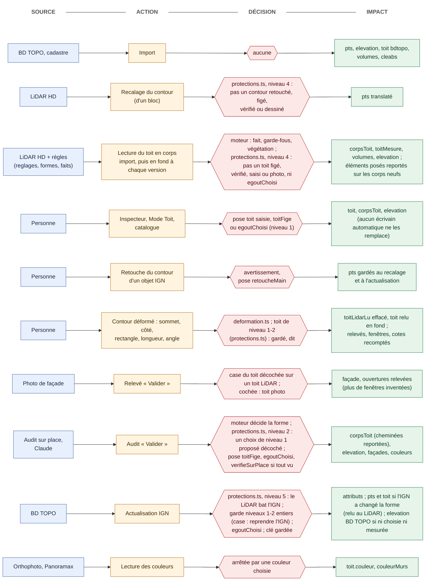
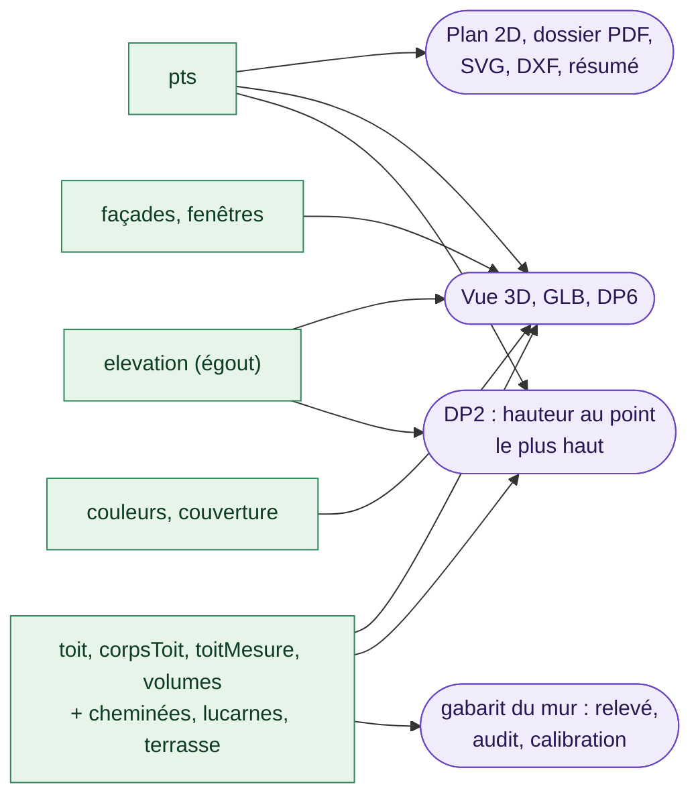
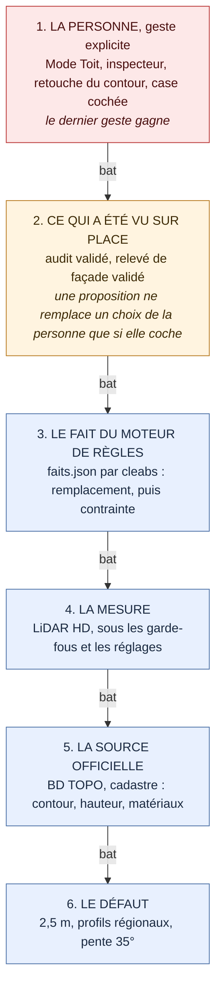

# Les ouvrages — un domaine par type d'objet, un contrôleur qui sait ce qui change

*Octobre 2026. Feuille de route d'architecture, phase 6. Décidé avec le propriétaire du projet le 27 octobre 2026 : « une terrasse
n'a pas les mêmes règles de construction qu'un chemin ».*

## Le constat

Un objet du plan est un `ObjetPlan` : une forme (`polygon`, `circle`, `path`) et une `fonction` (terrasse, piscine, pergola…). Ce
que la fonction donne à l'objet vit aujourd'hui en trois endroits :

- **un profil** (`model/fonctions.ts`) : les formes admises et les sections propres de l'inspecteur ;
- **des sous-objets** (`model/champsFonction.ts`, schéma 5) : `batiment`, `arbre`, `parasol`, `piscine`, `pergola`, `cloture` ;
- **des tests épars** : 90 comparaisons `fonction === '…'` réparties dans onze couches (33 dans `app/`, 16 dans `model/`, 12 dans
  `export/`, 7 dans `three/`…), et une centaine d'appels aux prédicats (`estTerrasse`, `estPiscine`…).

Les règles de construction, elles, sont rangées par moteur (`engine/structure.ts`, `layers.ts`, `bom.ts` pour la terrasse ;
`pergola.ts` pour l'abri ; `piscine/` ; `parasol.ts`) sans qu'aucun module ne dise : *voici ce qu'est une terrasse, voici ce
qu'est un chemin*. Pour ajouter un ouvrage (un jacuzzi qui n'est plus un « équipement », un carport qui n'est plus une pergola),
il faut retrouver tous les endroits qui comparent la fonction.

Deuxième constat, mesuré (banc du rendu, étape 2.2) : **le code ne sait pas quel objet a changé**. Une soixantaine de sites
écrivent directement dans les objets (gestes, inspecteur, commandes, préférences d'affichage, tâches de fond), et `render()` ne
prend pas d'argument. Le plan redessine donc ses 600 objets à chaque image, au téléphone 70 à 90 ms, alors qu'en conception un
seul objet bouge : celui qu'on dessine. « Si je fais une pergola, je ne fais pas une terrasse. »

## La cible

### 1. Un ouvrage par type, un registre par couche

Le test d'architecture impose des couches (`model` → `engine` → `core/render/three/export` → `ui` → `app` → `zones`) : un même
fichier ne peut pas porter le modèle d'une terrasse et son dessin 3D. Chaque couche a donc **son registre d'ouvrages**, un module
par type, rangé sous le même nom :

| Couche | Dossier | Ce qu'un ouvrage y déclare |
|---|---|---|
| modèle | `model/ouvrages/` | son identité (fonction, libellé), ses formes admises, ses sections, ses valeurs à la création, ses associés (la plage d'une piscine), ce qu'il perce (bassin, trémie), s'il occupe le sol, s'il s'isole |
| moteur | `engine/ouvrages/` | ses règles de construction : ce qui se calcule, ce qui se chiffre, ce qui se vérifie |
| plan | `render/ouvrages/` | ce que le plan dessine en plus de sa forme (couches de la terrasse, ombre du parasol, bassin) |
| 3D | `three/ouvrages/` | son volume dans la Vue 3D |
| inspecteur | `ui/champs/` (déjà par section) | ses sections propres, déclarées par l'ouvrage du modèle |

Les ouvrages, et leur famille de règles :

| Famille | Ouvrages | Règles de construction |
|---|---|---|
| **Construit, calculé** | terrasse | structure (cadre, solives, lambourdes, appuis), lames, nomenclature, prix, note de calcul |
| | pergola, carport | cadre suivant le contour, poteaux aux sommets, poutres ; mêmes règles, défauts différents |
| | piscine | bassin, terrassement, margelles, filtration, chiffrage |
| | parasol | mât, toile, ombre portée |
| **Bâti relevé** | bâtiment, annexe | toit (BD TOPO, LiDAR, corps), façades, relevé |
| **Surface simple** | dalle, chemin, massif, mobilier, équipement (jacuzzi) | une géométrie, une surface ou un linéaire, une matière ; pas de structure (« proche de la géométrie simple pour l'instant ») |
| **Ouverture** | trémie | perce la terrasse qu'elle chevauche |
| **Contexte** | terrain (parcelle, voisines), limite, arbre, point de vue, autre | ce qui situe le projet ; aucune règle de construction |

Un ouvrage absent ou inconnu (un ancien fichier) se comporte comme `autre`, comme aujourd'hui. **Aucun nombre ne bouge** :
chaque étape déplace des règles, elle n'en change aucune ; les empreintes de `tests/fixtures/golden/` le vérifient.

### 2. Un contrôleur des objets : le seul à dire « cet objet a changé »

`core/controleurObjets.ts` tient **une version par objet** (une `WeakMap` : un objet recréé — annulation, ouverture, import — n'a
pas de version, donc il est neuf) et une **version d'ensemble** :

- `toucher(obj)` : cet objet a changé. Le contrôleur touche aussi ce qui en dépend, d'après le registre des ouvrages : une
  piscine ou une trémie qui bouge touche la terrasse qu'elle perce.
- `toucherTout()` : on ne sait pas quel objet a changé ; tout est neuf. C'est le repli de toute écriture qui ne nomme pas son
  objet (`marquerModifie()` sans argument), donc le défaut sûr.
- `version(obj)` : la clé que lisent le dessin du plan et les calculs.

Les points de passage, d'après l'inventaire des écritures (27 octobre 2026) — huit couvrent l'usage courant :

1. le glisser (`interaction/pointeur.ts`, après `appliquerGlisser`) : `geste.obj` ;
2. l'inspecteur (`app/inspecteur.ts::appliquer`) : l'objet sélectionné, ou tous les chemins pour « appliquer à tous » ;
3. l'historique (`empiler`, `preparer`, `marquerModifie`) : un objet nommé s'il est passé, sinon `toucherTout()` ;
4. `rebuildHandles(obj)`, appelé après chaque édition structurelle (sommet ajouté, retiré, angle, longueur) ;
5. l'explorateur (`definirVisibilite`, `definirVisibiliteTous`) ;
6. la lecture des toits en tâche de fond (`redessinerObjets(cles)`, `apresLot`) ;
7. les décisions de l'audit (`appliquerPropositions`, qui rend ses clés) ;
8. la restauration (`historique.restaurer`) et l'import SVG : les objets sont neufs.

### 3. Le dessin du plan ne refait que ce qui a changé

`rendreObjets` garde, par objet, la clé de son dernier dessin : sa version, celle de ce qui le perce, et l'état d'ensemble qu'il
lit (cadrage et échelle, sélection, isolement, voisinage montré, pointage d'une cote, photo aérienne, thème). Clé inchangée : le
nœud SVG reste tel quel, sans un calcul. En conception, un rendu ne redessine que l'objet en cours.

### 4. Le garde-fou : la fumée vérifie chaque clé

Une clé fausse se verrait : un objet changé sans avoir été touché resterait dessiné à son ancienne place. En développement (le
serveur que joue la fumée), le plan **redessine quand même** les objets dont la clé n'a pas bougé et signale toute valeur qui
aurait changé (`[cle de version]` dans la console). La fumée fait échouer un point qui en produit. Un chemin d'écriture oublié
par l'inventaire se trouve donc par la fumée, pas par un client.

## La structure des ouvrages, de l'ouvrage à la géométrie

*Relevé dans le code le 27 octobre 2026.* Chaque ouvrage descend les couches dans le même ordre : **forme** (ce que l'objet est
géométriquement) → **modèle** (ses champs, sa fabrique) → **règles** (moteur) → **dessin** (plan, 3D) → **inspecteur** →
**exports**, et touche en bas des **primitives de géométrie** (`geometry/`). Ce qui suit est l'état d'aujourd'hui ; les étapes
6.3 et 6.4 rangent chaque ligne sous le nom de son ouvrage.

### Ce que tous partagent

| Couche | Commun à tout objet |
|---|---|
| forme | `polygon` (`pts`), `circle` (`center`, `r`), `path` (`pts`, `width`, `curve`) — `model/types.ts` |
| modèle | sous-objets par fonction en mémoire (`batiment`, `arbre`, `parasol`, `piscine`, `pergola`, `construction`, `cloture`), à plat dans le fichier (`model/champsFonction.ts`) |
| plan | le contour : `render/objects.ts::positionnerObjet` → `geometry/path.ts::polyStr` (polygone), `pathD` (chemin), `cx/cy/r` (cercle) ; le nom au `geometry/basic.ts::centroid` ; tout passe par `geometry/vue.ts::versEcran` |
| 3D | un prisme : `three/sceneObjets.ts::ajouterUnObjet`, hauteur `engine/hauteurs.ts::elevationOf` (défaut : `model/ouvrages/`), posé sur le sol ; le gazon s'arrête à l'emprise de ce qui `occupeLeSol` (`three/gazon.ts`) |
| inspecteur | Objet, Apparence ; Côtés, Coins, Alignement pour une forme à sommets (`ui/champs/objet.ts`) |
| exports | DXF (`export/dxfPlan.ts`), SVG et PDF du plan, résumé, dimensions du dossier PDF (`shoelace`, longueur × largeur) |

### Les champs que tout objet porte

`name`, `fonction`, `type` et sa géométrie ; `elevation` (hauteur en 3D) ; `locked` (verrou), `constrained` (l'objet reste dans
le contour de la parcelle : un geste qui l'en ferait sortir est refusé, `contourDeContrainte`), `priority` (ordre
d'empilement), `matiere` (texte libre) ; ce qui se montre : `showName`, `showSegNames`, `showVertNames`, `showDims`,
`showAngles`, `hidden` (préférences de l'explorateur) ; `fill`, `fillOpacity`, `stroke` ; `textureVerticale`,
`textureHorizontale` (textures Poly Haven, `TextureAppliquee`) ; noms des coins et des côtés, coins figés ; `bdtopo` et
`voisinage` pour ce qui vient de l'IGN.

### Arbre par ouvrage

**Terrasse** — construit, `polygon`
- modèle : `pts`, `construction` ; fabrique `creation.ts::nouvelleTerrasse` ; défauts `engine/construction.ts::ensureConstruction`
- règles : `engine/structure.ts::computeStructure` (cadre, solives, appuis `buildVisGrid`) → `layers.ts::computeTerrasseLayers`
  (lames `lames.ts::generateParallelLines`, rive) → `bom.ts::computeBOM`, `prix.ts`, `debit.ts`, `portees.ts` ;
  implantation `implantation.ts`, chantier `chantier.ts` ; hauteurs `hauteurs.ts` sur le sol `sol.ts::solSousEmprise` → `model/relief.ts`
- plan : couches `render/terrasseCouches.ts` ; trous par gabarit `render/objects.ts::percerContour`
- 3D : `three/sceneTerrasse.ts::construireStructureTerrasse`, `assise3d.ts`
- inspecteur : `ui/champs/construction.ts` ; exports : dossier PDF, cerfa, DP, DXF
- géométrie : `polygon.ts::polygonOffset`, `basic.ts::signedArea`, `shoelace`, `centroid`, `pointInPolygon`, `clipLineToPolygon`,
  `clipPolygonByConvex`, `difference.ts::differencePolygones`, `ringSegments`, `offsetZone`
- dépend de : **piscine** et **trémie** qui la percent (`objetsQuiPercent` → `contourOuverture`), **équipement** qui la renforce
  (`findSpaZones` → `offsetZone`), **terrain** (relief : hauteur des appuis), **parasol** qui lui est lié

**Pergola, carport** — construit, `polygon` ; mêmes règles, défauts différents (`ABRIS` : 4 × 3 m, 3 × 5 m)
- modèle : `pts`, `pergola` (toit, matériau, adossée, débord, hauteur, sections, entraxe) ; fabrique `creation.ts::nouvelAbri`
- règles : `engine/pergola.ts::calculerPergola` (poteaux par `polygonOffset`, poutres par `clipLineToPolygon`, angles par
  `lineLineIntersect`), `chiffrerPergola` ; passage du carport `PASSAGE_CARPORT_M` ; **note de calcul** (Eurocodes : neige,
  vent, bois ou aluminium) `engine/noteCalcul.ts`, inspecteur `ui/champs/noteCalcul.ts`, PDF `export/noteCalculPdf.ts`
- plan : `render/pergolaOverlay.ts` ; 3D : `three/pergola3d.ts` ; inspecteur : `ui/champs/pergola.ts` ; exports : cerfa
- dépend de : **terrain** (relief) seulement ; adossée, elle désigne un de ses propres côtés, pas un bâtiment

**Piscine** — construit, `polygon` ou `circle`
- modèle : `piscine` (implantation, structure, revêtement, plage, `terrasseKey`) ; fabrique `creation.ts::nouvellePiscine`
- règles : `engine/piscine/geometrie.ts` (`contourPiscine` : un cercle devient 48 côtés ; `elargir` = `polygonOffset` ; profil du
  fond, volume d'eau) → `calcul.ts::calculerPiscine` (margelles, plage, terrassement, filtration, distances aux limites, régime
  d'autorisation) → `chiffrage.ts`, `note.ts`
- plan : `render/piscineOverlay.ts` ; 3D : `three/piscine3d.ts` ; inspecteur : `ui/champs/piscine.ts` ; exports : `dossierPiscine.ts`
- géométrie : `polygonOffset`, `signedArea`, `shoelace`, `distancePointSegment`, `projectOntoSegment`
- dépend de : **terrasse** de plage (`piscine.terrasseKey`) ; elle **perce** toute terrasse qu'elle chevauche ; **terrain**
  (distances aux limites, relief)

**Parasol** — construit, `circle` (la toile)
- modèle : `parasol` (hauteur, mât déporté, angle, sur le périmètre, `terrasseLieeKey`) ; fabrique `creation.ts::nouveauParasol`
- règles : `engine/parasol.ts` — ombre `geometrieOmbre`, `ombreInstantanee` (soleil `geo/soleil.ts::positionSoleil`), cartes
  d'ombre et meilleure position, mât `positionMat`, `projeterSurPerimetre`
- plan : `render/parasolOverlay.ts` ; 3D : mât et toile `three/sceneObjets.ts::ajouterParasol` ; inspecteur : `sectionParasol`
- dépend de : **terrasse** (`terrasseLieeKey`, sinon celle qui le contient)

**Bâtiment, annexe** — bâti, `polygon` ; l'annexe est le bâtiment sous un autre nom
- modèle : `batiment` (toit, volumes, toit mesuré, corps, façades, fenêtres, couleur des murs), `bdtopo` ; import
  `geo/cadastreObjets.ts` ; toits `model/volumesToit.ts`, `model/toitMesure.ts`
- règles : `facade/toits/toitCorps.ts::reconstruireCorps`, `toitLidar.ts` ; façades `facade/ouvertures.ts`, `facade/profil.ts`
- 3D : `three/toitCorps3d.ts`, `toitMesure3d.ts`, `detailsBatiment.ts`, `releve3d.ts`, `cheminees3d.ts`
- inspecteur : relevé `ui/champs/facade.ts`, fenêtres, couleur des murs
- géométrie : `squelette.ts::squeletteDroit`, `faitage.ts::repereFaitage`, `facadeExterieure.ts`, `lineaire.ts`

**Chemin** — surface, `path` ; l'exemple d'un ouvrage « proche de la géométrie simple »
- forme : une polyligne ouverte d'au moins deux points (`pts`), une **largeur** (`width`, en mètres), une **courbe** (`curve`)
- modèle : fabrique `creation.ts::nouveauChemin` (deux points à 4 m, 1,20 m de large, droit) ; un tracé importé d'un SVG est un
  chemin (`io/importSvg.ts`) ; il occupe le sol parce qu'il a une largeur (`model/ouvrages/surfaces.ts`, `aUneLargeur`)
- règles : aucune — pas de structure ; sa surface est longueur du tracé dessiné × largeur, et sa largeur vaut 1 m quand le fichier
  n'en dit rien (`model/ouvrages/surfaces.ts` : `LARGEUR_CHEMIN_DEFAUT`, `largeurChemin`, `longueurChemin`, `surfaceChemin`)
- **la courbe** : avec `curve` et trois points au moins, le tracé passe par chaque point en Catmull-Rom uniforme, converti en
  Bézier cubiques (points de contrôle `p1 + (p2 − p0)/6` et `p2 − (p3 − p1)/6`, extrémités répétées) ; sinon une ligne brisée.
  Une seule définition, `geometry/courbe.ts` (`tronconsBezier`, `echantillonnerTrace`, `longueurTrace`)
- plan : un `<path>` sans remplissage, `d` par `geometry/path.ts::pathD(scène, pts, courbe)` (la courbe de `courbe.ts`), épaisseur de trait = largeur ×
  échelle : en 2D la largeur n'est qu'un trait, aucun contour décalé n'est calculé
- 3D : la même courbe échantillonnée (`geometry/courbe.ts::echantillonnerTrace`, 12 points par segment), élargie en ruban
  (`geometry/ruban.ts::ribbonChemin` : chaque côté décalé d'une demi-largeur, angles en onglet par `geometry/segments.ts::lineLineIntersect`, en
  biseau au-delà de 4 demi-largeurs), posé ou drapé sur le relief (`addRubanDrape`) ; le gazon s'arrête au même ruban
- inspecteur : longueur totale (du tracé dessiné), largeur (0,05 m au moins), « Courbe (passe par les points) », texture commune à tous les chemins
- exports : SVG et PDF du plan redessinent la courbe ; le DXF écrit la ligne brute (ni courbe, ni largeur) ; la surface (dossier,
  résumé, PDF) se compte sur le tracé dessiné : la courbe d'un chemin courbe (`longueurTrace`, 32 cordes par segment)
- géométrie : `courbe.ts`, `ruban.ts`, `path.ts::pathD`, `segments.ts::lineLineIntersect`, `basic.ts::dist`, `centroid`, `anneau.ts::sommetDe`
- dépend de : **terrain** (relief, pour le draper) ; d'aucun autre ouvrage

**Dalle, massif, mobilier** — surface, toute forme
- modèle : un objet générique ; les haies et la végétation de l'IGN arrivent en massif (`geo/cadastreObjets.ts`)
- règles : aucune ; 3D : le prisme commun ; exports : le dossier PDF les compte comme équipement posé sur la terrasse
- note : le type d'appui « dalle » et `empriseDalle` du moteur appartiennent à la **terrasse** posée sur dalle, pas à cet ouvrage

**Équipement (jacuzzi)** — surface, le plus souvent un `circle` (fabrique `creation.ts::nouveauCercle`)
- règles : il n'a pas de structure propre ; il **renforce la terrasse** qui le porte : `engine/structure.ts::findSpaZones` →
  `empriseEquipement` (32 côtés) + `offsetZone(marge)`, appuis de rôle `spa`, `portees.ts::porteeVisSpaM`
- géométrie : `offsetZone`, `centroid`, `pointInPolygon`

**Trémie (trou de terrasse)** — ouverture, `polygon` ou `circle`
- règles : `engine/structure.ts::contourOuverture` (un cercle devient 32 côtés), `objetsQuiPercent`, `trousDeTerrasse` ; une
  trémie entièrement dans la terrasse peut recevoir une rive (`layers.ts`, `safeOffset`)
- plan : le gabarit qui perce la terrasse ; 3D : le trou dans le prisme de la terrasse ; inspecteur : `sectionTrou`
- dépend de : la **terrasse** qu'elle chevauche

**Terrain (parcelle, voisines)** — contexte, `polygon`
- modèle : `key: 'parcelle'` ou fonction terrain ; porte `cloture` (`model/cloture.ts`), `relief` (`model/relief.ts`), `plu`,
  `cadastre`, `ortho`, `declaration`, `ruesVoisinage` ; voisines `voisinage: true` ; mitoyenneté `model/mitoyennete.ts`
- règles : le sol de tout le projet `engine/sol.ts::solDuRelief`, `solDuProjet`
- plan : clôture `render/cloture.ts`, courbes de niveau `render/relief.ts` → `geometry/isolignes.ts`, photo aérienne
  `render/ortho.ts` ; 3D : gazon, relief `three/relief3d.ts`, clôture `three/cloture3d.ts`
- inspecteur : parcelle, clôture, relief, voisinage, déclaration ; exports : DP, dossier mairie, cerfa, dossier piscine

*La clôture et le portail* (portés par la parcelle du projet, `model/typesCloture.ts`, `MD/spec-cloture.md`)
- forme : la clôture suit le **contour** de la parcelle, côté par côté ; un côté est repéré par son **numéro** (`cote`, l'indice
  de son premier sommet) et lu comme une façade vue de dehors (`facade/geometrie.ts::facadesDuContour`, `pointDeFacade`)
- modèle : `cloture` = `active`, un réglage par défaut (`ReglageCloture` : type palissade, grillage, haie, mur ; hauteur,
  couleur, soubassement), les côtés réglés à part (`cotes`), les **accès** (`portails`), les hauteurs maximales du PLU
- **le portail** (`Portail`) : `nature` portail ou portillon, `cote` (le numéro du côté), `x` (sa position en mètres depuis le
  bord gauche du côté vu de dehors, le repère des ouvertures de façade), `largeur`, `hauteur`, `ouverture` (un battant, deux
  battants, coulissant), `sens`, `refoulement`, `petitVantail`, `forme` (droit, chapeau de gendarme, chapeau inversé, bombé,
  concave) et sa `fleche`, `remplissage`, `materiau`, `couleur`, `texture`, `piliers`, `retrait`, `motorise`, `ouvert`
  (affichage seul) ; fabrique `model/cloture.ts::nouveauPortail`
- règles (`model/cloture.ts`) : le côté d'accès deviné à l'import (`coteDAcces`, `clotureDImport`, le côté sur rue
  `geo/coteRue.ts`), l'emprise de l'accès (`empriseAcces`) qui coupe la clôture en tronçons (`tronconsDuCote`), les vantaux
  (`vantauxDe`) et le profil du haut d'un vantail selon sa forme (`profilDuVantail`), les alertes (largeur, hauteur du PLU :
  `alertesAcces`, `alertesHauteur`), le portillon accolé au portail (`accolerPortillon`), la pose au clic (`poserAcces`,
  `coteLePlusProche`)
- plan : `render/cloture.ts::dessinerCloture` (tronçons et accès) ; geste : le portail se **glisse** le long de son côté ou
  sur un autre (`interaction/glisserAcces.ts::glisserAcces`, `interaction/pointeur.ts`)
- 3D : `three/cloture3d.ts::ajouterCloture3d` (tronçons, piliers, vantaux, ouverts ou fermés)
- inspecteur : `ui/champs/cloture.ts::sectionCloture`, `sectionPortails` ; audit de la parcelle : le portail se relève sur place
- géométrie : `facadesDuContour`, `pointDeFacade`, `geometry/segments.ts::projectOntoSegment`
- dépend de : la **parcelle**, par le numéro de ses côtés

**Limite** — contexte, `path` (les limites cadastrales, 0,12 m, verrouillées) : tirets sur le plan, rien en 3D, ligne au DXF
**Arbre** — contexte, toute forme : `arbre` (diamètre, couleur, essence), bibliothèque `model/especesArbre.ts`, 3D EZ-tree
`three/arbre3d.ts`, `three/ezTree.ts` ; ni règle ni dessin propre au plan
**Point de vue** — contexte, `path` de deux points (position, visée) : flèche sur le plan, il règle la caméra de la Vue 3D
**Autre** — le repli de toute fonction inconnue : le prisme et les sections communes

### Les champs propres, au complet

Ce que l'arbre ci-dessus ne nomme pas, relevé champ par champ (audit du 27 octobre 2026) :

- **Terrasse** (`construction`) : `segmentReference` (le côté qui donne le sens des lames, par son numéro), `sensPose`,
  `niveauFini`, `plotsDansEmprise`, `cotesSansRive` ; `bom`, le résultat enregistré qui porte les **prix réels** saisis ;
  les prix, le débit, le chantier, `echelleImplant` ; `lames3dFilaire` (préférence d'affichage de la Vue 3D rangée sur la
  terrasse courante) ; `vues3d`, déclaré et normalisé mais **lu par personne** (dormant).
- **Pergola, carport** (`pergola`) : `coteReference` (le côté, par son numéro, qui oriente les chevrons et le bas d'un
  appentis), `coteMur` (le côté adossé), `pente`, contrefiches, chevrons, couleurs, `longueursBois` ; `calcul` (hypothèses de
  la note), `prixMl`, `prixToile`, `prixCouverture`.
- **Piscine** (`piscine`) : `cotePetitBain` (le côté, par son numéro, du petit bain : il oriente le profil du fond), `fond`,
  profondeurs, `partFosse`, `hauteurHorsSol`, `margelle`, `largeurMargelle`, `largeurPlage`, `essencePlage`, filtration,
  traitement, chauffage, éclairage, sécurité, `local`, `distanceLocal`, couleurs, `prix`.
- **Bâtiment, annexe** (`batiment`) : `toitLidarLu`, `verifieSurPlace`, `toitFige`, `modeToit`, `profilFacades`,
  `toitACheval` (les **clés** des parcelles qu'il chevauche), `fenetres3d` (`mode`, `liste[].cote`) ; par façade relevée :
  `photoLocale` (clé d'une photo gardée sur l'appareil), `calage`, `calibration`, `corrections`, `grille`, `partieBasse`,
  `depuisAudit` ; par corps de toit : `saillie.hote` (rang d'un autre corps), `cheminees` (en coordonnées **absolues**),
  `lucarnes`, `elementsToit`, `terrasse.edicules.pts` ; `bdtopo.id` (le cleabs) est **son identité** : actualisation IGN,
  faits du moteur de règles (`regles/toits/faits.json`), audit.
- **Terrain, parcelle du projet** : le lieu (`latitude`, `longitude`, `nomLieu` : il règle le soleil, l'ombre des parasols,
  les profils de toits) ; `affichage` ; `voisinage3d` (murs, toits en corps — qui décide si les toits voisins se lisent au
  LiDAR —, vitres, clôtures des voisins, noms des rues) ; `gazon3d` ; `cadastre` (`idu`, `codeInsee`, `section`, `numero`,
  `adresse`, point d'adresse, `geometrieSource`, `idusCadastraux`, **origine** `origineLat/Lon` d'où se projettent la photo
  aérienne, le relief, le LiDAR et les rues) ; `relief` (`zRef` lu au centre de la terrasse courante, `paysage`, grille,
  `affichage` : courbes, équidistance, sol 3D) ; `plu` (point, secteur protégé `spr`, `servitudes`) ; la clôture côté par
  côté (`limite` rue ou séparative, `mitoyenne`, et le réglage : texture, lames, occultante, grillage, essence, épaisseur,
  taille, parement, couvertine) ; les anciens champs à plat de la clôture, tenus en phase (`synchroniserAnciensChamps`).
- **Arbre** : `arbre.texture` (ancien). **Point de vue** : `altitude` (hauteur de l'œil) ; l'ordre des deux points compte.

### Les dépendances entre ouvrages

```
PAR CLÉ (une référence enregistrée)
piscine ──terrasseKey (plage)──▶ terrasse        isolement des deux ensemble ; centrage de la piscine
parasol ──terrasseLieeKey──▶ terrasse            à défaut : celle qui le contient, puis la terrasse courante
bâtiment ──toitACheval.parcelles──▶ terrains     le toit à cheval sur deux parcelles
cote ──refObjKey, targetObjKey──▶ tout objet     (et un côté, un sommet par leur numéro)
audit, moteur de règles ──clé, cleabs, côté──▶ bâtiment, façade ; ils écrivent la clôture et les portails
copie d'un bâtiment ──bdtopo.id──▶ l'original    l'actualisation IGN lui redonne la géométrie de l'original

PAR GÉOMÉTRIE (calculé à chaque lecture)
piscine, trémie ──percent──▶ terrasse            deux définitions : objetsQuiPercent (margelle, dans les deux sens),
                                                 calculerPiscine (sommets du bassin dans la terrasse, un sens)
équipement ──renforce──▶ terrasse
terrasse ──pose le mât sur son bord──▶ parasol   à chaque rendu (contraindreParasols)
terrain ──relief──▶ terrasse, pergola, carport, piscine, chemin (hauteurs, drapé)
terrasse courante ──zRef──▶ relief               le zéro du plan se lit au centre de la terrasse
terrain ──limites, PLU (secteur protégé)──▶ piscine (distances, régime d'autorisation) ; clôture (hauteurs maximales)
terrain ──lieu──▶ parasol (soleil), façade au soleil, profils de toits
terrain ──origine──▶ photo aérienne, relief, LiDAR, rues
terrain ──contour──▶ tout objet `constrained`
terrain ──côtés (par numéro)──▶ clôture, portails, portillons ; côtés mitoyens, côté sur rue (adresse, rues)
côté sur rue, portail ──▶ placement d'un carport neuf
bâtiment ──▶ placement d'une terrasse ou d'une piscine neuve (façade au soleil, retrait)
bâtiment ◀──▶ bâtiments et parcelles voisines (mitoyenneté, profils de toits, corps lus au LiDAR)
terrains ──union──▶ emprise du calque (sol 3D, photo aérienne)
arbre ──essence──▶ bibliothèque d'essences ; tout objet ──texture──▶ Poly Haven
pergola, carport : aucun autre ouvrage
```

~~**Supprimer un objet ne nettoie rien** (`model/creation.ts::supprimer`) : la plage d'une piscine, le parasol lié, les cotes,
l'isolement, le toit à cheval et l'audit gardent une clé qui ne mène plus nulle part. Chaque flèche par clé doit dire ce que
devient la source quand la cible disparaît (étape 6.3).~~ — corrigé le 28 octobre 2026 : `model/ouvrages/index.ts::oublierLObjet`,
appelé par la suppression et par « Supprimer le voisinage ». Les cotes qui s'appuient sur l'objet partent avec lui ; chaque
ouvrage oublie ce qu'il en tenait (`Ouvrage.oublier`) : la piscine perd `terrasseKey` (comme une piscine dupliquée), le parasol
retombe sur la terrasse qui le contient (`terrasseLieeKey: null`), un toit à cheval perd la parcelle (à moins de deux, il n'est plus
à cheval). L'isolement est un état d'affichage, qui finit avec la sélection. L'audit garde ses clés : c'est le compte rendu d'une
visite (tests : `referencesContour.test.ts`, `creation.test.ts`).

Le contrôleur (étape 6.1) suit ces flèches : toucher une piscine, une trémie ou un équipement doit faire refaire la terrasse
qu'ils percent ou renforcent ; toucher le terrain (relief), tout ce qui pose sur le sol. Aujourd'hui une terrasse suit la version
de l'ensemble, le repli le plus simple ; l'étape 6.5 remplace ce repli par ces flèches.

### Ce que le relevé a trouvé à ranger

- ~~**La courbe est écrite quatre fois**~~ — rangé le 27 octobre 2026 : `geometry/courbe.ts` tient la courbe (tronçons de Bézier,
  échantillonnage, longueur du tracé), `geometry/ruban.ts` le ruban ; `pathD`, `exPathD`, `pdfPathD` et la 3D la lisent, à l'octet
  près (`tests/unit/geometry/courbe.test.ts` garde les anciennes copies comme oracle ; `plan.svg` et `plan.pdf` le vérifient aussi).
- ~~**La largeur par défaut d'un chemin n'est pas la même partout**~~ — décidé le 27 octobre 2026 : **1 m partout**
  (`model/ouvrages/surfaces.ts::largeurChemin`). Le dossier PDF et le dossier piscine lisaient 0,5 m. Version majeure.
- ~~**La surface d'un chemin courbe** se compte sur ses segments droits~~ — décidé le même jour : elle se compte sur la courbe
  dessinée (`surfaceChemin`), comme la longueur totale de l'inspecteur et du résumé. Version majeure ; les nombres qui bougent sur
  la démonstration sont dans `tests/fixtures/golden/EMPREINTES.md`.
- ~~**Les références par numéro de côté ou de sommet ne suivent pas un sommet ajouté ou retiré.**~~ — corrigé le 28 octobre 2026 :
  chaque ouvrage déclare ce qu'il range par côté, par sommet ou par abscisse le long d'un côté (`Ouvrage.suivreDeformation`,
  `model/ouvrages/*.ts`), et `model/contourDeforme.ts::suivreDeformation` le lui fait suivre, au geste (`core/deformation.ts`)
  comme à l'actualisation IGN (bâtiment, et parcelle : `parcelleRelue`). La correspondance des rangs et la règle des abscisses
  sont une fois pour tous dans `model/referencesContour.ts` (un test par référence : `tests/unit/model/referencesContour.test.ts`).
  Le tableau d'avant, barré ligne par ligne : `model/sommets.ts` tient en
  phase quatre tableaux (points, noms des coins, noms des côtés, coins figés) et rien d'autre. Aucune de ces références n'est
  renumérotée :

  | Référence | Ouvrage | Ce qui se passe, par exemple |
  |---|---|---|
  | ~~`cloture.cotes[].cote`, `portails[].cote`~~ | terrain | ~~un sommet ajouté sur le côté 1 met le portail du côté 3 sur l'ancien côté 2 ; un sommet retiré peut le faire tomber (`coteValide`)~~ — corrigé le 28 octobre 2026 : un côté réglé à part reste sur son mur (les deux parts d'un côté coupé le gardent) ; un portail reste à sa place, sur la part où il tombe (`model/ouvrages/contexte.ts`) |
  | ~~`construction.segmentReference`~~ | terrasse | ~~les lames tournent : **la nomenclature et le prix changent** sans que rien ne le dise~~ — corrigé le 28 octobre 2026 (`model/ouvrages/terrasse.ts`) |
  | ~~`construction.cotesSansRive`~~ | terrasse | ~~la rive change de côtés~~ — corrigé le 28 octobre 2026 : les deux parts d'un côté coupé restent sans rive |
  | ~~`pergola.coteReference`, `pergola.coteMur`~~ | abri | ~~les chevrons, le bas d'un appentis, le mur adossé sautent ; la DP titre l'élévation par ce côté~~ — corrigé le 28 octobre 2026 (`model/ouvrages/abri.ts`) |
  | ~~`piscine.cotePetitBain`~~ | piscine | ~~le petit bain change de bout : **volume d'eau, terrassement et prix changent**~~ — corrigé le 28 octobre 2026 (`model/ouvrages/piscine.ts`) |
  | ~~`batiment.facades[].cote`, `fenetres3d.liste[].cote`~~ | bâtiment | ~~un relevé passe sur un autre mur~~ — corrigé le 28 octobre 2026 (`model/ouvrages/bati.ts`, avant dans `contourDeforme.ts`) |
  | ~~cote : `refSegIndex`, `targetPtIndex`~~ | cotes | ~~une cote mesure le sommet voisin ; au-delà du dernier, plus rien~~ — corrigé le 28 octobre 2026 (`mesuresSuivent`) |
  | ~~audit : façades par côté, `cle#cote`, photos ; moteur de règles `facade:<cle>#<cote>`~~ | bâtiment | ~~même chose~~ — corrigé : l'audit retrouve son mur par la géométrie (`model/cotesAudit.ts`) |

  Trois autres gestes cassent ces références ou des positions :
  - **l'actualisation IGN** remplace les points d'une parcelle ou d'un bâtiment (un autre nombre de sommets) et garde par
    numéro la clôture, les façades relevées, les fenêtres, la couleur des murs ; elle remet les noms des coins et des côtés
    par défaut ; depuis le 27 octobre 2026, un bâtiment refait par « Actualiser le projet » garde la clé de l'ancien qui portait le
    même identifiant BD TOPO (`batimentsRecrees`) ; seul un bâtiment sans correspondant (dessiné, ou nouveau à la BD TOPO) prend
    une autre clé ;
  - ~~**raccourcir un côté** ne recale ni `Portail.x`, ni `OuvertureFacade.x`, ni `partieBasse`~~ — corrigé le 28 octobre 2026 : ce
    qui est posé à sa place sur le terrain (un portail, une fenêtre réglée une par une) y reste, borné au côté ; ce qui est lu sur
    l'image du mur (un relevé : ouvertures, partie basse, grille, largeur) suit en proportion, parce que la Vue 3D étire la photo sur
    le mur entier (`three/releve3d.ts`) et que l'échelle du relevé venait de la longueur du mur ;
  - ~~**déplacer ou tourner un bâtiment** laisse à l'ancienne place ce qui est en coordonnées absolues~~ — corrigé le 27 octobre
    2026 : un contour qui bouge d'un bloc (`geometry/deplacement.ts`) fait suivre à l'ouvrage ce qu'il porte
    (`Ouvrage.suivreContour`, `model/ouvrages/bati.ts` : corps, cheminées, édicules, volumes, faîtage ; la grille mesurée se
    translate, tournée elle part). Cela vaut pour un bâtiment dessiné : celui de l'IGN ne se déplace plus (section suivante).

    **Sa forme, elle, peut être retouchée, après un avertissement** (décision du propriétaire du 27 octobre 2026 : « Oui avec
    avertissement. Si IGN n'est pas bon. »). Tout geste qui déforme son contour (tirer un sommet, un côté ou le rayon, ajouter
    ou retirer un sommet, saisir un angle ou une longueur, le mode rectangle) demande d'abord, par le dialogue de confirmation :
    « « Maison » vient de l'IGN. La retoucher à la main la détache de l'IGN : à la prochaine actualisation, vous choisirez entre
    garder votre version et reprendre celle de l'IGN. Continuer ? » (`interaction/retoucheTerrain.ts`). « Annuler » : rien, aucun
    pas d'annulation. « Confirmer » : l'objet reçoit la marque `retoucheMain: { date }` (`model/retouche.ts`, enregistré dans le
    fichier), puis le geste a lieu ; pour un glisser, la question se pose à l'appui et la personne tire de nouveau. Marqué, il ne
    demande plus rien. À l'actualisation IGN (le dialogue « Actualiser depuis l'IGN » comme « Actualiser le projet »), un objet
    retouché est **gardé tel que la personne l'a laissé** (« ne plus autoriser la mise à jour IGN ») ; une case décochée par objet,
    « Reprendre la version de l'IGN pour « X », retouché à la main le JJ/MM/AAAA », le remplace par sa source, retire la marque
    et garde sa clé (« remplacer le bâtiment avec la source IGN »).

  Tiennent : le mode rectangle (même nombre, même ordre), `saillie.hote` (renuméroté par `facade/modeToit/saillies.ts` ; rangé sur
  les corps et non sur le contour, une déformation ne le touche pas, et la relecture le repose par `reporterSaillies`), les
  faits du moteur de règles (cleabs et azimut), le point de vue (deux points protégés). C'est le rôle même du contrôleur par
  ouvrage : **chaque ouvrage déclare ses références par côté, par sommet et en coordonnées absolues, et chaque geste les fait
  suivre par lui** (étape 6.3). Pour la terrasse, l'abri et la piscine, c'est un nombre qui bougeait sans raison : la
  correction se note `Corrigé`, et aucun nombre d'un fichier enregistré ne change.
- **Le bâtiment et l'annexe** se comparent encore à la main dans les exports (`'batiment' || 'annexe'`) : c'est le bâti, une
  famille, que le registre dit déjà (étape 6.4).

## Les objets posés sur le terrain réel

*Décidé avec le propriétaire le 27 octobre 2026.*

Ce qui vient du cadastre ou de l'IGN — la parcelle du projet, les parcelles voisines, les bâtiments et les éléments de l'IGN
(`model/fonctions.ts::estPoseSurLeTerrain` : l'objet porte `cadastre` ou `bdtopo`) — est à sa place réelle. Tout ce qui est
posé sur le terrain le lit à cette place :

| Ce qui lit la place réelle | Ce qui casserait si l'objet bougeait |
|---|---|
| l'actualisation IGN (parcelle par sa référence cadastrale, bâtiment par son identifiant IGN) | elle remettrait la géométrie réelle, ou garderait des données désalignées |
| la lecture des toits au LiDAR | elle lit les hauteurs à l'emplacement réel |
| la photo aérienne, le relief, les rues, le PLU | ils sont sur le terrain : **ils ne tournent pas** |
| le soleil, l'ombre des parasols, la façade au soleil | le nord réel |
| le voisinage, la mitoyenneté, le côté sur rue | les voisins ne s'aligneraient plus |
| l'audit sur place (GPS, photos de rue géolocalisées) | les façades visées ne correspondraient plus |

Les règles :

1. **Il ne se déplace ni ne tourne.** Le glisser à la souris et l'outil « Aligner » le refusent, en le disant
   (`MESSAGE_TERRAIN_REEL`, `interaction/pointeur.ts`, `interaction/outilAlignement.ts`). Un décalage se corrige par le
   recalage (LiDAR), pas à la main. La « remise à sa place de départ » reste permise : elle le ramène là où il était.
2. **Il se retouche, avec un avertissement**, parce que l'IGN peut se tromper. Le premier geste qui déforme son contour
   (tirer un sommet ou un côté, en ajouter, en retirer, changer un angle ou une longueur) demande : « « Maison » vient de
   l'IGN. La retoucher à la main la détache de l'IGN : à la prochaine actualisation, vous choisirez entre garder votre version
   et reprendre celle de l'IGN. Continuer ? ». Oui : l'objet est marqué « retouché à la main », avec la date, dans le fichier.
3. **À l'actualisation IGN, une question par objet retouché.** Par défaut, il est gardé tel quel : l'IGN ne le met plus à
   jour. Le dialogue montre une case décochée par objet, « Reprendre la version de l'IGN pour « X », retouché à la main le … » ;
   cochée, l'objet reprend la source IGN et perd sa marque — comme un bâtiment vérifié sur place, gardé sauf « Recalculer
   aussi ».
4. **Reprendre la source IGN ne crée pas un nouvel objet** : il garde sa clé, à laquelle tiennent les cotes, l'audit, les faits
   du moteur de règles et les réglages de la personne.
5. **Pas de vue tournée.** Tourner l'affichage seul (comme une carte sur la table) garderait tout juste ; proposé, écarté : le
   plan reste nord en haut.

## Le soleil et l'ombre

*Relevé dans le code le 27 octobre 2026.* Le soleil n'est pas un ouvrage, mais presque tout le plan en dépend : l'ombre des
parasols, la lumière et les ombres de la Vue 3D, le feuillage des arbres, le placement d'un objet neuf. Il n'a pas aujourd'hui
de composant à lui : il est réparti entre `geo/`, `engine/`, `three/`, `app/`, `ui/` et `util/`.

### Les repères

- Le plan : +x à l'est, +y au **nord réel** (un plan importé est projeté sur le plan tangent local, `geo/projection.ts`). Un plan
  dessiné à la main suppose le haut au nord : rien ne permet aujourd'hui de dire où est son nord.
- L'astronomie : l'azimut compte depuis le nord, dans le sens des aiguilles ; l'angle du mât d'un parasol (`matAngleDeg`) depuis
  l'est, dans l'autre sens.
- La 3D : +X à l'est, +Y en haut, le nord vers −Z (`three/primitives.ts::versLocalDepuis`).

### Le soleil lui-même

- **Une seule formule** (`geo/soleil.ts`) : `positionSoleil(année, mois, jour, heure, latitude, longitude)` rend la hauteur et
  l'azimut (déclinaison de Cooper, équation du temps approchée, sans réfraction) ; `leverEtCoucher` cherche minute par minute
  le premier et le dernier instant où le centre du disque est au-dessus de l'horizon (`null` au-delà des cercles polaires).
  Quatre modules l'appellent : `engine/parasol.ts`, `three/lumiere.ts`, `three/presentation.ts`, `app/boot/vitrine.ts`.
- **L'heure est l'heure légale française** (`decalageFuseauFrance`, heure d'été et d'hiver selon la règle européenne), quel que
  soit le lieu.
- **Le lieu** : la latitude et la longitude de la parcelle du projet (`model/lieu.ts::lieuDeParcelle`), posées à l'import du
  cadastre au centre de la parcelle ; à défaut, Le Vésinet (`LIEU_DEFAUT`).
- **La date et l'heure : trois soleils séparés**, aucun enregistré dans le projet :

  | Soleil | Où il vit | Par défaut | Ce qu'il éclaire |
  |---|---|---|---|
  | du plan | `etat.parasol` (`core/state.ts`) | le 21 juin de l'année du navigateur, 15 h | l'ombre des parasols sur le plan |
  | de la Vue 3D | `soleilVue3d` (`three/etat3d.ts`) | aujourd'hui (date UTC), midi | la lumière, les ombres, le ciel, le feuillage, l'horloge |
  | de la visionneuse GLB | `glb` (`three/etat3d.ts`) | aujourd'hui (date UTC), midi | la lumière du fichier relu |

  Les champs de date et d'heure sont des préférences d'affichage (`sale: false` : ni annulation, ni « projet modifié »).
  Seuls le lieu (sur la parcelle) et les réglages du parasol (hauteur, mât, terrasse liée) sont des données du projet.

  *Depuis le 28 octobre 2026 (étape 6.7)* : un seul soleil, `core/soleil.ts` (décrit dans `model/soleilProjet.ts`), pour les
  trois ; enregistré sur la parcelle (`soleil : { dateStr, minutes }`) une fois choisi ; par défaut aujourd'hui, date locale,
  15 h. L'intensité et la lumière d'appoint restent à chaque vue.

### Ce qui s'en sert

| Domaine | Où | Ce qu'il en fait |
|---|---|---|
| Plan 2D | `render/parasolOverlay.ts`, `engine/parasol.ts` | l'ombre du parasol à l'instant choisi ; la carte des heures d'ombre sur sa terrasse ; « Placer au mieux » |
| Inspecteur | `ui/champs/objet.ts::sectionParasol` | date, heure, afficher l'ombre, carte, meilleure position |
| Vue 3D, lumière | `three/lumiere.ts::reglerSoleil` | la lampe du soleil, son intensité (éteinte sous 10°), sa couleur (orange au couchant), la lumière d'appoint |
| Vue 3D, ciel | `three/rendu.ts` | couleurs du ciel, brouillard, éclairage d'ambiance |
| Vue 3D, ombres | `three/scene.ts`, `three/qualite.ts`, `three/sceneObjets.ts` | une carte d'ombres (1 024 à 4 096 px selon la qualité, coupée en « Économe ») dans un cadre d'environ 1,5 fois la parcelle |
| Arbres | `model/especesArbre.ts::arbreNu`, `three/arbre3d.ts` | un arbre caduc est nu de novembre à mars, selon la date de la Vue 3D |
| Heure dorée | `three/presentation.ts` | 50 minutes avant le coucher |
| Démonstration | `app/boot/vitrine.ts`, `three/soleilVitrine.ts` | la course du soleil animée, le disque, le couchant |
| Placement d'un objet neuf | `model/placement.ts::facadeAuSoleil` | la façade de la maison tournée vers le sud (un sud fixe), une piscine à 4 m « hors de son ombre » (une constante) |
| Photos de façade, de toit | `facade/vision/sansOmbres.ts`, `model/couleurMur.ts`, `model/couleurToit.ts` | les ombres de la photo sont retirées ou écartées par la seule image, sans modèle du soleil |
| Toits | `model/couleurToit.ts`, `facade/regles/toits/profils.ts` | la latitude (règles du sud de la France), pas le soleil |
| Exports | SVG, PNG, PDF, résumé, DXF | **aucune ombre** ; le GLB emporte ce que la 3D montre |

### L'ombre

- **Sur le plan, seul le parasol fait de l'ombre.** Sa toile est un disque à sa hauteur, au-dessus d'un sol plat : l'ombre est
  une ellipse (`geometrieOmbre` : décalée de h·cot(hauteur) à l'opposé du soleil, étirée de 1/sin(hauteur)), sous 8° il n'y en a
  pas. Ni bâtiment, ni arbre, ni pergola, ni mur, ni clôture, ni voisin ne fait d'ombre sur le plan ; le relief et la hauteur de
  la terrasse sont ignorés.
- **La carte des heures d'ombre** couvre la seule terrasse du parasol, ombrée par ses seuls parasols, sur une fenêtre fixe : le
  15 de mai à septembre, de 12 h à 18 h, en 2026 — et non la date et l'heure choisies, qui sont pourtant à côté. La recherche de
  la meilleure position prend les mêmes échantillons.
- **En 3D, tout fait de l'ombre et tout la reçoit** (bâtiments, toits, arbres, pergolas, parasols, terrasses, clôtures,
  voisins ; le sol la reçoit seulement), sauf les rues, la piscine et la clôture grillagée du voisinage, quand les ombres sont
  allumées et dans le cadre de la carte d'ombres.
- Géométrie : `geometry/basic.ts::pointInPolygon`, `shoelace`, `centroid` ; l'appartenance à l'ellipse est écrite deux fois dans
  `engine/parasol.ts`.

### Les dépendances

```
parcelle (latitude, longitude ; nord réel, posée sur le terrain) ──▶ le lieu ──▶ tout calcul du soleil
etat.parasol (date, heure) ──▶ ombre du parasol sur le plan
fenêtre fixe (mai–septembre, 12–18 h, 2026) ──▶ carte des heures d'ombre, meilleure position du parasol
soleilVue3d (date, heure, intensité, appoint) ──▶ lumière, ciel, ombres 3D, feuillage des arbres, horloge, heure dorée
glb (date, heure) ──▶ lumière de la visionneuse
parasol (rayon, hauteur, mât, terrasse liée) + terrasse ──▶ ombre 2D, carte, meilleure position
maison + sud fixe ──▶ placement d'une terrasse, d'une pergola, d'un parasol, d'une piscine neuve
latitude ──▶ couverture et profils des toits (pas le soleil)
```

### Ce qu'il faut ranger

Par ordre d'effet sur ce que voit la personne :

1. ~~**Trois soleils, trois défauts** : le même parasol a une ombre différente sur le plan et en 3D, et un projet rouvert ne
   retrouve pas son soleil ; la 3D change avec le jour où on l'ouvre (ombres et feuillage).~~ — corrigé le 28 octobre 2026 : un seul soleil
   (`core/soleil.ts`, décrit dans `model/soleilProjet.ts`), lu par le plan, la Vue 3D et la visionneuse, enregistré sur la
   parcelle (`soleil`) une fois choisi et relu à l'ouverture ; un projet sans soleil prend aujourd'hui, 15 h (étape 6.7).
2. ~~**La carte des heures d'ombre ignore la date et l'heure choisies** juste à côté d'elle, sans le dire.~~ — corrigé le 28 octobre 2026 : elle
   garde sa fenêtre (toute la saison, comme « Placer au mieux ») et le dit sous sa case : « Toute la saison, mai à septembre,
   12 h – 18 h, pas la date choisie » (`FENETRE_CARTE_OMBRE`).
3. ~~**Trois façons de dire « aujourd'hui »** : la date UTC (entre minuit et 2 h, la 3D montre la veille), l'année locale, la date
   locale.~~ — corrigé le 28 octobre 2026 : une seule, la date locale (`model/soleilProjet.ts::aujourdhui`), que la vitrine reprend.
4. **Le fuseau est toujours celui de la France**, faux outre-mer et à l'étranger ; les jours de changement d'heure, l'écart est
   choisi pour la journée entière.
5. **Un plan dessiné à la main n'a pas de nord** : soleil, ombres et façade au soleil supposent le haut au nord, sans le dire.
6. **Pas d'ombre des bâtiments, des arbres et des pergolas sur le plan** ; la carte n'existe que sur une terrasse qui a un
   parasol.
7. **Le 2D et la 3D divergent** : le parasol est un disque plat sur un sol plat en 2D, un cône posé sur le relief en 3D.
8. **Le placement « au soleil » suit un sud fixe** (pas de latitude, pas d'obstacle) ; « hors de l'ombre » de la piscine est
   une distance fixe.
9. **Lire le lieu écrit dans la parcelle** (`lieuDeParcelle` complète les champs manquants à chaque rendu) : une écriture que
   le contrôleur des objets ne voit pas.
10. ~~**La visionneuse GLB** éclaire à sa date mais garde le feuillage de la Vue 3D.~~ — corrigé le 28 octobre 2026 : elle n'a plus de date à elle ;
    lumière et feuillage suivent le soleil du projet.
11. **Des seuils de crépuscule épars** : 8° (ombre du parasol), 10° et 3° (lampe), 20, 6, −2 et −8° (ciel), 12, 0, −6 et −0,5°
    (démonstration), 0° (lever, coucher) ; ~~une astronomie simplifiée dont le commentaire dit « NOAA » à tort~~ ; la démonstration
    recalcule le soleil toutes les 250 ms à côté du calcul commun, et lit ses dates à la main. — corrigé le 28 octobre 2026, en partie : les seuils qui
    décident (ombre du parasol, extinction et plancher de la lampe, horizon) sont rangés dans `SEUILS_SOLEIL_DEG`
    (`model/soleilProjet.ts`) ; ceux du ciel et du couchant de la vitrine, de simples dégradés à l'œil, restent où ils sont ; le
    commentaire de `geo/soleil.ts` décrit la formule (Cooper, équation du temps approchée) au lieu de la NOAA. La démonstration
    reste à revoir.
12. **Le cadre des ombres 3D** s'arrête à environ 1,5 fois la parcelle : l'ombre longue d'un voisin lointain, au soleil bas, est
   coupée.
13. Les aperçus (façade, arbre, catalogue des toits) ont une lumière fixe : voulu, à dire.

**Décidé avec le propriétaire le 28 octobre 2026 :**

- **Un seul soleil, enregistré avec le projet.** Le plan, la Vue 3D et la visionneuse lisent le même lieu, la même date et la
  même heure ; elles s'enregistrent dans le fichier et reviennent à la réouverture. Les changer reste un réglage d'affichage :
  ni annulation, ni « projet modifié », permis en lecture seule — comme « Relief » et « Courbes de niveau », qui marquent
  pourtant le projet à enregistrer, pour qu'on les retrouve. Un même parasol a la même ombre sur le plan et en 3D.
- **Pas d'ombre des bâtiments, des arbres ni des pergolas sur le plan** : la Vue 3D les montre ; le plan garde l'ombre des
  parasols.
- **Pas de nord réglable** pour un plan dessiné à la main : le haut du plan reste le nord.

Reste à décider, sans urgence : le fuseau (celui du lieu plutôt que la France). La carte des heures d'ombre garde sa fenêtre fixe,
dite à l'écran (étape 6.7, 28 octobre 2026) : un parasol se place pour la saison, pas pour un jour.

## Les toits dans l'audit de la parcelle

*Relevé dans le code le 28 octobre 2026 (worktree `w68`, commit `a236c1e4`), en lecture seule : rien n'a été exécuté.* L'audit de la
parcelle ne dessine jamais un toit : il collecte des indices (photos, « Ce que je vois », Claude), les confronte au LiDAR dans
l'arbitrage des sources, et ce qu'il propose est un toit **relu sur la mesure** par le moteur des toits, tenu au fait du bâtiment
s'il en a un. Cela tient en quatre couches : la capture (`app/audit/parcelle/`), ce que Claude lit et répond (`src/regles/sujets/`,
`deploy/`), l'arbitrage et la relecture (`app/audit/parcelle/arbitrages.ts`, `facade/regles/toits/faits.ts`), l'écriture
(`regles/decisions.ts`, `validation.ts`).

### Les repères

- **Un bâtiment** se désigne par sa clé du plan (`o.key`, la `cle` de la liste de contrôle). Trois identités coexistent : la clé
  (capture, propositions, fichier d'audit), `bdtopo.id` (la clé gardée à l'actualisation IGN, `actualisationIgn.ts::batimentsRecrees`)
  et `bdtopo.cleabs` (les faits, `regles/toits/faits.ts::cleDuBatiment`, et la reprise d'un fichier dans un autre projet,
  `app/audit/cas.ts:51`).
- **Une façade** se désigne par le **rang de son côté** dans le contour (`cote`, `model/auditParcelle.ts:9`), comme un relevé ; rien
  ne la rattache à son mur par la géométrie.
- **Le sens du faîtage** du moteur est un azimut (0 = nord, sens horaire, modulo 180, `facade/regles/toits/faits.ts::azimutDe`) ;
  celui de Claude et de « Ce que je vois » est relatif à la rue (`parallele-rue`, `perpendiculaire-rue`) — la rue n'est pas dans le
  calcul.
- **Une façade se nomme par sa normale** (`facade: { azimutDeg }`) dans un fait ; dans l'audit, par son orientation et son côté
  (« est (côté 3) », `liste.ts::etiquetteFacade`).
- **Le corps principal** est le plus grand (`plusGrand`) : c'est lui que « la forme du toit » décrit, partout.

### Le parcours

**1. La capture** (`app/audit/parcelle/`, rien n'entre dans le projet, tout vit dans le brouillon local)

| Ce qui est pris | Où | Ce qu'il porte pour le toit |
|---|---|---|
| Liste de contrôle | `liste.ts` | les bâtiments **de la parcelle seulement** (les voisins restent en scène, hors liste) ; chaque façade, sa largeur, `hauteurMur` (LiDAR, corps compris) ; les murs mitoyens et courts n'ont rien à photographier |
| Façade visée | `reconnaissance.ts`, `viseeFacade.ts` | reconnue par GPS (`positionFiltree.ts`) et boussole (`capteursPrise.ts`), ou **choisie** (touchée en 3D, prise dans la liste) |
| Vue de prise | `vuePrise.ts`, `vueAudit.ts` | épurée (bâtiments de la parcelle et sol) ; une façade choisie fixe la vue : élévation devant elle (`poseFace`), orbite sur l'axe du bâtiment, ni zoom ni inclinaison ; « verrouiller un bâtiment » ne vaut que sur l'écran de prise (`vueAudit.ts::batimentsDeLaVue`) |
| Photos de façade | `capture.ts`, `controleur.ts` | chacune avec sa prise (`PhotoCas.prise` : position, azimut, inclinaison, source de l'azimut) |
| Photos du toit | `BatimentCapture.photos` | depuis la rue, rangées sur le bâtiment |
| « Ce que je vois » | `model/ceQueJeVois.ts` | `forme`, `sensFaitage`, `bouts`, `lucarnes`, `appentis`, `cheminees`, `terrasse`, `couverture` ; `toitVu` décide si le toit compte comme vu |

**Ce que Claude reçoit** (`entreesAnalyse.ts::preparerDemande`, trois passes identiques, `PASSES_ANALYSE = 3`) : par bâtiment
photographié, au plus 40 images (`IMAGES_PAR_REQUETE`, testé égal à celui de `deploy/analyse-fonctions.php:42`) — photos de façade
réduites, **le rendu de la façade de face** (`three/renduPrise.ts`, entière, du pied au haut du toit, **seul le bâtiment visé** et
le sol : `gardesDuRendu(e, b.cle)`, `entreesAnalyse.ts:142-145`, `:202`), photos du toit, orthophoto recadrée, carte LiDAR ; puis un
texte : indices LiDAR chiffrés (`indicesLidar`), le modèle actuel en JSON compact (`modeleCompact` : corps, faîtage, égouts,
croupes, nombre de pignons, cheminées, terrasse), les mesures du téléphone, « Ce que je vois » en clair.

**Ce qu'on lui demande** (`deploy/prompt-analyse.md` v9, `deploy/schema-analyse.json` v5, **générés** depuis
`src/regles/sujets/descriptions/` par `npm run regles:generer`) : pour le toit, le sujet `formeToit` (`forme` parmi 22 formes du
catalogue, `profil`, `faitage.sens` relatif à la rue, `bouts.gauche/droite`), et pour chaque façade sa `silhouette` (`triangle`,
`trapeze`, `rampe`, `ligne-droite`, `marches`, `plusieurs-sommets`) et son `bout` (`pignon`, `croupe`, `demi-croupe`, `brisis`,
`sans-objet`) ; « lire les pignons d'abord » : la forme et les bouts se déduisent des silhouettes. Plus `cheminees`, `lucarnes`,
`terrasse`, `couverture`, `ecarts` (rendu contre photo). Le serveur (`deploy/analyse.php`) choisit le modèle par usage, pose le
schéma dans le prompt système (`promptAvecSchema`), conforme la sortie au schéma (`conformer`), plafonne par organisation ; le
brouillon d'Admin › Règles ne part qu'avec `essai: "brouillon"`. Une quatrième réponse d'un modèle plus fin tranche les attributs
sans unanimité (`escalade.ts`, D20).

**2. La réponse devient une décision**

```
vote des passes (app/regles/sujets/vote.ts, model/analyseClaude.ts::voter)
   │
   ├─▶ sujets (app/regles/sujets/, registre SUJETS)  ── formeToit.proposer → corpsSousContrainte
   │      └─▶ lignes « claude » : JETÉES pour corpsToit, corpsDuToit, couverture, cheminees, lucarnes, appentis, materiauMurs
   │          (validation.ts:406, :413) ; formeToit.observer reste (« Forme du toit vue… », observationsClaude.ts)
   │
   └─▶ constats (constats.ts, constats/mesures.ts, constats/vus.ts) : une valeur par source et par attribut
          ign (forme BD TOPO), lidar (forme des corps, lecture des formes, bouts, azimut, silhouette de chaque mur),
          photo (silhouette lue sur la photo), claude (forme, bouts, silhouette et bout de chaque façade), terrain (« Ce que je vois »)
          │
          ▼  arbitrage (facade/regles/reconciliation.ts, poids et seuils de regles/reconciliation.json)
          formeToit, boutsToit, sensFaitage, silhouetteFacade par mur, hauteurTotale, lucarnes, cheminees, appentis, couverture
          │   décision auto | manuelle | choisie | forcée ; « rien » quand le projet a déjà la valeur
          ▼  propositions (arbitrages.ts::propositionsDesArbitrages)
```

| Proposition | Fonction | Relecture sur la mesure | Porte du fait | Écrit |
|---|---|---|---|---|
| Forme simple du corps principal | `arbitrages.ts::propositionToit` (:259) | `corpsSousObservation` → `corpsSousContrainte` (un fait synthétique en contrainte), refusée si l'écart du principal dépasse `ECART_FORME_SIMPLE_MAX_M` = 0,8 m (`formeToit.ts:29`, :62-70) ; pignons traversants des murs (`avecTraversants`, `pignonTraversant`) | `corpsProposesSousFait` (:282) | `{ corpsToit: corps }` (tous les corps) |
| Forme du catalogue (Mansart, demi-croupes, papillon…) | `arbitrages.ts::propositionForme` (:174) | `lireForme(…, { souple })` : vue par le LiDAR, seuils de la lecture des formes ; demandée par Claude, la photo ou la personne, jusqu'à `ECART_FORME_DEMANDEE_M` = 1,2 m (`regles/toits/formes.json:24`) | `corpsProposesSousFait` (:181) | `{ corpsToit }` |
| Un corps autre que le principal | `arbitrages.ts::propositionCorps` (:304) | `meilleurCorpsSelonObservation` direct (pas `corpsSousContrainte`), ≤ 0,8 m (:325) | `corpsProposesSousFait` (:331) | `{ corpsDuToit: k, toit }` |
| Hauteur totale (bâtiment sans corps) | `propositionHauteurTotale` | — | — | `{ hauteurToit }` |
| Cheminées, lucarnes, appentis ouvert/fermé | `propositionCheminees`, `propositionLucarnes`, `propositionAppentis` | posées sur le plus grand corps en pente (`corpsDesCheminees`), lucarnes réparties (`lucarnesSurLeCorps`) | — | `cheminees`, `lucarnes`, `appentis` |
| Couverture | `propositionCouverture` | — | — | `{ couverture }` sur `toit` |
| Toiture-terrasse | `propositions.ts::propositionTerrasse` et sujet `terrasse` (Claude) | — | — | `terrasse` (D21 : la note sur place l'emporte) |

Le fait du bâtiment (`regles/toits/faits.json`, lu par `faitDuBatiment` sur `cleabs`) ne se combine pas avec l'observation : il
**filtre** (`facade/regles/toits/faits.ts::corpsProposesSousFait`, :301) — en remplacement, rien ne se propose ; en contrainte, une
proposition qui ne le tient pas (`ecartsAuFait`) tombe. Les seuils de la relecture sont ceux de `regles/toits/reglages.json`
(`SEUILS_TOITS`) et de `regles/toits/formes.json` ; ceux de l'arbitrage, de `regles/reconciliation.json`. Aucune décision n'écrit
`faits.json`.

Une ligne arrive cochée si toutes ses décisions sont automatiques et qu'elle n'a ni réserve ni choix remplacé
(`regles/decisions.ts::cocheeParDefaut`, :140) ; « choix remplacé » pour un toit veut dire `toit.source === 'saisie'`, et rien
d'autre (`constats.ts:37`, `:45`).

**3. La validation**

- **L'écran** (`zones/parcours/PropositionsAudit.tsx`) : lignes par bâtiment, groupe « Toit » (`corpsToit`, `corpsDuToit`,
  `hauteurToit`, `couverture`, `cheminees`, `lucarnes`, `appentis`, `terrasse`), l'onglet « Sources » (arbitrages, retenir un
  groupe, forcer une valeur : `validation.decider`), les observations de Claude.
- **L'avant / après** (`validation.ts::apercuDe`) : `regles/decisions.ts::projetApres` copie les objets visés (copie de surface, le
  sous-objet `batiment` aussi) et y applique les lignes cochées ; la Vue 3D montre « Avant » et « Après » côte à côte
  (`three/comparaison3d.ts`). Le plan n'est pas censé être touché (mais voir « Ce qu'il faut ranger », 5).
- **L'admin** (Admin › Audits, « Avant / Après ») : `commande.ts::consulter` (:233) ouvre une session à part, sans analyse ni envoi ;
  `validation.figer` (:558) remplace le calcul par les propositions du fichier et leurs décisions ; lecture seule, « Valider » n'écrit
  rien, le pied n'a que « Retour aux audits ».
- **« Valider »** (`validation.ts::valider`, :520) : `pushHistory()` (un pas d'annulation, `core/historique.ts::empiler`, qui
  appelle `toucherTout()` : tout le plan est neuf pour le contrôleur des objets), `appliquerPropositions` modifie les objets en
  place, puis `render()` et la Vue 3D rebâtie ; les bâtiments dont tout est photographié, le toit vu et aucune ligne décochée
  sont marqués `verifieSurPlace` (`propositions.ts::verifications`, `decisions.ts:352`). La décision est notée dans la capture
  (`capture.noterDecision`). Ctrl+Z défait l'écriture dans le projet.
- **Pas de `toucher(o)`** : ni la validation ni l'application automatique des relevés (`alimenterLesFacades`) ne nomment leurs
  objets ; c'est le repli de l'historique (`toucherTout`) qui fait tout redessiner.

### Les dépendances

```
LiDAR HD (toitMesure, corps lus) ──▶ constats lidar ──┐
BD TOPO (toit.forme, hauteur) ─────▶ constats ign ────┤
photo de façade (silhouette) ──────▶ constats photo ──┤
Claude (forme, bouts, silhouettes) ▶ constats claude ─┼─▶ arbitrage (reconciliation.json) ─▶ observation (forme, bouts, azimut)
« Ce que je vois » (forme, bouts) ─▶ constats terrain ┘                                         │
                       (sensFaitage noté : aucun constat)                                        ▼
toitMesure + corpsToit du projet ─────────────────────────────────▶ corpsSousContrainte / lireForme / meilleurCorpsSelonObservation
regles/toits/reglages.json, formes.json, silhouettes.json ─────────▶ seuils de la relecture
regles/toits/faits.json (par cleabs) ──────────────────────────────▶ corpsProposesSousFait : filtre, ne combine pas
                                                                                                 │
                                                                                                 ▼
                                    proposition { corpsToit | corpsDuToit | cheminees | lucarnes | appentis | couverture }
                                                                                                 │ cochée, « Valider »
                                                                                                 ▼
                     batiment.corpsToit remplacé (toit, toitFige, modeToit, toitLidarLu inchangés) ; verifieSurPlace si tout vu
                                                                                                 │
        ┌────────────────────────────────────────────────────────────────────────────────────────┤
        ▼                                                                                        ▼
relecture LiDAR (toitsDepuisLidar, toitsFond) :                                actualisation IGN (toitsEtMurs.ts) :
  saute toitFige et verifieSurPlace ; retoucheMain lu, pas recalé               garde toitFige, verifieSurPlace, retoucheMain ;
  écrit pts, elevation, corpsToit…                                              clé gardée par bdtopo.id (batimentsRecrees)
Mode Toit (toitFige) ─────▶ l'audit le lit comme un choix (forme proposée décochée) ; une validation de toit le pose aussi
déplacement d'un bloc (Ouvrage.suivreContour, model/ouvrages/bati.ts) : corps, cheminées, volumes et grille suivent ;
  tournée, la grille part (toitMesure = null) et l'audit ne propose plus de toit sur ce bâtiment
retouche d'un sommet (retoucheMain) : le toit reste sur l'ancien contour ; les façades de l'audit suivent leur mur (cotesAudit.ts)
```

### Ce qu'il faut ranger

Par ordre d'effet sur ce que voit la personne :

1. ~~**Un toit décidé par l'audit n'est pas protégé.** La validation écrit `corpsToit` sans toucher `toit.source`, sans `toitFige`,
   et ne marque `verifieSurPlace` que si tout le bâtiment est vu (`propositions.ts:202-214`). Or la relecture ne saute que
   `toitFige` et `verifieSurPlace` (`toitsLidar.ts:264-270`, `:386` ; `toitsFond.ts:144-160`) : à la prochaine ligne de
   `LECTURES_TOITS`, ou à une actualisation qui relit, les corps validés sont remplacés en silence, et avec eux les cheminées,
   lucarnes et appentis ouverts écrits sur ces corps. Une relecture déjà en vol l'écrase aussi : `toitsFond.ts:137`, l'empreinte qui
   protège une écriture concurrente, ne compte que `pts` et `toit`, pas `corpsToit`.~~ — corrigé le 28 octobre 2026 : la validation coupe les « Règles » (`toitFige`) de tout bâtiment dont elle écrit le toit (`regles/decisions.ts::EFFETS_DU_TOIT`, `appliquerPropositions`), et l'empreinte de `toitsFond.ts` compte les corps, la hauteur et les marques (`tests/unit/app/toits/toitsFond.test.ts`, « ce que la relecture laisse tel quel »).
2. ~~**L'audit ne voit pas un toit retouché en Mode Toit.** Le Mode Toit pose `toitFige` (`app/toits/modeToit.ts:265`, `:465`) ; rien
   dans `app/audit/`, `app/regles/` ni `facade/regles/` ne le lit, et le « choix remplacé » d'un toit n'est que
   `toit.source === 'saisie'` (`constats.ts:37`, `:45`). Une décision automatique remplace donc le toit fait à la main, **cochée par
   défaut** et sans le dire.~~ — corrigé le 28 octobre 2026 : `toitChoisiALaMain` (`constats/cibles.ts`) : saisi ou figé, le toit est un choix ; sa forme proposée arrive décochée, « forme du toit saisie » (`tests/unit/app/audit/parcelle/toitDecide.test.ts`).
3. ~~**Valider la forme du toit efface ce que portait le corps principal.** Le corps relu sort neuf de `corpsImpose`
   (`facade/toits/toitCorps/ajustement.ts:239-250`, via `meilleurCorpsSelonObservation`) : ses `cheminees`, `lucarnes`, `terrasse`,
   `ouvert` disparaissent (`decisions.ts:285`). Dans la même validation, les cheminées sont placées sur l'ancien corps
   (`souchesSurLeCorps(c, …)`, `arbitrages.ts:204-208`) puis écrites après la forme (`RANG_EFFET`, `decisions.ts:330`) : leurs
   positions absolues ne suivent pas un faîtage qui a tourné. Pas de test (non vérifié à l'écran).~~ — corrigé le 28 octobre 2026 : `facade/regles/toits/elementsVus.ts::reporterElements` reporte cheminées, lucarnes, terrasse et appentis ouvert sur les corps relus, là où ils tiennent ; chaque élément proposé porte sa place sur la forme proposée (`apresForme`, `app/audit/parcelle/apresForme.ts`), prise quand la forme est écrite avec lui (`tests/unit/facade/regles/toits/elementsVus.test.ts`, `toitDecide.test.ts`).
4. ~~**Un bâtiment de l'IGN retouché à la main n'est protégé que de l'IGN.** L'actualisation le garde entier
   (`actualisationIgn/toitsEtMurs.ts:47`, `:72-80`), mais la relecture LiDAR ne connaît pas `retoucheMain` : elle relit son toit sur le
   nouveau contour et, sur la parcelle du projet ou un mitoyen, peut **recaler** (translater) le contour retouché
   (`toitsLidar.ts:428-431`, écrit par `toitsFond.ts:130`, `CHAMPS_LUS = ['pts', 'elevation']`). Entre la retouche et cette
   relecture, le toit reste sur l'ancien contour (rien ne remet `toitLidarLu`). Et les façades de l'audit, rangées par rang de côté,
   glissent d'un mur quand un sommet est ajouté ou retiré : photos, mesures et relevés vont au mur voisin
   (`model/fichierAuditParcelle.ts:156-160` le reconnaît sans réapparier). Non vérifié en exécution.~~ — corrigé le 28 octobre 2026 : la relecture ne recale plus un contour retouché et n'en écrit plus `pts` ; la capture garde le contour de ses façades (`BatimentCapture.contour`) et les recale par la géométrie à la réouverture (`model/cotesAudit.ts`, `controleur.ts::facadesSurLesMurs`), ce qui suit aussi Ctrl+Z. Restent rangés par rang : les relevés du projet (`batiment.facades`), les cotes et les réponses de Claude (l'analyse se dit « à relancer ») ; et rien ne remet `toitLidarLu` après une retouche.
5. ~~**L'aperçu écrit dans le projet** (hors toit, même chemin d'écriture) : l'effet `detailsOuvertures` modifie en place le relevé
   qu'il trouve (`decisions.ts:265-268`), et la copie de surface de `projetApres` partage ce relevé avec le plan. Cocher une ligne de
   détails sans son relevé change donc le projet, sans Ctrl+Z ni « projet modifié » — y compris dans la consultation en lecture
   seule de l'admin. Pas de test de pureté de `projetApres` sur cet effet (`tests/unit/regles/decisions.test.ts:168-185`).~~ — corrigé le 28 octobre 2026 : l'effet `detailsOuvertures` remplace le relevé au lieu de le modifier, `projetApres` ne touche plus le plan ; la validation nomme ses objets (`toucher`) après son pas d'historique (`tests/unit/regles/decisions.test.ts`, `validation.test.ts`, consultation comprise).
6. **La consultation de l'admin n'a ni « Sources » ni observations** : `figer` pose `arbitrages: []` et `observations: []`
   (`validation.ts:565`) ; les arbitrages ne se lisent que sous chaque ligne. L'avant / après n'est donc pas tout à fait « l'écran des
   propositions ».
7. **Le sens du faîtage noté sur place ne compte pas.** `constatsTerrain` (`constats/vus.ts:148`) lit `forme` et `bouts`, pas
   `sensFaitage` : la note rend le toit « vu » (`toitVu`) et part à Claude en texte, mais n'entre dans aucun arbitrage (seul
   `candidatFait.ts:48-54`, côté promenade, sait la convertir en azimut par la photo). De même `faitage.sens` de Claude ne sert
   qu'à une ligne d'observation (`formeToit.ts:141-149`) : on demande à Claude un attribut que rien ne décide.
8. **Un toit dont `modeToit` est choisi (`simple`, `volumes`, `mesure`) ne montre pas la décision** : `modeToitActif`
   (`model/toitMesure.ts:324-336`) ne passe aux corps qu'en mode automatique ; l'avant / après est identique et la ligne s'écrit quand
   même.
9. **Code mort, et testé.** Les propositions des sujets `formeToit`, `couverture` et `cheminees` sont calculées à chaque calcul
   (la relecture sur la mesure comprise, `formeToit.ts:95-128`) puis jetées (`validation.ts:406`, `:413`) : `propositionsDeClaude`
   n'a pas d'autre appelant. Elles restent testées (`tests/unit/app/regles/sujets/formeToit.test.ts:37`,
   `silhouettes.test.ts:48`) et comptées comme « proposeurs » par Admin › Règles (`app/administration/chaineVivante.ts:52`,
   `ecranRegles.ts:60`).
10. **La même lecture écrite deux fois, différemment.** La forme de Claude se traduit par `FORMES_LUES` dans le sujet
    (`formeToit.ts:22` : `asymetrique`, `toit-en-m`, `shed` → aucune proposition) et par `formeArbitree` dans les constats
    (`constats/cibles.ts:29` : `asymetrique` et `toit-en-m` → `deux-pans`, `shed` → `appentis`) ; un toit en M, deux corps, devient
    un deux-pans d'un seul corps. Les silhouettes des murs passent par `observationDesSilhouettes` dans le sujet (`formeToit.ts:99`)
    et dans les constats (`constats/vus.ts:51-52`).
11. **Des seuils hors des réglages, et qui ne se répondent pas.** `ECART_FORME_SIMPLE_MAX_M = 0.8` est écrit en dur dans
    `app/regles/sujets/formeToit.ts:29`, copie de `ECART_MAX_M` (`regles/toits/reglages.json`) sans y être lié ni vu par
    `tests/unit/regles/toits/reglages.test.ts` (qui ne lit que les modules nommés dans `reglages.json`) ; une forme du catalogue
    « demandée » passe jusqu'à 1,2 m (`ECART_FORME_DEMANDEE_M`) ; `TOLERANCE_SENS_DEG = 15` en dur (`facade/regles/toits/faits.ts:31`) ;
    `PAN_CLAUDE` range un pan `cote` en `rue` (`constats/cibles.ts:41`) ; `ECART_HAUTEUR_MIN_M = 0.1` (`propositions.ts:37`).
12. **La porte du moteur n'est pas la même pour tous.** CLAUDE.md dit qu'une décision passe par `corpsSousContrainte` ; c'est vrai du
    corps principal, pas d'un corps secondaire (`meilleurCorpsSelonObservation` direct, `arbitrages.ts:324`) ni d'une forme du
    catalogue (`lireForme`, `:179`). Tous passent ensuite par `corpsProposesSousFait`, qui filtre mais ne réapplique pas le fait
    (ses pignons ou ses appentis ne sont pas reposés sur un corps secondaire relu).
13. **Une décision défaite reste notée.** Ctrl+Z restaure les objets, pas la capture : `noterDecision` (`capture.ts:142`) garde les
    lignes « acceptées », que le fichier d'audit et le corpus rediront (non vérifié à l'écran).
14. **Trois identités pour un bâtiment** (clé, `bdtopo.id`, `cleabs`) ; la reprise d'un fichier préfère la clé à l'identifiant
    BD TOPO (`fichierAuditParcelle.ts:332-342`) : dans un autre projet de la même parcelle, une même clé peut désigner un autre
    bâtiment (non vérifié).
15. **Docs en retard.**
    - `MD/architecture.md:492-494` : « every audit roof proposal goes through `corpsProposesSousFait` » et « two sources propose » —
      pour le toit, une seule propose (l'arbitrage), l'autre est jetée ; `:575` : « the fit exceeds 0.8 m » — 1,2 m pour une forme du
      catalogue demandée.
    - `CLAUDE.md:155` : « le rendu pour Claude se dessine sur la scène épurée avec tous les bâtiments de la parcelle » — le rendu
      d'une façade ne garde que son bâtiment (`entreesAnalyse.ts:142-145`, `:202`, ce que dit le prompt v4) ; même phrase dans
      `vueAudit.ts:34-36`.
    - `app/regles/sujets/lucarnes.ts:1-2` : « le projet ne sait pas les écrire » — l'arbitrage les écrit (`arbitrages.ts:384`).
    - `propositionsClaude.ts:6-8` range « la forme du toit » parmi ce que les sujets proposent.
16. ~~**Tests manquants** : l'audit face à `toitFige` ; la survie d'une décision de toit à une relecture ; une retouche suivie d'une
    relecture LiDAR ; les cheminées et lucarnes du corps principal après une décision de forme ; la pureté de `projetApres`.~~ — corrigé le 28 octobre 2026 : les cinq tests sont écrits avec les corrections 1 à 5.
17. **L'écriture ne nomme pas ses objets** (`toucherTout` par l'historique, `validation.ts:529`, `:375`) : juste, mais tout le plan se
    redessine ; à ranger avec l'étape 6.1 du contrôleur des objets.

## Le flux de construction d'un bâtiment

*Relevé dans le code le 28 octobre 2026 (worktree `w68`, commit `445e5899`), en lecture seule : rien n'a été exécuté.* Un
bâtiment n'a pas d'auteur unique. Neuf sources écrivent dans le même objet, chacune quelques champs, à des moments différents :
la création, l'import IGN, la lecture LiDAR (à l'import, puis en tâche de fond), le moteur de règles, le Mode Toit,
l'inspecteur, le relevé de façade, l'audit de la parcelle et l'actualisation IGN. Ce qui arbitre entre elles n'est pas un
composant : ce sont quatre marques posées sur l'objet (`toitFige`, `verifieSurPlace`, `retoucheMain`, `toit.source`) et une
version (`toitLidarLu`), lues chacune par une partie des écrivains seulement.

**Depuis le relevé** (PR #468 et #469, fusionnées le 28 octobre 2026) : une décision de toit validée par l'audit pose `toitFige` ;
l'audit propose décoché ce qui remplacerait un toit fait à la main ; valider une forme reporte cheminées, lucarnes, terrasse et
appentis sur les nouveaux corps ; un contour retouché n'est plus recalé par le LiDAR ; les façades de l'audit retrouvent leur mur
par la géométrie ; la DP2 donne le point le plus haut ; le relevé ne coupe plus la lecture LiDAR sans le dire ; les fenêtres
automatiques quittent les murs relevés ; la couverture survit à l'actualisation ; le faîtage et l'appentis ouvert sont protégés ;
un mur en L garde les corps. Les tableaux ci-dessous le disent, point par point, dans « Ce qu'il faut ranger ». **La règle qui
arbitre est décidée** (« Qui l'emporte », 28 octobre 2026) ; son module unique est en cours (étape 6.3).

### Les repères

- **Un bâtiment** est un polygone de fonction `batiment` (ou `annexe`) : `model/ouvrages/bati.ts::BATIMENT`, particularité
  `releve`, élévation par défaut 2,5 m. `estBatiment` (`model/fonctions.ts:55`) vaut pour les deux ; la lecture LiDAR, elle, ne
  prend que `batiment` (`app/toits/toitsLidar.ts:265`).
- **Ce qu'il porte** : à plat sur l'objet, `pts`, `elevation` (la hauteur à l'égout, celle du prisme), `bdtopo`, `retoucheMain`,
  `fill` ; dans le sous-objet `batiment` (`model/typesFonctions.ts:13-79`), `toit` (la forme simple), `volumesToit`, `toitMesure`,
  `corpsToit` (cheminées, lucarnes, terrasse, appentis, bow-windows sont **dans** les corps), `toitLidarLu`, `toitACheval`,
  `modeToit`, `toitFige`, `verifieSurPlace`, `facades` (relevés), `fenetres3d`, `couleurMurs`, `profilFacades`.
- **Trois identités** : la clé du plan (`bati-<id>`, `geo/cadastreObjets.ts:335`), `bdtopo.id` (la clé gardée à l'actualisation)
  et `bdtopo.cleabs` (les faits du moteur, `regles/toits/faits.ts:339`).
- **Un mur** se désigne par le rang de son côté dans `pts` (`cote`) : relevés, fenêtres réglées une par une, façades de l'audit,
  cotes. Un corps a ses propres murs, numérotés dans `corps.pts`.
- **Les hauteurs** : `elevation` est l'égout (sol → égout, la `hauteur` de la BD TOPO) ; `toit.hauteur` est la montée du faîtage
  au-dessus de l'égout ; un corps porte ses hauteurs en absolu (`egouts`, `faitage`, depuis le sol).

### Le corps : définition et règle de découpe

**Définition.** Un corps est **un rectangle du bâtiment qui porte un toit à lui** : une maison, une aile, une annexe, un
appentis, une tourelle. Un bâtiment en L, en T ou en U n'a pas un toit mais plusieurs ; chacun a son faîtage, ses égouts, parfois
sa hauteur. Le corps est la brique du toit : tout ce qui se pose sur un toit appartient à un corps.

| Ce qu'un corps porte (`CorpsToit`, `model/typesToit.ts:71`) | Sens |
|---|---|
| `pts` | le rectangle, quatre sommets : `pts[0]→pts[1]` suit le faîtage (la longueur), `pts[0]→pts[3]` la largeur |
| `posFaitage` | la place du faîtage dans la largeur, depuis le côté `pts[0]-pts[1]` ; 0 ou la largeur : un appentis |
| `faitage`, `egouts: [e0, e1]` | hauteurs **absolues**, depuis le sol : le faîtage, l'égout de chaque pan ; faîtage = égouts : plat |
| `croupes`, `bouts` | ce qui ferme chaque bout : pignon (deux pans) ou croupe (quatre pans) |
| `pignons` | les pignons qui partent du faîtage, le long d'un mur |
| `cheminees`, `lucarnes`, `elementsToit`, `terrasse` | ce qui est posé sur lui : souches, lucarnes, fenêtres de toit et panneaux, toiture-terrasse |
| `profil`, `bords`, `speciale`, `ouvert`, `saillie`, `baie` | profil des pans, débords, toit de révolution, appentis ouvert, élément posé sur un mur d'un autre corps, bay window |
| `ecart` | l'écart quadratique moyen à la mesure LiDAR : ce que la lecture a su expliquer |

Les corps **se chevauchent** par construction : une aile qui pénètre la maison a son toit entier, le plus haut l'emporte en 3D, et
les noues naissent de leur rencontre. Le **corps principal** est le plus grand : il porte la porte d'entrée, donne la forme du
bâtiment (`model/formeToit.ts`) et c'est lui que remplace une forme du catalogue (Mansart, gambrel, berceau…).

Un corps n'est **pas** un volume (`volumesToit`, l'ancienne lecture : un rectangle et un toit simple, `estime`), ni la forme simple
`toit` du bâtiment (un seul toit sur tout le contour). Ce que la 3D montre se décide une fois (`model/toitMesure.ts::modeToitActif`) :
le mode choisi, sinon les corps, sinon les volumes, sinon le toit simple.

**Qui découpe.** Seule la lecture LiDAR découpe un bâtiment en corps, et seulement sur la parcelle du projet et ses mitoyens (le
voisinage garde un toit par bâtiment, sauf « Toits en corps et pignons », coché par défaut) :
`app/toits/toitsLidar.ts::corpsLus` → `facade/toits/toitCorps.ts::reconstruireCorps`. À la main, le Mode Toit ajoute, retire,
tourne ou duplique un corps ; un fait du moteur de règles impose le corps principal (`corpsSousContrainte`). Un bâtiment dessiné
sans LiDAR n'a pas de corps.

**La règle de découpe**, dans l'ordre (seuils de `regles/toits/reglages.json`, lus par le code, entrés dans
`VERSION_LECTURE_TOITS` : en changer un relit les toits déjà lus) :

1. **Mise à l'équerre** (`model/volumesToit.ts::decomposerEnRectangles`) : le contour est tourné dans l'axe de son plus long côté ;
   chaque côté à moins de **15°** (`TOLERANCE_DEG`) de l'équerre y est ramené. Les **décrochés de moins de 1,2 m**
   (`SEUIL_DECROCHE_M`) sont lissés : un ressaut, un conduit, un perron ne font pas un corps.
2. **Rectangles maximaux** (`couvertureRectangles`) : sur la grille des abscisses et ordonnées du contour, chaque rectangle tout
   entier dedans qu'aucun autre ne contient, du plus grand au plus petit, autant qu'il en faut pour tout couvrir. On renonce si le
   contour n'est pas rectiligne, si l'équerre change l'aire de plus de 15 %, ou si un rectangle fait moins de **1,5 m** de large
   (`LARGEUR_MIN_M`). Une maison rectangulaire donne un rectangle (`rectanglesDuContour`).
3. **Coupe aux marches** (`model/toitMesure.ts::decouperParHauteurs`) : un rectangle est recoupé là où la couverture mesurée
   saute d'au moins **0,8 m** (`SEUIL_MARCHE_M`) **d'un coup** — 1,6 fois plus que sur le mètre voisin : un pan raide monte
   partout, une marche d'un seul coup. Deux coupes au plus par rectangle ; un bloc fait au moins **1,5 m** (`LARGEUR_BLOC_MIN_M`).
   Une aile dont plus de **la moitié** est sous un rectangle plus grand (`PART_SOUS_PLUS_GRAND`) n'est pas coupée si son toit
   entier tient la mesure : ses « marches » sont les pentes du toit qui la couvre.
4. **Refonte** (`refondre`) : deux morceaux redeviennent un seul corps si le toit lu sur le rectangle entier fait presque aussi
   bien — un écart au plus **1,15 fois** celui des morceaux (`TOLERANCE_REFONTE`), **1,6 fois** si un morceau fait moins de 3 m
   (`TOLERANCE_BANDE`, `LARGEUR_BANDE_M`) — et toujours s'il n'y a **aucune marche** à la coupe (saut médian sous **0,6 m**,
   `CONTINUITE_M`). Un corps ne se coupe pas sans raison.
5. **Coupe par le modèle** (`meilleureCoupe`, deux fois au plus) : à l'inverse, un rectangle sans marche devient deux corps si
   deux toits simples expliquent la mesure nettement mieux qu'un — l'écart tombe aux **deux tiers** (`GAIN_COUPE`), il valait au
   moins 25 cm, et les deux toits diffèrent d'au moins 60 cm. Un pignon n'est pas un corps : ses mesures n'y comptent pas.
6. **Le toit de chaque corps** (`ajusterCorps`) : chaque sens et chaque place du faîtage, tous les 25 cm, murs compris (un
   appentis) ; ce qui dépasse le pan de plus de **40 cm** est écarté (pignon, arbre, lucarne). Pente au plus 60°, égouts au moins
   1,5 m ; moins de **30 cm** de montée ou moins de **3°** : plat (`HAUTEUR_PLAT_M`, `PENTE_PLAT_DEG`) ; un faîtage à moins de
   **1 m** d'un mur (`PAN_MIN_M`) : un appentis. Puis les **pignons** (la mesure dépasse le pan de 80 cm le long d'une façade, sur
   1,5 à 6 m) et les **croupes** (gardées si l'écart tombe à 0,8 fois celui des pignons de bout).
7. **Bandes recouvertes** (`sansBandesRecouvertes`) : un corps de moins de **3 m** de large dont plus de **90 %** est sous les
   autres est retiré — c'était un morceau du toit voisin. Un corps plus large reste, même recouvert.
8. **Contour de biais** (`corpsDeReprise`) : quand l'équerre échoue, le contour est ramené en marches dans l'axe qui aligne le plus
   de côtés, découpé en tranches, puis chaque corps avance ses côtés libres pour couvrir le contour (complétion, avec trois
   garde-fous : au moins 10 % du contour sans toit devant lui, pas d'égout sous 2 m, la mesure à sa hauteur). En dernier recours,
   un seul corps sur la boîte orientée.
9. **Après la découpe** : la forme du catalogue remplace le corps principal si elle explique mieux la mesure
   (`facade/regles/toits/catalogue.ts::corpsCalcules`), le fait du bâtiment s'impose (`corpsSelonFait`), et un corps dont l'égout
   dépasse la BD TOPO de plus de 3 m est écarté comme végétation (`corpsVraisemblables`).

La découpe de référence est **AE 101** (2 allée des Limites, Le Vésinet) : quatre corps sous ses faits ;
`npx tsx .claude/skills/toits/scripts/identite.ts` vérifie qu'elle ne bouge pas. Le détail des seuils, avec leurs cas, est dans
`MD/spec-toit-ign.md` §11 et §13 et dans le skill `toits` (§3).

**Ce que la découpe ne dit pas** (à relier au « Qui l'emporte ») : un corps n'a pas d'identité propre — il est rendu par sa place
dans `corpsToit`, et une lecture rend une liste neuve. Ce qui était posé sur un ancien corps (cheminées, lucarnes, terrasse) n'a
donc pas d'adresse stable : c'est le point 3 des « toits dans l'audit de la parcelle » (corrigé à part) ; pour la relecture LiDAR,
la même question reste à vérifier.

### 1. La naissance

| | Dessiné à la main | Importé (BD TOPO) |
|---|---|---|
| Geste | un polygone (`model/creation.ts::nouvelObjet`, fonction `autre`, rectangle si les quatre sommets sont gelés), puis « Fonction › Bâtiment » | « Nouveau plan depuis une adresse » → `geo/cadastreObjets.ts::objetBatiment` (:321) |
| `pts` | ceux du dessin, contraints à la parcelle (`constrained: true`) | l'anneau BD TOPO projeté, en sens horaire, simplifié si demandé (`geo/apiIgn.ts::anneauVersPts`, :141) ; jamais contraint |
| `elevation` | absente : 2,5 m par défaut (`engine/hauteurs.ts:101`) | `hauteurBatiment` (`geo/bdtopo.ts:30`) : la hauteur BD TOPO, sinon étages × 2,7 m, sinon 2,5 m |
| `toit` | absent (un bloc plat) ; créé `source: 'saisie'` au premier réglage de l'inspecteur ou du Mode Toit (`ui/champs/facade.ts:33`, `three/gestesToits.ts:250`) | `toitBdTopo` (`model/toitBdTopo.ts:50`) : deux pans dans l'axe d'un rectangle allongé, croupes sinon ; hauteur = altitude max − min du toit ; plat sous 0,5 m ou 10° ; `source: 'bdtopo'`, `estime` sans altitudes |
| `volumesToit` | — | sur la propriété : `volumesParDefaut` (`model/volumesToit.ts:290`) |
| `bdtopo` | — | `id`, `cleabs`, hauteurs, altitudes, étages, matériaux des murs et du toit, `surParcellePrincipale`, `recupereLe` (:339-354) |
| Verrou | non | `locked` hors de la propriété (:337) |

À l'import, dans l'ordre (`app/cadastre/importCadastre.ts:735-746`) : couleur des toits sur l'orthophoto, forme des toits au
LiDAR (les 30 plus proches), couleur des murs sur Panoramax, relief. Le reste des toits se lit à l'ouverture, en tâche de fond.

### 2. Le contour

| Geste | Bâtiment de l'IGN | Bâtiment dessiné | Ce que le toit fait |
|---|---|---|---|
| Glisser, aligner (tourner) | refusé, `MESSAGE_TERRAIN_REEL` (`interaction/pointeur.ts:210`, `interaction/outilAlignement.ts`) | permis | suit : `suivreLeContour` → `Ouvrage.suivreContour` (`model/ouvrages/index.ts:42`, `model/ouvrages/bati.ts:11-32`) translate et tourne corps, cheminées, édicules, volumes, `angleFaitage` ; `toitMesure` translaté, **effacé** s'il tourne |
| « Réinitialiser la position » | permis (`app/ecouteurs/objets.ts:117-133`) | permis | suit |
| Tirer un sommet ou un côté, en ajouter, saisir un angle ou une longueur | après la question de retouche (`interaction/retoucheTerrain.ts:26-28`, `app/inspecteur.ts:118`) : pose `retoucheMain` (`model/retouche.ts:27`) | permis sans question | se relit : à la fin du geste, un toit lu au LiDAR redevient à lire (`toitLidarLu` effacé) et la tâche de fond le refait sur le nouveau contour en reportant ce qui était posé dessus ; un toit protégé reste, et un message le dit (`core/deformation.ts`, `model/contourDeforme.ts`) |
| Rectangle (quatre sommets gelés) | — | coin ou côté tiré redimensionne (`interaction/drag.ts:117-131`) | se relit, comme ci-dessus |
| Recalage LiDAR | translation d'un bloc si plus de 12 % de vide sous le contour (projet et mitoyens, `toitsLidar.ts:73-88`) ; écrit `pts` (`toitsFond.ts:130`, `CHAMPS_LUS`) | id., s'il est lu (voir 4) | les corps sont relus ensuite sur le contour recalé |
| Actualisation IGN | `pts` remplacés par la BD TOPO du jour (`app/cadastre/actualisationIgn.ts:298`) | supprimé et recréé par « Actualiser le projet » s'il est sur la parcelle (`:164-169`, `:194`) | voir 9 |

Les relevés et les fenêtres, rangés par rang de côté, suivent un déplacement d'eux-mêmes ; depuis le 28 octobre 2026, un sommet
ajouté ou retiré recompte leurs rangs, et ceux des cotes du plan (une cote dont le point visé est retiré part avec lui) ;
l'actualisation IGN les range par la géométrie sur le contour du jour (`model/contourDeforme.ts`, qui reprend
`model/cotesAudit.ts::correspondanceDesCotes`). Le relevé posé sur un mur qui a changé de longueur s'étire, ses ouvertures gardent leur
cote depuis la gauche et celles qui sortent sont omises (`three/releve3d.ts:306-322`).

### 3. Les hauteurs

| Hauteur | Écrite par | Où |
|---|---|---|
| `elevation` (égout du prisme) | import : hauteur BD TOPO | `geo/cadastreObjets.ts:334` |
| | LiDAR : l'égout mesuré (10e centile) ou celui de la forme ajustée, s'il s'écarte d'au moins 0,3 m et reste entre 2 et 40 m | `facade/regles/toits/vraisemblance.ts:66-69`, `toitsLidar.ts:367-370` |
| | fait en remplacement : son égout | `toitsLidar.ts:137` |
| | inspecteur « Élévation » | `ui/champs/objet.ts:115` |
| | audit : « Hauteur à l'égout » (photos, Claude, LiDAR arbitrés) | `regles/decisions.ts:270`, `app/audit/parcelle/arbitrages.ts:92` |
| | actualisation IGN : hauteur BD TOPO, à chaque fois | `actualisationIgn.ts:302` |
| `toit.hauteur` (faîtage au-dessus de l'égout) | BD TOPO, LiDAR (forme ajustée), inspecteur (`source: 'saisie'`, `ui/champs/facade.ts:335-340`), audit « Hauteur totale » (`decisions.ts:271`) | |
| égouts et faîtage d'un corps | LiDAR (`reconstruireCorps`), fait, Mode Toit (poignées), audit (corps relus) | `corpsToit` |
| murs d'un volume, d'un corps | dérivés : `hauteurMurMesuree`, `hauteursMursCorps` | lus, jamais saisis |
| hauteur mesurée sur une photo de façade | **dite, pas appliquée** : « le bâtiment garde x m » | `app/releve/releve.ts:121-128` |

En mode corps, la 3D monte chaque prisme à l'égout de son corps (`three/sceneObjets.ts:316-320`) : `elevation` ne s'y voit plus,
mais reste celle que lisent l'inspecteur, les relevés, la DP2 et l'audit.

### 4. Le toit automatique

**La chaîne** (`app/toits/toitsLidar.ts::toitsDepuisLidar`, :380 ; le détail des règles est dans le skill `toits` §2-§3) :

1. **Qui est lu** : `toitAAjuster` (:264-270) — fonction `batiment`, pas `toitFige`, et un toit absent, `bdtopo` ou `lidar` ;
   puis `admis` (:386) écarte `verifieSurPlace` (sauf `verifies: 'relire'`). Rien ne demande `bdtopo` : **un bâtiment dessiné
   dans un projet géolocalisé est lu aussi**, en tâche de fond, comme un voisin. Une `annexe` ne l'est jamais.
2. **Un fait en remplacement** pose le toit sans rien lire, LiDAR ou pas (`toitDuFait`, :132-142) : corps et forme du fait,
   `toitMesure`, `volumesToit`, `toitACheval` effacés, `elevation` = son égout.
3. **Lecture** de la grille MNH sous le contour (`lireSous`, :306) ; `toitLidarLu` posé dès que le service a répondu, même sans
   mesure (:420).
4. **Recalage** d'un bloc, pour le projet et les mitoyens (:428-432).
5. **Sous les seuils du profil** du bâtiment (`avecSeuilsToit`, `facade/regles/toits/profils.ts`), `poserLeToit` (:339-372) :
   la forme simple ajustée (`facade/toits/toitLidar.ts::ajusterToit`, sous le fait en contrainte : `ajusteSelonFait`), écartée
   si c'est un houppier ; sur la propriété, `toitMesure` (`model/toitMesure.ts::toitMesureDepuisGrille`), `volumesToit`
   (`volumesDepuisLidar`) et `corpsToit` (`corpsLus`, :118-121) ; chez un voisin, les corps seuls (calcul allégé hors
   mitoyens), `toitMesure` gardé chez le mitoyen ; la question « à cheval » (`toitAChevalApresCalcul`, :102).
6. **`corpsLus`** = `corpsCalcules` (pentes droites `facade/toits/toitCorps.ts::reconstruireCorps`, puis formes du catalogue
   `facade/regles/toits/catalogue.ts:46`) → `corpsSelonFait` (fait en contrainte : `corpsSousContrainte`, pignons, appentis,
   bay windows ; `facade/regles/toits/faits.ts:170`, :309) → `corpsVraisemblables` (végétation).
7. **Écriture** : `toit` remplacé par la forme ajustée en gardant `couleur`, `origineCouleur` et `couverture` (`avecCouleurDe`,
   :124-127) ; `elevation` (point 3) ; `toucher(o)`.

**Le moteur de règles** ne s'appelle pas à part : il est dans cette chaîne. Réglages (`regles/toits/reglages.json`, lus à chaque
appel par `S.NOM`), formes (`regles/toits/formes.json`), profils (aucun livré), faits par `cleabs` (`regles/toits/faits.json` : un
seul, AE 101, en contrainte). Rien de l'application n'écrit ces fichiers.

**Ce qui déclenche une relecture** :

| Déclencheur | Effet | Où |
|---|---|---|
| Une ligne de `LECTURES_TOITS`, ou des empreintes de réglages, faits ou formes qu'aucune ligne ne connaît | `VERSION_LECTURE_TOITS` monte : tout bâtiment marqué plus bas redevient à lire | `toitsLidar.ts:209-249` |
| L'ouverture du plan, un import, une actualisation, « Reprendre » | `toitsFond.relancer()` : les bâtiments éligibles non lus, du plus proche au plus loin | `app/boot.ts:85`, `app/boot/chargements.ts:88`, `:108`, `app/ecouteurs/toitsFond.ts:18` |
| Une actualisation IGN qui relit un bâtiment | `toitLidarLu: null` | `actualisationIgn.ts:307` |
| « Règles » rallumées (Mode Toit) | `toitLidarLu`, corps, volumes, mesure, mode effacés ; `saisie` redevient `bdtopo` | `three/gestesToits.ts:374-382` |
| Faits d'essai (`?regles=local`) | relecture, marque `MARQUE_ESSAI_FAITS` | `toitsLidar.ts:255-259`, `app/boot/branchementToits.ts:25` |

La tâche de fond lit une **copie** et ne la reporte que si `pts` et `toit` n'ont pas bougé (`toitsFond.ts:137`, :148) ; elle écrit
`pts`, `elevation` et `toit`, `toitMesure`, `volumesToit`, `corpsToit`, `toitACheval`, `toitLidarLu` (:130-132), ou la seule marque
pour un bâtiment vérifié (:133, :150-156). Hors historique : Ctrl+Z ne la défait pas.

### 5. Le toit à la main

| Chemin | Ce qu'il écrit | Marque posée |
|---|---|---|
| Inspecteur, mode « Un seul toit » : forme, hauteur du faîtage | `toit.forme`, `toit.hauteur` | `toit.source = 'saisie'` (`ui/champs/facade.ts:316`, :339) |
| Inspecteur : direction du faîtage | `toit.angleFaitage` | **aucune** (:358-360) |
| Inspecteur : couverture (couleur), matériau | `toit.couleur` (retire `origineCouleur`), `toit.couverture` | l'absence d'`origineCouleur` (:371-376) ; rien pour le matériau (:139-142) |
| Inspecteur : « Toit en 3D » | `modeToit` | — (:261) |
| Inspecteur : appentis ouvert ou fermé | `corps.ouvert` | **aucune** (:164-171) |
| Inspecteur : éléments de façade (bow-window, galerie) | `corpsToit` (saillie) | `toitFige` (:186-189, :225, :230) |
| Mode Toit (Vue 3D, `app/toits/modeToit.ts`) : poignées, catalogue (`three/gestesToits.ts::appliquerPiece`), cheminées, lucarnes, édicules, corps neufs, tourner, dupliquer | `corpsToit`, `toit`, `modeToit`, `volumesToit` dans une session à part ; « Valider » : une étape d'historique | `toitFige` à la validation (`modeToit.ts:265`), à chaque geste du catalogue (`app/ecouteurs/toitCatalogue.ts`) ; une forme du catalogue pose aussi `toit.source = 'saisie'` (`gestesToits.ts:319`, :328) |
| Mode Toit : « Règles » | coupées : `toitFige` ; rallumées : `reprendreLectureAuto` | `toitCatalogue.ts:156-162` |

Le Mode Toit s'ouvre sur tout bâtiment polygone hors voisinage étendu (`modeToit.ts:71`, `estRetouchable`) ; `locked` n'y est
pas lu. Les cheminées, lucarnes et édicules n'ont que deux auteurs : le Mode Toit et l'audit ; le LiDAR n'en pose aucun.

### 6. Les ouvertures

| Source | Ce qu'elle écrit | Où |
|---|---|---|
| Disposition automatique | **rien** : la 3D la recalcule à chaque dessin. Niveaux de 2,7 m, fenêtres par entraxe, porte au rez-de-chaussée du plus long mur, fenêtres de pignon, aux dimensions du profil de façades | `facade/ouvertures.ts::ouverturesAutomatiques` (:128), `fenetresDesPignons` (:145), `three/detailsBatiment.ts::poserOuvertures` (:383) |
| Profil de façades | `profilFacades` (voisinage seulement, jamais la parcelle du projet ni un bâtiment vérifié) | `app/toits/profilsFacadesFond.ts:35`, :55 |
| Inspecteur « Fenêtres (3D) » | `fenetres3d` : dimensions communes, ou `uneParUne` (liste par `cote`) | `model/fenetres3d.ts`, `ui/champs/fenetres3d.ts` |
| Relevé de façade à la main | `facades[cote]` (photo redressée, ouvertures, calage) ; retire `depuisAudit` ; optionnellement `toit` (case **cochée par défaut**, `zones/Releve.tsx:212`) | `app/releve/releve.ts:112-120` |
| Audit, dès qu'une mesure est prête | `facades[cote]` avec `depuisAudit`, sans attendre « Valider », jamais sur un relevé fait à la main | `app/audit/parcelle/validation.ts::alimenterLesFacades` (:372) |
| Audit, « Valider » | relevé, détails des ouvertures | `regles/decisions.ts:260-268` |

Le relevé passe par l'assemblage des photos redressées (`facade/analyseMur.ts::analyserLeMur`, :50 ; `fondreLesVues`, :158). Le
**gabarit** (`facade/gabaritMur.ts::gabaritDesCorps`, :64) n'écrit rien : il se tire de `pts`, `corpsToit` et de la hauteur du
mur, à la demande. Un mur relevé n'a pas de fenêtres automatiques (`detailsBatiment.ts:387-388`) — sauf en mode corps (« Ce qu'il
faut ranger », 3).

### 7. Matériaux et couleurs

| Quoi | Automatique | À la main | Ce que l'automatique respecte |
|---|---|---|---|
| Couleur du toit | orthophoto, sinon repli rouge, brun ou gris selon le matériau (`render/couleurToitOrtho.ts:179-197`) ; pose `origineCouleur` | inspecteur, audit | une couleur sans `origineCouleur` (`couleurAResoudre`, :60-62) |
| Matériau de couverture | déduit en 3D : terrasse, matériau des fichiers fonciers, couleur, pente, latitude (`model/couleurToit.ts::materiauCouverture`) | `toit.couverture` : inspecteur, audit (`decisions.ts:287`) | gardé par le LiDAR (`avecCouleurDe`) ; **perdu** à l'actualisation (« Ce qu'il faut ranger », 5) |
| Couleur des murs | photo Panoramax (`couleurMurs.photo`, `render/couleurMurPhoto.ts:340-345`), sinon matériau BD TOPO | `couleurMurs.source` (Apparence), audit : `couleurMurs.terrain`, `couleurMurs.materiau` (`decisions.ts:272-284`) | la lecture n'écrit que `photo` ; `terrain` passe avant elle (`model/couleurMur.ts:99-110`) |
| Couleur du plan | — | `fill` | utilisée seulement si rien d'autre (`sceneObjets.ts:296-297`) |

### 8. L'audit de la parcelle

Détaillé dans « Les toits dans l'audit de la parcelle » ; en bref :

- il ne dessine pas de toit : il arbitre des constats (LiDAR, BD TOPO, photos, Claude, « Ce que je vois ») et fait relire le
  toit sur la mesure par le moteur, sous le fait du bâtiment ;
- « Valider » écrit en place : `corpsToit` ou un corps, cheminées, lucarnes, appentis, terrasse, couverture, `elevation`,
  `toit.hauteur`, couleur et matériau des murs, relevés ; un pas d'historique ;
- il pose `verifieSurPlace` quand tout le bâtiment a été vu, et rien d'autre ; ni `toitFige`, ni `toit.source` ;
- ses relevés de façade s'écrivent avant « Valider », marqués `depuisAudit`.

### 9. L'actualisation IGN

Deux portes : « Actualisation IGN » (objets IGN relus un par un) et « Fichier › Actualiser le projet » (`parDefaut`, et les
bâtiments de la parcelle supprimés puis recréés, dessinés compris).

| | Ce qui arrive | Où |
|---|---|---|
| **Gardé entier** | `toitFige`, `verifieSurPlace` (sauf « Recalculer aussi »), `retoucheMain` (sauf « Reprendre la version de l'IGN ») ; leurs `bdtopo.id` ne sont pas recréés à côté | `actualisationIgn/toitsEtMurs.ts:45-50`, `actualisationIgn.ts:189-195`, :272 |
| | les lectures qui suivent repassent dessus puis sont défaites : `toit` et `couleurMurs` remis ; pour un retouché, tout `batiment` et `elevation` remis — pas `pts` | `toitsEtMurs.ts:75-89` |
| **Relu** (bâtiment IGN gardé dans le plan) | depuis le 28 octobre 2026, ce que `model/protections.ts` permet au niveau 5 (« Qui l'emporte ») : attributs `bdtopo` toujours ; `pts` seulement si le contour n'a pas été lu au LiDAR, ou si l'IGN en a changé la forme (`memeFormeDeplacee`) — alors `toitLidarLu` effacé, relevés, fenêtres et cotes rangés par la géométrie ; `elevation` (hauteur BD TOPO) seulement si elle n'est ni choisie ni mesurée ; `toitActualise` seulement pour un toit `bdtopo` (ou `lidar` sur un contour changé), couleur et couverture choisie gardées ; sur la propriété, si le toit change, `volumesToit` neufs, `toitMesure` effacé, `corpsToit` gardés le temps de la lecture LiDAR qui les remplace en reportant ce qu'ils portent ; `profilFacades` effacé ; le reste de `batiment` (relevés, fenêtres, couleur des murs, mode) gardé tel quel ; `retoucheMain` retiré | `actualisationIgn.ts:280-317`, `model/toitBdTopo.ts:86-93` |
| **Recréé** (« Actualiser le projet ») | comme un import du jour (`batimentDeLaPropriete`) ; la clé de l'ancien **gardée** par `bdtopo.id` ; la réponse « à cheval » suit | `actualisationIgn.ts:203-229` |
| **Remis par défaut** (« Actualiser le projet », objets non recréés) | `couleurMurs` (photo, terrain, matériau compris), `fenetres3d`, `profilFacades`, `modeToit` ; toit repassé en `bdtopo`, sans couleur ni couverture | `app/cadastre/valeursParDefaut.ts:25-36` |
| **Puis** | orthophoto, LiDAR (30 plus proches, `verifies` selon la case), Panoramax ; le reste en tâche de fond | `toitsEtMurs.ts:91-97`, `chargements.ts:86-89` |

### 10. Ce qui en sort

| Sortie | Ce qu'elle lit du bâtiment |
|---|---|
| Plan 2D | `pts`, nom, cotes ; les ouvertures **relevées** en coupures du trait (`render/releve.ts`) ; aucun toit, aucune fenêtre automatique |
| Vue 3D (`three/sceneObjets.ts:284-389`) | le mode (`modeToitActif`, `model/toitMesure.ts:324` : `modeToit` choisi, sinon corps, sinon volumes, sinon simple ; forcé à simple si un relevé a une partie basse, :301) ; prismes à `elevation` ou aux égouts des corps ; `three/toitCorps3d.ts` (corps, pignons, croupes, profils, lucarnes, saillies, sur le contour s'il est de biais), `three/cheminees3d.ts`, `three/terrasse3d.ts`, `three/toitMesure3d.ts` ; relevés (`three/releve3d.ts`) ; détails (`three/detailsBatiment.ts`) : débord, fenêtres automatiques ou `uneParUne`, une cheminée **posée d'office** sur un toit simple ou en volumes (:569-608) ; couleur des murs, texture du matériau, couverture |
| GLB, capture DP6 | ce que montre la 3D |
| DP2 (`export/piecesDP.ts:205-211`) | `pts` et « Existant H » = `elevation` |
| DP3 (coupe) | ni bâtiment, ni annexe : terrasses et abris seulement (:287-298) |
| Dossier PDF, SVG, DXF, résumé | `pts`, nom ; aucune hauteur, aucun toit |
| Fichier d'audit, corpus | clé, `bdtopo`, `elevation`, corps, façades par `cote` |

### Le schéma, couche par couche

*État du 28 octobre 2026, après les PR #468, #469 et la branche `claude/batiment-protections`.* Quatre couches, de gauche à droite : **qui** apporte une donnée
(source), **quel geste** l'écrit (action), **ce qui décide** si elle passe (marque ou moteur), **ce qu'elle change** (champ du
bâtiment, puis ce que la personne voit). Une ligne par flux : chacun se lit seul, de la source à l'impact.



Ce que chaque champ change à l'écran et dans les dossiers :



| Source | Action | Décision | Impact |
|---|---|---|---|
| BD TOPO, cadastre | import (`geo/cadastreObjets.ts::objetBatiment`) | — | `pts`, `elevation`, toit `bdtopo`, volumes, `bdtopo.cleabs` ; plan, 3D, DP2 |
| LiDAR HD | recalage du contour, d'un bloc (`toitsLidar.ts`) | `model/protections.ts`, niveau 4 : pas un contour retouché, figé, vérifié ou dessiné (« Qui l'emporte ») | `pts` translaté ; tout le plan suit |
| LiDAR HD + règles | lecture du toit en corps, à l'import puis en fond à chaque nouvelle version des réglages | le moteur (fait du `cleabs`, garde-fous, végétation) ; `model/protections.ts`, niveau 4 : pas un toit figé, vérifié (lu en copie), saisi ou photo, ni une hauteur `egoutChoisi` | `corpsToit`, `toitMesure`, `volumesToit`, `elevation` ; cheminées, lucarnes, fenêtres de toit, terrasse, appentis ouvert et saillies reportés sur les corps neufs ; 3D, DP2 |
| Personne | dessin, inspecteur, Mode Toit, catalogue | pose `toit.source = saisie` (forme, hauteur, faîtage), `toitFige` (Mode Toit, éléments, appentis) ou `egoutChoisi: 'saisie'` (« Élévation ») : niveau 1 | `toit`, `corpsToit`, `elevation` ; aucun écrivain automatique ne les remplace |
| Personne | retouche du contour d'un objet IGN, après avertissement | pose `retoucheMain` | `pts` ; ni le recalage ni l'actualisation ne le remettent |
| Personne | contour déformé : sommet ou côté tiré, rectangle redimensionné, sommet ajouté ou retiré, longueur ou angle saisis | `core/deformation.ts` ; un toit de niveau 1 ou 2 (`model/protections.ts`) reste, et un message le dit | `toitLidarLu` effacé, toit relu en fond (éléments reportés) ; relevés, fenêtres réglées et cotes recomptés |
| Photo de façade | relevé « Valider » | case du toit décochée sur un toit lu au LiDAR ; cochée, pose `source = photo` | façades, ouvertures relevées (plus de fenêtres inventées sur ce mur) ; 3D |
| Audit sur place, Claude | « Valider » des propositions | le moteur décide la forme ; `model/protections.ts`, niveau 2 : un choix de la personne (niveau 1) est proposé décoché ; pose `toitFige` si le toit est écrit, `egoutChoisi: 'audit'` pour la hauteur, `verifieSurPlace` si tout est vu | `corpsToit` (cheminées, lucarnes reportées), `elevation`, façades, couleurs, couverture ; 3D |
| BD TOPO | actualisation IGN | `model/protections.ts`, niveau 5 : le LiDAR bat l'IGN ; garde entiers les bâtiments de niveau 1 ou 2 (case pour reprendre l'IGN), garde `egoutChoisi` ; clé du bâtiment gardée | attributs ; `pts` et toit `bdtopo` seulement si l'IGN a changé la forme (le LiDAR relit ensuite ; relevés, fenêtres, cotes rangés par la géométrie) ; `elevation` BD TOPO si elle n'est ni choisie ni mesurée ; couleur et couverture gardées |
| Orthophoto, Panoramax | lecture des couleurs | arrêtée par une couleur choisie (sans `origineCouleur`) | `toit.couleur`, `couleurMurs` ; 3D |

**Ce qui reste hors du schéma** : une `annexe` n'est jamais lue au LiDAR ; la couleur du toit (orthophoto) et des murs
(Panoramax) se décide encore à part (« Qui l'emporte », hors de la règle).

### Qui écrit quoi

É : écrit. L : lit. — : n'y touche pas. Entre parenthèses, ce qui l'arrête.

| Champ | Création | Import IGN | LiDAR (import, fond) | Moteur de règles | Inspecteur, Mode Toit | Retouche du contour | Relevé de façade | Audit | Actualisation IGN |
|---|---|---|---|---|---|---|---|---|---|
| `pts` | É | É | É recalage (`toitFige`, `verifieSurPlace` ; pas `retoucheMain`) | L | É dessiné : déplacement | É, pose `retoucheMain` | L | L | É (gardés : niveaux 1 et 2 ; pas un contour lu au LiDAR de même forme) |
| `elevation` | — (2,5 m implicite) | É BD TOPO | É si écart ≥ 0,3 m (`toitFige`, `verifieSurPlace`, toit `saisie`/`photo`, `egoutChoisi`) | É fait en remplacement (`egoutChoisi`) | É « Élévation », pose `egoutChoisi` | — | L, jamais écrit | É « Hauteur à l'égout », pose `egoutChoisi` | É BD TOPO, sauf hauteur choisie ou mesurée au LiDAR (gardés) |
| `toit` (forme, hauteur, angle) | É via inspecteur (`saisie`) | É `bdtopo` | É `lidar` (`toitFige`, `verifieSurPlace`, `source` ≠ `bdtopo`/`lidar`) | É fait (remplacement, contrainte) | É forme, hauteur → `saisie` ; angle sans marque ; Mode Toit forme → `saisie` | — | É `photo`, case cochée | É `hauteur` | É si `bdtopo` (ou `lidar` sur un contour changé à l'IGN ; gardés) |
| `toit.couleur` | — | É orthophoto | gardée | — | É, retire `origineCouleur` | — | — | — | gardée ; relue si `origineCouleur` |
| `toit.couverture` | — | — | gardée | — | É matériau | — | — | É | **perdue** si `bdtopo`/`lidar` |
| `corpsToit` | — | — | É (`toitFige`, `verifieSurPlace`, `source`) | É sous fait | É Mode Toit (`toitFige`) ; appentis ouvert (aucune) ; saillies (`toitFige`) | ne suit pas | L (gabarit) | É corps, cheminées, lucarnes, appentis, terrasse | effacé sur la propriété si le toit change (gardés) |
| `toitMesure`, `volumesToit` | — | É volumes (propriété) | É (mêmes gardes) | — | effacés par « Règles » rallumées | ne suivent pas ; `toitMesure` effacé si tourné | — | — | volumes refaits, mesure effacée |
| `toitLidarLu` | — | — | É version | L (empreintes) | effacé par « Règles » rallumées | — | — | — | effacé |
| `modeToit` | — | — | — | — | É | — | — | — | gardé ; effacé par « Actualiser le projet » |
| `toitFige` | — | — | L | L | É | — | — | — | L (garde) |
| `verifieSurPlace` | — | — | L | — | — | — | — | É | L (garde) |
| `retoucheMain` | — | — | — | — | — | É | — | — | L (garde), retiré si repris |
| `facades` (relevés) | — | — | — | — | É retirer | glissent si les sommets changent | É (retire `depuisAudit`) | É avant « Valider » (`depuisAudit`), jamais sur un relevé à la main | gardés, sans réappariement |
| `fenetres3d` | — | — | — | — | É | `uneParUne` glisse | — | — | gardé ; effacé par « Actualiser le projet » |
| `couleurMurs` | — | É photo | — | — | É `source` | — | — | É `terrain`, `materiau` | É photo (gardés) ; tout effacé par « Actualiser le projet » |
| `profilFacades` | — | — | — | É (voisinage, hors vérifiés) | — | — | — | — | effacé |
| `bdtopo` | — | É | L | L (`cleabs`) | — | — | — | L | É |

### Qui l'emporte

**La règle, décidée avec le propriétaire le 28 octobre 2026 : une seule hiérarchie**, du plus fort au plus faible. Un écrivain
automatique d'un niveau n'écrit un champ que si sa valeur en place vient de son niveau ou d'un niveau plus faible ; entre deux
gestes de la personne, le dernier gagne ; une proposition (audit, relevé) ne remplace un choix de la personne que si elle coche.



**Le LiDAR bat l'IGN** (même décision) : l'actualisation IGN garde la hauteur à l'égout et le recalage mesurés au LiDAR ; elle ne
met à jour que ce que le LiDAR n'a pas lu (attributs, nouveaux bâtiments, contour changé à l'IGN même, que le LiDAR relit ensuite).

**La matrice écrivain × champ × niveau**, écrite dans `model/protections.ts` (seul juge : plus aucun écrivain ne lit les marques à
la main) et figée case par case par `tests/unit/model/protections.test.ts`. Un écrivain de niveau N demande
`peutEcrire(o, groupe, N)` (ou `ecrivainPeut(o, écrivain, groupe)`) : l'audit (2 : sa proposition arrive cochée d'office, sinon
décochée, « choix remplacé » ; « Valider » écrit ce que la personne coche), le moteur de règles (3 : faits, profils de façades),
la lecture LiDAR et son recalage (4), la couleur du toit lue sur l'orthophoto (4, `ortho`, depuis le 28 octobre 2026), l'actualisation
IGN (5).

**Le niveau de la valeur d'aujourd'hui** se lit sur les marques que l'objet porte déjà, groupe par groupe, la première qui
s'applique (`origineActuelle`, épinglée par `tests/unit/model/protections.test.ts`) :

| Groupe | 1. la personne | 2. vu sur place | 3. le fait | 4. la mesure | 5. la source | 6. le défaut |
|---|---|---|---|---|---|---|
| Contour (`pts`) | `retoucheMain` ; `toitFige` ; dessiné (pas de `bdtopo`) | `verifieSurPlace` | — | lu au LiDAR (`toitLidarLu`, recalage compris) | BD TOPO | — |
| Hauteur à l'égout (`elevation`) | `egoutChoisi: 'saisie'` ; `toitFige` ; toit `saisie` ; posée sur un bâtiment dessiné | `egoutChoisi: 'audit'` ; `verifieSurPlace` ; toit `photo` | — | `toitLidarLu` | BD TOPO | absente (2,5 m) |
| Toit et corps | `toitFige` ; toit `saisie` | `verifieSurPlace` ; toit `photo` | — | toit `lidar` ou `toitLidarLu` | toit `bdtopo` | aucun |
| Éléments posés sur les corps | `toitFige` | cheminées, lucarnes, fenêtres de toit, terrasse, appentis ouvert ou saillies présents | — | — | — | aucun |
| Couverture | `toit.couverture` | — | — | — | — | aucune |
| Couleur du toit (`toit.couleur`) | couleur posée sans `origineCouleur` | `verifieSurPlace` | — | lue sur l'orthophoto, ou son repli (`origineCouleur`) | — | aucune |
| Murs (`couleurMurs`) | `source` choisie | `materiau`, `terrain` ; `verifieSurPlace` | — | `photo` (Panoramax) | — | rien |
| Façades | relevé à la main sur ce mur | relevé de l'audit sur ce mur ; `verifieSurPlace` | `profilFacades` | — | — | rien |

Ce que la personne demande lève une marque pour une écriture : « Recalculer aussi » (actualisation) lève `verifieSurPlace`, et la
tâche de fond lit la copie d'un bâtiment vérifié pour la comparer sans rien écrire que `toitLidarLu` ; « Reprendre la version de
l'IGN » lève `retoucheMain`. Un contour changé à l'IGN même (`mesurePerimee` : la BD TOPO du jour n'a plus la même forme, au
déplacement près) rend périmée la mesure lue sur l'ancien contour, pour le contour et le toit — pas pour la hauteur.

**Ce que chacun peut donc écrire :**

| Écrivain (niveau) | Écrit une valeur de niveau | Ce qui l'arrête, en pratique |
|---|---|---|
| Audit, proposition cochée d'office (2) | 2 à 6 | `toitFige`, toit `saisie`, `egoutChoisi: 'saisie'`, hauteur d'un dessiné, couverture choisie, source des murs choisie, relevé à la main sur le mur ; pas `verifieSurPlace` |
| Moteur de règles (3) | 3 à 6 | les niveaux 1 et 2 ; un profil de façades ne se rechoisit pas sur un bâtiment vérifié |
| Relecture LiDAR (4) | 4 à 6 | les niveaux 1 à 3 ; ce qui est posé sur les corps (2) n'est jamais écrit : il est reporté sur les corps neufs |
| Recalage LiDAR (4) | 4 à 6 | un contour retouché, figé, vérifié ou dessiné |
| Orthophoto, couleur du toit (4) | 4 à 6 | une couleur posée sans origine (choisie) ; un bâtiment vérifié sur place, sauf « Recalculer aussi » ; pas `toitFige`, qui arrête la forme et non la couleur |
| Actualisation IGN (5) | 5 et 6 | les niveaux 1 à 4 : **le LiDAR bat l'IGN** ; elle ne met à jour que ce que le LiDAR n'a pas lu (attributs, bâtiments nouveaux, un contour changé à l'IGN même, que le LiDAR relit ensuite ; la hauteur mesurée reste) ; elle garde entier un bâtiment dont le contour est de niveau 1 ou 2 (sauf un bâtiment dessiné, que « Actualiser le projet » recrée parce que la personne l'a demandé) |

~~Hors de la règle, et dits ici : la couleur du toit lue sur l'orthophoto respecte une couleur sans `origineCouleur`
(`couleurToitOrtho.ts:60-62`) et saute un bâtiment vérifié en tâche de fond (`toitsFond.ts`)~~ — rangé sous le module le
28 octobre 2026 : groupe `couleurToit`, écrivain `ortho` ; `couleurToitOrtho.ts`, `toitsFond.ts` et l'actualisation le demandent,
même comportement, sauf qu'à l'actualisation un bâtiment vérifié et gardé n'est plus lu puis remis (son toit n'est plus compté au
bilan des couleurs lues). De même, le relevé posé d'office par l'audit (`alimenterLesFacades`, `propositionReleve`) demande
`releveChoisiALaMain` (groupe `facades`) au lieu de lire `depuisAudit`. Reste hors du module, et dit ici : la couleur des murs lue
sur Panoramax (`couleurMurPhoto.ts`, `mursFond.ts`) n'écrit que sa lecture, `couleurMurs.photo`, rangée à part, jamais la couleur
retenue ; la hiérarchie s'applique quand la couleur se choisit pour la 3D (`model/couleurMur.ts::couleurMursRetenue`). La
soumettre au groupe `murs` changerait ce que voit la personne : une source « photo » choisie ne recevrait plus de photo, et un
bâtiment vérifié sans couleur vue garderait une photo périmée. Restent aussi : `toitLidarLu` à jour arrête une nouvelle lecture en
fond ; « Actualiser le projet » remet par défaut couleurs des murs, fenêtres et mode du toit des objets non gardés (une case
cochée : le geste de la personne).

*Avant le 28 octobre 2026* (relevé du même jour, commit `e4d89f97`, puis un premier tableau écrivain par écrivain, remplacé le même
jour par la hiérarchie) : quatre marques, lues chacune par une partie des écrivains,
à la main — `toitFige` par le LiDAR et l'actualisation, `verifieSurPlace` par le LiDAR, la couleur et le profil de façades,
`retoucheMain` par l'actualisation et le recalage, `toit.source` par le LiDAR et l'actualisation du toit — et `elevation` sans
aucune : la dernière source gagnait.

### Les dépendances

```
BD TOPO (contour, hauteur, altitudes, matériaux, cleabs) ──▶ pts, elevation, toit bdtopo, volumes, bdtopo
dessin à la main ─────────────────────────────────────────▶ pts ; toit saisie au premier réglage
                                   │
LiDAR HD (grille MNH) ─▶ recalage (pts) ─▶ toitMesure ─▶ corps (pentes droites, catalogue) ─▶ fait (cleabs) ─▶ garde-fous
regles/toits/reglages.json, formes.json, profils, faits.json ─▶ seuils et faits de la lecture ─▶ VERSION_LECTURE_TOITS
                                   │                                                              │
                                   ▼                                                              ▼
                 toit lidar, elevation (égout), volumesToit, corpsToit                  toitLidarLu (relecture si plus bas)
                                   │
Mode Toit, inspecteur ─────────────┼──▶ corpsToit, toit, modeToit  ── toitFige ──✗ LiDAR, actualisation
audit « Valider » ─────────────────┼──▶ corpsToit, cheminées, lucarnes, elevation, couleurs ── verifieSurPlace si tout vu
relevé de façade ──────────────────┼──▶ facades[cote], toit photo ── source photo ──✗ LiDAR
retouche du contour ───────────────┼──▶ pts ── retoucheMain ──✗ actualisation (pas le LiDAR)
orthophoto ────────────────────────┼──▶ toit.couleur (si origineCouleur ou vide)
Panoramax, matériau BD TOPO ───────┼──▶ couleurMurs.photo
                                   ▼
pts + corpsToit + elevation ──▶ gabarit du mur (relevé, audit, calibration)
pts + corpsToit/volumes/mesure/toit + facades + fenetres3d + profilFacades + couleurs ──▶ Vue 3D ──▶ GLB, DP6
pts + elevation ──▶ DP2 ; pts ──▶ plan 2D, dossier PDF, SVG, DXF, résumé
déplacement d'un bloc ──▶ suivreContour : corps, cheminées, volumes, angle suivent ; toitMesure effacé si tourné
déformation (sommet, côté, rectangle, actualisation) ──▶ toitLidarLu effacé (sauf toit protégé) ; relevés, fenêtres, cotes recomptés
```

### Ce qu'il faut ranger

Par ordre d'effet sur ce que voit la personne. Les cinq premiers points de « Les toits dans l'audit de la parcelle » (décision
validée écrasée par le LiDAR, audit aveugle à `toitFige`, cheminées du corps principal perdues, contour retouché recalé, aperçu
qui écrit dans le projet) sont en cours de correction et ne sont pas repris ici.

1. ~~**La DP2 donne l'égout pour le point le plus haut.**~~ — corrigé le 28 octobre 2026 : `model/volumesToit.ts::hauteurAuPointLePlusHaut`, le toit que montre la 3D. La pièce dit « Existant H » avec `o.elevation` (`export/piecesDP.ts:210`),
   la hauteur à l'égout, et sa légende « H : hauteur au point le plus haut » (:245). Sur une maison à deux pans, l'écart est la
   hauteur du toit (plusieurs mètres), dans une pièce qui part en mairie. Après un réglage en Mode Toit, la DP2 ne voit même
   plus l'égout dessiné (les corps portent les leurs, `elevation` reste celle de la lecture).
2. ~~**Une façade relevée fige le bâtiment au LiDAR sans que rien ne se voie.**~~ — corrigé le 28 octobre 2026 : décochée sur un toit lu au LiDAR, texte qui dit ce qu'elle arrête ; cochée, le toit relevé se montre (`modeToit` simple). La case « toit » du relevé est cochée par défaut
   (`zones/Releve.tsx:212`, :267) ; le toit lu sur la photo est `source: 'photo'` (`facade/toits/toit/estimation.ts:114`) et
   remplace `toit` (`app/releve/releve.ts:119`). Dès lors `toitAAjuster` refuse le bâtiment (`toitsLidar.ts:269`) : plus de
   corps relus, plus d'égout corrigé, plus de recalage, à aucune version. Or un bâtiment en corps montre ses corps et pas `toit`
   (`model/toitMesure.ts:332`) : le message dit « toit remplacé » et la 3D ne change pas. À l'actualisation, ce toit est gardé
   (`model/toitBdTopo.ts:87`), donc `corpsToit` n'est pas effacé (`volumesRecalcules`, `toitsEtMurs.ts:34-37`) alors que `pts`
   est remplacé : des corps sur l'ancien contour, que plus rien ne relira.
3. ~~**En mode corps, un mur relevé reçoit aussi les fenêtres automatiques.**~~ — corrigé le 28 octobre 2026 : `geometry/facadeExterieure.ts::cotesSurLesCotes` écarte les côtés des corps posés sur un mur relevé. `poserOuverturesDesCorps` passe
   `cotesReleves: interieurs` (`three/detailsBatiment.ts:372`) et écrase la liste des côtés relevés que la scène avait donnée
   (`three/sceneObjets.ts:382`) ; or le mode corps est celui de tout bâtiment lu sur la propriété. La photo et ses ouvertures,
   plus une grille de fenêtres par-dessus. Non vérifié à l'écran.
4. ~~**La hauteur à l'égout n'a pas de propriétaire.** Saisie dans l'inspecteur (`ui/champs/objet.ts:115`) ou validée par l'audit
   (`regles/decisions.ts:270`), elle est réécrite sans marque par la prochaine relecture LiDAR (`toitsLidar.ts:369-370`,
   `toitsFond.ts:130`, :153 ; l'empreinte de :137 ne la compte pas) et, toujours, par l'actualisation IGN
   (`actualisationIgn.ts:302`). L'audit ne la tient pour « saisie » que sur un bâtiment sans `bdtopo` (`constats.ts:43`). En mode
   corps, le champ « Élévation » ne change rien à la 3D (`sceneObjets.ts:316-320`).~~ — corrigé le 28 octobre 2026 : une hauteur saisie dans l'inspecteur ou validée par l'audit porte `egoutChoisi` (`'saisie'`, `'audit'` ; `model/typesFonctions.ts`, enregistré par `io/serialisation.ts`, relu par `model/normalisation.ts`) ; la relecture LiDAR, un fait en remplacement et l'actualisation IGN ne la réécrivent plus, « Actualiser le projet » la reporte sur le bâtiment recréé, et l'audit la tient pour un choix (`model/protections.ts` ; tests : `protections.test.ts`, `toitsLidar.test.ts`, `retoucheIgn.test.ts`, `champsElevation.test.ts`, `decisions.test.ts`). Reste vrai : en mode corps, le champ ne change rien à la 3D.
5. ~~**L'actualisation IGN perd le matériau de couverture choisi.**~~ — corrigé le 28 octobre 2026 : la couverture est gardée avec la couleur. `toitActualise` rend le toit neuf avec la seule couleur
   (`model/toitBdTopo.ts:92`) : `couverture`, posée par l'inspecteur (`ui/champs/facade.ts:139-142`) ou par l'audit
   (`decisions.ts:287`), disparaît de tout toit `bdtopo` ou `lidar`. La règle du skill (« une valeur choisie à la main n'est
   jamais touchée par une actualisation », §4 bis) n'est pas tenue ; aucun test (`tests/unit/model/toitBdTopo.test.ts`).
6. ~~**Deux réglages de l'inspecteur ne se protègent pas.**~~ — corrigé le 28 octobre 2026 : le faîtage pose `saisie`, l'appentis ouvert ou fermé `toitFige`. La direction du faîtage s'écrit sans `source: 'saisie'`
   (`ui/champs/facade.ts:358-360`), là où la forme et la hauteur la posent (:316, :339) : la relecture et l'actualisation la
   recalculent. « Appentis ouvert ou fermé » écrit les corps sans `toitFige` (:164-171), là où les éléments de façade le posent
   (:188) : perdu à la relecture suivante.
7. ~~**Un mur relevé « en L » efface les corps de la 3D.**~~ — corrigé le 28 octobre 2026 : le mode suit `modeToitActif` ; le mur en L ne coupe qu'en toit simple. Un seul relevé avec `partieBasse` force le mode simple
   (`sceneObjets.ts:301-304`) : les corps lus au LiDAR, les cheminées et lucarnes posées dessus ne se dessinent plus, sans que
   l'inspecteur le dise (son mode reste « Corps et pignons »).
8. ~~**Seul un déplacement d'un bloc fait suivre le toit.** Tirer un sommet, un côté, un coin de rectangle, saisir une longueur ou
   un angle : `suivreLeContour` n'est appelé que par le glisser d'objet, l'alignement et la remise en place
   (`interaction/drag.ts:147`, `interaction/outilAlignement.ts:102`, `app/ecouteurs/objets.ts:132`). Corps, volumes, mesure et
   cheminées restent sur l'ancien contour, pour un bâtiment dessiné comme pour un bâtiment de l'IGN, et `toitLidarLu` ne retombe
   pas. L'actualisation IGN fait de même en grand : elle remplace `pts` (`actualisationIgn.ts:298`) et garde `facades` et
   `fenetres3d` (:305) sans les réapparier, alors que la BD TOPO du jour peut avoir un sommet de plus ou un autre premier
   sommet.~~ — corrigé le 28 octobre 2026 : après un geste qui déforme le contour (sommet ou côté tiré, rectangle redimensionné, sommet ajouté ou retiré, longueur ou angle saisis ; `core/deformation.ts::apresDeformation`, appelé par `interaction/pointeur.ts` et `app/assemblage/gestes.ts`), un toit lu au LiDAR redevient à lire (`toitLidarLu` effacé) et la tâche de fond est relancée (`lectureToits.demanderRelecture`) : ses corps restent jusqu'à la relecture, qui y prend ce qui est posé dessus. Un toit protégé (figé, vérifié, saisi, photo) reste tel quel, et un message dit d'ajuster ses corps en Mode Toit. Les relevés, les fenêtres réglées une par une et les cotes du plan sont recomptés quand un sommet s'ajoute ou s'en va ; l'actualisation les range par la géométrie sur le contour du jour, et garde les corps d'un toit recalculé le temps de la lecture LiDAR qui suit, pour qu'elle reporte ce qu'ils portaient (`model/contourDeforme.ts` ; tests : `contourDeforme.test.ts`, `retoucheIgn.test.ts`).
9. **Un bâtiment dessiné est lu au LiDAR, une annexe jamais.** `toitAAjuster` ne demande que la fonction `batiment`
   (`toitsLidar.ts:264-270`) : dans un projet géolocalisé, une extension dessinée sans toit est lue en tâche de fond (toit
   `lidar`, `elevation` corrigée), et recalée d'un bloc si son centre tombe sur une parcelle mitoyenne (`clesMitoyens`,
   `model/mitoyennete.ts:44`). La fonction `annexe`, sœur de `batiment` (`model/ouvrages/bati.ts:41`), n'est jamais lue. Non
   vérifié en exécution. — *En partie corrigé le 28 octobre 2026* (hiérarchie, « Qui l'emporte ») : le contour d'un bâtiment dessiné est un geste de la personne (niveau 1), il n'est plus recalé, et une hauteur posée dessus n'est plus réécrite par la lecture ; son toit, lui, se lit encore. Reste : l'`annexe` n'est jamais lue.
10. **« Règles allumées : le toit sera relu » efface tout de suite et relit plus tard.** `reprendreLectureAuto` retire corps,
    volumes et mesure à l'instant (`three/gestesToits.ts:374-382`) ; la relecture n'attend que `toitsFond.relancer()`, appelé à
    l'ouverture, après une actualisation ou par « Reprendre » (`app/boot.ts:85`, `app/boot/chargements.ts:88`). Entre les deux, le
    bâtiment montre son toit simple, qui peut porter une forme du catalogue avec `source: 'bdtopo'`.
11. **L'actualisation garde les bâtiments figés sans le dire.** `batimentsGardes` garde `toitFige` (`toitsEtMurs.ts:47`), mais le
    bilan les compte comme « vérifié(s) sur place » (`actualisationIgn.ts:272`, :364) ; le dialogue d'« Actualiser le projet »
    annonce la recréation de « tous les bâtiments de la parcelle du projet, même ceux que vous avez dessinés »
    (`actualiserProjet.ts`, `POINTS_ACTUALISATION`) et ne nomme que les vérifiés et les retouchés ; le commentaire de tête de
    `toitsEtMurs.ts:1-2` aussi.
12. **La 3D pose une cheminée que personne n'a vue.** Sur un toit simple ou en volumes assez grand, `poserCheminee`
    (`three/detailsBatiment.ts:569-608`) en dessine une au tiers du faîtage ; en mode corps, seules les cheminées des données se
    dessinent. Elle disparaît quand le LiDAR arrive, et l'audit compte zéro cheminée (`constats.ts:48`) là où la 3D en montre une.
13. **Le Mode Toit s'ouvre sur un bâtiment verrouillé.** `estRetouchable` (`app/toits/modeToit.ts:71`) ne lit pas `locked`, que
    le plan respecte (`interaction/pointeur.ts:208`) : le toit d'une maison voisine d'une parcelle mitoyenne se règle et se fige.
14. **Une session du Mode Toit écrit dans le plan avant « Valider ».** Les gestes modifient le bâtiment en place
    (`modeToit.ts:322-333`, :461-468) sans marquer le projet ; l'enregistrement seul de la tâche de fond enregistre quand tout ce
    qui attend vient d'elle (`toitsFond.ts:302-304`) et sérialise alors le bâtiment tel que la session le laisse. Une session
    abandonnée peut donc avoir été enregistrée. Non vérifié en exécution.
15. **Tests manquants** : la couverture choisie à travers `toitActualise` ; les fenêtres d'un mur relevé en mode corps ; un
    relevé avec toit suivi d'une relecture ; `suivreLeContour` absent d'une déformation ; la DP2 d'un bâtiment à toit en pente.
16. ~~**La relecture LiDAR perd ce qui est posé sur le toit.** Elle remplace `corpsToit` en bloc par des corps neufs
    (`app/toits/toitsLidar.ts:347`, `poserLeToit` ; reporté tel quel par `toitsFond.ts:132`, `CHAMPS_LUS_BATIMENT`) : cheminées,
    lucarnes, terrasse, fenêtres de toit et panneaux, appentis ouvert, saillies d'un bâtiment non protégé disparaissent ; les faits
    (`regles/toits/faits.json`) n'en portent aucune. Elle se déclenche à chaque changement de `reglages.json`
    (`VERSION_LECTURE_TOITS`). Vérifié à la lecture du code le 28 octobre 2026. À reporter sur les corps neufs par
    `reporterElements` (`facade/regles/toits/elementsVus.ts`), écrit pour la validation de l'audit.~~ — corrigé le 28 octobre 2026 : la relecture (LiDAR et fait en remplacement) reporte sur les corps neufs ce que portaient les anciens, là où il tient encore (`facade/regles/toits/elementsVus.ts::corpsAvecCeQuIlsPortaient` : `reporterElements`, étendu aux fenêtres de toit et panneaux, puis `reporterSaillies`, qui repose bow-windows, galeries et appentis sur le mur d'un corps neuf à moins de 0,8 m de leur attache) ; ce qui ne tient plus est laissé (`tests/unit/app/toits/toitsLidar.test.ts`, « la relecture garde ce qui est posé sur le toit »). La forme du toit validée par l'audit passe par le même chemin depuis le 28 octobre 2026 (`app/audit/parcelle/arbitrages.ts`, `corpsAvecCeQuIlsPortaient` à la place de `reporterElements` seul) : une forme du catalogue rangeait le corps relu en dernier et laissait au bow-window un `hote` compté sur les anciens rangs, et un toit relu sur un seul corps perdait ses saillies ; elles se reposent maintenant sur le mur qui reste (`elementsVus.test.ts`, `toitDecide.test.ts`).

## Ce qui n'est pas un objet mais fait le plan

| Structure | Où elle vit | De quoi elle dépend |
|---|---|---|
| Cotes | `etat.measures`, enregistrées dans le fichier | tout objet, par clé et par numéro de côté ou de sommet |
| Sélection, terrasse courante | `selectedKey`, `terrasseSelectedKey` | la terrasse courante règle le parasol par défaut, le zéro du relief (`zRef`), le filaire, le placement des créations |
| Isolement | `etat.isolement` | les associés : une piscine et sa plage |
| Couches de la terrasse | `etat.calquesVisibles` | la terrasse sélectionnée |
| Emprise du calque | `model/calque.ts` | l'union des terrains et la visibilité du voisinage ; elle borne le sol 3D et la photo aérienne |
| Points de vue | les objets `camera` (une position, une visée, une hauteur d'œil) | — |
| Soleil | trois états non enregistrés : `etat.parasol` (plan), `soleilVue3d` (Vue 3D), `glb` (visionneuse) ; le lieu sur la parcelle | la parcelle (lieu, nord réel) ; section « Le soleil et l'ombre » |
| Relief | `parcelle.relief` | le zéro lu à la terrasse courante, l'étendue de tous les objets (`geo/relief.ts::etendueDuPlan`) |
| Photo aérienne | `ortho` | l'origine du cadastre, l'emprise du calque |
| Rues | `ruesVoisinage`, `voisinage3d.rues` | elles devinent le côté sur rue |
| PLU | `parcelle.plu` | lu par la piscine (régime), la clôture (hauteurs), le cerfa, le dossier piscine |
| Déclaration préalable | `parcelle.declaration` | la parcelle, les ouvrages déclarés |
| Audit de la parcelle | un fichier à part, `etat.audit` | bâtiment par clé, côté, cleabs |
| Moteur de règles | `regles/` : faits (par cleabs), réglages, décisions | il écrit les bâtiments, la clôture, les portails |
| Textures | Poly Haven (`TextureAppliquee`) | — |
| Essences d'arbres | la bibliothèque de l'admin (`admin/arbres`) | — |
| Photos locales | `io/photosLocales.ts`, sur l'appareil | la clé `photoLocale` d'une façade relevée |
| Schéma du fichier | `schemaVersion`, champs à plat (`CHAMPS_A_PLAT`) | — |

## L'indépendance de chaque composant

**La règle.** Un ouvrage ne lit d'un autre que ce que leur lien déclare (une clé, une géométrie publiée), jamais ses
modules internes ; une primitive de géométrie vit dans `geometry/`, pas dans le moteur d'un ouvrage ; une couche lit
l'ouvrage par son registre, pas en important le moteur d'un autre. Ce qui est partagé par plusieurs ouvrages a un nom à soi.

**Ce que l'audit a trouvé** (imports d'un ouvrage dans les internes d'un autre) :

| Couplage | Où | Ce qu'il faut |
|---|---|---|
| ~~terrasse ↔ piscine, dans les deux sens~~ | ~~`engine/structure.ts` → `engine/piscine` ; `engine/piscine/calcul.ts` → `construction`, `hauteurs`, `portees`, `constantes` de la terrasse~~ | **fait le 28 octobre 2026** : `engine/ouvrages/liens.ts` (la plage par sa clé, percer une seule fois) ; la piscine publie `bordDuBassin`, la terrasse ce qu'est une terrasse neuve ; le bois partagé dans `engine/bois/` |
| ~~pergola → terrasse~~ | ~~`engine/pergola.ts` → `debit`, `prix` de la terrasse ; → `model/creation.ts` pour `NatureAbri`~~ | **fait le 28 octobre 2026** : `engine/bois/debit.ts` (débit et longueurs de stock) ; `NatureAbri` dans `model/ouvrages/abri.ts` |
| ~~clôture → façades de bâtiment~~ | ~~`render/cloture.ts`, `three/cloture3d.ts`, `ui/champs/cloture.ts`, `interaction/glisserAcces.ts`, `pointeur.ts` → `facade/geometrie.ts` ; `three/cloture3d.ts` → `facade/toits/toit.ts::trianguler`~~ | **fait le 28 octobre 2026** : `geometry/cotesVusDeDehors.ts`, `geometry/triangulation.ts` |
| ~~la géométrie dans le moteur de la terrasse~~ | ~~`safeOffset` (`engine/structure.ts`) lu par la clôture 3D et le relevé 3D~~ | **fait le 28 octobre 2026** : `geometry/polygon.ts` (avec `aireCommune`) |
| ~~le plan et les exports → moteur de la terrasse~~ | ~~`render/pipeline.ts`, `piscineOverlay.ts`, `terrasseCouches.ts`, `export/*`, `zones/Explorateur.tsx`, `FeuilleSelection.tsx` → `engine/structure.ts` (`trousDeTerrasse`, `surfaceNetteTerrasse`, `formeDeTerrasse`)~~ | **fait le 28 octobre 2026** : définies dans `engine/ouvrages/terrasse.ts`, ce que la terrasse publie |
| ~~la 3D → moteur de la piscine~~ | ~~`three/gazon.ts`, `three/presentation.ts` → `engine/piscine`~~ | **fait le 28 octobre 2026** : `empriseDuBassin`, `bordDuBassin` (`engine/ouvrages/piscine.ts`) |
| ~~un module pour trois ouvrages~~ | ~~`three/sceneObjets.ts` : terrasse, parasol, toits de bâtiment~~ | **fait le 28 octobre 2026** : `three/ouvrages/` (`parasol.ts`, `terrasse.ts`, `bati.ts`, et `pose.ts` partagé) ; `sceneObjets.ts` aiguille |
| ~~la section commune de l'inspecteur~~ | ~~`ui/champs/objet.ts` → moteur du parasol, de la terrasse~~ | **fait le 28 octobre 2026** : la section Parasol dans `ui/champs/parasol.ts` ; la terrasse lue par sa publication |
| ~~les gestes → moteur de la piscine~~ | ~~`app/assemblage/gestes.ts` → `constructionDeLaPlage`, `contourTerrasseAutour`~~ | **fait le 28 octobre 2026** : par `engine/ouvrages/piscine.ts` |
| ~~géo et moteur de règles → clôture~~ | ~~`geo/coteRue.ts`, `geo/cadastreObjets.ts`, `regles/decisions.ts` → `model/cloture.ts`~~ | **fait le 28 octobre 2026** : les écritures passent par trois gestes de la clôture (`reglerCoteVuDeLaRue`, `poserAccesVuDeLaRue`, `poserClotureDImport`) ; les lectures passaient déjà par `clotureDe` |
| une écriture pendant le rendu | `contraindreParasols` déplaçait les parasols sans le dire | corrigé à l'étape 6.1 : il rend les parasols déplacés, le dessin les touche |
| ~~la note de calcul~~ | ~~`engine/noteCalcul.ts` est celle de l'**abri** (Eurocodes), pas de la terrasse~~ | **fait le 28 octobre 2026** : `engine/abri/noteCalcul.ts`, avec `engine/abri/pergola.ts` |

**Comment on le tient** (28 octobre 2026). Comme les couches : `tests/unit/architecture.test.ts` (« l'indépendance des ouvrages »)
nomme les modules de chaque ouvrage (terrasse, piscine, abri, parasol, clôture, bâti) et ce qu'il publie, et interdit à un module
d'ouvrage d'importer un module interne d'un autre. Le cliquet des couplages (`RESTANTS`) est parti de dix-neuf ; il est à zéro.
Ce que plusieurs ouvrages partagent a un nom à soi et n'est à aucun : `engine/ouvrages/liens.ts`, `engine/bois/`, `engine/sol.ts`,
`geometry/`, `three/ouvrages/pose.ts`. Les couches communes (exports, application, zones) lisent encore le moteur de chaque
ouvrage directement : la règle ne les couvre pas.

## L'inspecteur de chaque ouvrage : ce qui sert la conception

*Inventaire tiré du code le 27 octobre 2026 (les sections et les champs que l'inspecteur montre pour chaque ouvrage de la
démonstration). Décision du propriétaire : l'inspecteur ne garde que ce qui sert à concevoir l'ouvrage sélectionné.*

### Aujourd'hui

| Ouvrage | Sections | Champs | Ce qui charge |
|---|---|---|---|
| Parcelle | 11 | 90 | déclaration préalable (21), clôture (17), relief (11), voisinage 3D (11) |
| Terrasse | 13 | 79 | sept étapes de construction, côtés, coins, alignement |
| Piscine | 12 | 75 | métrage et chiffrage (16 lignes calculées), prix (15) |
| Bâtiment | 7 | 67 | façades et toit (19), côtés (14), coins (14), fenêtres (6) |
| Carport, pergola | 9 | 63, 62 | métrage (7), prix (5), note de calcul (11) |
| Annexe | 7 | 40 | comme le bâtiment |
| Chemin | 4 | 37 | un champ par point et par segment (21) |
| Dalle, massif, autre, trémie | 5 à 6 | 23 | côtés, coins, alignement |
| Parasol | 3 | 21 | ombre (date, heure, carte), position du mât |
| Arbre, équipement, terrain voisin, point de vue | 2 à 6 | 7 à 14 | — |

Tous portent les mêmes sections communes : Objet (nom, fonction, priorité d'affichage, matière, élévation, surface, verrou),
Apparence (couleur, deux textures), Côtés, Coins, Alignement par rotation.

### Les règles du tri

1. **L'inspecteur règle, il n'affiche pas de résultat** (règle de la zone Z5, `.claude/skills/design-ui`). Le métrage, le
   chiffrage, les prix, le volume d'eau, les distances aux limites, la taxe d'aménagement vont au tiroir des résultats (Z6), dans
   les onglets de l'ouvrage, comme ceux de la terrasse.
2. **Un geste n'existe qu'à un endroit.** L'alignement par rotation est un outil de la palette (« Aligner ») ; le relief et les
   courbes de niveau sont des bascules du menu Affichage ; la priorité d'affichage est le geste « Reculer ». Leur double sort de
   l'inspecteur.
3. **Ce qui concerne le projet, pas l'objet, sort de l'objet.** La déclaration préalable (21 champs d'identité et d'adresse) est
   un dossier : elle s'ouvre en dialogue depuis le menu Exporter, là où le dossier se génère. Le voisinage 3D (murs, toits,
   vitres, clôtures des voisins, noms des rues) est un réglage de la Vue 3D : il rejoint la feuille des réglages 3D.
4. **Ce qui sert rarement se replie.** Les listes de côtés et de coins (une ligne par sommet : 14 + 14 pour la maison) restent,
   repliées ; elles disparaissent d'un objet importé et verrouillé (bâtiment de l'IGN, parcelle voisine), qu'on ne redessine
   pas. Les textures, la note de calcul d'un abri, les paramètres de calcul de la terrasse : repliés.
5. **Un champ que rien ne lit disparaît.** « Matière » : un texte libre que seul l'attribut `data-matiere` de l'export SVG
   recopie.
6. **Rien ne se perd.** Retirer un champ de l'inspecteur ne retire aucune donnée : le fichier garde la valeur, l'export aussi ;
   aucun nombre ne bouge.

### Décidé, ouvrage par ouvrage (27 octobre 2026)

Le propriétaire a tranché chaque proposition, une par une. Rien de ce qui est retiré ne se perd : le fichier garde la valeur.
Appliqué le même jour (`tests/unit/ui/inventaireInspecteur.test.ts` fige l'inventaire) ; l'outil « Aligner » de la palette a
repris, dans son bandeau, la distance au trait que portait la section retirée.

- **Tous les objets** : retirer « Matière » (rien ne la lit), « Priorité d'affichage » (le geste « Reculer » la remplace) et
  « Alignement par rotation » (l'outil « Aligner » de la palette la remplace) ; replier les textures, la liste des côtés et
  celle des coins.
- **Parcelle** : garder ouverts le lieu, le cadastre, la clôture et les portails. La déclaration préalable part en dialogue du
  menu Exporter ; le voisinage 3D rejoint la feuille des réglages 3D ; « Relief » et « Courbes de niveau » ne restent que dans
  le menu Affichage ; les réglages techniques du relief (grille, maillage, points, zéro) se replient, « Actualiser » reste à
  portée ; la clôture côté par côté se replie, le réglage général reste ouvert.
- **Terrasse** : garder les sept étapes (une ouverte à la fois) ; replier les paramètres de calcul ; l'optimisation du débit
  part au tiroir des résultats ; la lame de rive côté par côté se replie.
- **Piscine** : garder les cinq étapes ; le métrage, le chiffrage et les prix partent dans un onglet « Piscine » du tiroir
  des résultats, avec le volume d'eau, les distances aux limites et la taxe d'aménagement (un rappel court reste sous l'étape).
- **Pergola, carport** : garder ouverts matériau, toit, hauteur, côté de référence, adossé, débord, poteaux, poutres ; replier
  contrefiches, chevrons, couleurs, longueurs achetables, et la note de calcul (son PDF reste à portée) ; le métrage et les
  prix partent dans un onglet du tiroir des résultats.
- **Bâtiment, annexe** : garder « Façades et toit » ; replier « Fenêtres (3D) » ; un bâtiment importé et verrouillé ne montre
  plus ses côtés ni ses coins (dessiné à la main, il les garde, repliés).
- **Parasol** : garder ouverts la terrasse rattachée, le mât, « Afficher l'ombre » et « Meilleure position » ; replier la date,
  l'heure et la carte des heures d'ombre.
- **Chemin** : garder ouverts longueur, largeur, courbe ; replier les points et segments.
- **Objets simples** (dalle, massif, mobilier, équipement, trémie, arbre, point de vue, autre) : tels que les décisions
  communes les laissent, sept à dix réglages.

## Les étapes

| # | Étape | Critère de fin | État (28 octobre 2026) |
|---|---|---|---|
| 6.1 | Le contrôleur des objets, la version par objet aux huit points de passage, le dessin du plan qui saute un objet inchangé, le garde-fou en développement | au banc, à 600 objets au téléphone, le dessin du plan sous 10 ms quand rien ne change ; fumée complète sans `[cle de version]` | **fait** : dessin du plan au téléphone, à 600 objets, 77 → 20 à 26 ms (au-dessus des 10 ms visés : photo aérienne, parasols, grille) |
| 6.2 | Le registre des ouvrages du modèle (`model/ouvrages/`) : profils, défauts de création, associés, ouvertures ; les comparaisons de `model/` et d'`engine/` passent par lui | empreintes inchangées ; plus aucun `fonction === '…'` dans `model/` et `engine/` hors du registre (cliquet du test d'architecture) | **fait** ; restent à déclarer dans le registre : les associés, ce qui perce, ce qui s'isole |
| 6.3 | Les règles de construction par ouvrage (`engine/ouvrages/`) : terrasse, abri, piscine, parasol, surfaces simples ; le chiffrage et les dossiers lisent l'ouvrage. La courbe et le ruban du chemin deviennent des primitives de `geometry/`, lues par le plan, la 3D et les exports. Chaque ouvrage déclare ses références par côté, par sommet et en coordonnées absolues ; les gestes (sommet ajouté ou retiré, déplacement, rotation, actualisation IGN, côté raccourci) et la suppression d'un objet les font suivre par lui | empreintes inchangées ; un test par référence du tableau « Les références par numéro… » : elle reste sur son côté, son sommet ou sa position | **en partie** : la courbe et le ruban dans `geometry/` ; le toit suit son bâtiment (déplacement, rotation) ; l'actualisation IGN garde la clé d'un bâtiment reconstruit (même identifiant IGN) et la retouche d'un objet IGN ; les façades de l'audit retrouvent leur mur par la géométrie (`model/cotesAudit.ts`) ; valider un toit reporte ce que portaient ses corps (`reporterElements`) ; la hiérarchie des décisions arrêtée et écrite dans un module unique (`model/protections.ts`, la matrice écrivain × champ × niveau figée par un test) ; la hauteur à l'égout protégée (`egoutChoisi`) ; la relecture LiDAR qui garde les éléments posés ; le toit relu et les relevés, fenêtres et cotes recomptés quand le contour se déforme (`core/deformation.ts`, `model/contourDeforme.ts`), y compris à l'actualisation IGN ; restent les références par côté et par sommet des autres ouvrages, la suppression sans nettoyage |
| 6.4 | Le dessin, la 3D, les exports et l'inspecteur par ouvrage : leurs comparaisons passent par le registre de leur couche. L'inspecteur de chaque ouvrage ne garde que ce qui sert sa conception (section « L'inspecteur de chaque ouvrage ») | plus aucun `fonction === '…'` hors des registres (cliquet) ; inventaire de l'inspecteur au tableau décidé (test) ; fumée complète | **en partie** : l'inspecteur allégé, ouvrage par ouvrage (décisions ci-dessus) ; restent les comparaisons du dessin, de la 3D et des exports |
| 6.5 | Les écritures des commandes et des gestes nomment leur objet (`controleur.modifier(obj, …)`) ; le chiffrage et les cotes se gardent d'un rendu à l'autre sur la version de ce qu'ils lisent | au banc, à 600 objets au téléphone, un rendu sans changement sous 33 ms (l'étape 2.2) | **en partie** : le chiffrage, les cotes et les doublons se gardent sur la version ; rendu complet au téléphone 73 à 97 ms. En cours (28 octobre 2026) : les zones abonnées à ce qu'elles montrent, pour passer sous 33 ms |
| 6.6 | L'indépendance des ouvrages : les couplages du tableau « L'indépendance de chaque composant » levés ; un test d'architecture interdit à un module d'ouvrage d'importer les internes d'un autre | le cliquet des couplages à zéro | **fait** (28 octobre 2026) : les onze couplages levés, cliquet de 19 à 0 |
| 6.7 | Le soleil du projet, un seul : le lieu, la date et l'heure, les seuils, en un composant ; le plan, la 3D et la visionneuse le lisent ; la date et l'heure s'enregistrent avec le projet ; la carte des heures d'ombre dit sa fenêtre | un parasol a la même ombre sur le plan et en 3D ; un projet rouvert retrouve son soleil ; aucune empreinte ne bouge | **fait** (28 octobre 2026) : `core/soleil.ts` et `model/soleilProjet.ts` ; enregistré sur la parcelle (`soleil`) une fois choisi, défaut aujourd'hui 15 h ; carte « mai à septembre, 12 h – 18 h » dite sous sa case ; empreintes inchangées |

## Journal des décisions

| Date | Décision |
|---|---|
| 27 octobre 2026 | Un domaine par ouvrage, un contrôleur qui sait ce qui change (phase 6) : « une terrasse n'a pas les mêmes règles de construction qu'un chemin », « si je fais une pergola, je ne fais pas une terrasse ». |
| 27 octobre 2026 | Chemins : une largeur par défaut de 1 m partout, une surface comptée sur la courbe dessinée (version majeure). |
| 27 octobre 2026 | L'inspecteur ne garde que ce qui sert la conception, ouvrage par ouvrage (tableau « Décidé ») ; la déclaration préalable en dialogue du menu Exporter. |
| 27 octobre 2026 | L'outil « Aligner » garde la distance au trait (le champ de son bandeau). |
| 27 octobre 2026 | Le relief, la photo aérienne, les rues et le PLU sont sur le terrain : ils ne tournent pas. |
| 27 octobre 2026 | Le soleil et l'ombre décrits comme un composant (section « Le soleil et l'ombre »). |
| 27 octobre 2026 | Ce qui vient du cadastre ou de l'IGN ne se déplace ni ne tourne ; il se retouche avec un avertissement, et l'actualisation IGN demande, pour chaque objet retouché, de garder la version de la personne ou de reprendre celle de l'IGN, sans créer un nouvel objet. Pas de vue tournée. |
| 28 octobre 2026 | Un seul soleil pour le plan, la 3D et la visionneuse, enregistré avec le projet (sans « projet modifié ») ; pas d'ombre des bâtiments, des arbres ni des pergolas sur le plan ; pas de nord réglable pour un plan dessiné. Étape 6.7. |
| 28 octobre 2026 | Le flux de construction d'un bâtiment décrit (section du même nom) : qui écrit quoi, qui l'emporte, la définition du corps et sa règle de découpe. |
| 28 octobre 2026 | Une seule hiérarchie des décisions sur un bâtiment : la personne > ce qui a été vu sur place > le fait du moteur > le LiDAR > la BD TOPO > le défaut ; un écrivain automatique n'écrit que sur une valeur de son niveau ou plus faible (« Qui l'emporte »). |
| 28 octobre 2026 | Le LiDAR bat l'IGN : l'actualisation garde la hauteur à l'égout et le recalage mesurés. |
